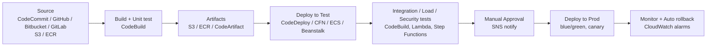

[← 0. Exam facts and strategy](00-exam-strategy.md) | [🏠 Home](README.md) | [Services](services/README.md) | [Labs](labs/README.md) | [2. Domain 2: Configuration Management and IaC (17%) →](02-config-mgmt-iac.md)

# Chapter 1 - Domain 1: SDLC Automation (22%)

> Biggest domain. Master CodePipeline, CodeBuild, CodeDeploy, CodeArtifact, ECR, Image Builder, and every deployment strategy (EC2, ECS, Lambda, Elastic Beanstalk).

## Services to study for this domain

Read these service files first, then the sections below.

- [AWS CodeCommit (and Git sources)](services/codecommit.md)
- [AWS CodeBuild](services/codebuild.md)
- [AWS CodePipeline](services/codepipeline.md)
- [AWS CodeDeploy](services/codedeploy.md)
- [AWS CodeArtifact](services/codeartifact.md)
- [Amazon ECR](services/ecr.md)
- [EC2 Image Builder](services/ec2-image-builder.md)
- [AWS Elastic Beanstalk](services/elastic-beanstalk.md)
- [Amazon ECS, EKS and Fargate](services/ecs-eks.md)
- [AWS Lambda deployments](services/lambda.md)
- [Amazon API Gateway](services/api-gateway.md)
- [Amazon S3 (events, integrity, protection)](services/s3.md)
- [Secrets Manager and Parameter Store](services/secrets-manager-parameter-store.md)

## 1.1 The big picture

**Simple words:**
- **CI (Continuous Integration)** = every commit is built and tested automatically.
- **Continuous Delivery** = every good build is *ready* to go to prod, with a manual approval before prod.
- **Continuous Deployment** = every good build goes to prod automatically, no human step.

**Test types and where they run in the pipeline**

| Test | What it checks | Pipeline stage |
|---|---|---|
| Unit tests + code coverage | Single functions | Build stage (CodeBuild, fail build on low coverage) |
| Static analysis / SAST / secret scan | Code quality, vulnerabilities | Build stage / on pull request |
| Integration tests | Components working together | After deploy to test/staging env |
| Acceptance / UI tests | Business requirements, browser flows | Staging |
| Load / stress / performance | Behaviour at scale | Staging (prod-like), before prod approval |
| Security scan of image | CVEs in container image | ECR scan / Inspector after push |
| Synthetic canaries | Live endpoints keep working | After prod deploy (CloudWatch Synthetics) |

**Exit codes:** any command in CodeBuild returning **non-zero** fails that phase. Tests and health scripts must return non-zero on failure so the pipeline stops. CodeDeploy lifecycle hook scripts also fail the deployment on non-zero exit (or timeout).

---

## 1.2 Deployment strategies (concepts + where each lives in AWS)

| Strategy | How | Downtime | Rollback | Cost | AWS implementations |
|---|---|---|---|---|---|
| All at once (in-place) | Update all at once | Yes | Redeploy old | Lowest | CodeDeploy AllAtOnce, Beanstalk "All at once" |
| Rolling | Batches on existing instances | No (reduced capacity) | Redeploy | Low | Beanstalk Rolling, CodeDeploy OneAtATime/HalfAtATime, ECS rolling, ASG rolling update |
| Rolling with additional batch | Launch extra batch first, keep full capacity | No | Redeploy | Medium | Beanstalk |
| Immutable | New instances in a temp ASG, swap when healthy | No | Fast (terminate new) | Higher during deploy | Beanstalk Immutable, CFN AutoScalingReplacingUpdate |
| Blue/green | Full new env, switch traffic (DNS / LB / alias) | No | Fastest (switch back) | 2x during deploy | CodeDeploy B/G, Beanstalk swap URL, Route 53 weighted, ALB weighted target groups |
| Canary | Small % first, then all | No | Fast | Medium | CodeDeploy Lambda/ECS canary, API Gateway canary, Beanstalk traffic splitting, AppConfig, Route 53 weighted |
| Linear | Increase % in equal steps | No | Fast | Medium | CodeDeploy Linear, AppConfig Linear |
| Feature flags | Deploy code dark, turn feature on by config | No | Toggle off | Low | AWS AppConfig feature flags |

**Mutable vs immutable:** mutable = change existing servers (config drift risk). Immutable = never modify, replace with new instances from a new AMI/image. Exam prefers immutable for consistency and easy rollback.

### Storage patterns for deployments
| Storage | Use for app deployment |
|---|---|
| EBS | Single-instance, AZ-bound block storage. Lost with instance replacement unless snapshot/separate volume. Not shared. |
| EFS | Shared NFS across instances and AZs (Linux). Good for shared content/uploads with ASG; survives immutable deploys. |
| FSx for Windows | Shared SMB storage for Windows fleets. |
| S3 | Static assets, artifacts, user uploads. Best for stateless apps. |
| Instance store | Ephemeral, fast. Gone on stop/terminate. |

**Rule:** to make immutable/blue-green deployments safe, keep state out of the instance (EFS/S3/RDS/DynamoDB/ElastiCache for sessions).

---

## 1.3 Domain 1 scenario quick-map

| Scenario | Answer |
|---|---|
| Deploy Lambda gradually, rollback on error alarms, least effort | SAM `AutoPublishAlias` + `DeploymentPreference` Canary/Linear + Alarms |
| ECS service zero-downtime with test traffic before shift | CodeDeploy ECS blue/green with test listener + `AfterAllowTestTraffic` hook |
| ECS tasks failing after deploy should auto revert, least effort | ECS deployment circuit breaker with rollback |
| Beanstalk deploy, no capacity reduction, fastest safe rollback | Immutable (or blue/green with Swap URLs) |
| Beanstalk test new version on 10% of real traffic | Traffic splitting |
| EC2 fleet must keep 100% capacity and quick rollback | CodeDeploy blue/green with ASG |
| CodeDeploy fails on every deploy at ApplicationStop after a bad release | Redeploy with ignore ApplicationStop failures |
| New ASG instances don't get the app | Ensure CodeDeploy deployment group targets the ASG (CodeDeploy lifecycle hook), agent in AMI/user data or via SSM |
| Install/update CodeDeploy agent on 500 instances | SSM State Manager / Distributor `AWSCodeDeployAgent` |
| Run unit tests on each PR in CodeCommit | EventBridge rule on PR events -> CodeBuild -> post status on PR |
| Pipeline must deploy to accounts in another org OU | Cross-account role + CMK-encrypted artifact bucket, or StackSets action |
| Pipeline starts only when files in `/infra` change on main | CodePipeline V2 trigger with file path + branch filter |
| Don't overwrite tag `latest`, keep traceable builds | ECR tag immutability + tag with commit ID |
| Delete old images automatically | ECR lifecycle policy |
| Monthly patched golden AMI shared to all accounts | EC2 Image Builder pipeline + distribution to org/OUs + launch template update |
| Cache npm/pip packages, approve internal packages | CodeArtifact with upstream + external connection |
| Build needs private RDS for integration test | CodeBuild in VPC (private subnet + NAT) |
| Turn features on/off without redeploy, gradual rollout, auto rollback | AWS AppConfig feature flags + deployment strategy + CloudWatch alarm |

---

[← 0. Exam facts and strategy](00-exam-strategy.md) | [🏠 Home](README.md) | [Services](services/README.md) | [Labs](labs/README.md) | [2. Domain 2: Configuration Management and IaC (17%) →](02-config-mgmt-iac.md)
