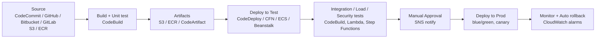
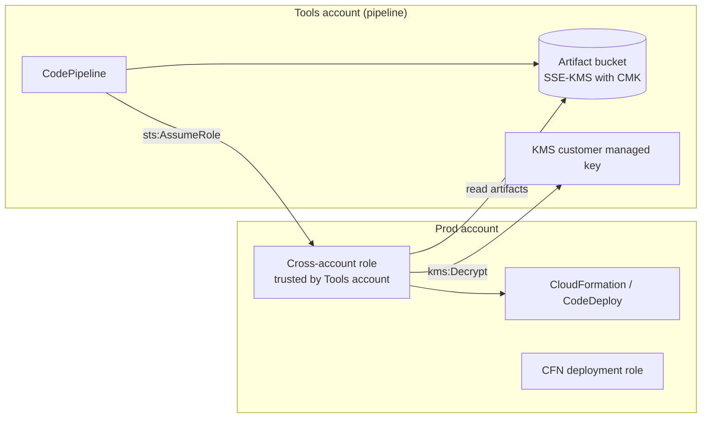

[← 0. Exam facts and strategy](00-exam-strategy.md) | [🏠 Home](README.md) | [2. Domain 2: Configuration Management and IaC (17%) →](02-config-mgmt-iac.md)

# Chapter 1 - Domain 1: SDLC Automation (22%)

> Biggest domain. Master CodePipeline, CodeBuild, CodeDeploy, CodeArtifact, ECR, Image Builder, and every deployment strategy (EC2, ECS, Lambda, Elastic Beanstalk).

## 1.1 The big picture



**Simple words:**
- **CI (Continuous Integration)** = every commit is built and tested automatically.
- **Continuous Delivery** = every good build is *ready* to go to prod, with a manual approval before prod.
- **Continuous Deployment** = every good build goes to prod automatically, no human step.

**Test types and where they run in the pipeline**

| Test | What it checks | Pipeline stage |
|---|---|---|
| Unit tests + code coverage | Single functions | Build stage (CodeBuild, fail build on low coverage) |
| Static analysis / SAST / secret scan | Code quality, vulnerabilities | Build stage / on pull request |
| Integration tests | Components working together | After deploy to test/staging env |
| Acceptance / UI tests | Business requirements, browser flows | Staging |
| Load / stress / performance | Behaviour at scale | Staging (prod-like), before prod approval |
| Security scan of image | CVEs in container image | ECR scan / Inspector after push |
| Synthetic canaries | Live endpoints keep working | After prod deploy (CloudWatch Synthetics) |

**Exit codes:** any command in CodeBuild returning **non-zero** fails that phase. Tests and health scripts must return non-zero on failure so the pipeline stops. CodeDeploy lifecycle hook scripts also fail the deployment on non-zero exit (or timeout).

---

## 1.2 Source control: AWS CodeCommit (and other Git hosts)

**What:** Managed private Git repos in AWS. Returned to full GA in Nov 2025.

Must-knows:
- Auth: HTTPS Git credentials (IAM user), SSH keys (IAM user), or **git-remote-codecommit** with IAM roles / temporary creds (best for federated users / SSO).
- Access control is **IAM policies** (e.g., deny `codecommit:GitPush` to `refs/heads/main` for developers using a condition on `codecommit:References`). This is how you "protect the main branch".
- **Approval rule templates** = require N approvals on pull requests (like branch protection).
- **Notifications** (via CodeStar Notifications -> SNS / Chatbot) and **triggers** (SNS or Lambda on push).
- **EventBridge** events: `referenceCreated`, `referenceUpdated`, `pullRequestCreated`, `pullRequestSourceBranchUpdated`, etc. Use these to start CodeBuild for PR validation.
- Encrypted at rest with KMS, in transit with HTTPS/SSH.
- Cross-account access: create a role in the repo account, users in other account assume it.

**Pattern: "Run tests on every pull request and post result back to the PR"**
EventBridge rule on `pullRequestCreated` / `pullRequestSourceBranchUpdated` -> CodeBuild project -> Lambda/CodeBuild posts comment and approval state on the PR.
With **GitHub/Bitbucket/GitLab** as source, CodeBuild **webhooks** with filter groups (`PULL_REQUEST_CREATED`, `PULL_REQUEST_UPDATED`, `PUSH`, branch/file filters) do the same natively.

**Other sources:** GitHub, GitHub Enterprise, Bitbucket, GitLab connect to CodePipeline through **AWS CodeConnections** (formerly CodeStar Connections). The connection is created "PENDING" and must be completed in the console (OAuth handshake) once.

---

## 1.3 AWS CodeBuild

**What:** Fully managed build service. Runs your commands in a fresh container per build. Pay per build minute. No build servers to manage.

### buildspec.yml (memorise this structure)

```yaml
version: 0.2

env:
  variables:                     # plain text, NOT for secrets
    APP_ENV: "test"
  parameter-store:               # value pulled from SSM Parameter Store at build start
    DB_USER: "/myapp/db/user"
  secrets-manager:               # secret-id:json-key:version-stage:version-id
    DB_PASS: "prod/myapp/db:password"
  exported-variables:            # make vars available to later pipeline actions
    - IMAGE_TAG
  git-credential-helper: yes

phases:
  install:
    runtime-versions:
      python: 3.12
    commands:
      - pip install -r requirements.txt
  pre_build:
    commands:
      - aws ecr get-login-password | docker login --username AWS --password-stdin $REPO_URI
      - export IMAGE_TAG=$(echo $CODEBUILD_RESOLVED_SOURCE_VERSION | cut -c1-7)
  build:
    commands:
      - pytest --junitxml=reports/junit.xml --cov --cov-report=xml
      - docker build -t $REPO_URI:$IMAGE_TAG .
  post_build:
    commands:
      - docker push $REPO_URI:$IMAGE_TAG
      - printf '[{"name":"web","imageUri":"%s"}]' $REPO_URI:$IMAGE_TAG > imagedefinitions.json
    finally:
      - echo "always runs"

reports:                         # test + coverage reports shown in console
  pytest-reports:
    files: ["reports/junit.xml"]
    file-format: JUNITXML
  coverage:
    files: ["coverage.xml"]
    file-format: COBERTURAXML

artifacts:
  files:
    - imagedefinitions.json
    - appspec.yml
    - scripts/**/*

cache:
  paths:
    - '/root/.cache/pip/**/*'
```

Phase order: **install -> pre_build -> build -> post_build**. If `install` or `pre_build` fails, the build stops (build and post_build are skipped). If `build` fails, `post_build` **still runs** (check `$CODEBUILD_BUILD_SUCCEEDING`, 1 or 0). A phase's `finally` block runs even when that phase's commands fail.

### Must-knows

| Topic | Fact |
|---|---|
| Secrets | Use `parameter-store` / `secrets-manager` in buildspec or project env vars of type PARAMETER_STORE / SECRETS_MANAGER. Service role needs `ssm:GetParameters` / `secretsmanager:GetSecretValue` (+ `kms:Decrypt` for CMK). Never plain-text vars. |
| Docker builds | Enable **privileged mode** on the project to run the Docker daemon (docker build). |
| Caching | **S3 cache** (shared across hosts, survives) or **local cache**: source cache, Docker layer cache, custom cache. Speeds up dependency download. |
| VPC | Build inside your VPC to reach private RDS/ElastiCache etc. Needs **private subnets + NAT gateway** (or VPC endpoints) for internet/AWS APIs. CodeBuild in a public subnet does NOT get a public IP. |
| Timeout | Build timeout 5 min to 36 hours (default 60 min). Separate **queued timeout**. |
| Logs | CloudWatch Logs and/or S3. Build metrics in CloudWatch (`AWS/CodeBuild`). |
| Reports | Test reports: JUnit XML, NUnit, TestNG, Cucumber JSON, Visual Studio TRX. Coverage: JaCoCo, Cobertura, Clover, SimpleCov, LCOV. |
| Batch builds | Build graph / build list / build matrix: parallel builds with different env or images. |
| Compute | EC2 on-demand, **reserved capacity fleets**, Lambda compute (fast start, short builds), custom images from ECR, Windows/ARM/GPU. |
| Local debugging | CodeBuild local agent (run buildspec on your machine), **Session Manager** debug (pause build with `codebuild-breakpoint`). |
| Events | Build state change events in EventBridge (`CodeBuild Build State Change`) -> SNS/Chatbot notifications. |
| Artifacts encryption | Uses KMS (default `aws/s3` key or a CMK). Cross-account pipelines need a CMK. |

**Traps**
- "Build can't reach the internet after being placed in VPC" -> add NAT gateway / endpoints, not a public subnet.
- "Docker daemon not running" -> privileged mode.
- "Build is slow downloading dependencies" -> enable caching (S3 or local), or use CodeArtifact as a proxy cache.
- "Store DB password for build" -> Secrets Manager / Parameter Store SecureString referenced in buildspec.

---

## 1.4 Artifact repositories

### AWS CodeArtifact
**What:** Managed package repository for npm, PyPI, Maven/Gradle, NuGet, Swift, Ruby gems, Cargo, generic.

- **Domain** = container for repositories, one KMS key, shared storage (a package version stored once per domain). Cross-account sharing is via the **domain policy**.
- **Repository** with **upstream repositories** (chain) and **external connection** (npmjs.com, PyPI, Maven Central...). An internal repo -> upstream "public-proxy" repo -> external connection = cache public packages + host private ones.
- Auth: `aws codeartifact login --tool npm|pip|twine --domain X --repository Y` (gets an auth token, default 12 h, max 12 h). In CodeBuild run it in `pre_build`.
- **Package origin controls**: block a package name from being pulled from upstream (protects against dependency-confusion attacks).
- Events in EventBridge when a package version is published/changed -> trigger a pipeline.

**Scenario:** "Developers must only use approved open-source packages, builds must not reach the public internet" -> CodeArtifact with external connection on a separate repo, CodeBuild in VPC with CodeArtifact VPC endpoints (`codeartifact.api`, `codeartifact.repositories`) + S3 gateway endpoint.

### Amazon ECR
**What:** Managed Docker/OCI image registry.

| Feature | Fact |
|---|---|
| Lifecycle policies | Expire images by count or age, by tag status/prefix (e.g., keep last 10 `prod-*`, delete untagged after 1 day). |
| Tag immutability | Prevents overwriting a tag (e.g., `v1.2`). Good for traceability. |
| Basic scanning | On push or manual, OS-package CVEs. |
| Enhanced scanning | **Amazon Inspector**: continuous scanning, OS + programming-language packages, findings in Inspector/Security Hub/EventBridge. |
| Replication | Cross-Region and cross-account (registry-level setting, filters by repo prefix). |
| Pull-through cache | Cache images from Docker Hub, Quay, GitHub, ECR Public, K8s registry, etc. |
| Cross-account pull | **Repository policy** allowing the other account's principal `ecr:BatchGetImage`, `ecr:GetDownloadUrlForLayer` (+ `ecr:GetAuthorizationToken` in their IAM policy). |
| Encryption | AES-256 or KMS. |
| Signing | AWS Signer + Notation; verify in EKS with admission controller / Kyverno. |

**Pattern: "Block deployment of images with CRITICAL vulnerabilities"** -> Enhanced scanning -> EventBridge `Inspector2 Finding` with severity CRITICAL -> Lambda/Step Functions stops the pipeline or tags image; or a CodeBuild step that checks scan results before deploy.

### Amazon S3 as artifact store
CodePipeline stores artifacts in an S3 bucket per Region. Use **versioning**, **lifecycle rules** to expire old artifacts, SSE-KMS.

**Artifact lifecycle tips:** immutable versioned artifacts (build once, promote the same artifact through stages), retain prod artifacts for rollback, expire dev ones.

---

## 1.5 EC2 Image Builder (golden AMIs and container images)

**What:** Managed pipeline that builds, tests, and distributes AMIs or container images on a schedule.

Pieces:
- **Image recipe** (AMI) or **container recipe** = base image + **components**.
- **Components** = YAML documents (AWSTOE) with build and test phases (install agents, harden with CIS/STIG components, run tests).
- **Infrastructure configuration** = instance type, subnet, security group, IAM instance profile (needs `EC2InstanceProfileForImageBuilder` + `AmazonSSMManagedInstanceCore`), SNS topic, logs to S3.
- **Distribution settings** = copy AMI to other Regions, share with accounts/OUs, update a **launch template** with the new AMI ID, export to S3.
- **Pipeline** = schedule (cron) or "run when base image / components have updates".
- Integrates with **Inspector** for vulnerability scanning of the output image.
- **Lifecycle policies** deprecate/delete old AMIs and snapshots.

**Typical exam flow:** Image Builder builds monthly patched AMI -> distribution updates launch template -> SNS/EventBridge triggers -> ASG **instance refresh** to roll the new AMI.
Older pattern (still valid): SSM Automation runbook `AWS-UpdateLinuxAmi` / `AWS-UpdateWindowsAmi`, store AMI ID in **Parameter Store**, CFN references `{{resolve:ssm:/golden/ami}}` or `AWS::SSM::Parameter::Value<AWS::EC2::Image::Id>`.

---

## 1.6 AWS CodePipeline

**What:** Orchestrator. Stages contain actions. Actions: Source, Build, Test, Deploy, Approval, Invoke (Lambda / Step Functions), Compute.

### Core concepts
- **Stages** run in order. Actions in a stage run in parallel unless `runOrder` differs (same runOrder = parallel).
- **Artifacts** pass between actions via S3 (input/output artifact names).
- **Manual approval** action: SNS notification, optional URL for reviewers, times out after **7 days**.
- **Invoke Lambda action**: the function must call `PutJobSuccessResult` or `PutJobFailureResult`, else action times out.
- **Variables**: actions emit output variables (`#{SourceVariables.CommitId}`, `#{BuildVariables.IMAGE_TAG}`), V2 pipelines also have **pipeline-level variables** set at execution start.
- **Pipeline V2 features** (exam likes these):
  - **Triggers with filters**: on Git **tags**, branches, **file paths**, pull request events (for CodeConnections sources).
  - **Execution modes**: `SUPERSEDED` (default, newer run replaces older waiting run), `QUEUED` (one at a time, in order), `PARALLEL` (independent runs).
  - **Stage-level conditions and automatic rollback on stage failure** (rollback to last successful pipeline execution's artifacts).
- **Change detection**: EventBridge (default for CodeCommit/S3/ECR source) - not polling. For S3 source, CloudTrail data events + EventBridge.
- **Notifications**: pipeline/stage/action state changes in EventBridge (`CodePipeline Pipeline Execution State Change`).
- Retry failed stage/actions without rerunning the whole pipeline.

### Cross-Region pipeline
Set an **artifact store (S3 bucket) in each Region** where actions run (`artifactStores` map). CodePipeline copies artifacts automatically. Use a KMS key in each Region.

### Cross-account pipeline (very common question)



Checklist:
1. **Customer managed KMS key** in the pipeline account (the default `aws/s3` managed key can't be shared cross-account). Key policy grants the prod account role `kms:Decrypt`, `kms:DescribeKey`, `kms:GenerateDataKey*`.
2. **Artifact bucket policy** allows the prod account role to `s3:GetObject`/`PutObject`.
3. **Role in prod account** trusted by the tools account, with permissions to deploy (CloudFormation, CodeDeploy). Pipeline action has `roleArn` = that role.
4. For CloudFormation deploy action: also a **CFN service role** in prod (passed with `iam:PassRole`).
5. Pipeline service role in tools account can `sts:AssumeRole` the prod role.

### Multi-account deployment patterns
- One pipeline in a **tools/shared-services account** deploys to dev, test, prod accounts with cross-account roles (above).
- **CloudFormation StackSets** action in CodePipeline to deploy to many accounts/Regions.
- **CDK Pipelines** (self-mutating pipeline, stages per account/Region).
- **Customizations for Control Tower (CfCT)** pipeline for landing zone resources.

### Traps
- "Pipeline doesn't start on push" -> check EventBridge rule / CodeConnections connection status / trigger filters.
- "Pipeline in account A cannot decrypt artifacts in account B" -> CMK key policy + bucket policy, not the default key.
- "Need a test step that calls an API and fails the pipeline" -> Lambda invoke action or CodeBuild test action.
- "Approval must be by a specific team" -> IAM permission `codepipeline:PutApprovalResult` only for that group.

---

## 1.7 AWS CodeDeploy (most tested Code* service)

**What:** Deploys application revisions to **EC2/on-premises**, **AWS Lambda**, and **Amazon ECS**.

Terms: **Application** -> **Deployment group** (target instances/tags/ASG, or ECS service, or Lambda function; deployment config; alarms; rollback; triggers) -> **Deployment** of a **revision** (from S3 or GitHub for EC2; AppSpec for Lambda/ECS).

### Compute platforms and deployment types

| Platform | In-place | Blue/green | Traffic shifting options |
|---|---|---|---|
| EC2 / on-prem | Yes (stop app, install new version on same instances) | Yes (new instances, ASG copy or manual; reroute LB) | AllAtOnce, HalfAtATime, OneAtATime, or custom minimum healthy hosts |
| Lambda | No (always shifts alias traffic = blue/green style) | Yes | Canary, Linear, AllAtOnce |
| ECS | No | Yes (new task set, ALB/NLB listener switch, optional test listener) | Canary, Linear, AllAtOnce |

### Predefined deployment configurations

| Platform | Configs |
|---|---|
| EC2 | `CodeDeployDefault.AllAtOnce`, `CodeDeployDefault.HalfAtATime`, `CodeDeployDefault.OneAtATime` |
| Lambda | `CodeDeployDefault.LambdaCanary10Percent5Minutes` (also 10, 15, 30 Minutes), `LambdaLinear10PercentEvery1Minute` (also 2, 3, 10 Minutes), `LambdaAllAtOnce` |
| ECS | `CodeDeployDefault.ECSCanary10Percent5Minutes` / `15Minutes`, `ECSLinear10PercentEvery1Minutes` / `3Minutes`, `ECSAllAtOnce` |

- **Canary** = 10% first, wait N min, then 100%.
- **Linear** = +10% every N min until 100%.
- EC2 `OneAtATime`: deployment fails if any instance fails (except last). `HalfAtATime`: up to half down. Custom config = "minimum healthy hosts" as number or %.

### AppSpec file

**EC2/On-prem (`appspec.yml` at root of revision):**
```yaml
version: 0.0
os: linux
files:
  - source: /build
    destination: /var/www/app
permissions:
  - object: /var/www/app
    owner: nginx
hooks:
  ApplicationStop:
    - location: scripts/stop.sh
      timeout: 60
  BeforeInstall:
    - location: scripts/install_deps.sh
  AfterInstall:
    - location: scripts/configure.sh
  ApplicationStart:
    - location: scripts/start.sh
  ValidateService:
    - location: scripts/health_check.sh   # exit non-zero = deployment fails
      timeout: 300
      runas: root
```

**Lambda:**
```yaml
version: 0.0
Resources:
  - MyFunction:
      Type: AWS::Lambda::Function
      Properties:
        Name: my-function
        Alias: live
        CurrentVersion: "3"
        TargetVersion: "4"
Hooks:
  - BeforeAllowTraffic: PreTrafficTestFn     # Lambda that runs tests, calls PutLifecycleEventHookExecutionStatus
  - AfterAllowTraffic: PostTrafficTestFn
```

**ECS:**
```yaml
version: 0.0
Resources:
  - TargetService:
      Type: AWS::ECS::Service
      Properties:
        TaskDefinition: "arn:aws:ecs:...:task-definition/web:12"
        LoadBalancerInfo:
          ContainerName: "web"
          ContainerPort: 80
Hooks:
  - BeforeInstall: "LambdaFnA"
  - AfterInstall: "LambdaFnB"
  - AfterAllowTestTraffic: "LambdaFnC"   # run tests against the test listener (e.g., port 8080)
  - BeforeAllowTraffic: "LambdaFnD"
  - AfterAllowTraffic: "LambdaFnE"
```

### Lifecycle hook ORDER (memorise)

**EC2 in-place (with load balancer):**
```
BeforeBlockTraffic -> BlockTraffic -> AfterBlockTraffic
-> ApplicationStop -> DownloadBundle -> BeforeInstall -> Install -> AfterInstall
-> ApplicationStart -> ValidateService
-> BeforeAllowTraffic -> AllowTraffic -> AfterAllowTraffic
```
- You can script: ApplicationStop, BeforeInstall, AfterInstall, ApplicationStart, ValidateService, and the Before/After traffic hooks.
- You **cannot** script: DownloadBundle, Install, BlockTraffic, AllowTraffic (CodeDeploy does them).
- **ApplicationStop runs the script from the PREVIOUS successful revision.** If that script is broken, every deployment fails at ApplicationStop. Fix: deploy with `--ignore-application-stop-failures` (or console checkbox), or remove the old revision on the instance.

**EC2 blue/green:** on the **green** (replacement) instances: ApplicationStop ... ValidateService, BeforeAllowTraffic -> AllowTraffic -> AfterAllowTraffic. On the **blue** (original) instances: BeforeBlockTraffic -> BlockTraffic -> AfterBlockTraffic, then they are terminated (after the wait time you set) or kept.

**ECS:** BeforeInstall -> Install -> AfterInstall -> AllowTestTraffic -> AfterAllowTestTraffic -> BeforeAllowTraffic -> AllowTraffic -> AfterAllowTraffic.

**Lambda:** BeforeAllowTraffic -> AllowTraffic -> AfterAllowTraffic.

### CodeDeploy agent (EC2/on-prem)
- Must be installed and running on instances (install via **SSM Distributor / State Manager** association `AWS-ConfigureAWSPackage` with package `AWSCodeDeployAgent` - this is the "least overhead" way, also keeps it updated).
- Instance profile needs **S3 read** for the revision bucket (and KMS decrypt if encrypted).
- On-prem servers: register with IAM user or IAM role session (`aws deploy register-on-premises-instance`), tag them.
- Logs: `/var/log/aws/codedeploy-agent/codedeploy-agent.log`; script output: `/opt/codedeploy-agent/deployment-root/deployment-logs/codedeploy-agent-deployments.log`.
- Keeps **5 revisions** by default on disk (`:max_revisions:` in `/etc/codedeploy-agent/conf/codedeployagent.yml`). Disk full from old revisions -> lower this value.

### Rollbacks
- **Automatic rollback**: on deployment failure and/or when **CloudWatch alarms** (attached to the deployment group) go to ALARM. Rollback = a **new deployment** of the last known good revision (new deployment ID).
- During ECS/Lambda blue/green, rollback just shifts traffic back - fast.
- "Stop deployment" + rollback can also be triggered manually.

### ASG integration
- CodeDeploy installs a lifecycle hook on the ASG, so **new instances launched by scale-out automatically get the latest revision**.
- If a scale-out happens **during** a deployment, new instances get the previously deployed revision; CodeDeploy then starts a **follow-on deployment** to update them. To avoid this, configure the deployment group to **suspend ASG processes during the deployment** (valid values: Terminate, AZRebalance, InstanceRefresh, ScheduledActions). CodeDeploy resumes them when the deployment ends.
- Blue/green with ASG: CodeDeploy copies the ASG (new ASG, new instances), then shifts LB traffic.

### Troubleshooting table

| Symptom | Cause / fix |
|---|---|
| Deployment stuck "Pending"/fails with no instance logs | Agent not installed/running, instance profile missing, no route to CodeDeploy/S3 endpoints |
| Fails at ApplicationStop | Previous revision's stop script broken -> `ignoreApplicationStopFailures` |
| Fails at ValidateService | Health script exit code non-zero or timeout; check deployments log |
| "The overall deployment failed because too many individual instances failed" | Min healthy hosts violated; fix the scripts, check instance health |
| Files already exist at destination | Set `file_exists_behavior` (DISALLOW default, OVERWRITE, RETAIN) |
| AccessDenied downloading revision | Instance profile lacks s3:GetObject / kms:Decrypt |
| ECS deployment fails in Install | Task definition / container health check failing; check ECS service events |
| Lambda deployment rolls back | Alarm went into ALARM during canary, or BeforeAllowTraffic hook reported Failed |

---

## 1.8 Deployment strategies (concepts + where each lives in AWS)

| Strategy | How | Downtime | Rollback | Cost | AWS implementations |
|---|---|---|---|---|---|
| All at once (in-place) | Update all at once | Yes | Redeploy old | Lowest | CodeDeploy AllAtOnce, Beanstalk "All at once" |
| Rolling | Batches on existing instances | No (reduced capacity) | Redeploy | Low | Beanstalk Rolling, CodeDeploy OneAtATime/HalfAtATime, ECS rolling, ASG rolling update |
| Rolling with additional batch | Launch extra batch first, keep full capacity | No | Redeploy | Medium | Beanstalk |
| Immutable | New instances in a temp ASG, swap when healthy | No | Fast (terminate new) | Higher during deploy | Beanstalk Immutable, CFN AutoScalingReplacingUpdate |
| Blue/green | Full new env, switch traffic (DNS / LB / alias) | No | Fastest (switch back) | 2x during deploy | CodeDeploy B/G, Beanstalk swap URL, Route 53 weighted, ALB weighted target groups |
| Canary | Small % first, then all | No | Fast | Medium | CodeDeploy Lambda/ECS canary, API Gateway canary, Beanstalk traffic splitting, AppConfig, Route 53 weighted |
| Linear | Increase % in equal steps | No | Fast | Medium | CodeDeploy Linear, AppConfig Linear |
| Feature flags | Deploy code dark, turn feature on by config | No | Toggle off | Low | AWS AppConfig feature flags |

**Mutable vs immutable:** mutable = change existing servers (config drift risk). Immutable = never modify, replace with new instances from a new AMI/image. Exam prefers immutable for consistency and easy rollback.

### Elastic Beanstalk deployment policies (exam favourite)

| Policy | Behaviour | Downtime | Deploy time | Rollback |
|---|---|---|---|---|
| All at once | All instances updated together | Yes | Fastest | Manual redeploy |
| Rolling | Batch by batch on existing instances | No, reduced capacity | Medium | Manual redeploy |
| Rolling with additional batch | New batch launched first, full capacity kept | No | Longer | Manual redeploy |
| Immutable | New instances in a temporary ASG, then moved to original ASG | No | Longest | Terminate new instances (fast, safe) |
| Traffic splitting | Canary: new instances get X% of traffic for an evaluation time | No | Long | Automatic if health fails |
| Blue/green (not a policy) | Clone env, deploy, **Swap environment URLs** (CNAME swap) | No | - | Swap back |

Other Beanstalk must-knows:
- `.ebextensions/*.config` = YAML/JSON config (option_settings, packages, commands, container_commands, resources in CFN syntax). `container_commands` run after app is extracted, before deployment; `leader_only: true` runs on one instance (e.g., DB migrations).
- `.platform/hooks/` (prebuild, predeploy, postdeploy) and `.platform/nginx/` on Amazon Linux 2/2023 platforms.
- **Don't create the production RDS inside the Beanstalk environment** (it's deleted with the env). Create RDS separately and pass the endpoint via env properties / Secrets Manager. For blue/green, data tier must be outside.
- **Managed platform updates** in a weekly maintenance window (minor/patch), done as immutable.
- Worker environments + SQS + `cron.yaml` for periodic tasks.
- App version **lifecycle policy** (max count/age) to avoid hitting the application version quota.
- Saved configurations / `eb config` to clone envs.

### ECS deployments
- **Rolling update** (ECS controller): `minimumHealthyPercent` and `maximumPercent` control how many tasks stay up / extra tasks launched.
- **Deployment circuit breaker** with `rollback: true` -> if new tasks keep failing to reach steady state, ECS automatically rolls back to the last completed deployment. Also **CloudWatch alarm-based rollback** for ECS deployments.
- **Blue/green via CodeDeploy**: two target groups, production listener + optional test listener, task sets. Traffic shifting canary/linear/all-at-once. Termination wait time for original tasks.
- ECS also has native blue/green, canary and linear deployments (2025) without CodeDeploy - know they exist; most questions still use CodeDeploy.
- Pipeline: CodeBuild writes `imagedefinitions.json` (for ECS standard deploy action) or `imageDetail.json` + `appspec.yaml` + `taskdef.json` (for "Amazon ECS (Blue/Green)" CodeDeploy action).

### EKS deployments
- Kubernetes rolling updates (`maxSurge`, `maxUnavailable`), blue/green with two services/ingress, canary with service mesh or Argo Rollouts / Flagger.
- CI/CD: CodeBuild builds image -> pushes to ECR -> `kubectl`/Helm in CodeBuild (role mapped via **EKS access entries** or aws-auth ConfigMap) or GitOps (Argo CD / Flux).

### Lambda deployments
- **Versions** are immutable snapshots; **aliases** point to versions and can split traffic (weighted alias, e.g., 90/10).
- **CodeDeploy + alias traffic shifting** (canary/linear) with pre/post traffic hooks and CloudWatch alarm rollback.
- **AWS SAM** makes this easy:

```yaml
Transform: AWS::Serverless-2016-10-31
Resources:
  MyFunction:
    Type: AWS::Serverless::Function
    Properties:
      Runtime: python3.12
      Handler: app.handler
      CodeUri: src/
      AutoPublishAlias: live                 # publish a new version + move alias
      DeploymentPreference:
        Type: Canary10Percent5Minutes        # creates CodeDeploy app + deployment group
        Alarms:
          - !Ref ErrorsAlarm                 # rollback if alarm fires
        Hooks:
          PreTraffic: !Ref PreTrafficHookFn
          PostTraffic: !Ref PostTrafficHookFn
```

### API Gateway deployments
- Stages (dev/test/prod), stage variables (point to Lambda alias `${stageVariables.alias}`).
- **Canary release** on a stage: % of traffic to the canary deployment, then promote.
- Also: Route 53 weighted between two APIs / custom domain base path mappings.

### Storage patterns for deployments
| Storage | Use for app deployment |
|---|---|
| EBS | Single-instance, AZ-bound block storage. Lost with instance replacement unless snapshot/separate volume. Not shared. |
| EFS | Shared NFS across instances and AZs (Linux). Good for shared content/uploads with ASG; survives immutable deploys. |
| FSx for Windows | Shared SMB storage for Windows fleets. |
| S3 | Static assets, artifacts, user uploads. Best for stateless apps. |
| Instance store | Ephemeral, fast. Gone on stop/terminate. |

**Rule:** to make immutable/blue-green deployments safe, keep state out of the instance (EFS/S3/RDS/DynamoDB/ElastiCache for sessions).

---

## 1.9 Secrets in build and deploy

| Need | Use |
|---|---|
| DB password with automatic rotation | **Secrets Manager** (managed rotation for RDS/Aurora/Redshift/DocumentDB, Lambda rotation for others) |
| Config values, flags, non-rotating secrets, cheapest | **SSM Parameter Store** (String, StringList, SecureString with KMS) |
| Reference in CloudFormation | `{{resolve:secretsmanager:MySecret:SecretString:password}}`, `{{resolve:ssm:/path}}`, `{{resolve:ssm-secure:/path}}` (ssm-secure only for supported properties) |
| Reference in ECS task definition | `secrets` with `valueFrom` = Secrets Manager ARN or Parameter ARN (execution role needs read access) |
| Reference in CodeBuild | `env.secrets-manager` / `env.parameter-store` |
| Reference in Lambda | Fetch at runtime (cache with AWS Parameters and Secrets Lambda Extension). Environment variables are encrypted at rest but visible in console to those with permissions. |

---

## 1.10 Domain 1 scenario quick-map

| Scenario | Answer |
|---|---|
| Deploy Lambda gradually, rollback on error alarms, least effort | SAM `AutoPublishAlias` + `DeploymentPreference` Canary/Linear + Alarms |
| ECS service zero-downtime with test traffic before shift | CodeDeploy ECS blue/green with test listener + `AfterAllowTestTraffic` hook |
| ECS tasks failing after deploy should auto revert, least effort | ECS deployment circuit breaker with rollback |
| Beanstalk deploy, no capacity reduction, fastest safe rollback | Immutable (or blue/green with Swap URLs) |
| Beanstalk test new version on 10% of real traffic | Traffic splitting |
| EC2 fleet must keep 100% capacity and quick rollback | CodeDeploy blue/green with ASG |
| CodeDeploy fails on every deploy at ApplicationStop after a bad release | Redeploy with ignore ApplicationStop failures |
| New ASG instances don't get the app | Ensure CodeDeploy deployment group targets the ASG (CodeDeploy lifecycle hook), agent in AMI/user data or via SSM |
| Install/update CodeDeploy agent on 500 instances | SSM State Manager / Distributor `AWSCodeDeployAgent` |
| Run unit tests on each PR in CodeCommit | EventBridge rule on PR events -> CodeBuild -> post status on PR |
| Pipeline must deploy to accounts in another org OU | Cross-account role + CMK-encrypted artifact bucket, or StackSets action |
| Pipeline starts only when files in `/infra` change on main | CodePipeline V2 trigger with file path + branch filter |
| Don't overwrite tag `latest`, keep traceable builds | ECR tag immutability + tag with commit ID |
| Delete old images automatically | ECR lifecycle policy |
| Monthly patched golden AMI shared to all accounts | EC2 Image Builder pipeline + distribution to org/OUs + launch template update |
| Cache npm/pip packages, approve internal packages | CodeArtifact with upstream + external connection |
| Build needs private RDS for integration test | CodeBuild in VPC (private subnet + NAT) |
| Turn features on/off without redeploy, gradual rollout, auto rollback | AWS AppConfig feature flags + deployment strategy + CloudWatch alarm |

---

[← 0. Exam facts and strategy](00-exam-strategy.md) | [🏠 Home](README.md) | [2. Domain 2: Configuration Management and IaC (17%) →](02-config-mgmt-iac.md)
