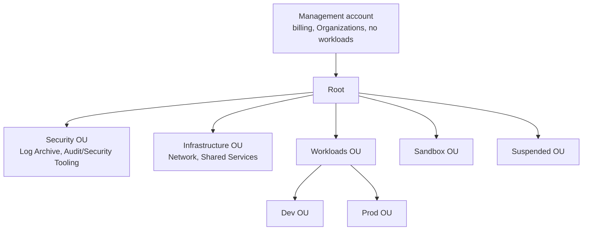

[← 1. Domain 1: SDLC Automation (22%)](01-sdlc-automation.md) | [🏠 Home](README.md) | [3. Domain 3: Resilient Cloud Solutions (15%) →](03-resilient-cloud.md)

# Chapter 2 - Domain 2: Configuration Management and IaC (17%)

> CloudFormation is the single most important service on this exam. Then Systems Manager, Organizations/Control Tower, Config, Service Catalog, CDK/SAM, Step Functions/Lambda automation.

## 2.1 IaC options on AWS

| Tool | What | When the exam picks it |
|---|---|---|
| **CloudFormation** | Declarative JSON/YAML templates -> stacks | Default IaC answer; StackSets for multi-account |
| **AWS SAM** | CFN extension (Transform) for serverless | Lambda + API Gateway + DynamoDB apps, gradual Lambda deploys, `sam local` testing |
| **AWS CDK** | Write infra in TypeScript/Python/Java/Go/C#, synthesises to CFN | Reusable constructs, loops/logic, developer-friendly; CDK Pipelines |
| **Service Catalog** | Approved CFN/Terraform products in portfolios for self-service | "Let users launch only approved, compliant resources without giving them broad IAM" |
| **CloudFormation modules / registry** | Reusable resource blocks / third-party types | Standard building blocks in many templates |
| **Terraform** | HashiCorp IaC (Service Catalog supports Terraform products, Control Tower AFT uses Terraform) | When question explicitly uses Terraform |
| **Elastic Beanstalk / App Runner / Copilot / Proton** | Higher-level app platforms | Developers want to deploy apps without managing infra |

---

## 2.2 CloudFormation deep dive

### Template anatomy
```yaml
AWSTemplateFormatVersion: "2010-09-09"
Description: Web tier
Transform: AWS::Serverless-2016-10-31          # optional: SAM, AWS::Include, LanguageExtensions, macros
Metadata: {}                                   # AWS::CloudFormation::Init lives under a resource's Metadata
Parameters:
  Env:
    Type: String
    AllowedValues: [dev, prod]
  LatestAmi:
    Type: AWS::SSM::Parameter::Value<AWS::EC2::Image::Id>   # always latest AMI from Parameter Store
    Default: /aws/service/ami-amazon-linux-latest/al2023-ami-kernel-default-x86_64
Rules: {}                                      # validate parameter combinations before create/update
Mappings:
  RegionMap:
    us-east-1: { InstanceType: t3.micro }
Conditions:
  IsProd: !Equals [!Ref Env, prod]
Resources:                                     # the ONLY required section
  Bucket:
    Type: AWS::S3::Bucket
    DeletionPolicy: Retain
    UpdateReplacePolicy: Retain
Outputs:
  BucketName:
    Value: !Ref Bucket
    Export:
      Name: !Sub "${AWS::StackName}-BucketName"
```

### Intrinsic functions (know what each returns)
`!Ref` (param value / resource physical ID), `!GetAtt` (attribute, e.g. `ALB.DNSName`), `!Sub`, `!Join`, `!Split`, `!Select`, `!FindInMap`, `!If` / `!Equals` / `!And` / `!Or` / `!Not`, `!ImportValue` (cross-stack), `!GetAZs`, `!Base64` (user data), `!Cidr`, `Fn::ForEach` (LanguageExtensions transform). Pseudo params: `AWS::Region`, `AWS::AccountId`, `AWS::StackName`, `AWS::StackId`, `AWS::Partition`, `AWS::URLSuffix`, `AWS::NoValue`.

### Dynamic references (secrets without hard-coding)
- `{{resolve:ssm:/myapp/ami-id}}` - plain parameter (can pin version `:3`)
- `{{resolve:ssm-secure:/myapp/db-pass}}` - SecureString, only for supported resource properties
- `{{resolve:secretsmanager:prod/db:SecretString:password}}` - **most common answer for RDS master password**. Even better: `ManageMasterUserPassword: true` on RDS (RDS stores and rotates it in Secrets Manager).

### Stack lifecycle tools

| Feature | What it does | Exam use |
|---|---|---|
| **Change sets** | Preview what an update will add/modify/**replace** before executing | "Ensure no resource is replaced unexpectedly"; manual review step in pipeline |
| **Drift detection** | Compares actual resource config to template | "Find manual changes"; Config rule `cloudformation-stack-drift-detection-check` for automation |
| **Stack policy** | JSON policy that protects resources from **updates** (Update:Replace, Update:Delete...) | "Prevent accidental replacement of the prod database during stack updates". Once set, every resource is protected unless allowed; you can update but not delete the policy; override temporarily during an update. |
| **Termination protection** | Prevents stack deletion | "Prevent someone deleting the stack" |
| **DeletionPolicy** | `Delete` (default for most), `Retain`, `RetainExceptOnCreate`, `Snapshot` (EBS volume, RDS instance/cluster, ElastiCache, Redshift, Neptune, DocumentDB) | "Keep data when stack is deleted" |
| **UpdateReplacePolicy** | Same options, applies when an update **replaces** the resource | "Keep old DB snapshot when a property change forces replacement" |
| **Rollback triggers** | CloudWatch alarms monitored during create/update + monitoring time (0-180 min) after; alarm = rollback | "Roll back stack update automatically if errors increase after deploy" |
| **Disable rollback / preserve resources** | Keep successfully created resources on failure to debug, then retry | Faster troubleshooting iterations |
| **Retain on delete / skip** | On DELETE_FAILED, retry delete with resources to retain | Bucket not empty, resource deleted manually |
| **ContinueUpdateRollback** | Fix `UPDATE_ROLLBACK_FAILED` (optionally `--resources-to-skip`) | Resource changed outside CFN, rollback can't restore it |
| **IaC generator** | Scan existing resources, generate a template | Bring manually created resources under IaC |
| **Resource import** | Import existing resources into a stack (needs DeletionPolicy in template) | Adopt resources without recreating |
| **Stack refactoring** | Move resources between stacks | Split a big stack |

### Helper scripts and signals (EC2 bootstrapping)

```yaml
WebServer:
  Type: AWS::EC2::Instance
  CreationPolicy:
    ResourceSignal:
      Count: 1
      Timeout: PT15M                # wait up to 15 min for cfn-signal
  Metadata:
    AWS::CloudFormation::Init:
      configSets:
        default: [install, configure]
      install:
        packages: { yum: { httpd: [] } }
        files:
          /var/www/html/index.html:
            content: "hello"
        services:
          sysvinit:
            httpd: { enabled: true, ensureRunning: true }
      configure:
        commands:
          01_run: { command: "echo configured" }
  Properties:
    ImageId: !Ref LatestAmi
    InstanceType: t3.micro
    UserData:
      Fn::Base64: !Sub |
        #!/bin/bash -xe
        /opt/aws/bin/cfn-init -v --stack ${AWS::StackName} --resource WebServer --region ${AWS::Region}
        /opt/aws/bin/cfn-signal -e $? --stack ${AWS::StackName} --resource WebServer --region ${AWS::Region}
```

| Script | Purpose |
|---|---|
| `cfn-init` | Reads `AWS::CloudFormation::Init` metadata: packages, groups, users, sources, files, commands, services (in that order within a config) |
| `cfn-signal` | Sends success/failure to a **CreationPolicy** or **WaitCondition** |
| `cfn-hup` | Daemon that detects **metadata changes** on stack update and re-runs hooks (e.g., cfn-init). Default check interval **15 minutes**. Config `/etc/cfn/cfn-hup.conf` + `/etc/cfn/hooks.d/*.conf` |
| `cfn-get-metadata` | Print metadata |

- **CreationPolicy** = wait for N signals before marking EC2 instance / ASG `CREATE_COMPLETE`. Timeout -> CREATE_FAILED -> rollback.
- **WaitCondition + WaitConditionHandle** = wait for signals from **outside** (on-prem script, external system) or coordinate ordering. For EC2/ASG prefer CreationPolicy.
- Troubleshooting "stack fails waiting for signal": check `/var/log/cfn-init.log`, `/var/log/cfn-init-cmd.log`, `/var/log/cloud-init-output.log`; instance needs outbound access to CFN endpoint (NAT or VPC endpoint); use "preserve resources on failure" to keep the instance for debugging.

### UpdatePolicy for Auto Scaling groups (frequently tested)

| Policy | Behaviour |
|---|---|
| `AutoScalingRollingUpdate` | Replace instances in batches: `MaxBatchSize`, `MinInstancesInService`, `MinSuccessfulInstancesPercent`, `PauseTime`, `WaitOnResourceSignals: true` (needs cfn-signal from new instances), `SuspendProcesses` (suspend HealthCheck, ReplaceUnhealthy, AZRebalance, AlarmNotification, ScheduledActions during update) |
| `AutoScalingReplacingUpdate` | `WillReplace: true` -> creates a **new ASG**, switches when new one is healthy, deletes old one; rollback is easy (keep old ASG). Immutable style. |
| `AutoScalingScheduledAction` | `IgnoreUnmodifiedGroupSizeProperties: true` so stack updates don't reset sizes changed by scheduled actions |

Updates triggered by changing the **launch template/configuration** (AMI, instance type, user data). Other UpdatePolicy uses: `CodeDeployLambdaAliasUpdate` (Lambda alias traffic shifting via CodeDeploy), `EnableVersionUpgrade` (OpenSearch), `UseOnlineResharding` (ElastiCache).

Alternative for ASGs outside CFN control: **ASG Instance Refresh** (min healthy %, checkpoints, skip matching, auto rollback on alarm).

### Multi-stack architecture

| Pattern | How | Notes |
|---|---|---|
| **Cross-stack references** | Producer `Outputs` with `Export`, consumer `!ImportValue` | Same account + Region. You **cannot delete or modify** an export while it's imported. Good for separately-owned layers (network team VPC stack). |
| **Nested stacks** | `AWS::CloudFormation::Stack` with TemplateURL | Reuse components (common ALB pattern); updated through the root stack. |
| **SSM parameters** | Producer writes value to Parameter Store, consumer reads `{{resolve:ssm:}}` | Loose coupling, works cross-Region via replication logic |
| **StackSets** | One template -> many accounts/Regions | See below |

### StackSets (multi-account / multi-Region)

| Permission model | Setup | Best for |
|---|---|---|
| **Self-managed** | Create `AWSCloudFormationStackSetAdministrationRole` in admin account and `AWSCloudFormationStackSetExecutionRole` in each target account (trusting admin) | Accounts not in your org, fine-grained control |
| **Service-managed** | Uses AWS Organizations (trusted access). Target **OUs**. **Automatic deployment** to new accounts added to the OU (and removal on leave). Can be run from a **delegated administrator** member account. | "Every new account must automatically get this baseline (IAM role, Config rule, CloudTrail...)" |

Deployment options: **maximum concurrent accounts** (number/%), **failure tolerance** (number/%), **Region concurrency** (sequential/parallel), **region order**. Stack instances can have **parameter overrides** per account/Region.
Note: service-managed StackSets do **not deploy to the management account** - deploy it there separately.

### Custom resources
- `Type: Custom::Something` (or `AWS::CloudFormation::CustomResource`) with `ServiceToken` = Lambda ARN or SNS topic.
- CFN sends Create/Update/Delete events. Your function **must send a response (SUCCESS/FAILED) to the pre-signed S3 URL** (`cfn-response` module). If it never responds the stack hangs until timeout (default **1 hour**; configurable with `ServiceTimeout`).
- Common bugs: Lambda crashes before responding; Delete not handled -> stack stuck in DELETE_IN_PROGRESS/DELETE_FAILED; Lambda in VPC with no route to S3 URL.
- Use for: things CFN doesn't support, emptying an S3 bucket before deletion, looking up AMI IDs, calling third-party APIs.
- Modern alternatives: **CloudFormation Registry resource types** (private types) and **Hooks**.

### Macros, transforms, modules, hooks, Guard
- **Transforms**: `AWS::Serverless` (SAM), `AWS::Include` (insert snippets from S3), `AWS::LanguageExtensions` (`Fn::ForEach`, `Fn::Length`, `Fn::ToJsonString`, intrinsic in DeletionPolicy).
- **Macros**: your Lambda processes the template before deployment (custom shorthand, loops).
- **Modules**: package resources + config as a reusable type `MyOrg::Web::Bucket::MODULE`.
- **CloudFormation Hooks**: run validation **before** create/update/delete of resources (proactive control). Control Tower **proactive controls** are Hooks. Can use **Guard** rules or Lambda. Fail = operation blocked.
- **cfn-guard** (policy-as-code) and **cfn-lint** in the pipeline to validate templates before deploy. **Template scanning** via CodeBuild step.

### Common CloudFormation errors -> fix

| Error | Fix |
|---|---|
| `UPDATE_ROLLBACK_FAILED` | Fix the underlying resource manually or `continue-update-rollback --resources-to-skip` |
| `DELETE_FAILED` (S3 bucket not empty, SG in use, resource gone) | Empty bucket / remove dependency / retry delete retaining the resource |
| `Export X cannot be deleted as it is in use by Y` | Remove the import from consumer stack first |
| Resource replaced unexpectedly | Use change sets; stack policy; check "Update requires: Replacement" in docs (e.g., renaming a resource with a custom name) |
| `Requires capabilities: [CAPABILITY_IAM / CAPABILITY_NAMED_IAM / CAPABILITY_AUTO_EXPAND]` | Pass the capability (named IAM resources / macros + nested with transforms) |
| Timeout waiting for signal | cfn-init/cfn-signal logs, network to CFN endpoint, correct resource logical ID |
| Insufficient permissions during deploy | Use a **CFN service role** (`--role-arn`) with needed permissions; users only need `iam:PassRole` + CFN permissions (least privilege pattern) |

---

## 2.3 AWS SAM and AWS CDK

**SAM**
- `Transform: AWS::Serverless-2016-10-31`; resource types `AWS::Serverless::Function`, `::Api`, `::HttpApi`, `::SimpleTable`, `::LayerVersion`, `::StateMachine`, `::Application` (nested from Serverless Application Repository).
- CLI: `sam init`, `sam build`, `sam local invoke` / `sam local start-api` (Docker), `sam deploy --guided`, `sam sync --watch` (fast dev), `sam pipeline init` (generate CI/CD pipeline), `sam logs`.
- `DeploymentPreference` = CodeDeploy canary/linear for Lambda (see Chapter 1).
- `Policies:` with SAM policy templates (e.g., `DynamoDBReadPolicy`) = easy least privilege.

**CDK**
- Constructs: **L1** (`Cfn*`, 1:1 with CFN), **L2** (intent-based with defaults, e.g., `s3.Bucket`, `bucket.grantRead(fn)`), **L3 / patterns** (e.g., `ApplicationLoadBalancedFargateService`).
- App -> Stacks -> Constructs. `cdk init`, `cdk synth` (template), `cdk diff`, `cdk deploy`, `cdk destroy`.
- **`cdk bootstrap`** creates the `CDKToolkit` stack (S3 asset bucket, ECR repo, deploy roles) per account/Region. Cross-account deploy: bootstrap target with `--trust <tools-account>`.
- **CDK Pipelines** (`pipelines.CodePipeline`): self-mutating pipeline that updates itself when you change the pipeline code; add stages/waves per account/Region.
- **Aspects** to apply rules to all constructs (e.g., enforce encryption, add tags). **cdk-nag** for compliance checks.
- Unit test infra with `assertions` module (`Template.fromStack`).

---

## 2.4 Configuration management services: which one?

| Service | What it manages | Pick when |
|---|---|---|
| **Systems Manager** | Instances (EC2 + on-prem + edge): commands, patching, state, inventory, sessions, parameters, runbooks | Almost every "manage the fleet" question |
| **AWS Config** | Records resource configuration + evaluates compliance rules; remediates via SSM | "Detect / audit / remediate non-compliant resources" |
| **AWS AppConfig** | Application configuration + feature flags deployed gradually with validation and rollback | "Change app behaviour without redeploying code, safely" |
| **OpsWorks** (EOL) | Managed Chef / Puppet | Only if the question insists on Chef/Puppet; otherwise SSM |
| **CloudFormation** | Infrastructure lifecycle | Provision resources |
| **Elastic Beanstalk `.ebextensions`** | App env config | App running on Beanstalk |

### AWS AppConfig
- Configuration profiles (freeform JSON/YAML/text from AppConfig hosted store, S3, Parameter Store, Secrets Manager, CodePipeline) or **feature flags**.
- **Validators**: JSON Schema or Lambda - bad config is rejected before deploy.
- **Deployment strategies**: `AppConfig.AllAtOnce`, `AppConfig.Linear50PercentEvery30Seconds`, `AppConfig.Linear20PercentEvery6Minutes`, `AppConfig.Canary10Percent20Minutes`, or custom (growth type linear/exponential, bake time).
- **Automatic rollback** when a linked **CloudWatch alarm** fires during deployment/bake time.
- App retrieves via AppConfig Agent / Lambda extension (`StartConfigurationSession`, `GetLatestConfiguration`) with local caching.

---

## 2.5 AWS Systems Manager (SSM) - complete map

**Prerequisites for a managed node** (classic troubleshooting question: "instance not showing in Fleet Manager / Run Command"):
1. **SSM Agent** installed and running (pre-installed on Amazon Linux, Windows AMIs, Ubuntu snaps).
2. **IAM instance profile** with `AmazonSSMManagedInstanceCore` (or enable **Default Host Management Configuration**, which gives EC2 instances permissions without an instance profile, needs IMDSv2).
3. **Network** to `ssm`, `ssmmessages`, `ec2messages` endpoints: internet/NAT, or **interface VPC endpoints** for private subnets (+ S3 gateway endpoint for patches/logs).
4. On-premises: create a **hybrid activation** (activation code + ID), register; nodes appear with `mi-` prefix.

| Capability | What | Key exam points |
|---|---|---|
| **Run Command** | Run a document (e.g., `AWS-RunShellScript`, `AWS-RunPowerShellScript`) on many nodes | Targets by tags/resource groups; **rate control** (concurrency, error threshold); output to S3/CloudWatch; no SSH needed |
| **State Manager** | **Associations** that keep nodes in a desired state on a schedule | Install/keep agents (CloudWatch agent, CodeDeploy agent), enforce config, run Ansible playbooks/Chef recipes (`AWS-ApplyAnsiblePlaybooks`, `AWS-ApplyChefRecipes`), join domain. Re-applied on schedule = drift correction |
| **Patch Manager** | Scan/install OS (and some app) patches | **Patch baselines** (predefined per OS or custom: approval rules, auto-approve after N days, approved/rejected lists, compliance severity), **patch groups** (tag key `Patch Group` or `PatchGroup`), `AWS-RunPatchBaseline` document with Operation `Scan` or `Install`, **Maintenance Windows** for timing, **Patch policies (Quick Setup)** for org-wide multi-account/multi-Region patching. Compliance results in Compliance / Security Hub |
| **Maintenance Windows** | Schedule tasks (Run Command, Automation, Lambda, Step Functions) in a time window | Patching on Sunday 2-4 AM; max concurrency/errors |
| **Automation** | Runbooks (documents) with steps (`aws:executeAwsApi`, `aws:runCommand`, `aws:approve`, `aws:executeScript`, `aws:branch`) | Remediation for Config rules, EventBridge targets, AMI baking (`AWS-UpdateLinuxAmi`), `AWS-RestartEC2Instance`, `AWS-StopEC2Instance`, `AWS-DisablePublicAccessForSecurityGroup`, `AWS-ConfigureS3BucketLogging`. **Multi-account / multi-Region** execution. Approval steps. Rate control |
| **Inventory** | Collect software, files, network config, Windows roles/updates, custom inventory | **Resource Data Sync** to S3 -> **Athena / QuickSight** for org-wide reports |
| **Compliance** | Patch + association compliance status | Feed to Security Hub / Config |
| **Session Manager** | Browser/CLI shell to instances; **no SSH keys, no open port 22, no bastion** | IAM-controlled; **session logging to S3 / CloudWatch Logs** (KMS encrypted); port forwarding; audit in CloudTrail |
| **Parameter Store** | Hierarchical config/secrets | Standard (free, 4 KB, 10,000 params/Region) vs Advanced (8 KB, 100,000, **parameter policies**: expiration, notification). SecureString with KMS. **Public parameters** (latest AMI IDs). Versioned. EventBridge events on change |
| **Distributor** | Package and distribute software (agents) | `AWS-ConfigureAWSPackage` |
| **Fleet Manager** | UI to manage nodes (files, processes, users, logs) | |
| **OpsCenter** | **OpsItems** = operational issues aggregated (from CloudWatch alarms, Config, EventBridge, Security Hub) with runbooks to fix | "Central place for ops engineers to see and remediate issues" |
| **Incident Manager** | Response plans, on-call contacts/escalation, chat channels, runbooks, post-incident analysis | Closed to new customers (Nov 2025) - know concept |
| **Change Manager** | Change requests with approvals, change calendar | Controlled changes |
| **Change Calendar** | Block automation during business events | "Don't patch during Black Friday" |
| **Explorer** | Ops dashboard across accounts/Regions | |
| **Application Manager** | App-level view (CFN stacks, resource groups) | |
| **Quick Setup** | One-click org-wide setup (host management, patch policies, DHMC, Config recording) | Least overhead for org-wide SSM baseline |

**Scenario examples**
- "Run a script on 2,000 instances, stop if more than 5% fail" -> Run Command with rate control (concurrency + error threshold).
- "Ensure CloudWatch agent is always installed and configured on all instances, including new ones" -> State Manager association (tag-based target) + config in Parameter Store.
- "Patch all instances in 40 accounts monthly and report compliance centrally" -> Quick Setup patch policy (or Maintenance Window + `AWS-RunPatchBaseline`) + Resource Data Sync / Security Hub.
- "Engineers must not SSH; all sessions recorded" -> Session Manager with S3/CloudWatch logging, remove port 22.
- "Collect installed software list across all accounts and query" -> Inventory + Resource Data Sync to S3 + Athena.

---

## 2.6 Multi-account strategy: AWS Organizations



Best practices:
- Keep the **management account** for billing/Organizations only; no workloads.
- Separate accounts per environment/team = blast radius + billing separation.
- **Log Archive** account (central CloudTrail/Config logs, locked down) and **Audit / Security Tooling** account (delegated admin for GuardDuty, Security Hub, Config aggregator, Inspector, Macie, Detective, Access Analyzer).
- Use **delegated administrator** so security services are managed from the security account, not management.

### Policy types

| Policy | What it does |
|---|---|
| **SCP (Service Control Policy)** | Sets the **maximum permissions** for IAM principals in member accounts. **Never grants** permissions. Doesn't affect the management account, or service-linked roles. Applies to root user of member accounts. Attach to root/OU/account. Inherited down. |
| **RCP (Resource Control Policy)** | Maximum permissions on **resources** (S3, STS, KMS, SQS, Secrets Manager...) regardless of who calls - e.g., "no principal outside my org can access my S3 buckets" (data perimeter). |
| **Tag policies** | Standardise tag keys/values (case, allowed values); report or enforce on resource types |
| **Backup policies** | Org-wide AWS Backup plans |
| **AI services opt-out** | Opt out of content use by AI services |
| **Declarative policies** | Enforce service configuration baselines (e.g., block public AMI sharing, IMDSv2 default, VPC block public access) even for new features |
| **Chatbot policies** | Control Chatbot access |

**SCP examples to recognise**
```json
{
  "Version": "2012-10-17",
  "Statement": [
    {
      "Sid": "DenyOutsideApprovedRegions",
      "Effect": "Deny",
      "NotAction": ["iam:*", "organizations:*", "sts:*", "cloudfront:*", "route53:*", "support:*", "budgets:*"],
      "Resource": "*",
      "Condition": { "StringNotEquals": { "aws:RequestedRegion": ["us-east-1", "eu-west-1"] } }
    },
    {
      "Sid": "ProtectSecurityServices",
      "Effect": "Deny",
      "Action": ["cloudtrail:StopLogging", "cloudtrail:DeleteTrail", "guardduty:DeleteDetector", "config:StopConfigurationRecorder"],
      "Resource": "*",
      "Condition": { "ArnNotLike": { "aws:PrincipalArn": "arn:aws:iam::*:role/OrgSecurityAdmin" } }
    }
  ]
}
```
- SCP strategy: keep `FullAWSAccess` attached and add **deny list** SCPs (common), or remove it and use **allow list** SCPs (strict).
- Effective permission = intersection of SCP allows (at every level from root down) AND IAM policy. Explicit deny anywhere wins.

**Account creation automation:** `CreateAccount` API (Organizations) creates `OrganizationAccountAccessRole` in the new account (admin role trusted by management account). For full baselines use **Control Tower Account Factory**.

---

## 2.7 AWS Control Tower

**What:** Sets up and governs a multi-account **landing zone** using Organizations, IAM Identity Center, CloudTrail, Config, Service Catalog, StackSets.

| Component | Detail |
|---|---|
| **Landing zone** | Creates Security OU with **Log Archive** + **Audit** accounts, org CloudTrail, Config in all governed Regions, IAM Identity Center, optional region deny |
| **Controls (guardrails)** | **Preventive** = SCPs/RCPs (e.g., disallow deleting log archive). **Detective** = AWS Config rules (e.g., detect public S3 buckets). **Proactive** = CloudFormation Hooks (block non-compliant resources before they're created). Behaviour: mandatory / strongly recommended / elective |
| **Account Factory** | Provision new accounts with baseline via console / Service Catalog product. **Account Factory Customization (AFC)** = blueprints (CFN/Terraform) applied at creation |
| **AFT (Account Factory for Terraform)** | GitOps account vending: account request in a repo -> pipeline creates + customises accounts with Terraform |
| **CfCT (Customizations for Control Tower)** | CodePipeline that deploys CFN templates + SCPs (manifest file) to accounts/OUs, triggered on lifecycle events |
| **Lifecycle events** | `CreateManagedAccount`, `UpdateManagedAccount`, `RegisterOrganizationalUnit`, etc. in EventBridge -> trigger automation for new accounts |
| **Drift** | Changes made outside Control Tower (e.g., moving account between OUs in Organizations, editing CT SCPs) -> repair / re-register OU |
| **Enroll existing accounts** | Register OU / enroll account (needs `AWSControlTowerExecution` role) |
| **Landing zone versions** | Update landing zone to get new features |

**Scenario:** "Standardise new accounts with network, roles, security tools, least effort" -> Control Tower Account Factory (+ AFC blueprints or CfCT/AFT). "Detect and alert on non-compliance across all accounts" -> CT detective controls / Config + Security Hub. "Block creation of unencrypted resources before they are created" -> CT proactive control (Hook).

---

## 2.8 AWS Config (desired-state + compliance)

- **Configuration recorder** records resource configuration items (all supported types or selected; continuous or daily recording). **Delivery channel** to S3 (+ SNS).
- **Rules**: AWS **managed rules** (e.g., `s3-bucket-public-read-prohibited`, `encrypted-volumes`, `restricted-ssh`, `required-tags`, `approved-amis-by-id`, `cloudtrail-enabled`, `iam-user-mfa-enabled`, `access-keys-rotated`, `rds-multi-az-support`, `acm-certificate-expiration-check`) or **custom rules** (Lambda or **Guard** DSL).
- Triggers: **configuration change** (resource changes) and/or **periodic** (1, 3, 6, 12, 24 h).
- **Remediation**: attach an **SSM Automation** document; **automatic** remediation with retry attempts, or manual (button). Needs an automation assume role.
- **Conformance packs**: bundle of rules + remediations (YAML) deployed as one; **organization conformance packs** from management/delegated admin.
- **Organization rules** deploy a rule to all accounts.
- **Aggregator**: multi-account + multi-Region view of config and compliance (in delegated admin/security account). Read-only view, doesn't remediate by itself.
- **Advanced queries**: SQL-like query of current configuration across aggregator.
- Config **does not prevent** - it detects after the fact (use SCP/Hook to prevent).
- Config + EventBridge: `Config Rules Compliance Change` events -> SNS/Lambda.
- Resource timeline and relationships = "who changed this SG and when" (with CloudTrail link).

**Scenario:** "Automatically enable S3 default encryption / block public access on any non-compliant bucket in all accounts" -> Org Config rule (or conformance pack) + auto remediation SSM document (e.g., `AWS-EnableS3BucketEncryption`, `AWS-ConfigureS3BucketPublicAccessBlock`).

---

## 2.9 AWS Service Catalog

- **Portfolio** (collection of **products**; product = CFN template or Terraform config with versions).
- Share portfolios with accounts or the whole **organization / OU**; import in member accounts.
- **Constraints**:
  - **Launch constraint**: IAM role Service Catalog uses to launch the product -> **end users don't need permissions for the underlying resources** (least privilege, very common answer).
  - **Template constraint**: restrict parameter values (e.g., only t3.small/t3.medium).
  - **Notification constraint**: stack events to SNS.
  - **Tag update constraint**, **StackSet constraint** (deploy product to multiple accounts/Regions).
- **TagOptions**: enforce consistent tags on provisioned products.
- End users need `AWSServiceCatalogEndUserFullAccess` + portfolio access (via IAM principal association).
- Update products by publishing new versions; users update provisioned products.
- **AppRegistry**: define applications and attribute groups.

**Scenario:** "Developers must create only approved, compliant EC2/RDS configurations without admin permissions" -> Service Catalog product + launch constraint + template constraint.

---

## 2.10 Automation for complex tasks: Lambda, Step Functions, SDK/CLI

- **Lambda** for event-driven automation: triggered by EventBridge (schedules, AWS events), S3, SNS, SQS, Config custom rules, CloudWatch alarms (direct action), CFN custom resources. Use **SDK (boto3)** with IAM execution role.
- **Step Functions** when the automation has **multiple steps, waits, retries, branching, parallel work, human approval, or runs longer than 15 minutes** (Lambda max timeout = 15 min).
  - **Standard** workflows: up to 1 year, exactly-once, audit history. **Express**: up to 5 minutes, at-least-once, high volume, cheap.
  - States: Task, Choice, Parallel, Map (distributed map for millions of S3 objects), Wait, Pass, Succeed, Fail.
  - **Retry** (ErrorEquals, IntervalSeconds, MaxAttempts, BackoffRate) and **Catch** (fallback state) per state.
  - **SDK integrations** for 200+ services (call any API directly without Lambda), `.sync` (wait for job like CodeBuild/ECS task/Glue to finish), `.waitForTaskToken` (callback pattern, e.g., human approval via email).
- **SSM Automation** when the steps are operational actions on AWS resources (prefer it for remediation, it has built-in runbooks).
- **EventBridge Scheduler** for one-time or recurring scheduled invocations (replaces cron EC2).

**Scenario:** "Nightly process: snapshot DB, run a CodeBuild job, wait for it, if fails notify, takes 2 hours" -> EventBridge Scheduler -> Step Functions Standard with `.sync` integrations + Catch -> SNS.

---

## 2.11 Domain 2 scenario quick-map

| Scenario | Answer |
|---|---|
| Deploy IAM role/Config rule to all current and future accounts in an OU | StackSets **service-managed** with automatic deployment |
| Deploy to accounts not in the org | StackSets self-managed (admin + execution roles) |
| Prevent stack update from replacing RDS | Stack policy denying `Update:Replace` on the DB (and DeletionPolicy/UpdateReplacePolicy Snapshot/Retain) |
| Preview impact of template change | Change set |
| Detect manual changes to stack resources | Drift detection (automate with Config rule) |
| EC2 must finish configuration before stack completes | cfn-init + cfn-signal + CreationPolicy |
| Apply config changes to running instances on stack update | cfn-hup |
| ASG update with zero downtime, rollback easy | UpdatePolicy `AutoScalingReplacingUpdate` (or rolling with `WaitOnResourceSignals`) |
| Stack stuck in UPDATE_ROLLBACK_FAILED | ContinueUpdateRollback (skip resources) |
| Use latest AMI always | Parameter type `AWS::SSM::Parameter::Value<AWS::EC2::Image::Id>` with public param |
| Reusable infra in a programming language | CDK |
| Users launch approved stacks without IAM rights | Service Catalog + launch constraint |
| Org-wide account vending with Terraform | Control Tower AFT |
| Block non-compliant resource before creation | CloudFormation Hook / CT proactive control |
| Desired-state config on instances, re-applied automatically | SSM State Manager |
| Report and fix config drift on AWS resources | AWS Config rule + SSM Automation remediation |
| Org-wide patching | SSM Patch Manager patch policy via Quick Setup |
| Feature flag gradual rollout + auto rollback | AppConfig + CloudWatch alarm |
| Long multi-step automation with retries | Step Functions |

---

[← 1. Domain 1: SDLC Automation (22%)](01-sdlc-automation.md) | [🏠 Home](README.md) | [3. Domain 3: Resilient Cloud Solutions (15%) →](03-resilient-cloud.md)
