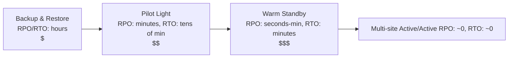

[← 2. Domain 2: Configuration Management and IaC (17%)](02-config-mgmt-iac.md) | [🏠 Home](README.md) | [4. Domain 4: Monitoring and Logging (15%) →](04-monitoring-logging.md)

# Chapter 3 - Domain 3: Resilient Cloud Solutions (15%)

> High availability, scaling and disaster recovery. Questions give you RTO/RPO numbers or a business requirement and ask for the cheapest design that meets it.

## 3.1 Core vocabulary

| Term | Meaning in one line |
|---|---|
| **High availability (HA)** | System keeps working when a component/AZ fails (Multi-AZ, no single point of failure) |
| **Fault tolerance** | Zero interruption even during failure (more redundancy, more cost) |
| **Scalability** | Handles more load by adding resources (horizontal = more instances, vertical = bigger instance) |
| **Elasticity** | Scales out *and back in* automatically with demand |
| **RTO** (Recovery Time Objective) | Max acceptable **downtime** after a disaster ("back up in 1 hour") |
| **RPO** (Recovery Point Objective) | Max acceptable **data loss** measured in time ("lose at most 5 minutes of data") |
| **SLA** | Availability promise. 99.9% = ~43.8 min downtime/month, 99.99% = ~4.4 min/month, 99.999% = ~26 s/month. Serial components multiply: 99.9% x 99.9% = 99.8% |

**Remember:** RPO is about **how often you copy data** (backup frequency / replication lag). RTO is about **how fast you can bring compute + data back** (how much is already running).

## 3.2 Disaster recovery strategies (memorise this table)

| Strategy | What runs in the DR Region | RPO | RTO | Cost | AWS building blocks |
|---|---|---|---|---|---|
| **Backup and restore** | Nothing; only backups/AMIs/templates copied | Hours (backup frequency) | Hours | Lowest | AWS Backup cross-Region copy, S3 CRR, EBS snapshot copy, AMI copy, CFN templates to rebuild |
| **Pilot light** | **Data layer live** (replicated DB), compute **off / not provisioned** | Minutes | 10s of minutes (start/scale compute) | Low | Aurora Global DB / RDS cross-Region read replica, DynamoDB global tables, AMIs + CFN/ASG with desired 0 |
| **Warm standby** | Full stack running at **reduced size**, can take traffic | Seconds to minutes | Minutes (scale up) | Medium | Same as pilot light + small ASG running, Route 53 failover |
| **Multi-site active/active** | Full stack in 2+ Regions serving traffic | Near zero | Near zero | Highest | Route 53 latency/weighted, DynamoDB global tables, Aurora Global DB (write forwarding), Global Accelerator |

Tie-breakers:
- "Data must be in DR Region but compute can be off" -> pilot light.
- "Must serve traffic immediately at lower capacity" -> warm standby.
- "Most cost-effective and RTO of 24 hours is fine" -> backup and restore.

**AWS Elastic Disaster Recovery (DRS)**: continuous block-level replication of servers (on-prem, other cloud, EC2) to a low-cost staging area in AWS; launch recovery instances in minutes (RPO seconds, RTO minutes); failback supported; non-disruptive **drills**. Pick it for "lift-and-shift servers DR with minimal RPO and low cost".

**AWS Resilience Hub**: define the app (from CFN/ Terraform/ Resource groups/ EKS), set RTO/RPO **resiliency policy**, it **assesses** whether the architecture meets them, recommends fixes, generates CloudWatch alarms, SOPs (SSM docs) and **FIS experiments**. Runs in pipelines for continuous assessment.

**AWS Fault Injection Service (FIS)**: chaos engineering. Experiment templates with actions (stop/terminate EC2, throttle API, inject CPU stress via SSM, fail AZ power interruption scenario, Aurora/RDS failover, ECS/EKS task kill, network disruption) with **stop conditions** = CloudWatch alarms. Use to **test** resilience and DR runbooks.

## 3.3 Multi-AZ / multi-Region by service

### Compute and load balancing

| Service | HA mechanism |
|---|---|
| EC2 | ASG across **multiple AZs** behind a load balancer. Single instance = SPOF. EC2 **auto recovery** (CloudWatch alarm `StatusCheckFailed_System` -> recover action, keeps instance ID/IP; default simplified auto recovery for supported types) |
| ELB | ALB/NLB nodes in each enabled AZ. **Cross-zone load balancing**: ALB always on (can turn off per target group), NLB/GWLB off by default (charges inter-AZ). Turn on to avoid uneven distribution when AZs have different instance counts |
| ECS | Service with tasks spread across AZs (`spread` placement on `attribute:ecs.availability-zone` default for Fargate), multiple subnets |
| EKS | Managed node groups across AZs, pod topology spread constraints, PodDisruptionBudgets |
| Lambda | Runs in multiple AZs automatically. If in VPC, give subnets in multiple AZs |

**ALB/NLB health checks + recovery from backend failure**
- Target group health check: protocol, path (`/health`), port, healthy/unhealthy threshold, interval, timeout, success codes.
- ALB routes only to healthy targets. If **all** targets are unhealthy, ALB **fails open** (routes to all).
- ASG health check type **ELB** (not just EC2) so ASG **replaces** instances that fail the LB health check. Health check grace period so booting instances aren't killed.
- **Deregistration delay** (connection draining, default 300 s) to finish in-flight requests on scale-in/deploy.
- Route 53 health check + failover for multi-Region.

### Data layer

| Service | Same-Region HA | Cross-Region |
|---|---|---|
| **RDS** (MySQL/PG/MariaDB/Oracle/SQL Server) | **Multi-AZ instance** (sync standby, automatic failover 60-120 s, DNS endpoint stays same) or **Multi-AZ DB cluster** (1 writer + 2 readable standbys, failover ~35 s). Read replicas = scale reads (async) | **Cross-Region read replica** (async), **promote** for DR (manual, breaks replication). Automated backups **cross-Region replication**. Snapshot copy |
| **Aurora** | Storage 6 copies across 3 AZs; up to 15 replicas; failover to replica ~30 s (set **failover priority tiers**). Reader endpoint load balances | **Aurora Global Database**: up to 10 secondary Regions (was 5 before May 2025; older questions may say 5), replication typically < 1 s, **RPO ~1 s, RTO < 1 min**. **Managed planned switchover** (no data loss, for drills) vs **failover** (unplanned, `failover-global-cluster` with allow data loss). **Write forwarding** from secondary. **Global writer endpoint** |
| **Aurora Serverless v2** | Scales ACUs in seconds; Multi-AZ via readers | Can be part of Global Database |
| **DynamoDB** | Multi-AZ by default | **Global tables**: multi-Region, multi-active (write anywhere), last writer wins; replication usually < 1 s. Multi-Region strong consistency option (MRSC). Needs Streams (managed). **PITR** (restore to any second in the last 1-35 days, configurable) + on-demand backups, cross-Region via AWS Backup |
| **ElastiCache (Redis OSS / Valkey)** | Multi-AZ with auto-failover (replicas) | **Global Datastore** (cross-Region replica clusters, promote secondary) |
| **MemoryDB** | Multi-AZ durable transaction log | Multi-Region (active-active) |
| **S3** | 3+ AZs by default (except One Zone-IA) | **CRR** (Cross-Region Replication, needs versioning both sides; **S3 RTC** = 99.99% in 15 min SLA); **SRR** same-Region; **Multi-Region Access Points** with failover controls; replicate existing objects with **Batch Replication** |
| **EFS** | Regional (multi-AZ) | **EFS replication** to another Region (RPO ~minutes), failover by making replica writable |
| **EBS** | Replicated within one AZ only | **Snapshots** (incremental, stored in S3) copied cross-Region; Data Lifecycle Manager (DLM) for scheduled snapshots + cross-Region copy |
| **Redshift** | Multi-AZ (RA3) | Cross-Region snapshot copy |
| **DocumentDB** | Replicas across AZs | Global clusters |

### DNS and edge: Route 53

| Routing policy | Use |
|---|---|
| Simple | One record, no health checks |
| **Failover** | Active-passive: primary record with health check, secondary used when primary unhealthy (DR) |
| **Weighted** | Split traffic by % (blue/green, canary across Regions) |
| **Latency** | Send users to lowest-latency Region (active-active) |
| Geolocation | By user's country/continent (compliance, localisation). Add default record |
| Geoproximity | By distance with bias (Traffic Flow) |
| Multivalue answer | Up to 8 healthy records, client-side LB |
| IP-based | By client CIDR |

**Health checks**: endpoint (HTTP/HTTPS/TCP, string matching, from global checkers), **calculated** (combine child checks with AND/OR/threshold), **CloudWatch alarm-based** (for private resources - Route 53 checkers can't reach private IPs, so alarm on a metric and attach a health check to the alarm). **Evaluate target health** on alias records (ALB health propagates). **Route 53 ARC** (Application Recovery Controller): readiness checks + routing controls for highly reliable manual failover; **Region switch** for orchestrated multi-Region failover plans.

### CloudFront
- **Origin groups** with primary + secondary origin -> **origin failover** on specific HTTP error codes (500, 502, 503, 504, 403, 404) or timeouts. Good for S3 bucket in 2 Regions (with CRR).
- Caching reduces origin load; cache behaviours per path; TTLs; invalidations.
- **AWS Global Accelerator**: static anycast IPs, routes to healthy endpoints in multiple Regions in seconds (TCP/UDP, non-HTTP, no DNS caching problem). Choose it over Route 53 when "clients cache DNS / need static IPs / fast failover".

## 3.4 Scalability

### EC2 Auto Scaling (very heavily tested)

**Scaling policy types**

| Policy | How | Use |
|---|---|---|
| **Target tracking** | Keep a metric at a target (e.g., CPU 50%, `ALBRequestCountPerTarget` 1000, SQS backlog per instance) | Default best answer; ASG creates alarms for you |
| **Step scaling** | Different adjustments for different alarm breach sizes | Big spikes need bigger jumps |
| Simple scaling | One adjustment + cooldown | Legacy |
| **Scheduled** | Change min/max/desired at times | Known patterns (business hours, Monday 9 AM) |
| **Predictive scaling** | ML forecast from 14 days history, scales **ahead** of load | Recurring daily/weekly patterns, slow-boot apps. Use "forecast only" mode first |

**Other must-knows**
- **Launch templates** (versions, mixed instances) - launch configurations are legacy.
- **Mixed instances policy**: On-Demand base + % Spot, multiple instance types, allocation strategies (`price-capacity-optimized` for Spot). **Capacity Rebalancing** replaces Spot instances at elevated interruption risk.
- **Warm pools**: pre-initialised stopped/hibernated/running instances -> fast scale-out for apps with long boot/init time.
- **Lifecycle hooks**: `autoscaling:EC2_INSTANCE_LAUNCHING` / `TERMINATING` -> instance waits in `Pending:Wait` / `Terminating:Wait` (heartbeat timeout default 1 h, range 30 s-2 h; extend with `RecordLifecycleActionHeartbeat`; total wait max 48 h or 100 x heartbeat, whichever is smaller) so you can install software or **copy logs before termination**. Notify via EventBridge/SNS/SQS -> Lambda / SSM Run Command, then `complete-lifecycle-action` (CONTINUE/ABANDON).
- **Termination policies**: Default (AZ balance -> oldest launch template/config -> closest to next billing hour), OldestInstance, NewestInstance, OldestLaunchTemplate, AllocationStrategy, custom Lambda. **Instance scale-in protection** for specific instances.
- **Suspend processes** (Launch, Terminate, HealthCheck, ReplaceUnhealthy, AZRebalance, AlarmNotification, ScheduledActions, AddToLoadBalancer, InstanceRefresh) - e.g., suspend `ReplaceUnhealthy` while debugging, `AZRebalance` to avoid churn.
- **Standby** state: take instance out of service for troubleshooting without terminating.
- **Instance refresh**: rolling replacement to a new launch template/AMI with min healthy %, warm-up, checkpoints, **auto rollback** on failure/alarm.
- **Default instance warmup** so new instances' metrics don't trigger more scaling too early.
- Health checks: EC2 (status checks) default; add **ELB** health checks; custom via `set-instance-health`.
- Scaling metric for queue workers: **backlog per instance** = `ApproximateNumberOfMessagesVisible` / running instances (custom metric) with target tracking.

### Other auto scaling

| Service | Scaling |
|---|---|
| **DynamoDB** | On-demand mode (no capacity planning, spiky/unknown) or provisioned + **Application Auto Scaling** (target tracking on consumed RCU/WCU). DAX for microsecond read caching |
| **RDS** | **Storage auto scaling** (when free space < 10%, low-storage for 5 min, 6 h since last change; set max storage). Read replicas for reads. Instance class change = vertical (downtime short with Multi-AZ) |
| **Aurora** | **Aurora Auto Scaling** of replicas (target tracking on CPU or connections); Serverless v2 ACUs |
| **ECS** | **Service auto scaling** (Application Auto Scaling: target tracking on CPU/memory/ALB request count) for tasks + **capacity providers** with **managed scaling** for EC2 cluster capacity (ASG scales to fit tasks, `CapacityProviderReservation` target), managed termination protection. Fargate = no cluster scaling needed |
| **EKS** | **HPA** (pods by CPU/memory/custom), **VPA**, **Cluster Autoscaler** (scales node groups/ASGs when pods pending) or **Karpenter** (provisions right-sized nodes directly, faster, Spot-aware). **EKS Auto Mode** = AWS-managed Karpenter + add-ons |
| **Lambda** | Scales automatically; **reserved concurrency** (cap + guarantee), **provisioned concurrency** (pre-warmed, removes cold starts; can be scaled with Application Auto Scaling / scheduled) |
| **API Gateway** | Managed; throttling limits (10,000 rps account default, burst 5,000), usage plans, caching |
| **Kinesis Data Streams** | On-demand mode or provisioned shards (split/merge, UpdateShardCount) |
| **Aurora / ElastiCache** | Add replicas/shards |

### Loosely coupled architecture
- Put **SQS** between producers and consumers to absorb spikes (decoupling, buffer). Scale consumers on queue depth.
- **SNS fan-out** to multiple SQS queues for parallel independent processing.
- **EventBridge** for event routing between services/accounts.
- **Kinesis** for ordered streaming, multiple consumers, replay.
- **Step Functions** for orchestration.
- Stateless compute + external state (ElastiCache/DynamoDB for sessions, S3 for files).
- **Caching**: CloudFront (edge), API Gateway cache, ElastiCache/DAX (DB), Lambda execution context.

### Containers and serverless platforms (Domain 3.2)
- **ECS** launch types: EC2 (you manage instances), **Fargate** (serverless). ECS Anywhere for on-prem. Task definitions, services, task role (app permissions) vs **task execution role** (pull ECR image, push logs, read secrets).
- **EKS**: managed control plane; node types: managed node groups, self-managed, Fargate profiles, Auto Mode. Pod IAM: **IRSA** (OIDC provider) or **EKS Pod Identity** (simpler). Add-ons: VPC CNI, CoreDNS, kube-proxy, EBS CSI driver, ADOT.
- **App Runner**: fully managed web apps from source/image, auto scaling, least overhead for simple web services. (Closed to new customers from Apr 30, 2026; AWS recommends ECS Express Mode now. Know the concept.)
- **Copilot** CLI for ECS/App Runner apps with pipelines. **App2Container** containerises existing .NET/Java apps.
- **API Gateway + Lambda + DynamoDB** = classic serverless. Use **Lambda Powertools**, X-Ray, DLQs / on-failure destinations.

### Multi-Region for global scalability
- Deploy stacks to each Region (StackSets / pipeline with multi-Region actions).
- Data: DynamoDB global tables, Aurora Global DB, S3 CRR, ECR replication, Secrets Manager **replica secrets**, KMS **multi-Region keys** (same key ID/material in multiple Regions - decrypt data copied across Regions without re-encrypting), AMI copy, Parameter Store (no native replication - copy via automation).
- Route traffic: Route 53 latency/geolocation + health checks, Global Accelerator, CloudFront.

## 3.5 Backup and recovery

**AWS Backup**
- **Backup plans** (schedule, lifecycle: transition to cold storage, retention), **backup rules**, **resource assignment** by tags or ARNs.
- Supports EC2/EBS, RDS, Aurora, DynamoDB, EFS, FSx, S3, Storage Gateway, DocumentDB, Neptune, Redshift, Timestream, SAP HANA on EC2, VMware...
- **Cross-Region copy** and **cross-account copy** (within org) in the plan's copy action.
- **Vault Lock** (WORM: governance or compliance mode) - backups can't be deleted even by root -> ransomware protection. **Logically air-gapped vault**.
- **Organization backup policies** to apply plans to all accounts.
- **Backup Audit Manager** frameworks/controls for compliance reports.
- **Restore testing** plans (automatic periodic restore validation).
- EventBridge events for job state (failed backups -> SNS).

**Service-native backups:** RDS automated backups (1-35 days, PITR to 5-min granularity) + manual snapshots (kept until deleted); DynamoDB PITR; EBS snapshots with DLM; S3 versioning + Object Lock + replication; Aurora **Backtrack** (MySQL, rewind in place without restore).

**Recovery procedures (automate them):** SSM Automation runbooks to restore/promote, CFN templates for DR stack, Route 53 ARC / failover records, regular **DR drills** with FIS / Aurora switchover / DRS drills.

## 3.6 Domain 3 scenario quick-map

| Scenario | Answer |
|---|---|
| RPO 1 s, RTO 1 min, relational, multi-Region | Aurora Global Database |
| Multi-Region active-active writes, key-value | DynamoDB global tables |
| Cheapest DR, RTO 24 h | Backup and restore with AWS Backup cross-Region copy |
| DB live in DR, compute off | Pilot light |
| Lift-and-shift servers DR, seconds RPO | AWS Elastic Disaster Recovery |
| Test that app survives AZ failure | AWS FIS with stop conditions |
| Check whether app meets RTO/RPO | AWS Resilience Hub |
| Route to DR Region automatically when primary unhealthy | Route 53 failover records + health checks |
| Health check on private resource | CloudWatch alarm + Route 53 health check on alarm |
| Static IPs + fast multi-Region failover | Global Accelerator |
| S3 static site served from 2 Regions | CRR + CloudFront origin group failover |
| ASG keeps unhealthy-but-running instances | Set ASG health check type to ELB |
| Uneven load between AZs on NLB | Enable cross-zone load balancing |
| App takes 10 min to boot, scale-out too slow | Warm pools (and/or predictive scaling) |
| Known daily peak | Predictive or scheduled scaling |
| Copy logs off instance before scale-in terminates it | Lifecycle hook (Terminating:Wait) + SSM Run Command |
| SQS worker fleet scaling | Target tracking on backlog-per-instance custom metric |
| ECS on EC2 tasks pending due to no capacity | Capacity provider with managed scaling |
| EKS pods pending, need nodes fast and right-sized | Karpenter |
| Lambda cold starts on latency-sensitive API | Provisioned concurrency |
| Backups must not be deletable (ransomware) | AWS Backup Vault Lock (compliance mode) |
| Encrypted snapshots usable in DR Region | Copy with a KMS key in target Region / KMS multi-Region key |
| Secrets available in DR Region | Secrets Manager replica secrets |

---

[← 2. Domain 2: Configuration Management and IaC (17%)](02-config-mgmt-iac.md) | [🏠 Home](README.md) | [4. Domain 4: Monitoring and Logging (15%) →](04-monitoring-logging.md)
