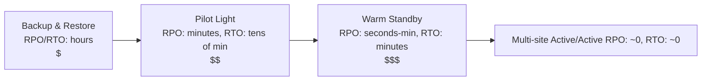

[← 2. Domain 2: Configuration Management and IaC (17%)](02-config-mgmt-iac.md) | [🏠 Home](README.md) | [Services](services/README.md) | [Labs](labs/README.md) | [4. Domain 4: Monitoring and Logging (15%) →](04-monitoring-logging.md)

# Chapter 3 - Domain 3: Resilient Cloud Solutions (15%)

> High availability, scaling and disaster recovery. Questions give you RTO/RPO numbers or a business requirement and ask for the cheapest design that meets it.

## Services to study for this domain

Read these service files first, then the sections below.

- [Amazon ECS, EKS and Fargate](services/ecs-eks.md)
- [AWS Lambda deployments](services/lambda.md)
- [Amazon API Gateway](services/api-gateway.md)
- [Amazon EC2 Auto Scaling](services/ec2-auto-scaling.md)
- [Elastic Load Balancing and compute high availability](services/elastic-load-balancing.md)
- [Amazon S3 (events, integrity, protection)](services/s3.md)
- [Databases and storage: HA and replication](services/databases-storage.md)
- [Amazon Route 53](services/route53.md)
- [CloudFront and Global Accelerator](services/cloudfront-global-accelerator.md)
- [AWS Backup](services/aws-backup.md)
- [Resilience Hub, FIS and Elastic Disaster Recovery](services/resilience-hub-fis-drs.md)
- [SQS, SNS, Kinesis, Firehose and Lambda event handling](services/sqs-sns-kinesis.md)

## 3.1 Core vocabulary

| Term | Meaning in one line |
|---|---|
| **High availability (HA)** | System keeps working when a component/AZ fails (Multi-AZ, no single point of failure) |
| **Fault tolerance** | Zero interruption even during failure (more redundancy, more cost) |
| **Scalability** | Handles more load by adding resources (horizontal = more instances, vertical = bigger instance) |
| **Elasticity** | Scales out *and back in* automatically with demand |
| **RTO** (Recovery Time Objective) | Max acceptable **downtime** after a disaster ("back up in 1 hour") |
| **RPO** (Recovery Point Objective) | Max acceptable **data loss** measured in time ("lose at most 5 minutes of data") |
| **SLA** | Availability promise. 99.9% = ~43.8 min downtime/month, 99.99% = ~4.4 min/month, 99.999% = ~26 s/month. Serial components multiply: 99.9% x 99.9% = 99.8% |

**Remember:** RPO is about **how often you copy data** (backup frequency / replication lag). RTO is about **how fast you can bring compute + data back** (how much is already running).

## 3.2 Disaster recovery strategies (memorise this table)

| Strategy | What runs in the DR Region | RPO | RTO | Cost | AWS building blocks |
|---|---|---|---|---|---|
| **Backup and restore** | Nothing; only backups/AMIs/templates copied | Hours (backup frequency) | Hours | Lowest | AWS Backup cross-Region copy, S3 CRR, EBS snapshot copy, AMI copy, CFN templates to rebuild |
| **Pilot light** | **Data layer live** (replicated DB), compute **off / not provisioned** | Minutes | 10s of minutes (start/scale compute) | Low | Aurora Global DB / RDS cross-Region read replica, DynamoDB global tables, AMIs + CFN/ASG with desired 0 |
| **Warm standby** | Full stack running at **reduced size**, can take traffic | Seconds to minutes | Minutes (scale up) | Medium | Same as pilot light + small ASG running, Route 53 failover |
| **Multi-site active/active** | Full stack in 2+ Regions serving traffic | Near zero | Near zero | Highest | Route 53 latency/weighted, DynamoDB global tables, Aurora Global DB (write forwarding), Global Accelerator |

Tie-breakers:
- "Data must be in DR Region but compute can be off" -> pilot light.
- "Must serve traffic immediately at lower capacity" -> warm standby.
- "Most cost-effective and RTO of 24 hours is fine" -> backup and restore.

## 3.3 Scalability

### Other auto scaling

| Service | Scaling |
|---|---|
| **DynamoDB** | On-demand mode (no capacity planning, spiky/unknown) or provisioned + **Application Auto Scaling** (target tracking on consumed RCU/WCU). DAX for microsecond read caching |
| **RDS** | **Storage auto scaling** (when free space < 10%, low-storage for 5 min, 6 h since last change; set max storage). Read replicas for reads. Instance class change = vertical (downtime short with Multi-AZ) |
| **Aurora** | **Aurora Auto Scaling** of replicas (target tracking on CPU or connections); Serverless v2 ACUs |
| **ECS** | **Service auto scaling** (Application Auto Scaling: target tracking on CPU/memory/ALB request count) for tasks + **capacity providers** with **managed scaling** for EC2 cluster capacity (ASG scales to fit tasks, `CapacityProviderReservation` target), managed termination protection. Fargate = no cluster scaling needed |
| **EKS** | **HPA** (pods by CPU/memory/custom), **VPA**, **Cluster Autoscaler** (scales node groups/ASGs when pods pending) or **Karpenter** (provisions right-sized nodes directly, faster, Spot-aware). **EKS Auto Mode** = AWS-managed Karpenter + add-ons |
| **Lambda** | Scales automatically; **reserved concurrency** (cap + guarantee), **provisioned concurrency** (pre-warmed, removes cold starts; can be scaled with Application Auto Scaling / scheduled) |
| **API Gateway** | Managed; throttling limits (10,000 rps account default, burst 5,000), usage plans, caching |
| **Kinesis Data Streams** | On-demand mode or provisioned shards (split/merge, UpdateShardCount) |
| **Aurora / ElastiCache** | Add replicas/shards |

### Loosely coupled architecture
- Put **SQS** between producers and consumers to absorb spikes (decoupling, buffer). Scale consumers on queue depth.
- **SNS fan-out** to multiple SQS queues for parallel independent processing.
- **EventBridge** for event routing between services/accounts.
- **Kinesis** for ordered streaming, multiple consumers, replay.
- **Step Functions** for orchestration.
- Stateless compute + external state (ElastiCache/DynamoDB for sessions, S3 for files).
- **Caching**: CloudFront (edge), API Gateway cache, ElastiCache/DAX (DB), Lambda execution context.

### Multi-Region for global scalability
- Deploy stacks to each Region (StackSets / pipeline with multi-Region actions).
- Data: DynamoDB global tables, Aurora Global DB, S3 CRR, ECR replication, Secrets Manager **replica secrets**, KMS **multi-Region keys** (same key ID/material in multiple Regions - decrypt data copied across Regions without re-encrypting), AMI copy, Parameter Store (no native replication - copy via automation).
- Route traffic: Route 53 latency/geolocation + health checks, Global Accelerator, CloudFront.

## 3.4 Domain 3 scenario quick-map

| Scenario | Answer |
|---|---|
| RPO 1 s, RTO 1 min, relational, multi-Region | Aurora Global Database |
| Multi-Region active-active writes, key-value | DynamoDB global tables |
| Cheapest DR, RTO 24 h | Backup and restore with AWS Backup cross-Region copy |
| DB live in DR, compute off | Pilot light |
| Lift-and-shift servers DR, seconds RPO | AWS Elastic Disaster Recovery |
| Test that app survives AZ failure | AWS FIS with stop conditions |
| Check whether app meets RTO/RPO | AWS Resilience Hub |
| Route to DR Region automatically when primary unhealthy | Route 53 failover records + health checks |
| Health check on private resource | CloudWatch alarm + Route 53 health check on alarm |
| Static IPs + fast multi-Region failover | Global Accelerator |
| S3 static site served from 2 Regions | CRR + CloudFront origin group failover |
| ASG keeps unhealthy-but-running instances | Set ASG health check type to ELB |
| Uneven load between AZs on NLB | Enable cross-zone load balancing |
| App takes 10 min to boot, scale-out too slow | Warm pools (and/or predictive scaling) |
| Known daily peak | Predictive or scheduled scaling |
| Copy logs off instance before scale-in terminates it | Lifecycle hook (Terminating:Wait) + SSM Run Command |
| SQS worker fleet scaling | Target tracking on backlog-per-instance custom metric |
| ECS on EC2 tasks pending due to no capacity | Capacity provider with managed scaling |
| EKS pods pending, need nodes fast and right-sized | Karpenter |
| Lambda cold starts on latency-sensitive API | Provisioned concurrency |
| Backups must not be deletable (ransomware) | AWS Backup Vault Lock (compliance mode) |
| Encrypted snapshots usable in DR Region | Copy with a KMS key in target Region / KMS multi-Region key |
| Secrets available in DR Region | Secrets Manager replica secrets |

---

[← 2. Domain 2: Configuration Management and IaC (17%)](02-config-mgmt-iac.md) | [🏠 Home](README.md) | [Services](services/README.md) | [Labs](labs/README.md) | [4. Domain 4: Monitoring and Logging (15%) →](04-monitoring-logging.md)
