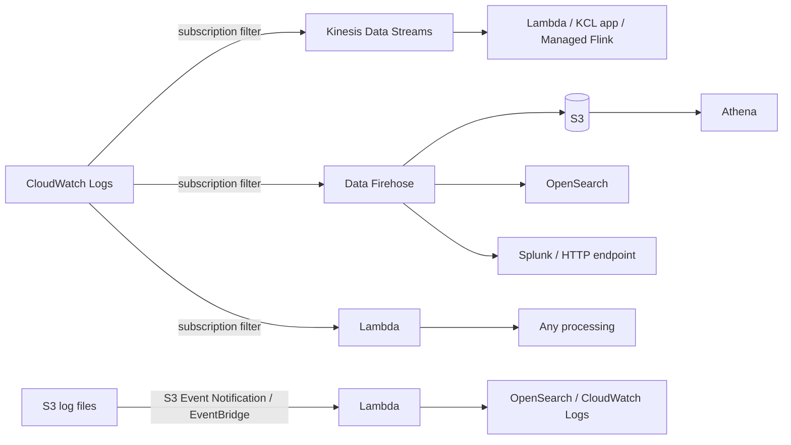

[← 3. Domain 3: Resilient Cloud Solutions (15%)](03-resilient-cloud.md) | [🏠 Home](README.md) | [5. Domain 5: Incident and Event Response (14%) →](05-incident-event-response.md)

# Chapter 4 - Domain 4: Monitoring and Logging (15%)

> CloudWatch (metrics, alarms, logs, Logs Insights, subscriptions, agent, dashboards, anomaly detection, Synthetics), X-Ray, CloudTrail, log storage/encryption, and the "process logs in real time" pipelines.

## 4.1 CloudWatch Metrics

| Concept | Detail |
|---|---|
| **Namespace** | Container, e.g., `AWS/EC2`, `AWS/ApplicationELB`, custom `MyApp` |
| **Metric** | Name + time-ordered data points |
| **Dimensions** | Name/value pairs that identify a metric (up to 30), e.g., `InstanceId`, `AutoScalingGroupName`. A metric with different dimensions is a different metric |
| **Resolution** | Standard = 1-minute; **high resolution = 1-second** (custom metrics, `StorageResolution=1`). Alarms on high-res metrics can evaluate every 10 or 30 s |
| **Retention** | 1-s data 3 h, 60-s data 15 days, 5-min 63 days, 1-h 455 days (15 months) |
| **EC2 default** | **Basic monitoring 5-min** (free); **detailed monitoring 1-min** (paid). Hypervisor metrics only: CPU, network, disk (instance store), status checks. **Memory and disk space usage are NOT default** -> CloudWatch agent |
| **Custom metrics** | `PutMetricData` API / CLI, **Embedded Metric Format (EMF)** from logs (Lambda/containers write JSON logs, CloudWatch extracts metrics - no API calls), CloudWatch agent, StatsD/collectd |
| **Metric math** | Combine metrics in expressions (e.g., error rate = 5xx / requests * 100) and alarm on it |
| **Metrics Insights** | SQL queries over metrics (`SELECT AVG(CPUUtilization) FROM SCHEMA("AWS/EC2", InstanceId) GROUP BY ...`) |
| **Metric streams** | Continuous near-real-time stream of metrics via **Kinesis Data Firehose** to S3, Redshift, OpenSearch, or third parties (Datadog, Splunk, New Relic...). Include/exclude namespaces. Output JSON or OpenTelemetry. Use when "send all metrics to external tool / data lake in near real time" (better than polling `GetMetricData`) |
| **Cross-account observability** | Monitoring account linked to source accounts (OAM sinks/links) to view metrics, logs, traces centrally |

### Common metrics to know (exam guide calls these out)

| Service | Metrics |
|---|---|
| EC2 | `CPUUtilization`, `StatusCheckFailed_System` (AWS hardware -> recover), `StatusCheckFailed_Instance` (your OS -> reboot), `NetworkIn/Out`, `CPUCreditBalance` (T instances) |
| ALB | `HTTPCode_Target_5XX_Count` (your app), `HTTPCode_ELB_5XX_Count` (the LB itself, e.g., 502/503/504), `TargetResponseTime`, `RequestCount`, `HealthyHostCount`, `UnHealthyHostCount`, `RejectedConnectionCount`, `RequestCountPerTarget` |
| NLB | `HealthyHostCount`, `TCP_Target_Reset_Count`, `ActiveFlowCount` |
| RDS | `CPUUtilization`, `DatabaseConnections`, `FreeStorageSpace`, `FreeableMemory`, `ReadLatency/WriteLatency`, **`DiskQueueDepth`** (this is the "queue length" metric for RDS), `ReplicaLag`, `ReadIOPS/WriteIOPS` |
| SQS | `ApproximateNumberOfMessagesVisible` (backlog), `ApproximateAgeOfOldestMessage` (processing is falling behind), `NumberOfMessagesSent/Deleted` |
| Lambda | `Invocations`, `Errors`, `Throttles`, `Duration`, `ConcurrentExecutions`, `IteratorAge` (stream consumers falling behind), `DeadLetterErrors` |
| API Gateway | `Count`, `4XXError`, `5XXError`, `Latency`, `IntegrationLatency`, `CacheHitCount` |
| DynamoDB | `ConsumedRead/WriteCapacityUnits`, `ThrottledRequests`, `ReadThrottleEvents`, `SystemErrors`, `ReplicationLatency` (global tables) |
| ECS | `CPUUtilization`, `MemoryUtilization` (service/cluster); per-task with **Container Insights** |
| Kinesis | `GetRecords.IteratorAgeMilliseconds`, `WriteProvisionedThroughputExceeded`, `ReadProvisionedThroughputExceeded` |
| ASG | `GroupDesiredCapacity`, `GroupInServiceInstances` (enable group metrics) |
| Billing | `EstimatedCharges` (us-east-1 only) |

## 4.2 CloudWatch Alarms

- States: `OK`, `ALARM`, `INSUFFICIENT_DATA`.
- Settings: period, **evaluation periods**, **datapoints to alarm** ("M out of N", e.g., 3 of 5 to avoid flapping), threshold, statistic (Average, Sum, Min, Max, SampleCount, pNN percentiles), **missing data treatment** (`missing`, `notBreaching`, `breaching`, `ignore`).
- **Actions**: SNS notification, **EC2 actions** (stop, terminate, reboot, **recover**), **Auto Scaling** policy, **SSM OpsItem / Incident Manager incident**, **Lambda function** (direct alarm action), and EventBridge gets every alarm state change.
- **Composite alarms**: combine alarms with AND/OR/NOT -> reduce alert noise ("page only if 5xx high AND latency high"). Can suppress actions with an actions suppressor alarm.
- **Anomaly detection**: ML band based on metric history (seasonality, trend); alarm when metric goes outside band (`ANOMALY_DETECTION_BAND`). Use when "threshold is hard to define / traffic varies by time of day".
- Alarm on **metric math expressions** and **Metrics Insights queries** (alarm across a fleet with one query).
- **Logs anomaly detection** and **pattern analysis** also exist for log groups.

## 4.3 CloudWatch Logs

| Concept | Detail |
|---|---|
| **Log group** | Container with **retention** (1 day to 10 years, or never expire - default never) and **KMS encryption** (associate a CMK; key policy must allow `logs.<region>.amazonaws.com`) |
| **Log stream** | Sequence from one source (instance, container, Lambda instance) |
| **Log classes** | Standard vs **Infrequent Access** (cheaper ingestion, fewer features) |
| **Metric filters** | Turn log patterns into **CloudWatch metrics** (e.g., count `ERROR`, extract latency value). Then alarm on the metric. Filters only apply to **new** events after creation |
| **Subscription filters** | **Real-time** stream of log events to **Kinesis Data Streams, Kinesis Data Firehose, Lambda, or OpenSearch Service** (via Lambda). Up to 2 subscription filters per log group. **Account-level subscription filter** for all log groups |
| **Cross-account log delivery** | Subscription to a **destination** in central account (destination wraps a Kinesis stream/Firehose; destination policy allows source accounts) -> centralised logging |
| **Logs Insights** | Interactive query language over log groups (see below). Query across up to many log groups/accounts |
| **Live Tail** | Real-time view of incoming logs for troubleshooting |
| **Export to S3** | `CreateExportTask` - **batch**, can take up to 12 h, not real time. For continuous delivery to S3 use subscription -> Firehose -> S3 |
| **Data protection policies** | Detect and **mask sensitive data** (PII, credentials) in logs |
| **Field indexes / transformers** | Parse/normalise logs at ingestion |
| **Centralization rules** | Copy logs from org accounts/Regions into a central account |

### Filter pattern syntax (used by metric filters, subscription filters, `filter-log-events`)
```
ERROR                                   # term match
"Access Denied"                         # exact phrase
?ERROR ?WARN                            # OR
ERROR -Healthcheck                      # exclude
{ $.statusCode = 500 }                  # JSON field
{ $.latency > 1000 && $.path = "/api*" }
{ $.eventName = "ConsoleLogin" && $.responseElements.ConsoleLogin = "Failure" }
[ip, user, ts, request, status_code = 5*, size]   # space-delimited
```

### Logs Insights queries you should be able to read
```
fields @timestamp, @message
| filter @message like /ERROR/
| sort @timestamp desc
| limit 50

filter level = "ERROR"              # filter BEFORE stats
| stats count(*) as errors by bin(5m)

filter @type = "REPORT"                 # Lambda: memory and duration
| stats max(@maxMemoryUsed/1000/1000) as maxMB, avg(@duration) by bin(1h)

parse @message "user=* action=*" as user, action
| stats count() by user, action
```

### Real-time log processing patterns (memorise the arrows)



| Need | Use |
|---|---|
| Near-real-time, durable, multiple consumers, replay, ordered | Kinesis Data Streams |
| Near-real-time delivery to S3/OpenSearch/Redshift/Splunk, no code, transform with Lambda, buffer interval 0-900 s (0 = zero buffering, delivery within seconds) | Data Firehose |
| Search, dashboards (Kibana-style) | OpenSearch Service (+ OpenSearch Dashboards) |
| Ad-hoc SQL over logs in S3 | Athena (partition by date, use Parquet via Firehose conversion for cost) |
| BI dashboards | QuickSight (over Athena) |
| Big data processing | EMR |
| Stream analytics SQL/Java | Managed Service for Apache Flink |
| Logs from SaaS apps | AppFlow |

## 4.4 CloudWatch agent (unified agent)

- Collects **system metrics** (memory `mem_used_percent`, disk `disk_used_percent`, swap, processes, netstat) and **logs** (any file) from EC2 and on-prem, Linux and Windows (Windows event logs, performance counters).
- Config JSON created by wizard (`amazon-cloudwatch-agent-config-wizard`), store in **SSM Parameter Store** (`AmazonCloudWatch-*`), deploy and start at scale with **SSM** (`AWS-ConfigureAWSPackage` to install, `AmazonCloudWatch-ManageAgent` to configure) via State Manager.
- IAM: `CloudWatchAgentServerPolicy` (+ `AmazonSSMManagedInstanceCore`).
- `append_dimensions` (InstanceId, AutoScalingGroupName), `aggregation_dimensions`, `metrics_collection_interval` (can be 1 s for high-res).
- **procstat** plugin to monitor specific processes; **StatsD/collectd** for app metrics.
- Older "CloudWatch Logs agent" (awslogs) is deprecated -> unified agent.
- Troubleshoot: agent log `/opt/aws/amazon-cloudwatch-agent/logs/amazon-cloudwatch-agent.log`, IAM role, network/endpoint, config file path.

**Containers:** ECS `awslogs` log driver or **FireLens** (Fluent Bit) for routing to multiple destinations; **Container Insights** (with enhanced observability) for cluster/service/task/pod metrics on ECS & EKS (CloudWatch agent / ADOT / Fluent Bit DaemonSet on EKS). **Prometheus** metrics -> Amazon Managed Service for Prometheus + **Amazon Managed Grafana** dashboards.
**Lambda:** logs go to `/aws/lambda/<fn>` automatically (role needs `logs:CreateLogStream/PutLogEvents`); Lambda Insights extension for system-level metrics.

## 4.5 Dashboards and visualisation
- **CloudWatch dashboards**: global (widgets from multiple Regions **and accounts** with cross-account observability), automatic dashboards per service, share dashboards publicly or with SSO users, text/alarm/log widgets, custom widgets via Lambda.
- **Amazon QuickSight** (Quick Sight): BI dashboards from Athena/S3/Redshift (e.g., Config/Inventory/CUR data).
- **Managed Grafana**: Grafana dashboards over CloudWatch, Prometheus, X-Ray, OpenSearch, with IAM Identity Center auth.

## 4.6 AWS X-Ray (distributed tracing)

- **Traces** (end-to-end request) made of **segments** (one per service) and **subsegments** (downstream calls, SQL, HTTP). **Service map** shows latency/errors between components. **Trace Analytics**, **Insights** (anomaly detection on traces), **groups** (filter expression).
- **Annotations** = indexed key-value -> **searchable/filterable** (`annotation.customer_id = "123"`). **Metadata** = not indexed, just stored.
- **Sampling rules** (default: first request per second + 5% of additional) to control cost.
- How to enable per service:

| Service | How |
|---|---|
| **Lambda** | Turn on **active tracing** (`TracingConfig: Active`); execution role needs `xray:PutTraceSegments`, `xray:PutTelemetryRecords` (`AWSXRayDaemonWriteAccess`); use X-Ray SDK / Powertools / ADOT to trace downstream calls |
| **API Gateway** | Enable X-Ray tracing on the **stage** |
| **EC2 / on-prem** | Run the **X-Ray daemon** (UDP 2000) or CloudWatch agent / ADOT collector; instrument app with SDK; instance role with X-Ray write |
| **ECS** | Run X-Ray daemon / ADOT collector as a **sidecar container** in the task (task role with X-Ray permissions) |
| **EKS** | X-Ray daemon / ADOT collector as a **DaemonSet** |
| **Elastic Beanstalk** | Enable the X-Ray daemon option in env config (`.ebextensions`: `aws:elasticbeanstalk:xray: XRayEnabled: true`) |
| SNS, SQS, Step Functions, AppSync, ELB | Pass trace header / enable tracing (ALB adds `X-Amzn-Trace-Id` header but does not send segments) |

- **AWS Distro for OpenTelemetry (ADOT)** = vendor-neutral way to send traces/metrics to X-Ray, CloudWatch, AMP. X-Ray SDKs/daemon are moving to OpenTelemetry - for exam, both are valid answers; pick the one offered.
- **CloudWatch Application Signals**: automatic APM (SLOs, service dashboards) using ADOT. **CloudWatch ServiceLens** combined traces+metrics+logs view (older).

## 4.7 CloudWatch Synthetics and RUM
- **Synthetics canaries**: scripts (Node.js Puppeteer/Playwright, Python Selenium) run on a schedule to test endpoints/UI flows (heartbeat, API, broken link checker, visual monitoring, GUI workflow). Metrics + screenshots + HAR, alarm on `SuccessPercent`. Test **before users notice**; run after deploys in the pipeline.
- **RUM**: real user monitoring from browsers (page load, JS errors).
- **Internet Monitor**: internet-side availability/performance for your users.
- **Evidently** (feature experiments) - deprecated; use AppConfig.

## 4.8 AWS CloudTrail (API audit)

| Concept | Detail |
|---|---|
| **Event history** | Last **90 days** of **management events** free, per Region, no setup |
| **Trail** | Deliver events to **S3** (and optionally **CloudWatch Logs**, SNS on file delivery). **Multi-Region trail** (recommended) and **organization trail** (from management/delegated admin account, all member accounts, members can't modify it) |
| **Management events** | Control plane (CreateBucket, RunInstances, ConsoleLogin...). Read/write separation. Logged by default on trails |
| **Data events** | High-volume data plane: **S3 object-level** (GetObject/PutObject/DeleteObject), Lambda Invoke, DynamoDB item-level, etc. **Not logged by default**, extra cost. Use advanced event selectors to filter |
| **Insights events** | Detects **unusual API call rates or error rates** (e.g., spike in `TerminateInstances` or AccessDenied) -> anomalous activity |
| **Network activity events** | API calls through VPC endpoints (for data perimeter) |
| **Log file integrity validation** | SHA-256 digest files each hour -> prove logs weren't modified/deleted (`aws cloudtrail validate-logs`). Common answer for "prove logs not tampered" |
| **Encryption** | SSE-S3 default; **SSE-KMS** with CMK for extra control |
| **CloudTrail Lake** | Managed event data store with **SQL queries**, long retention (up to ~10 years), can ingest non-AWS events, org-wide. Use for "query API activity with SQL without managing Athena" |
| **Delivery delay** | Events delivered to S3 within ~**5 minutes** on average (not real time); EventBridge gets management events near real time |
| **Protection** | S3 bucket policy (only CloudTrail writes), MFA delete / Object Lock, separate Log Archive account, SCP denying `StopLogging`/`DeleteTrail` |

**CloudTrail + EventBridge:** EventBridge receives events with detail-type **"AWS API Call via CloudTrail"**. Per the EventBridge docs, this **needs a CloudTrail trail with logging enabled**; S3 object-level (data) events additionally need data event selectors on the trail. Read-only management events can be matched on the default bus (opt-in rule setting). Pattern: rule on `eventName: ["DeleteBucket","StopLogging","AuthorizeSecurityGroupIngress"]` -> SNS / Lambda remediation.
**CloudTrail -> CloudWatch Logs -> metric filter -> alarm** = the classic CIS benchmark alerts (root login, console login without MFA, IAM policy changes, unauthorized API calls, NACL/SG changes).

**Querying CloudTrail logs in S3:** Athena (create table from CloudTrail console, partition projection) or CloudTrail Lake.

## 4.9 Other logs you must know

| Log | What | Destination |
|---|---|---|
| **VPC Flow Logs** | IP traffic metadata (src/dst IP, port, protocol, ACCEPT/REJECT) for VPC/subnet/ENI. Not packet contents. Custom format fields (`pkt-srcaddr`, `tcp-flags`, `flow-direction`) | CloudWatch Logs, S3, Firehose. Query with Logs Insights / Athena. REJECT = SG or NACL blocked |
| **ELB access logs** | Each request (client IP, latency, path, status codes, TLS) | S3 only (every 5 min). Bucket policy for ELB service. Connection logs too |
| **CloudFront logs** | Standard logs to S3 (or CloudWatch/Firehose with v2), **real-time logs** to Kinesis Data Streams | |
| **S3 server access logs** | Requests to a bucket (best effort) | Another S3 bucket. (CloudTrail data events are the reliable alternative) |
| **Route 53 query logs** | Public DNS queries (CloudWatch Logs us-east-1); **Resolver query logs** for VPC DNS | |
| **API Gateway logs** | Execution logs + **access logs** (custom format) | CloudWatch Logs (needs account-level role ARN) / Firehose |
| **WAF logs** | Full request logs | CloudWatch Logs, S3, Firehose (names must start `aws-waf-logs-`) |
| **RDS logs** | Error, slow query, general, audit logs | Publish to CloudWatch Logs |
| **Session Manager logs** | Shell session transcripts | S3 / CloudWatch Logs |
| **CodeBuild / Lambda / ECS** | Build/function/container stdout | CloudWatch Logs |
| **EKS control plane logs** | api, audit, authenticator, controllerManager, scheduler | CloudWatch Logs (enable per type) |

## 4.10 Log storage, security and lifecycle
- **CloudWatch Logs retention** per log group (set it - default is never expire = cost). Automate with Config rule `cw-loggroup-retention-period-check` + remediation, or an EventBridge rule on `CreateLogGroup` -> Lambda sets retention.
- Long-term storage: export/stream to **S3** with **lifecycle rules** (Standard -> Standard-IA -> Glacier Flexible Retrieval/Deep Archive -> expire). **S3 Object Lock** (compliance mode) for WORM retention. Glacier **Vault Lock**.
- **Encryption at rest:** CloudWatch Logs with KMS CMK (`associate-kms-key`); S3 SSE-S3/SSE-KMS (bucket key to reduce KMS cost); **client-side** encryption if data must be encrypted before leaving the app. **In transit**: HTTPS/TLS to all endpoints.
- **Access control:** IAM policies on `logs:*` with resource ARNs; **centralised Log Archive account** with bucket policy that allows only `PutObject` from org accounts (condition `aws:PrincipalOrgID`), deny delete; separate read-only role for auditors.
- **IAM for log collection:** instance profile (CloudWatch agent), Lambda execution role, ECS task execution role (`awslogs`), Firehose role to write S3, CloudWatch Logs role to put into Kinesis for subscriptions (`logs.amazonaws.com` trust).

## 4.11 Automating monitoring and event management (Task 4.3)

- **S3 Event Notifications** (to SNS, SQS, Lambda, or EventBridge for advanced filtering and many targets) -> e.g., new log file in S3 -> Lambda parses and loads into OpenSearch / CloudWatch Logs.
- **EventBridge** rules on service events -> SNS/Lambda/SSM Automation/Step Functions.
- **Alarm -> action**: SNS (email/SMS/Chatbot to Slack/Teams), Lambda, EC2 recover/reboot, ASG scaling, OpsItem.
- **EC2 automatic recovery**: alarm on `StatusCheckFailed_System` with `recover` action (same instance ID, private IP, EIP, metadata; not for instance store). Many instance types have simplified automatic recovery by default.
- **Health checks**: ALB target group health checks (Domain 3), Route 53 health checks (endpoint/calculated/alarm-based), ECS container health checks (`healthCheck` in task definition), EKS liveness/readiness probes.
- **Auto scaling capabilities**: EC2 ASG, RDS storage auto scaling, DynamoDB auto scaling/on-demand, ECS capacity providers + service auto scaling, EKS Cluster Autoscaler/Karpenter (Chapter 3).
- **Install agents at scale**: SSM Agent (in AMI / DHMC), CloudWatch agent (State Manager), Inspector (uses SSM Agent), CodeDeploy agent (Distributor).
- **Config rules to remediate** (Chapter 2/6).

## 4.12 Domain 4 scenario quick-map

| Scenario | Answer |
|---|---|
| Monitor EC2 memory / disk usage | CloudWatch agent (config in Parameter Store, deploy via SSM) |
| Count ERROR lines and alert | Metric filter -> alarm -> SNS |
| Process logs in real time with custom code | Subscription filter -> Kinesis Data Streams or Lambda |
| Deliver logs to S3 / OpenSearch / Splunk continuously, no code | Subscription filter -> Firehose |
| Centralise logs from 50 accounts | Cross-account subscription to a destination (Kinesis/Firehose) in Log Archive account, or Logs centralization, or org trail for API logs |
| Ad-hoc query on log groups | Logs Insights |
| SQL over logs in S3 | Athena |
| Send all metrics to Datadog/S3 in near real time | CloudWatch metric streams (Firehose) |
| Threshold hard to define, seasonal traffic | Anomaly detection alarm |
| Reduce alert noise | Composite alarm |
| Alarm on error rate % | Metric math expression alarm |
| Sub-minute metrics | High-resolution custom metrics (1 s) |
| Trace latency across Lambda/API GW/DynamoDB | X-Ray active tracing (Lambda) + stage tracing (API GW) |
| Filter traces by customer ID | X-Ray annotations |
| Traces from ECS tasks | X-Ray daemon / ADOT sidecar |
| Know site is down before users | CloudWatch Synthetics canary |
| Prove CloudTrail logs not modified | Log file integrity validation |
| Detect unusual API volume | CloudTrail Insights |
| Who downloaded object X from S3 | CloudTrail S3 data events |
| SQL over API history, no infra | CloudTrail Lake |
| Why is traffic to instance rejected | VPC Flow Logs (REJECT) |
| Log retention cost growing | Set log group retention, archive to S3 with lifecycle |
| Encrypt CloudWatch Logs with own key | Associate KMS CMK with log group (key policy for logs service principal) |
| Auto-recover EC2 on hardware failure | Alarm on StatusCheckFailed_System with recover action |

---

[← 3. Domain 3: Resilient Cloud Solutions (15%)](03-resilient-cloud.md) | [🏠 Home](README.md) | [5. Domain 5: Incident and Event Response (14%) →](05-incident-event-response.md)
