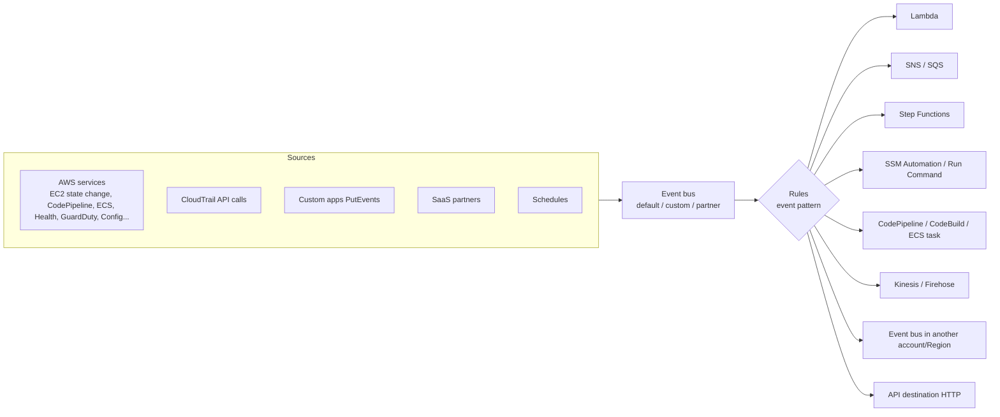
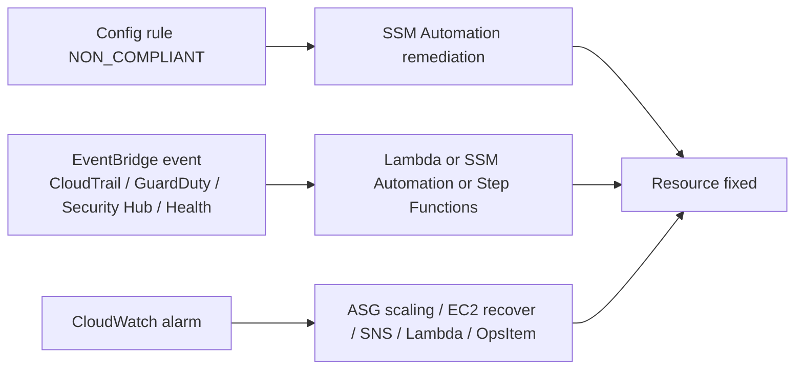

[← 4. Domain 4: Monitoring and Logging (15%)](04-monitoring-logging.md) | [🏠 Home](README.md) | [6. Domain 6: Security and Compliance (17%) →](06-security-compliance.md)

# Chapter 5 - Domain 5: Incident and Event Response (14%)

> Event sources (EventBridge, Health, CloudTrail), event-processing services (SQS, SNS, Kinesis, Lambda, Step Functions), auto-remediation, and troubleshooting failed deployments / scaling / containers.

## 5.1 Amazon EventBridge (the centre of this domain)



| Concept | Detail |
|---|---|
| **Event buses** | **Default** (AWS service events), **custom** (your apps), **partner** (SaaS). Resource policy on bus to allow other accounts/org (`aws:PrincipalOrgID`) to `PutEvents` |
| **Rules** | Event pattern **or** schedule; up to 5 targets per rule; input transformer to reshape event for target |
| **Event pattern** | JSON matching on `source`, `detail-type`, `detail.*`. Supports prefix, suffix, anything-but, numeric, exists, IP, wildcard, `$or` |
| **Cross-account / cross-Region** | Target = event bus in another account/Region -> **central event bus** in security/ops account |
| **Retry + DLQ** | Retries up to 24 h / 185 attempts by default; configure **SQS dead-letter queue** per target for failed deliveries |
| **Archive and replay** | Store events, replay later (testing, recovery) |
| **Schema registry** | Discover event schemas, generate code bindings |
| **Pipes** | Point-to-point source (SQS, Kinesis, DynamoDB Streams, MSK...) -> filter -> enrich (Lambda/Step Functions/API) -> target |
| **Scheduler** | Cron/rate/one-time schedules at large scale, time zones, flexible windows, retries/DLQ. Preferred over scheduled rules |
| **API destinations** | HTTP endpoints with connection auth (Slack, PagerDuty, ServiceNow) |

Example pattern: EC2 instance terminated in prod
```json
{
  "source": ["aws.ec2"],
  "detail-type": ["EC2 Instance State-change Notification"],
  "detail": { "state": ["terminated"] }
}
```
Example pattern: someone made a security group change (CloudTrail API call)
```json
{
  "source": ["aws.ec2"],
  "detail-type": ["AWS API Call via CloudTrail"],
  "detail": {
    "eventSource": ["ec2.amazonaws.com"],
    "eventName": ["AuthorizeSecurityGroupIngress"]
  }
}
```

**Event examples the exam uses** (source / detail-type):
- `aws.codepipeline` "CodePipeline Pipeline Execution State Change" / "Stage" / "Action"
- `aws.codebuild` "CodeBuild Build State Change"
- `aws.codedeploy` "CodeDeploy Deployment State-change Notification"
- `aws.codecommit` "CodeCommit Repository State Change" / "CodeCommit Pull Request State Change"
- `aws.ecs` "ECS Task State Change", "ECS Service Action", "ECS Deployment State Change"
- `aws.autoscaling` "EC2 Instance Launch Successful/Unsuccessful", "EC2 Instance-launch Lifecycle Action"
- `aws.health` "AWS Health Event"
- `aws.guardduty` "GuardDuty Finding"
- `aws.securityhub` "Security Hub Findings - Imported"
- `aws.config` "Config Rules Compliance Change", "Config Configuration Item Change"
- `aws.inspector2` "Inspector2 Finding"
- `aws.ssm` "Parameter Store Change", "EC2 State Manager Association State Change"
- `aws.s3` "Object Created" (when bucket has EventBridge notifications enabled)
- `aws.cloudformation` "CloudFormation Stack Status Change"
- `aws.trustedadvisor` "Trusted Advisor Check Item Refresh Notification" (us-east-1)
- `aws.signin` "AWS Console Sign In via CloudTrail" (us-east-1 for global)

**Global services events** (IAM, STS global, CloudFront, Route 53, Organizations) are delivered to **us-east-1** -> create the rule in us-east-1.

## 5.2 AWS Health
- **AWS Health Dashboard (your account)**: events affecting **your** resources (scheduled maintenance, retirements, service issues, account notifications) - vs Service Health Dashboard (public, all customers).
- **AWS Health API** (Business/Enterprise support for full API) and **EventBridge events** (`aws.health`) - free for all.
- **Organizational view**: aggregate Health events across org (from management or delegated admin).
- Classic patterns:
  - EC2 instance **scheduled retirement / maintenance** event -> EventBridge -> Lambda/SSM Automation stops and starts instance (moves to new hardware) or notifies.
  - **Exposed access key** event (`AWS_RISK_CREDENTIALS_EXPOSED`) -> EventBridge -> Lambda/Step Functions: **delete/deactivate key**, summarise CloudTrail activity, notify security.
  - Health events -> SNS / Chatbot to Slack.
- **AWS Health Aware (AHA)** solution for multi-account alerts.

## 5.3 Event processing services - which one?

| Service | Model | Key facts |
|---|---|---|
| **SQS Standard** | Queue (pull), at-least-once, best-effort order, unlimited throughput | Visibility timeout (default 30 s, up to 12 h; set ≥ 6x Lambda timeout for Lambda triggers), retention 1 min-14 days (default 4 days), message up to **1 MiB** (since Aug 2025, was 256 KB), long polling (`WaitTimeSeconds` up to 20), delay queues (0-15 min). **DLQ** with `maxReceiveCount` redrive policy; **DLQ redrive** back to source |
| **SQS FIFO** | Exactly-once processing, strict order per **message group ID** | 300 TPS (3,000 with batching, higher with high-throughput mode), deduplication ID / content-based dedup (5-min window), name ends `.fifo` |
| **SNS** | Pub/sub push, fan-out | Subscribers: SQS, Lambda, HTTP/S, email, SMS, mobile, Firehose. **Message filtering** (subscription filter policy on attributes or body). FIFO topics -> FIFO queues. DLQ per subscription. **Fan-out = SNS -> multiple SQS** |
| **EventBridge** | Event router with rules | Content-based routing to 20+ target types, SaaS, cross-account; lower throughput than SNS but richer filtering |
| **Kinesis Data Streams** | Ordered stream (shards), replay, multiple consumers | Retention 24 h default up to 365 days; per shard 1 MB/s or 1,000 records/s in, 2 MB/s out; **enhanced fan-out** (dedicated 2 MB/s per consumer); partition key -> shard ordering; on-demand mode |
| **Data Firehose** | Managed delivery (no consumers to write) | Buffer by size/time, transform with Lambda, convert to Parquet/ORC, destinations S3/Redshift/OpenSearch/Splunk/HTTP. Near real-time (not real-time) |
| **Lambda** | Compute triggered by events | Sync (API GW), async (S3, SNS, EventBridge - 2 retries, **on-failure destination** or DLQ), poll-based **event source mapping** (SQS, Kinesis, DynamoDB Streams, MSK: batch size, batching window, **bisect batch on error**, **maximum retry attempts**, **maximum record age**, on-failure destination, **partial batch response** `ReportBatchItemFailures`) |
| **Step Functions** | Orchestration | Retries/Catch, parallel, human approval, long-running |

**Patterns (exam names them):**
- **Fan-out**: SNS topic -> many SQS queues / Lambdas (or EventBridge rule with multiple targets).
- **Queuing / buffering / load levelling**: producer -> SQS -> consumers scale on depth.
- **Event streaming**: Kinesis with multiple consumer apps reading same stream, ordered per key, replay.
- **Choreography** (services react to events via EventBridge) vs **orchestration** (Step Functions controls the flow).
- **Poison message handling**: DLQ + alarm on `ApproximateNumberOfMessagesVisible` of DLQ.

**Lambda failure handling cheat-sheet**

| Invocation type | Retries | Where failures go |
|---|---|---|
| Synchronous (API GW, SDK invoke) | None by Lambda (caller retries) | Caller gets error |
| Asynchronous (S3, SNS, EventBridge, CloudWatch Logs) | 2 retries (configurable 0-2), event age up to 6 h | **On-failure destination** (SQS/SNS/Lambda/EventBridge/S3) or DLQ (SQS/SNS) |
| SQS event source | Message reappears after visibility timeout until `maxReceiveCount` | Queue's **redrive DLQ** (configure on the SQS queue) |
| Kinesis / DynamoDB Streams | Retries until success or record expires (blocks shard!) | Set max retry attempts / max record age / bisect batch + **on-failure destination** |

## 5.4 Configuration changes in response to events (Task 5.2)



Common automated remediations:

| Event | Remediation |
|---|---|
| S3 bucket made public | Config rule `s3-bucket-public-read-prohibited` -> `AWS-ConfigureS3BucketPublicAccessBlock`; or account-level S3 Block Public Access + SCP to prevent |
| Security group opened 0.0.0.0/0 on port 22 | Config `restricted-ssh` -> `AWS-DisablePublicAccessForSecurityGroup`; or EventBridge on `AuthorizeSecurityGroupIngress` -> Lambda revokes |
| Unencrypted EBS volume | Config `encrypted-volumes` -> notify (can't encrypt in place: snapshot -> copy encrypted -> new volume). Prevent: **EBS encryption by default** per Region |
| GuardDuty finding: EC2 crypto mining / C2 traffic | EventBridge -> Lambda/SSM: isolate instance (swap SG to quarantine SG with no rules), snapshot EBS for forensics, tag, notify |
| GuardDuty: IAM credentials used from unusual IP | EventBridge -> Lambda: deactivate key / attach deny-all policy / revoke role sessions (`AWSRevokeOlderSessions` inline policy with `aws:TokenIssueTime`) |
| IAM access key exposed (Health event) | Lambda deletes key, notifies |
| Instance failing status checks | CloudWatch alarm recover/reboot action |
| Disk almost full | Alarm -> SSM Automation runbook to clean logs / expand EBS volume |
| Config drift on instances | State Manager association re-applies desired state |
| ASG launch failures | EventBridge "EC2 Instance Launch Unsuccessful" -> SNS + investigate |
| Unapproved AMI used | Config `approved-amis-by-id/tag` -> stop instance via automation |
| Parameter changed | EventBridge "Parameter Store Change" -> trigger redeploy / restart service |

**Fleet management in response to events:** SSM Run Command / Automation targeted by tags; ASG instance refresh; ECS force new deployment; State Manager on schedule.

## 5.5 Troubleshooting (Task 5.3) - systematic approach

**Root cause analysis tools**
- **CloudWatch** metrics/alarms/dashboards, **Logs Insights**, **X-Ray** service map (find the slow/failing hop), **CloudTrail** (who changed what), **AWS Config** timeline (what config changed), **Health Dashboard** (is it AWS?), **SSM OpsCenter** (OpsItems with related resources and runbooks), **DevOps Guru** (ML-detected operational anomalies with recommendations), **CloudWatch Investigations** (AI-assisted).

### Failed deployments: where to look

| Service | Look at | Typical causes |
|---|---|---|
| **CodePipeline** | Execution history, failed action details link, EventBridge failure events | Missing IAM permissions for the pipeline role, artifact/KMS cross-account issues, source connection pending, action timeout (Lambda didn't call PutJobResult) |
| **CodeBuild** | Build logs (CloudWatch/S3), phase details (which phase failed, exit code) | Non-zero exit in commands, missing privileged mode, no internet in VPC, missing secrets permissions, wrong runtime version, buildspec YAML errors, artifacts path not found |
| **CodeDeploy** | Deployment events per instance and lifecycle event, agent logs on instance | Agent not running, IAM instance profile, hook script failing/timeouts, ApplicationStop of old revision, health check, too many failed instances, ALB health check failing, ECS task can't start |
| **CloudFormation** | Stack **Events** tab - the **first** `*_FAILED` event (the root cause; later ones are cascading "Resource creation cancelled"), "Detect root cause" feature | Permissions (use service role), limits/quotas, name conflicts (custom names), dependency ordering (`DependsOn`), wait condition/signal timeouts, invalid property values, resource already exists |
| **Elastic Beanstalk** | Environment events, health (enhanced health), request logs / bundle logs (`eb logs`) | `.ebextensions` command failures, health check URL wrong, instance profile missing, immutable deploy timeout |
| **CloudWatch Synthetics** | Canary runs, screenshots, HAR, logs | Endpoint broken after deployment, UI change |

### Failed processes: Auto Scaling, ECS, EKS

| Symptom | Likely cause / fix |
|---|---|
| ASG keeps launching and terminating instances (churn) | Instances fail **ELB health check** before app ready -> increase **health check grace period**; wrong health check path; app crashes on boot (user data) |
| ASG doesn't launch instances | Check **activity history**: insufficient capacity in AZ (add instance types/AZs), invalid/deleted AMI, launch template SG/subnet invalid, instance profile issue, service quota (vCPU limit), KMS key for encrypted EBS not usable by `AWSServiceRoleForAutoScaling` |
| ASG doesn't scale out on load | Alarm not triggering (wrong metric/dimension), max capacity reached, cooldown, scaling processes suspended |
| ASG scaling lag | Use target tracking, detailed monitoring, warm pools, predictive scaling |
| ECS task stuck PENDING / not placed | Not enough CPU/memory/ports on container instances (use capacity provider managed scaling), placement constraints, ENI limits (awsvpc) |
| ECS task STOPPED immediately | Check **stopped reason**: `CannotPullContainerError` (no route to ECR - NAT/VPC endpoints `ecr.api`, `ecr.dkr`, S3 gateway; execution role lacks ECR permissions), `ResourceInitializationError` (can't fetch secrets/logs - execution role or network), essential container exited (app error - check logs), OutOfMemory (raise memory) |
| ECS service unhealthy targets | Container health check / ALB health check path, security group between ALB and tasks, `healthCheckGracePeriodSeconds` |
| ECS deployment never completes | Circuit breaker (enable rollback), min healthy percent prevents replacement |
| EKS pods Pending | No nodes / resources -> Cluster Autoscaler/Karpenter; node selector/taints mismatch |
| EKS pods CrashLoopBackOff / ImagePullBackOff | App error (logs) / image or ECR permission (node role or IRSA) |
| EKS nodes NotReady / not joining | Node IAM role missing from **access entries / aws-auth**, CNI IP exhaustion (prefix delegation / larger subnets), security groups |
| `kubectl` Unauthorized for a pipeline role | Add an EKS **access entry** (or aws-auth mapping) for the CodeBuild role |
| Lambda throttling (429) | Concurrency limit reached -> reserved/provisioned concurrency, request quota increase, SQS buffer |
| Lambda timeout | Increase timeout/memory, check VPC NAT for internet calls, downstream latency (X-Ray) |
| API Gateway 502 | Lambda integration returned wrong format / errors; 504 = integration timeout (29 s default for REST) |
| ALB 502/503/504 | 502 = bad response from target, 503 = no registered targets in the target group (if all registered targets are unhealthy, ALB fails open and still sends traffic), 504 = target timeout |

## 5.6 Incident response process (operational)
1. **Detect** (alarms, GuardDuty, Health, synthetic canaries).
2. **Notify / engage** (SNS, Chatbot, Incident Manager response plans and on-call escalation, OpsItems).
3. **Triage / diagnose** (dashboards, Logs Insights, X-Ray, CloudTrail, Config).
4. **Mitigate** (rollback deployment, failover, scale, isolate).
5. **Recover and post-incident analysis** (runbooks as SSM documents, lessons learned, automate the fix next time).

## 5.7 Domain 5 scenario quick-map

| Scenario | Answer |
|---|---|
| Notify team when pipeline fails | EventBridge rule on CodePipeline execution state FAILED -> SNS (or CodeStar Notifications -> Chatbot) |
| Act on EC2 scheduled maintenance automatically | AWS Health event -> EventBridge -> SSM Automation / Lambda |
| Exposed IAM key detected | Health `AWS_RISK_CREDENTIALS_EXPOSED` -> EventBridge -> Lambda/Step Functions deletes key |
| Central security event processing for all accounts | EventBridge rules forward to central event bus in security account (bus policy with `aws:PrincipalOrgID`) |
| IAM/CloudFront API event rule not firing | Create rule in **us-east-1** (global service events) and have a trail |
| Same event processed by 3 independent systems | SNS fan-out to 3 SQS queues (or EventBridge 3 targets) |
| Ordered processing per customer | SQS FIFO with message group ID = customer ID (or Kinesis partition key) |
| Messages failing repeatedly block processing | DLQ with maxReceiveCount + alarm |
| Kinesis Lambda consumer stuck on bad record | Bisect batch, max retry attempts, on-failure destination |
| Run job every night | EventBridge Scheduler -> Lambda / ECS task / Step Functions |
| Isolate compromised EC2 | EventBridge on GuardDuty finding -> Lambda swaps SG to isolation SG + snapshot |
| Central place for ops issues with runbooks | SSM OpsCenter (OpsItems) |
| CloudFormation failed - find cause | First FAILED event in stack events |
| ECS task CannotPullContainerError in private subnet | VPC endpoints for ECR (api + dkr) + S3 gateway, or NAT; execution role ECR permissions |
| ASG instances terminated before app starts | Health check grace period / lifecycle hook |
| ML detection of operational anomalies | Amazon DevOps Guru |

---

[← 4. Domain 4: Monitoring and Logging (15%)](04-monitoring-logging.md) | [🏠 Home](README.md) | [6. Domain 6: Security and Compliance (17%) →](06-security-compliance.md)
