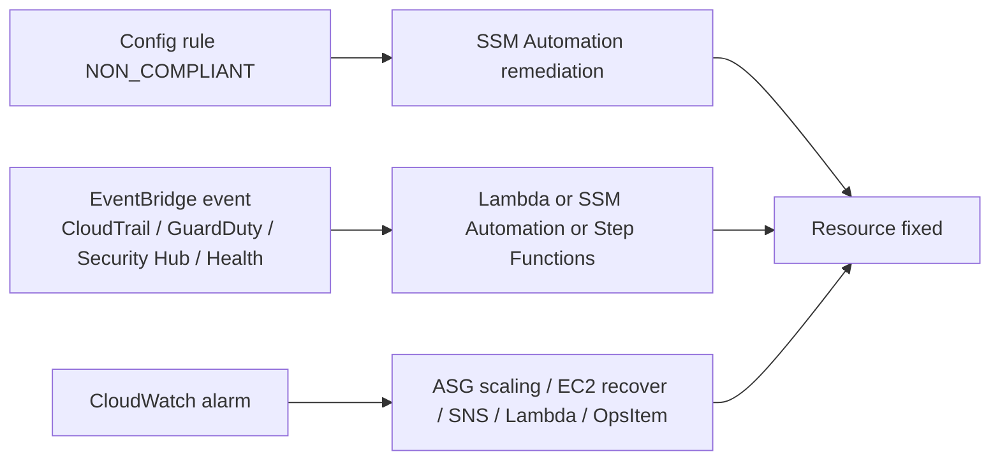

[← 4. Domain 4: Monitoring and Logging (15%)](04-monitoring-logging.md) | [🏠 Home](README.md) | [Services](services/README.md) | [Labs](labs/README.md) | [6. Domain 6: Security and Compliance (17%) →](06-security-compliance.md)

# Chapter 5 - Domain 5: Incident and Event Response (14%)

> Event sources (EventBridge, Health, CloudTrail), event-processing services (SQS, SNS, Kinesis, Lambda, Step Functions), auto-remediation, and troubleshooting failed deployments / scaling / containers.

## Services to study for this domain

Read these service files first, then the sections below.

- [AWS CodeBuild](services/codebuild.md)
- [AWS CodePipeline](services/codepipeline.md)
- [AWS CodeDeploy](services/codedeploy.md)
- [Amazon ECS, EKS and Fargate](services/ecs-eks.md)
- [AWS Lambda deployments](services/lambda.md)
- [AWS Step Functions and Lambda automation](services/step-functions.md)
- [Amazon EC2 Auto Scaling](services/ec2-auto-scaling.md)
- [AWS CloudFormation](services/cloudformation.md)
- [AWS Systems Manager](services/systems-manager.md)
- [AWS Config](services/config.md)
- [Amazon S3 (events, integrity, protection)](services/s3.md)
- [Amazon CloudWatch (metrics, alarms, logs, agent, synthetics)](services/cloudwatch.md)
- [Amazon EventBridge](services/eventbridge.md)
- [AWS Health](services/health.md)
- [SQS, SNS, Kinesis, Firehose and Lambda event handling](services/sqs-sns-kinesis.md)

## 5.1 Configuration changes in response to events (Task 5.2)

Common automated remediations:

| Event | Remediation |
|---|---|
| S3 bucket made public | Config rule `s3-bucket-public-read-prohibited` -> `AWS-ConfigureS3BucketPublicAccessBlock`; or account-level S3 Block Public Access + SCP to prevent |
| Security group opened 0.0.0.0/0 on port 22 | Config `restricted-ssh` -> `AWS-DisablePublicAccessForSecurityGroup`; or EventBridge on `AuthorizeSecurityGroupIngress` -> Lambda revokes |
| Unencrypted EBS volume | Config `encrypted-volumes` -> notify (can't encrypt in place: snapshot -> copy encrypted -> new volume). Prevent: **EBS encryption by default** per Region |
| GuardDuty finding: EC2 crypto mining / C2 traffic | EventBridge -> Lambda/SSM: isolate instance (swap SG to quarantine SG with no rules), snapshot EBS for forensics, tag, notify |
| GuardDuty: IAM credentials used from unusual IP | EventBridge -> Lambda: deactivate key / attach deny-all policy / revoke role sessions (`AWSRevokeOlderSessions` inline policy with `aws:TokenIssueTime`) |
| IAM access key exposed (Health event) | Lambda deletes key, notifies |
| Instance failing status checks | CloudWatch alarm recover/reboot action |
| Disk almost full | Alarm -> SSM Automation runbook to clean logs / expand EBS volume |
| Config drift on instances | State Manager association re-applies desired state |
| ASG launch failures | EventBridge "EC2 Instance Launch Unsuccessful" -> SNS + investigate |
| Unapproved AMI used | Config `approved-amis-by-id/tag` -> stop instance via automation |
| Parameter changed | EventBridge "Parameter Store Change" -> trigger redeploy / restart service |

**Fleet management in response to events:** SSM Run Command / Automation targeted by tags; ASG instance refresh; ECS force new deployment; State Manager on schedule.

## 5.2 Troubleshooting (Task 5.3) - systematic approach

**Root cause analysis tools**
- **CloudWatch** metrics/alarms/dashboards, **Logs Insights**, **X-Ray** service map (find the slow/failing hop), **CloudTrail** (who changed what), **AWS Config** timeline (what config changed), **Health Dashboard** (is it AWS?), **SSM OpsCenter** (OpsItems with related resources and runbooks).

### Failed deployments: where to look

| Service | Look at | Typical causes |
|---|---|---|
| **CodePipeline** | Execution history, failed action details link, EventBridge failure events | Missing IAM permissions for the pipeline role, artifact/KMS cross-account issues, source connection pending, action timeout (Lambda didn't call PutJobResult) |
| **CodeBuild** | Build logs (CloudWatch/S3), phase details (which phase failed, exit code) | Non-zero exit in commands, missing privileged mode, no internet in VPC, missing secrets permissions, wrong runtime version, buildspec YAML errors, artifacts path not found |
| **CodeDeploy** | Deployment events per instance and lifecycle event, agent logs on instance | Agent not running, IAM instance profile, hook script failing/timeouts, ApplicationStop of old revision, health check, too many failed instances, ALB health check failing, ECS task can't start |
| **CloudFormation** | Stack **Events** tab - the **first** `*_FAILED` event (the root cause; later ones are cascading "Resource creation cancelled"), "Detect root cause" feature | Permissions (use service role), limits/quotas, name conflicts (custom names), dependency ordering (`DependsOn`), wait condition/signal timeouts, invalid property values, resource already exists |
| **Elastic Beanstalk** | Environment events, health (enhanced health), request logs / bundle logs (`eb logs`) | `.ebextensions` command failures, health check URL wrong, instance profile missing, immutable deploy timeout |
| **CloudWatch Synthetics** | Canary runs, screenshots, HAR, logs | Endpoint broken after deployment, UI change |

### Failed processes: Auto Scaling, ECS, EKS

| Symptom | Likely cause / fix |
|---|---|
| ASG keeps launching and terminating instances (churn) | Instances fail **ELB health check** before app ready -> increase **health check grace period**; wrong health check path; app crashes on boot (user data) |
| ASG doesn't launch instances | Check **activity history**: insufficient capacity in AZ (add instance types/AZs), invalid/deleted AMI, launch template SG/subnet invalid, instance profile issue, service quota (vCPU limit), KMS key for encrypted EBS not usable by `AWSServiceRoleForAutoScaling` |
| ASG doesn't scale out on load | Alarm not triggering (wrong metric/dimension), max capacity reached, cooldown, scaling processes suspended |
| ASG scaling lag | Use target tracking, detailed monitoring, warm pools, predictive scaling |
| ECS task stuck PENDING / not placed | Not enough CPU/memory/ports on container instances (use capacity provider managed scaling), placement constraints, ENI limits (awsvpc) |
| ECS task STOPPED immediately | Check **stopped reason**: `CannotPullContainerError` (no route to ECR - NAT/VPC endpoints `ecr.api`, `ecr.dkr`, S3 gateway; execution role lacks ECR permissions), `ResourceInitializationError` (can't fetch secrets/logs - execution role or network), essential container exited (app error - check logs), OutOfMemory (raise memory) |
| ECS service unhealthy targets | Container health check / ALB health check path, security group between ALB and tasks, `healthCheckGracePeriodSeconds` |
| ECS deployment never completes | Circuit breaker (enable rollback), min healthy percent prevents replacement |
| EKS pods Pending | No nodes / resources -> Cluster Autoscaler/Karpenter; node selector/taints mismatch |
| EKS pods CrashLoopBackOff / ImagePullBackOff | App error (logs) / image or ECR permission (node role or IRSA) |
| EKS nodes NotReady / not joining | Node IAM role missing from **access entries / aws-auth**, CNI IP exhaustion (prefix delegation / larger subnets), security groups |
| `kubectl` Unauthorized for a pipeline role | Add an EKS **access entry** (or aws-auth mapping) for the CodeBuild role |
| Lambda throttling (429) | Concurrency limit reached -> reserved/provisioned concurrency, request quota increase, SQS buffer |
| Lambda timeout | Increase timeout/memory, check VPC NAT for internet calls, downstream latency (X-Ray) |
| API Gateway 502 | Lambda integration returned wrong format / errors; 504 = integration timeout (29 s default for REST) |
| ALB 502/503/504 | 502 = bad response from target, 503 = no registered targets in the target group (if all registered targets are unhealthy, ALB fails open and still sends traffic), 504 = target timeout |

## 5.3 Incident response process (operational)
1. **Detect** (alarms, GuardDuty, Health, synthetic canaries).
2. **Notify / engage** (SNS, Chatbot, Incident Manager response plans and on-call escalation, OpsItems).
3. **Triage / diagnose** (dashboards, Logs Insights, X-Ray, CloudTrail, Config).
4. **Mitigate** (rollback deployment, failover, scale, isolate).
5. **Recover and post-incident analysis** (runbooks as SSM documents, lessons learned, automate the fix next time).

## 5.4 Domain 5 scenario quick-map

| Scenario | Answer |
|---|---|
| Notify team when pipeline fails | EventBridge rule on CodePipeline execution state FAILED -> SNS (or CodeStar Notifications -> Chatbot) |
| Act on EC2 scheduled maintenance automatically | AWS Health event -> EventBridge -> SSM Automation / Lambda |
| Exposed IAM key detected | Health `AWS_RISK_CREDENTIALS_EXPOSED` -> EventBridge -> Lambda/Step Functions deletes key |
| Central security event processing for all accounts | EventBridge rules forward to central event bus in security account (bus policy with `aws:PrincipalOrgID`) |
| IAM/CloudFront API event rule not firing | Create rule in **us-east-1** (global service events) and have a trail |
| Same event processed by 3 independent systems | SNS fan-out to 3 SQS queues (or EventBridge 3 targets) |
| Ordered processing per customer | SQS FIFO with message group ID = customer ID (or Kinesis partition key) |
| Messages failing repeatedly block processing | DLQ with maxReceiveCount + alarm |
| Kinesis Lambda consumer stuck on bad record | Bisect batch, max retry attempts, on-failure destination |
| Run job every night | EventBridge Scheduler -> Lambda / ECS task / Step Functions |
| Isolate compromised EC2 | EventBridge on GuardDuty finding -> Lambda swaps SG to isolation SG + snapshot |
| Central place for ops issues with runbooks | SSM OpsCenter (OpsItems) |
| CloudFormation failed - find cause | First FAILED event in stack events |
| ECS task CannotPullContainerError in private subnet | VPC endpoints for ECR (api + dkr) + S3 gateway, or NAT; execution role ECR permissions |
| ASG instances terminated before app starts | Health check grace period / lifecycle hook |

---

[← 4. Domain 4: Monitoring and Logging (15%)](04-monitoring-logging.md) | [🏠 Home](README.md) | [Services](services/README.md) | [Labs](labs/README.md) | [6. Domain 6: Security and Compliance (17%) →](06-security-compliance.md)
