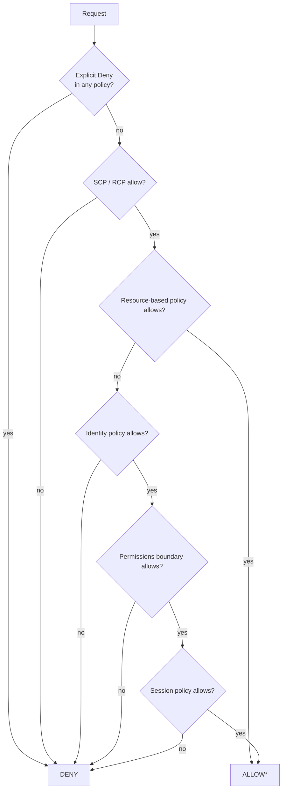

[← 5. Domain 5: Incident and Event Response (14%)](05-incident-event-response.md) | [🏠 Home](README.md) | [7. "Which one?" comparisons + numbers →](07-service-comparisons-numbers.md)

# Chapter 6 - Domain 6: Security and Compliance (17%)

> IAM at scale (policy evaluation, roles, federation, permission boundaries, SCPs, ABAC), secrets rotation, KMS/encryption, network security, and the detection services (GuardDuty, Inspector, Macie, Security Hub, Detective, Access Analyzer, Config).

## 6.1 IAM entities: who uses what

| Entity | Use for | Exam rule |
|---|---|---|
| **IAM user** | Legacy humans or third-party systems that can't use roles | Avoid; no long-term keys for humans. If used: MFA, rotate keys |
| **IAM group** | Attach policies to many users | Groups can't be principals in resource policies; no nesting |
| **IAM role** | **Machines** (EC2 instance profile, Lambda execution role, ECS task role, CodeBuild service role), **cross-account access**, **federated humans** | Temporary credentials from STS. Always preferred |
| **Identity provider** | SAML 2.0 or OIDC federation into IAM roles | OIDC for **GitHub Actions/GitLab CI to AWS without keys**, EKS IRSA |
| **IAM Identity Center** | Workforce SSO to many accounts with **permission sets**; identity source = built-in, AD (via Directory Service/AD Connector), or external IdP (Okta, Entra ID) with SCIM | **Default answer for human access to multiple accounts** |
| **Service-linked role** | Predefined role owned by an AWS service | Not restricted by SCPs |
| **Cognito** | App end-users (user pools = sign-up/sign-in; identity pools = temp AWS creds for app users) | Customer-facing apps, not workforce |

### Policy types

| Policy | Attached to | Grants? | Notes |
|---|---|---|---|
| **Identity-based** (managed / inline) | User, group, role | Yes | AWS managed vs customer managed vs inline |
| **Resource-based** | S3 bucket, KMS key, SQS, SNS, Lambda, ECR repo, Secrets Manager, role trust policy... | Yes | Has `Principal`; enables cross-account without role assumption |
| **Permissions boundary** | User or role | **No - sets max** | Delegate admin safely: devs can create roles only with the boundary attached |
| **SCP** | Org root/OU/account | No - max for account principals | Doesn't affect management account or service-linked roles |
| **RCP** | Org root/OU/account | No - max for resources | Data perimeter |
| **Session policy** | Passed in `AssumeRole`/`GetFederationToken` | No - max for that session | Narrow a session further |
| **ACLs** | S3, VPC NACL | Yes | Legacy for S3 (disable with Object Ownership = bucket owner enforced) |

### Policy evaluation logic (single account)

- Default = **implicit deny**. **Explicit deny always wins.**
- *Same account: a resource-based policy that names the principal can allow access even when the identity policy doesn't. For **KMS keys** and **IAM role trust policies**, the resource policy is always required: an identity policy alone is never enough.
- **Cross-account**: need **both** - identity policy in the caller's account **and** resource policy (or role trust) in the target account.
- **KMS**: the **key policy** is the primary control. Unless the key policy allows the account root (`arn:aws:iam::111122223333:root`) to delegate to IAM, IAM policies alone don't give access.

### Conditions you must recognise
| Condition key | Use |
|---|---|
| `aws:MultiFactorAuthPresent` / `aws:MultiFactorAuthAge` | Require MFA for sensitive actions |
| `aws:SourceIp`, `aws:SourceVpce`, `aws:SourceVpc` | Network origin restrictions (S3 bucket only via VPC endpoint) |
| `aws:PrincipalOrgID` / `aws:PrincipalOrgPaths` | Allow anyone in my organization/OU (bucket policies, KMS, EventBridge bus) |
| `aws:ResourceOrgID` | Only access resources in my org (data perimeter) |
| `aws:RequestedRegion` | Restrict Regions |
| `aws:PrincipalTag/xxx`, `aws:ResourceTag/xxx`, `aws:RequestTag/xxx`, `aws:TagKeys` | **ABAC** |
| `aws:SecureTransport` | Deny non-HTTPS (S3 bucket policy) |
| `aws:SourceArn`, `aws:SourceAccount` | **Confused deputy** protection for service principals |
| `sts:ExternalId` | Confused deputy protection for third-party cross-account roles |
| `iam:PassedToService` | Restrict `iam:PassRole` to a service |
| `aws:CalledVia` | Allow only when called through a service (e.g., CloudFormation) |
| `s3:x-amz-server-side-encryption` | Require encryption on PutObject |
| `token.actions.githubusercontent.com:sub` | Restrict GitHub OIDC role to a repo/branch |

### RBAC vs ABAC
- **RBAC**: roles/permission sets per job function (Developer, ReadOnly, Admin). Simple; grows with number of resources.
- **ABAC**: one policy using tags: allow when `aws:ResourceTag/Project` == `${aws:PrincipalTag/Project}`. Scales: new projects need no new policies. Session tags from IdP via Identity Center **attributes for access control**.
```json
{
  "Effect": "Allow",
  "Action": ["ec2:StartInstances", "ec2:StopInstances"],
  "Resource": "*",
  "Condition": {
    "StringEquals": { "aws:ResourceTag/Project": "${aws:PrincipalTag/Project}" }
  }
}
```

### Permissions boundary pattern (delegated admin)
"Developers must create IAM roles for their Lambda functions but must not escalate privileges":
1. Create boundary policy `DevBoundary` (max allowed: S3/DynamoDB/Logs on their resources).
2. Give developers `iam:CreateRole`/`iam:PutRolePolicy`/`iam:AttachRolePolicy` **only with condition** `iam:PermissionsBoundary` = `DevBoundary` ARN.
3. Deny them `iam:DeleteRolePermissionsBoundary` / editing the boundary policy.

### STS and credentials
- `AssumeRole` (cross-account, same account), `AssumeRoleWithSAML`, `AssumeRoleWithWebIdentity` (OIDC: GitHub Actions, EKS IRSA, Cognito), `GetSessionToken` (MFA for IAM users), `GetFederationToken`.
- Session duration: role max session 1-12 h (default 1 h); **role chaining** limited to 1 h.
- **Revoke** active sessions: "Revoke active sessions" on role (adds deny on `aws:TokenIssueTime` older than now).
- EC2 **instance profile** + **IMDSv2** (session-token based, protects from SSRF) - enforce with launch template `HttpTokens: required`, SCP condition `ec2:MetadataHttpTokens`, Config rule `ec2-imdsv2-check`, or declarative policy.
- **IAM Roles Anywhere**: X.509 certs for on-prem workloads to get temporary creds (no long-term keys).
- **MFA**: enforce with policy denying all except MFA setup when `aws:MultiFactorAuthPresent` is false; root user MFA (hardware/passkey); Identity Center MFA settings.
- **Credential reports** and **access advisor / last accessed** info to remove unused permissions; Access Analyzer **unused access** findings and **policy generation from CloudTrail**.

## 6.2 Secrets Manager vs Parameter Store (rotation)

| Feature | Secrets Manager | Parameter Store |
|---|---|---|
| Automatic rotation | **Yes** (managed rotation for RDS/Aurora/Redshift/DocumentDB, or Lambda rotation function; schedule up to every 4 h) | No (DIY with EventBridge + Lambda) |
| Cost | Per secret per month + API calls | Standard free; Advanced paid |
| Size | 64 KB | 4 KB standard / 8 KB advanced |
| Cross-Region replication | **Yes** (replica secrets) | No |
| Resource policy / cross-account | Yes | No (advanced params can be shared via RAM) |
| Versioning | Staging labels `AWSCURRENT`, `AWSPENDING`, `AWSPREVIOUS` | Version numbers + labels |
| Use | DB creds, API keys that must rotate | Config, AMI IDs, flags, cheap secrets |

Rotation Lambda steps: `createSecret` -> `setSecret` -> `testSecret` -> `finishSecret`. Rotation Lambda in VPC needs route to Secrets Manager endpoint and the DB. **Single-user** vs **alternating-users** rotation strategy (alternating = no downtime for high-concurrency apps).
Machine identity rotation: prefer **roles (auto-rotating temp creds)** over keys; for IAM user keys that must exist: Config `access-keys-rotated` + automation or Secrets Manager custom rotation.

## 6.3 Data protection: encryption and KMS

### AWS KMS
- **Key types**: AWS owned (invisible), **AWS managed** (`aws/s3`, `aws/ebs` - can't change policy, **can't use cross-account**, auto-rotated yearly), **customer managed keys (CMK)** - you control key policy, grants, rotation (optional automatic rotation every 90 days to 7 years, default 1 year; or on-demand), deletion (7-30 days waiting period).
- Symmetric (AES-256, default) vs asymmetric (RSA/ECC sign/verify, encrypt) vs HMAC.
- **Envelope encryption**: KMS generates a data key (`GenerateDataKey`), data encrypted locally with plaintext data key, encrypted data key stored with data. Direct `Encrypt` limited to 4 KB.
- **Key policy + grants**; `kms:ViaService` condition (key usable only via S3/EBS in a Region); `kms:CallerAccount`.
- **Multi-Region keys**: replicas with same key material and ID in other Regions -> decrypt in DR Region without cross-Region calls.
- **Imported key material (BYOK)**, **custom key store** backed by **CloudHSM** (you control HSMs) or **external key store (XKS)**.
- KMS quota throttling (`ThrottlingException`) at high request rate -> S3 **Bucket Keys**, data key caching.
- Sharing encrypted resources cross-account (AMI, EBS snapshot, RDS snapshot, S3 objects): **must use a CMK** and grant the other account in the key policy; AWS managed keys can't be shared -> re-encrypt copy with a CMK.

### AWS CloudHSM
- Dedicated **single-tenant FIPS 140-3 Level 3** HSMs in your VPC; **you** manage keys and users (AWS can't access). Cluster across AZs for HA.
- Pick when: "regulatory requirement for single-tenant HSM / full control of keys / SSL offload / Oracle TDE / PKCS#11, JCE, CNG".

### Encryption by service (at rest)
| Service | How |
|---|---|
| S3 | **SSE-S3 default for all new objects**; SSE-KMS (audit via CloudTrail, key policy control); DSSE-KMS; SSE-C (customer-provided); client-side. Default bucket encryption; deny unencrypted uploads in bucket policy |
| EBS | **Encryption by default** per Region setting; snapshots of encrypted volumes are encrypted; can't encrypt existing volume in place (snapshot -> copy with encryption) |
| RDS / Aurora | Enable at creation; **can't encrypt existing unencrypted DB** -> snapshot -> copy encrypted -> restore. Read replicas same encryption |
| DynamoDB | Always encrypted (AWS owned, AWS managed or CMK) |
| EFS | At creation; in transit with TLS mount helper |
| CloudWatch Logs, SNS, SQS, Kinesis, Secrets Manager, Parameter SecureString | KMS |

### In transit and PKI: AWS Certificate Manager (ACM)
- **Public certs free**, auto-renew (DNS validation renews automatically; email validation needs action). Deploy on **ELB, CloudFront (cert must be in us-east-1), API Gateway**, App Runner. You can't export public ACM private keys to EC2 (except exportable public certs feature, paid) -> for EC2 use ACM-integrated LB, or Nitro Enclaves.
- **Imported certificates** don't auto-renew -> monitor with **`DaysToExpiry`** metric / Config rule `acm-certificate-expiration-check` / EventBridge "ACM Certificate Approaching Expiration" events (45 days before by default).
- **AWS Private CA**: private PKI for internal TLS, mTLS, IoT; issues private certs usable in ACM.
- Enforce TLS: ALB HTTPS listener + redirect HTTP->HTTPS, security policies (TLS 1.2+), S3 `aws:SecureTransport`, RDS `rds.force_ssl`, CloudFront viewer protocol policy "Redirect HTTP to HTTPS".

### Data classification: Amazon Macie
- Discovers and classifies **sensitive data in S3** (PII, financial, credentials) with managed + custom data identifiers; **automated sensitive data discovery** samples all buckets continuously; also bucket-level security posture (public, unencrypted, shared).
- Multi-account via delegated admin. Findings -> EventBridge/Security Hub -> remediation (e.g., move object, tag, alert).

## 6.4 Network security components

| Layer | Control | Key facts |
|---|---|---|
| Instance / ENI | **Security group** | **Stateful**, allow rules only, reference other SGs. Default: deny inbound, allow outbound |
| Subnet | **Network ACL** | **Stateless** (allow return traffic, ephemeral ports 1024-65535), allow + **deny** rules, numbered order. Use to **block a specific IP** |
| Routing | Route tables | Private subnet -> NAT; isolate with no IGW route |
| VPC perimeter | **AWS Network Firewall** | Managed stateful/stateless firewall, Suricata rules, **domain filtering** (allow only `*.amazonaws.com`), IPS. Centralised inspection with Transit Gateway. **Firewall Manager** to deploy across accounts |
| Edge L7 | **AWS WAF** | On CloudFront, ALB, API Gateway, AppSync, Cognito, App Runner, Verified Access. Web ACL rules: managed rule groups (Core rule set, SQLi, known bad inputs, IP reputation, Bot Control), rate-based rules, geo match, IP sets. Logs to S3/CW/Firehose |
| DDoS | **AWS Shield** | **Standard** free (L3/L4) on all; **Advanced** paid: 24x7 Shield Response Team, cost protection, L7 with WAF, advanced metrics, proactive engagement |
| Org-wide | **AWS Firewall Manager** | Centrally enforce WAF rules, Shield Advanced, SGs, Network Firewall, Route 53 Resolver DNS Firewall policies across accounts (needs Organizations + Config) |
| DNS | **Route 53 Resolver DNS Firewall** | Block queries to malicious domains |
| Private access | **VPC endpoints**: gateway (S3, DynamoDB, free) and **interface (PrivateLink)** | Keep traffic off internet; **endpoint policies** restrict which buckets/actions; bucket policy `aws:SourceVpce` |
| Sharing | **AWS RAM** | Share subnets (VPC sharing), Transit Gateway, Resolver rules, Prefix lists, License Manager configs, Private CA... with accounts/OUs |
| Remote access | Client VPN, Site-to-Site VPN, **Verified Access** | |

**Defense in depth example (exam style):** CloudFront + **WAF** + **Shield** -> ALB with **ACM** cert in public subnets (SG allows 443 from CloudFront prefix list) -> app in private subnets (SG from ALB SG only) -> RDS in isolated subnets (SG from app SG, encryption KMS) -> **GuardDuty** + **Config rules** + **Security Hub** + **Inspector** + **Detective** monitoring, **NACLs** to block bad IPs, **Network Firewall** for egress filtering.

## 6.5 Security monitoring and detection services

| Service | What it does | Data sources / scope | Typical exam use |
|---|---|---|---|
| **Amazon GuardDuty** | **Threat detection** with ML/threat intel | CloudTrail management events, VPC Flow Logs, DNS logs (no need to enable these yourself), plus protection plans: S3 data events, EKS audit logs + runtime, ECS/EC2 runtime, RDS login activity, Lambda network, **Malware Protection** (EBS scan, S3 uploads) | "Detect compromised instances, crypto mining, unusual API calls, credential exfiltration". Findings -> EventBridge -> auto response. Org-wide with delegated admin, auto-enable new accounts. Trusted IP lists / threat lists, suppression rules |
| **Amazon Inspector** | **Vulnerability scanning** (CVEs + network reachability) | EC2 (via SSM Agent, or agentless EBS snapshot scanning), **ECR images** (enhanced scanning, on push + continuous), **Lambda** functions and code, CIS benchmark assessments | "Continuously scan for software vulnerabilities". Inspector score, findings to Security Hub/EventBridge. Classic Inspector had "assessment templates" (exam guide wording) - v2 is automatic |
| **Amazon Macie** | Sensitive data discovery in S3 | S3 | "Find PII in S3 buckets at scale" |
| **AWS Security Hub (CSPM)** | **Aggregates findings** (ASFF/OCSF) from GuardDuty, Inspector, Macie, Config, Access Analyzer, Firewall Manager, partners; runs **security standards** checks (AWS Foundational Security Best Practices, CIS, PCI DSS, NIST 800-53) via Config | Multi-account (delegated admin, central configuration), **cross-Region aggregation** | "Single pane of glass / security score / compliance standards across accounts". **Automation rules** (update/suppress findings), **custom actions** -> EventBridge -> remediation |
| **Amazon Detective** | **Investigate** root cause: graph of entities from CloudTrail, VPC Flow Logs, GuardDuty, EKS audit logs | Multi-account | "Analyse/visualise the security finding's root cause, who did what" (after GuardDuty finds) |
| **IAM Access Analyzer** | **External access** findings (resources shared outside zone of trust: S3, KMS, IAM roles, Lambda, SQS, Secrets Manager...), **unused access** findings, **policy validation** (lint + custom policy checks in CI: `check-no-new-access`, `check-access-not-granted`), **policy generation** from CloudTrail | Account or organization zone of trust | "Find resources shared with external accounts", "validate IAM policies in pipeline", "generate least-privilege policy from activity" |
| **AWS Config** | Configuration compliance (Chapter 2) | All supported resources | "Detect non-compliant configuration" |
| **AWS Trusted Advisor** | Best-practice checks: cost, performance, **security** (open SGs, MFA on root, exposed keys, S3 permissions), fault tolerance, service limits | Full checks with Business+ support; org view | "Check service quotas / basic security checks"; events in EventBridge (us-east-1) |
| **AWS Audit Manager** | Collect evidence continuously for audits (frameworks: SOC 2, PCI, HIPAA, GDPR) | | "Prepare audit-ready evidence reports" |
| **AWS Artifact** | Download AWS compliance reports (SOC, ISO) and agreements (BAA) | | "Auditor needs AWS's SOC report" |
| **CloudTrail / VPC Flow Logs / drift detection** | Auditing (Chapter 4) | | |

**Detect vs investigate vs aggregate vs remediate (don't mix them up):**
- GuardDuty = **detect threats**. Inspector = **find vulnerabilities**. Macie = **find sensitive data**. Config = **detect misconfiguration**. Access Analyzer = **find external/unused access**.
- Security Hub = **aggregate + score + standards**. Detective = **investigate**. 
- EventBridge + Lambda / SSM Automation = **remediate**. SCP / CFN Hook / IAM = **prevent**.

### Common threat -> control mapping (exam guide lists these threats)

| Threat | Prevent | Detect | Respond |
|---|---|---|---|
| Insecure web traffic (HTTP) | ALB redirect to HTTPS, CloudFront viewer policy, S3 `aws:SecureTransport` deny | Config `alb-http-to-https-redirection-check`, Security Hub | Auto remediation |
| Exposed access keys | No long-term keys (roles, OIDC), git-secrets / CodeGuru Security / secret scanning in pipeline | AWS Health `AWS_RISK_CREDENTIALS_EXPOSED`, GuardDuty `UnauthorizedAccess:IAMUser/InstanceCredentialExfiltration.OutsideAWS` | EventBridge -> Lambda deactivates key, reviews CloudTrail |
| S3 bucket public | Account-level **S3 Block Public Access**, SCP denying `s3:PutBucketPublicAccessBlock` changes, Object Ownership enforced | Config `s3-bucket-public-read/write-prohibited`, Access Analyzer, Macie, Trusted Advisor | Config auto remediation |
| S3 encryption disabled | Default encryption (SSE-S3 is now automatic), bucket policy deny non-KMS uploads | Config `s3-bucket-server-side-encryption-enabled`, Security Hub | Remediation runbook |
| Open SSH/RDP to world | SCP / Firewall Manager SG policies, Session Manager instead of SSH | Config `restricted-ssh`, `restricted-common-ports`, Trusted Advisor, Security Hub | Remove rule automatically |
| Root user usage | MFA on root, no root keys, SCP limits on member root (or centralised root access, delete member root creds) | CloudTrail metric filter on `userIdentity.type = Root` -> alarm | Notify |
| Compromised instance | IMDSv2, least privilege, patching | GuardDuty | Isolate SG, snapshot, Detective |

## 6.6 Security automation at scale (multi-account, multi-Region)
- **Organizations + delegated admin** for GuardDuty, Security Hub, Inspector, Macie, Detective, Config, Access Analyzer, Firewall Manager, Backup, CloudTrail (org trail).
- **Auto-enable** for new member accounts (GuardDuty/Security Hub/Inspector/Macie org settings).
- **Security Hub central configuration**: one policy applied to OUs (standards, controls, Regions) + cross-Region aggregation into a home Region.
- **Control Tower** controls (preventive/detective/proactive) on OUs.
- **StackSets** (service-managed) to deploy security roles/config.
- **SSM Automation** multi-account/multi-Region remediation; **Quick Setup** org configs.
- **Config conformance packs (org)** + **aggregator**.
- **Firewall Manager** for WAF/SG/Network Firewall policies everywhere.
- Pipeline security: **CodeGuru Reviewer/Security** (code scanning), **Inspector** (images, Lambda), Access Analyzer policy checks, **cfn-guard/cfn-lint/cfn-nag**, secrets scanning, signed artifacts (AWS Signer for Lambda code signing).

## 6.7 Domain 6 scenario quick-map

| Scenario | Answer |
|---|---|
| Workforce access to 100 accounts with corporate IdP | IAM Identity Center + external IdP (SAML + SCIM) + permission sets |
| GitHub Actions deploy to AWS without keys | IAM OIDC provider + role with trust condition on `sub` (repo:org/repo:ref:refs/heads/main) |
| Third-party SaaS needs access to our account | Cross-account role with **ExternalId** |
| App on EC2 needs S3 access | Instance profile role (never keys) |
| Pods need AWS access | IRSA or EKS Pod Identity |
| Devs create roles safely | Permissions boundary + condition on `iam:PermissionsBoundary` |
| Scale permissions with many projects | ABAC with tags |
| Nobody (even admins) in member accounts may disable CloudTrail | SCP deny `cloudtrail:StopLogging/DeleteTrail` |
| Bucket accessible only from our org | Bucket policy with `aws:PrincipalOrgID` (or RCP for whole org) |
| Bucket only via VPC endpoint | Bucket policy deny unless `aws:SourceVpce` |
| Rotate RDS password automatically | Secrets Manager managed rotation (or RDS `ManageMasterUserPassword`) |
| Share encrypted AMI/snapshot cross-account | Re-encrypt with CMK; key policy grants target account |
| Single-tenant HSM, full key control | CloudHSM (optionally KMS custom key store) |
| Multi-Region encryption for DR | KMS multi-Region keys |
| Certificate expiring (imported) | ACM `DaysToExpiry` / EventBridge expiry event / Config rule -> SNS |
| Find PII in S3 across org | Macie with automated discovery, delegated admin |
| Detect crypto mining / malicious IPs | GuardDuty |
| CVE scan of ECR images and EC2 | Inspector |
| One dashboard of all findings + CIS/FSBP compliance | Security Hub (delegated admin + cross-Region aggregation) |
| Investigate a GuardDuty finding's root cause | Detective |
| Find resources shared outside org | IAM Access Analyzer (org zone of trust) |
| Validate IAM policies in pipeline | Access Analyzer `ValidatePolicy` / custom policy checks |
| Block SQLi / bad bots / rate limit | WAF (managed rules, rate-based rule) |
| Block one malicious IP fast at subnet | NACL deny rule (or WAF IP set if web) |
| Egress allow-list of domains | Network Firewall domain list (or DNS Firewall) |
| Same WAF rules in every account | Firewall Manager |
| Auditor needs AWS SOC 2 report | AWS Artifact |
| Continuous audit evidence collection | Audit Manager |

---

[← 5. Domain 5: Incident and Event Response (14%)](05-incident-event-response.md) | [🏠 Home](README.md) | [7. "Which one?" comparisons + numbers →](07-service-comparisons-numbers.md)
