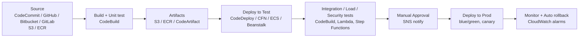
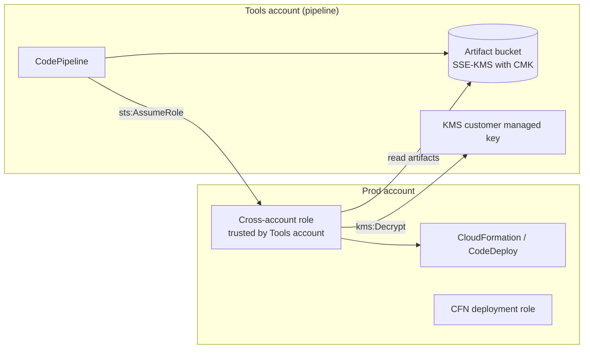
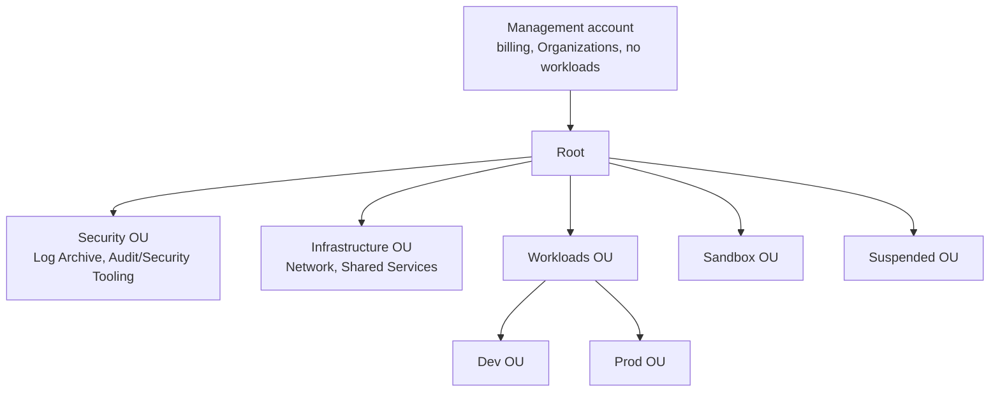
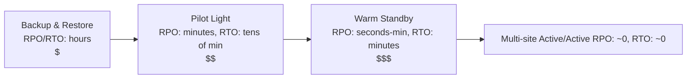
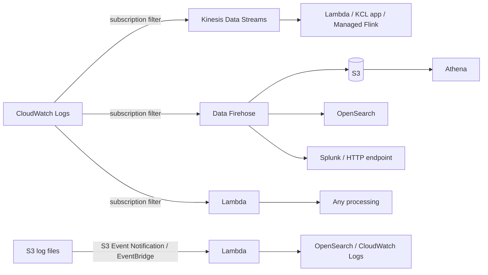
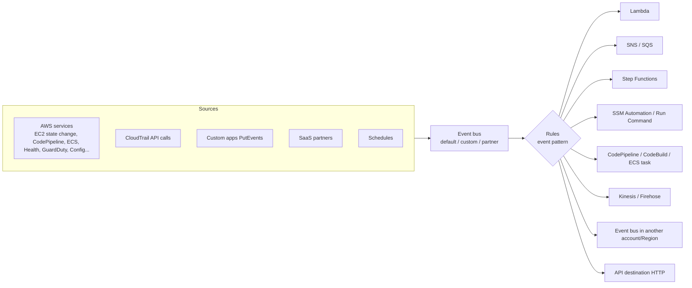
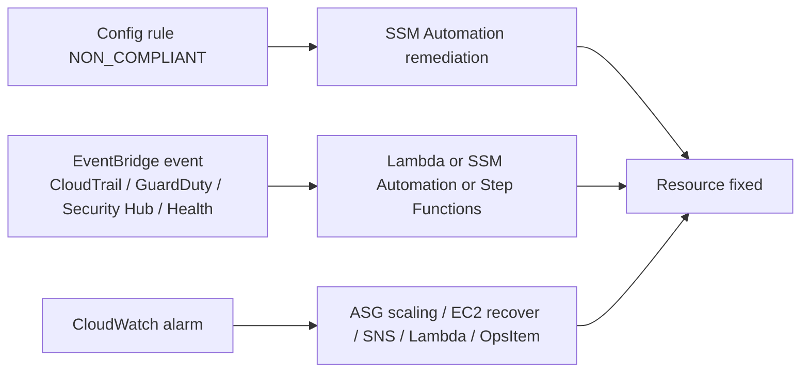
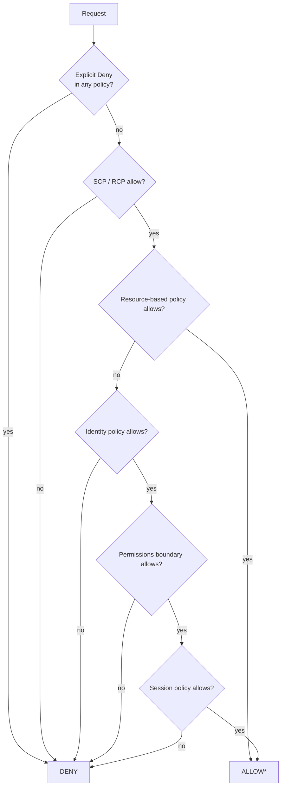

# AWS Certified DevOps Engineer - Professional (DOP-C02): Complete Study Guide

**Exam date:** Tue, Dec 29, 2026 | **Version:** v1.0 (Nov 2026) | Built from the official DOP-C02 exam guide (6 domains, all task statements, in-scope services list)

**How to use this guide**
1. Follow the **46-day plan** in Chapter 9 (one row per day).
2. Every topic follows the same layout: *what it is (simple words) -> must-know facts -> traps -> "scenario -> answer" quick-map table*.
3. Do the cheap **labs** (Chapter 9.3) in a sandbox account.
4. Self-test with the **60 practice questions** (Chapter 8), then do full mock exams from an exam bank.
5. In the last week, read only **Chapter 7** (comparisons + numbers) and **Chapter 10** (cheat sheet), plus your mistakes log.

> Facts were checked against AWS documentation as of Nov 2026. AWS changes fast; where a service changed after the exam questions were written (CodeCommit, OpsWorks, App Runner, Incident Manager, Inspector, Aurora Global DB limits, SQS size), Chapter 0.4 explains how to answer.

## Table of Contents
- [Chapter 0 - Exam Facts and Strategy](#chapter-0---exam-facts-and-strategy)
  - [0.1 Exam facts (from the official DOP-C02 exam guide)](#01-exam-facts-from-the-official-dop-c02-exam-guide)
  - [0.2 How DOP-C02 questions are written](#02-how-dop-c02-questions-are-written)
  - [0.3 Time strategy on exam day](#03-time-strategy-on-exam-day)
  - [0.4 Service status changes (2024-2026) you should know](#04-service-status-changes-2024-2026-you-should-know)
  - [0.5 Recommended extra resources (all official or widely used)](#05-recommended-extra-resources-all-official-or-widely-used)
- [Chapter 1 - Domain 1: SDLC Automation (22%)](#chapter-1---domain-1-sdlc-automation-22)
  - [1.1 The big picture](#11-the-big-picture)
  - [1.2 Source control: AWS CodeCommit (and other Git hosts)](#12-source-control-aws-codecommit-and-other-git-hosts)
  - [1.3 AWS CodeBuild](#13-aws-codebuild)
  - [1.4 Artifact repositories](#14-artifact-repositories)
  - [1.5 EC2 Image Builder (golden AMIs and container images)](#15-ec2-image-builder-golden-amis-and-container-images)
  - [1.6 AWS CodePipeline](#16-aws-codepipeline)
  - [1.7 AWS CodeDeploy (most tested Code service)](#17-aws-codedeploy-most-tested-code-service)
  - [1.8 Deployment strategies (concepts + where each lives in AWS)](#18-deployment-strategies-concepts--where-each-lives-in-aws)
  - [1.9 Secrets in build and deploy](#19-secrets-in-build-and-deploy)
  - [1.10 Domain 1 scenario quick-map](#110-domain-1-scenario-quick-map)
- [Chapter 2 - Domain 2: Configuration Management and IaC (17%)](#chapter-2---domain-2-configuration-management-and-iac-17)
  - [2.1 IaC options on AWS](#21-iac-options-on-aws)
  - [2.2 CloudFormation deep dive](#22-cloudformation-deep-dive)
  - [2.3 AWS SAM and AWS CDK](#23-aws-sam-and-aws-cdk)
  - [2.4 Configuration management services: which one?](#24-configuration-management-services-which-one)
  - [2.5 AWS Systems Manager (SSM) - complete map](#25-aws-systems-manager-ssm---complete-map)
  - [2.6 Multi-account strategy: AWS Organizations](#26-multi-account-strategy-aws-organizations)
  - [2.7 AWS Control Tower](#27-aws-control-tower)
  - [2.8 AWS Config (desired-state + compliance)](#28-aws-config-desired-state--compliance)
  - [2.9 AWS Service Catalog](#29-aws-service-catalog)
  - [2.10 Automation for complex tasks: Lambda, Step Functions, SDK/CLI](#210-automation-for-complex-tasks-lambda-step-functions-sdkcli)
  - [2.11 Domain 2 scenario quick-map](#211-domain-2-scenario-quick-map)
- [Chapter 3 - Domain 3: Resilient Cloud Solutions (15%)](#chapter-3---domain-3-resilient-cloud-solutions-15)
  - [3.1 Core vocabulary](#31-core-vocabulary)
  - [3.2 Disaster recovery strategies (memorise this table)](#32-disaster-recovery-strategies-memorise-this-table)
  - [3.3 Multi-AZ / multi-Region by service](#33-multi-az--multi-region-by-service)
  - [3.4 Scalability](#34-scalability)
  - [3.5 Backup and recovery](#35-backup-and-recovery)
  - [3.6 Domain 3 scenario quick-map](#36-domain-3-scenario-quick-map)
- [Chapter 4 - Domain 4: Monitoring and Logging (15%)](#chapter-4---domain-4-monitoring-and-logging-15)
  - [4.1 CloudWatch Metrics](#41-cloudwatch-metrics)
  - [4.2 CloudWatch Alarms](#42-cloudwatch-alarms)
  - [4.3 CloudWatch Logs](#43-cloudwatch-logs)
  - [4.4 CloudWatch agent (unified agent)](#44-cloudwatch-agent-unified-agent)
  - [4.5 Dashboards and visualisation](#45-dashboards-and-visualisation)
  - [4.6 AWS X-Ray (distributed tracing)](#46-aws-x-ray-distributed-tracing)
  - [4.7 CloudWatch Synthetics and RUM](#47-cloudwatch-synthetics-and-rum)
  - [4.8 AWS CloudTrail (API audit)](#48-aws-cloudtrail-api-audit)
  - [4.9 Other logs you must know](#49-other-logs-you-must-know)
  - [4.10 Log storage, security and lifecycle](#410-log-storage-security-and-lifecycle)
  - [4.11 Automating monitoring and event management (Task 4.3)](#411-automating-monitoring-and-event-management-task-43)
  - [4.12 Domain 4 scenario quick-map](#412-domain-4-scenario-quick-map)
- [Chapter 5 - Domain 5: Incident and Event Response (14%)](#chapter-5---domain-5-incident-and-event-response-14)
  - [5.1 Amazon EventBridge (the centre of this domain)](#51-amazon-eventbridge-the-centre-of-this-domain)
  - [5.2 AWS Health](#52-aws-health)
  - [5.3 Event processing services - which one?](#53-event-processing-services---which-one)
  - [5.4 Configuration changes in response to events (Task 5.2)](#54-configuration-changes-in-response-to-events-task-52)
  - [5.5 Troubleshooting (Task 5.3) - systematic approach](#55-troubleshooting-task-53---systematic-approach)
  - [5.6 Incident response process (operational)](#56-incident-response-process-operational)
  - [5.7 Domain 5 scenario quick-map](#57-domain-5-scenario-quick-map)
- [Chapter 6 - Domain 6: Security and Compliance (17%)](#chapter-6---domain-6-security-and-compliance-17)
  - [6.1 IAM entities: who uses what](#61-iam-entities-who-uses-what)
  - [6.2 Secrets Manager vs Parameter Store (rotation)](#62-secrets-manager-vs-parameter-store-rotation)
  - [6.3 Data protection: encryption and KMS](#63-data-protection-encryption-and-kms)
  - [6.4 Network security components](#64-network-security-components)
  - [6.5 Security monitoring and detection services](#65-security-monitoring-and-detection-services)
  - [6.6 Security automation at scale (multi-account, multi-Region)](#66-security-automation-at-scale-multi-account-multi-region)
  - [6.7 Domain 6 scenario quick-map](#67-domain-6-scenario-quick-map)
- [Chapter 7 - "Which one?" Comparisons and Numbers to Memorise](#chapter-7---which-one-comparisons-and-numbers-to-memorise)
  - [7.1 Confusing pairs](#71-confusing-pairs)
  - [7.2 Numbers to memorise](#72-numbers-to-memorise)
  - [7.3 "Least operational overhead" defaults (when in doubt)](#73-least-operational-overhead-defaults-when-in-doubt)
- [Chapter 8 - Practice Questions (exam style, with explanations)](#chapter-8---practice-questions-exam-style-with-explanations)
  - [Domain 1 - SDLC Automation](#domain-1---sdlc-automation)
  - [Domain 2 - Configuration Management and IaC](#domain-2---configuration-management-and-iac)
  - [Domain 3 - Resilient Cloud Solutions](#domain-3---resilient-cloud-solutions)
  - [Domain 4 - Monitoring and Logging](#domain-4---monitoring-and-logging)
  - [Domain 5 - Incident and Event Response](#domain-5---incident-and-event-response)
  - [Domain 6 - Security and Compliance](#domain-6---security-and-compliance)
  - [Scoring guide](#scoring-guide)
- [Chapter 9 - 46-Day Study Plan (Nov 14 - Dec 29, 2026) and Hands-on Labs](#chapter-9---46-day-study-plan-nov-14---dec-29-2026-and-hands-on-labs)
  - [9.1 How to study each chapter (method)](#91-how-to-study-each-chapter-method)
  - [9.2 Day-by-day plan](#92-day-by-day-plan)
  - [9.3 Hands-on labs (cheap, in your sandbox account)](#93-hands-on-labs-cheap-in-your-sandbox-account)
  - [9.4 Exam-day checklist](#94-exam-day-checklist)
- [Chapter 10 - Final Cheat Sheet (read on Dec 28 and the morning of Dec 29)](#chapter-10---final-cheat-sheet-read-on-dec-28-and-the-morning-of-dec-29)
  - [Keyword -> answer reflexes](#keyword---answer-reflexes)
  - [Orders to remember](#orders-to-remember)
  - [Traps to avoid](#traps-to-avoid)

---

# Chapter 0 - Exam Facts and Strategy

## 0.1 Exam facts (from the official DOP-C02 exam guide)

| Item | Value |
|---|---|
| Exam code | DOP-C02 (AWS Certified DevOps Engineer - Professional) |
| Questions | 75 total = 65 scored + 10 unscored (unscored ones are not marked) |
| Time | 180 minutes (about 2.4 minutes per question) |
| Question types | Multiple choice (1 of 4) and multiple response (2+ of 5+) |
| Score | Scaled 100-1000, pass = **750** |
| Scoring model | Compensatory: you need to pass the exam overall, not each domain |
| Guessing | No penalty. **Never leave a question blank.** |
| Validity | 3 years |

### Domain weights (plan your study time by these)

| # | Domain | Weight | Approx. scored questions |
|---|---|---|---|
| 1 | SDLC Automation | 22% | ~14 |
| 2 | Configuration Management and IaC | 17% | ~11 |
| 3 | Resilient Cloud Solutions | 15% | ~10 |
| 4 | Monitoring and Logging | 15% | ~10 |
| 5 | Incident and Event Response | 14% | ~9 |
| 6 | Security and Compliance | 17% | ~11 |

Domains 1 + 2 + 6 = 56% of the exam. CodePipeline/CodeBuild/CodeDeploy, CloudFormation, Systems Manager, Organizations/Control Tower, IAM/KMS and EventBridge show up across almost every domain.

### ESL accommodation (do this today if you have not)

Non-native English speakers can request the **"ESL +30 minutes"** accommodation in your AWS Certification account (Certmetrics > Request Exam Accommodations). That turns 180 minutes into 210. Request it before the exam. If your exam is already scheduled when it is approved, check whether the extra time is applied to the existing booking; if not, reschedule the same slot so the accommodation attaches. Verify this yourself in the portal, the rules may change.

## 0.2 How DOP-C02 questions are written

- Long scenarios (5-10 lines), 4-5 long answer options that differ in 1-2 words.
- Almost every question has a **qualifier**. The qualifier decides the answer:

| Qualifier in question | What it usually points to |
|---|---|
| "LEAST operational overhead" / "LEAST management effort" | Fully managed / native feature over custom scripts, Lambda, cron jobs or EC2 |
| "MOST cost-effective" | Fewest always-on resources; serverless; backup and restore over warm standby |
| "MINIMUM downtime" / "zero downtime" | Blue/green, immutable, traffic shifting, Route 53 weighted, CNAME swap |
| "As quickly as possible" / "fastest recovery" | Already-running resources (warm standby, multi-site, Aurora Global DB) |
| "Near real time" | EventBridge, Kinesis, CloudWatch Logs subscription filters (not S3 export, not CloudTrail to S3 + Athena) |
| "Must be auditable" / "prove" | CloudTrail (with log file validation), AWS Config history, Audit Manager |
| "Prevent" | SCP / RCP, IAM deny, Control Tower preventive control, permission boundary, CFN Hook, stack policy |
| "Detect" | AWS Config rule, GuardDuty, Security Hub, Access Analyzer, Control Tower detective control |
| "Automatically remediate" | Config rule + SSM Automation remediation, or EventBridge rule + Lambda / SSM Automation |
| "Across all accounts in the organization" | Organizations + delegated admin + StackSets (service-managed) / org trail / Config aggregator / org conformance pack |
| "Without SSH / bastion" | Systems Manager Session Manager / Run Command |
| "Rollback automatically" | CodeDeploy alarms + auto-rollback, CFN rollback triggers, ECS circuit breaker, AppConfig alarm rollback |

### Answer-elimination rules that work on this exam

1. **Custom code loses to a native feature.** If one option writes a Lambda function to poll something every 5 minutes, and another uses a built-in integration (EventBridge rule, Config managed rule, CodeDeploy auto-rollback), pick the built-in one.
2. **Cron on EC2 almost never wins.** Use EventBridge Scheduler / EventBridge rule schedule / SSM Maintenance Window / State Manager.
3. **Manual steps lose** when the question asks for automation ("the team logs in and runs...").
4. **Long-term access keys on instances or in code = wrong.** Use IAM roles, instance profiles, IRSA / EKS Pod Identity, task roles.
5. **Secrets in environment variables in plain text / in the repo = wrong.** Use Secrets Manager or Parameter Store SecureString.
6. **"Polling CloudTrail logs in S3"** is slower than EventBridge rule on the CloudTrail event.
7. **Options that break something already required** ("disable encryption", "make the bucket public", "open 0.0.0.0/0") are distractors.
8. For multi-response questions, the correct options usually **work together** (one sets up the source, the other the action). Check that each picked option is true on its own.
9. If two answers both work, re-read the qualifier and choose by overhead, cost or speed.

## 0.3 Time strategy on exam day

- First pass: answer everything, max ~2 minutes each. If unsure, pick your best guess, **flag** it, move on.
- Aim to finish the first pass with 40+ minutes left.
- Second pass: only flagged questions. Don't change an answer without a concrete reason.
- Read the **last sentence first** (the actual ask + qualifier), then the scenario.
- Underline mentally: number of accounts/Regions, RTO/RPO values, "existing" resources, compliance words.

## 0.4 Service status changes (2024-2026) you should know

The exam question bank was written over several years. Some services in it have changed status. Answer from the exam's point of view, but know the facts:

| Service | Status | Exam impact |
|---|---|---|
| AWS CodeCommit | Closed to new customers July 2024, **returned to full general availability on Nov 24, 2025**. Widely used in questions. | Know it as a Git source for CodePipeline, triggers, EventBridge events, approval rule templates, IAM-based access. |
| AWS CodeStar | Discontinued (July 2024) | Rarely the right answer now. |
| AWS OpsWorks (Chef/Puppet) | End of life (May 2024) | Still in the in-scope list. Know: Chef/Puppet managed config management; today the answer is usually Systems Manager. |
| Amazon Inspector Classic | Replaced by Inspector (v2) | Exam guide still says "assessment templates" (Classic). Inspector v2 scans EC2, ECR images and Lambda continuously, no templates. |
| AWS Proton | Announced end of support | Know what it is (platform team templates for environments + services). |
| Amazon ECS native blue/green | ECS added built-in blue/green (2025) plus linear/canary without CodeDeploy | Most exam questions still expect **CodeDeploy** for ECS blue/green. |
| AWS App Runner | Closed to new customers from **Apr 30, 2026**; AWS now recommends **Amazon ECS Express Mode** | Still in the in-scope list. Know it as "simplest managed web app from source/image". |
| SSM Incident Manager | Closed to new customers from **Nov 7, 2025** | Know the concept: response plans, contacts, escalation, runbooks. |
| Security Hub | Original product renamed **Security Hub CSPM**; a new unified Security Hub launched in 2025 | Questions refer to "Security Hub" findings, standards, aggregation. Same concepts. |

If a question offers a discontinued service and a current managed service that does the same job, prefer the current one.

## 0.5 Recommended extra resources (all official or widely used)

- Official exam guide: https://docs.aws.amazon.com/aws-certification/latest/devops-engineer-professional-02/devops-engineer-professional-02.html
- AWS Skill Builder: **"AWS Certified DevOps Engineer - Professional Official Practice Question Set"** (free, 20 questions) and the **Official Practice Exam** (subscription). Take the free set in week 1 as a baseline.
- AWS whitepapers to skim: "Practicing Continuous Integration and Continuous Delivery on AWS", "Blue/Green Deployments on AWS", "Disaster Recovery of Workloads on AWS", "Organizing Your AWS Environment Using Multiple Accounts", "Infrastructure as Code".
- A third-party practice exam bank (Tutorials Dojo / similar) for weeks 5-6. Do at least **3 full timed mocks** before Dec 29 and read every explanation, including for the ones you got right.

---

# Chapter 1 - Domain 1: SDLC Automation (22%)

> Biggest domain. Master CodePipeline, CodeBuild, CodeDeploy, CodeArtifact, ECR, Image Builder, and every deployment strategy (EC2, ECS, Lambda, Elastic Beanstalk).

## 1.1 The big picture



**Simple words:**
- **CI (Continuous Integration)** = every commit is built and tested automatically.
- **Continuous Delivery** = every good build is *ready* to go to prod, with a manual approval before prod.
- **Continuous Deployment** = every good build goes to prod automatically, no human step.

**Test types and where they run in the pipeline**

| Test | What it checks | Pipeline stage |
|---|---|---|
| Unit tests + code coverage | Single functions | Build stage (CodeBuild, fail build on low coverage) |
| Static analysis / SAST / secret scan | Code quality, vulnerabilities | Build stage / on pull request |
| Integration tests | Components working together | After deploy to test/staging env |
| Acceptance / UI tests | Business requirements, browser flows | Staging |
| Load / stress / performance | Behaviour at scale | Staging (prod-like), before prod approval |
| Security scan of image | CVEs in container image | ECR scan / Inspector after push |
| Synthetic canaries | Live endpoints keep working | After prod deploy (CloudWatch Synthetics) |

**Exit codes:** any command in CodeBuild returning **non-zero** fails that phase. Tests and health scripts must return non-zero on failure so the pipeline stops. CodeDeploy lifecycle hook scripts also fail the deployment on non-zero exit (or timeout).

---

## 1.2 Source control: AWS CodeCommit (and other Git hosts)

**What:** Managed private Git repos in AWS. Returned to full GA in Nov 2025.

Must-knows:
- Auth: HTTPS Git credentials (IAM user), SSH keys (IAM user), or **git-remote-codecommit** with IAM roles / temporary creds (best for federated users / SSO).
- Access control is **IAM policies** (e.g., deny `codecommit:GitPush` to `refs/heads/main` for developers using a condition on `codecommit:References`). This is how you "protect the main branch".
- **Approval rule templates** = require N approvals on pull requests (like branch protection).
- **Notifications** (via CodeStar Notifications -> SNS / Chatbot) and **triggers** (SNS or Lambda on push).
- **EventBridge** events: `referenceCreated`, `referenceUpdated`, `pullRequestCreated`, `pullRequestSourceBranchUpdated`, etc. Use these to start CodeBuild for PR validation.
- Encrypted at rest with KMS, in transit with HTTPS/SSH.
- Cross-account access: create a role in the repo account, users in other account assume it.

**Pattern: "Run tests on every pull request and post result back to the PR"**
EventBridge rule on `pullRequestCreated` / `pullRequestSourceBranchUpdated` -> CodeBuild project -> Lambda/CodeBuild posts comment and approval state on the PR.
With **GitHub/Bitbucket/GitLab** as source, CodeBuild **webhooks** with filter groups (`PULL_REQUEST_CREATED`, `PULL_REQUEST_UPDATED`, `PUSH`, branch/file filters) do the same natively.

**Other sources:** GitHub, GitHub Enterprise, Bitbucket, GitLab connect to CodePipeline through **AWS CodeConnections** (formerly CodeStar Connections). The connection is created "PENDING" and must be completed in the console (OAuth handshake) once.

---

## 1.3 AWS CodeBuild

**What:** Fully managed build service. Runs your commands in a fresh container per build. Pay per build minute. No build servers to manage.

### buildspec.yml (memorise this structure)

```yaml
version: 0.2

env:
  variables:                     # plain text, NOT for secrets
    APP_ENV: "test"
  parameter-store:               # value pulled from SSM Parameter Store at build start
    DB_USER: "/myapp/db/user"
  secrets-manager:               # secret-id:json-key:version-stage:version-id
    DB_PASS: "prod/myapp/db:password"
  exported-variables:            # make vars available to later pipeline actions
    - IMAGE_TAG
  git-credential-helper: yes

phases:
  install:
    runtime-versions:
      python: 3.12
    commands:
      - pip install -r requirements.txt
  pre_build:
    commands:
      - aws ecr get-login-password | docker login --username AWS --password-stdin $REPO_URI
      - export IMAGE_TAG=$(echo $CODEBUILD_RESOLVED_SOURCE_VERSION | cut -c1-7)
  build:
    commands:
      - pytest --junitxml=reports/junit.xml --cov --cov-report=xml
      - docker build -t $REPO_URI:$IMAGE_TAG .
  post_build:
    commands:
      - docker push $REPO_URI:$IMAGE_TAG
      - printf '[{"name":"web","imageUri":"%s"}]' $REPO_URI:$IMAGE_TAG > imagedefinitions.json
    finally:
      - echo "always runs"

reports:                         # test + coverage reports shown in console
  pytest-reports:
    files: ["reports/junit.xml"]
    file-format: JUNITXML
  coverage:
    files: ["coverage.xml"]
    file-format: COBERTURAXML

artifacts:
  files:
    - imagedefinitions.json
    - appspec.yml
    - scripts/**/*

cache:
  paths:
    - '/root/.cache/pip/**/*'
```

Phase order: **install -> pre_build -> build -> post_build**. If `build` fails, `post_build` still runs (use `$CODEBUILD_BUILD_SUCCEEDING` to check). `finally` blocks always run.

### Must-knows

| Topic | Fact |
|---|---|
| Secrets | Use `parameter-store` / `secrets-manager` in buildspec or project env vars of type PARAMETER_STORE / SECRETS_MANAGER. Service role needs `ssm:GetParameters` / `secretsmanager:GetSecretValue` (+ `kms:Decrypt` for CMK). Never plain-text vars. |
| Docker builds | Enable **privileged mode** on the project to run the Docker daemon (docker build). |
| Caching | **S3 cache** (shared across hosts, survives) or **local cache**: source cache, Docker layer cache, custom cache. Speeds up dependency download. |
| VPC | Build inside your VPC to reach private RDS/ElastiCache etc. Needs **private subnets + NAT gateway** (or VPC endpoints) for internet/AWS APIs. CodeBuild in a public subnet does NOT get a public IP. |
| Timeout | Build timeout 5 min to 36 hours (default 60 min). Separate **queued timeout**. |
| Logs | CloudWatch Logs and/or S3. Build metrics in CloudWatch (`AWS/CodeBuild`). |
| Reports | Test reports: JUnit XML, NUnit, TestNG, Cucumber JSON, Visual Studio TRX. Coverage: JaCoCo, Cobertura, Clover, SimpleCov, LCOV. |
| Batch builds | Build graph / build list / build matrix: parallel builds with different env or images. |
| Compute | EC2 on-demand, **reserved capacity fleets**, Lambda compute (fast start, short builds), custom images from ECR, Windows/ARM/GPU. |
| Local debugging | CodeBuild local agent (run buildspec on your machine), **Session Manager** debug (pause build with `codebuild-breakpoint`). |
| Events | Build state change events in EventBridge (`CodeBuild Build State Change`) -> SNS/Chatbot notifications. |
| Artifacts encryption | Uses KMS (default `aws/s3` key or a CMK). Cross-account pipelines need a CMK. |

**Traps**
- "Build can't reach the internet after being placed in VPC" -> add NAT gateway / endpoints, not a public subnet.
- "Docker daemon not running" -> privileged mode.
- "Build is slow downloading dependencies" -> enable caching (S3 or local), or use CodeArtifact as a proxy cache.
- "Store DB password for build" -> Secrets Manager / Parameter Store SecureString referenced in buildspec.

---

## 1.4 Artifact repositories

### AWS CodeArtifact
**What:** Managed package repository for npm, PyPI, Maven/Gradle, NuGet, Swift, Ruby gems, Cargo, generic.

- **Domain** = container for repositories, one KMS key, shared storage (a package version stored once per domain). Cross-account sharing is via the **domain policy**.
- **Repository** with **upstream repositories** (chain) and **external connection** (npmjs.com, PyPI, Maven Central...). An internal repo -> upstream "public-proxy" repo -> external connection = cache public packages + host private ones.
- Auth: `aws codeartifact login --tool npm|pip|twine --domain X --repository Y` (gets an auth token, default 12 h, max 12 h). In CodeBuild run it in `pre_build`.
- **Package origin controls**: block a package name from being pulled from upstream (protects against dependency-confusion attacks).
- Events in EventBridge when a package version is published/changed -> trigger a pipeline.

**Scenario:** "Developers must only use approved open-source packages, builds must not reach the public internet" -> CodeArtifact with external connection on a separate repo, CodeBuild in VPC with CodeArtifact VPC endpoints (`codeartifact.api`, `codeartifact.repositories`) + S3 gateway endpoint.

### Amazon ECR
**What:** Managed Docker/OCI image registry.

| Feature | Fact |
|---|---|
| Lifecycle policies | Expire images by count or age, by tag status/prefix (e.g., keep last 10 `prod-*`, delete untagged after 1 day). |
| Tag immutability | Prevents overwriting a tag (e.g., `v1.2`). Good for traceability. |
| Basic scanning | On push or manual, OS-package CVEs. |
| Enhanced scanning | **Amazon Inspector**: continuous scanning, OS + programming-language packages, findings in Inspector/Security Hub/EventBridge. |
| Replication | Cross-Region and cross-account (registry-level setting, filters by repo prefix). |
| Pull-through cache | Cache images from Docker Hub, Quay, GitHub, ECR Public, K8s registry, etc. |
| Cross-account pull | **Repository policy** allowing the other account's principal `ecr:BatchGetImage`, `ecr:GetDownloadUrlForLayer` (+ `ecr:GetAuthorizationToken` in their IAM policy). |
| Encryption | AES-256 or KMS. |
| Signing | AWS Signer + Notation; verify in EKS with admission controller / Kyverno. |

**Pattern: "Block deployment of images with CRITICAL vulnerabilities"** -> Enhanced scanning -> EventBridge `Inspector2 Finding` with severity CRITICAL -> Lambda/Step Functions stops the pipeline or tags image; or a CodeBuild step that checks scan results before deploy.

### Amazon S3 as artifact store
CodePipeline stores artifacts in an S3 bucket per Region. Use **versioning**, **lifecycle rules** to expire old artifacts, SSE-KMS.

**Artifact lifecycle tips:** immutable versioned artifacts (build once, promote the same artifact through stages), retain prod artifacts for rollback, expire dev ones.

---

## 1.5 EC2 Image Builder (golden AMIs and container images)

**What:** Managed pipeline that builds, tests, and distributes AMIs or container images on a schedule.

Pieces:
- **Image recipe** (AMI) or **container recipe** = base image + **components**.
- **Components** = YAML documents (AWSTOE) with build and test phases (install agents, harden with CIS/STIG components, run tests).
- **Infrastructure configuration** = instance type, subnet, security group, IAM instance profile (needs `EC2InstanceProfileForImageBuilder` + `AmazonSSMManagedInstanceCore`), SNS topic, logs to S3.
- **Distribution settings** = copy AMI to other Regions, share with accounts/OUs, update a **launch template** with the new AMI ID, export to S3.
- **Pipeline** = schedule (cron) or "run when base image / components have updates".
- Integrates with **Inspector** for vulnerability scanning of the output image.
- **Lifecycle policies** deprecate/delete old AMIs and snapshots.

**Typical exam flow:** Image Builder builds monthly patched AMI -> distribution updates launch template -> SNS/EventBridge triggers -> ASG **instance refresh** to roll the new AMI.
Older pattern (still valid): SSM Automation runbook `AWS-UpdateLinuxAmi` / `AWS-UpdateWindowsAmi`, store AMI ID in **Parameter Store**, CFN references `{{resolve:ssm:/golden/ami}}` or `AWS::SSM::Parameter::Value<AWS::EC2::Image::Id>`.

---

## 1.6 AWS CodePipeline

**What:** Orchestrator. Stages contain actions. Actions: Source, Build, Test, Deploy, Approval, Invoke (Lambda / Step Functions), Compute.

### Core concepts
- **Stages** run in order. Actions in a stage run in parallel unless `runOrder` differs (same runOrder = parallel).
- **Artifacts** pass between actions via S3 (input/output artifact names).
- **Manual approval** action: SNS notification, optional URL for reviewers, times out after **7 days**.
- **Invoke Lambda action**: the function must call `PutJobSuccessResult` or `PutJobFailureResult`, else action times out.
- **Variables**: actions emit output variables (`#{SourceVariables.CommitId}`, `#{BuildVariables.IMAGE_TAG}`), V2 pipelines also have **pipeline-level variables** set at execution start.
- **Pipeline V2 features** (exam likes these):
  - **Triggers with filters**: on Git **tags**, branches, **file paths**, pull request events (for CodeConnections sources).
  - **Execution modes**: `SUPERSEDED` (default, newer run replaces older waiting run), `QUEUED` (one at a time, in order), `PARALLEL` (independent runs).
  - **Stage-level conditions and automatic rollback on stage failure** (rollback to last successful pipeline execution's artifacts).
- **Change detection**: EventBridge (default for CodeCommit/S3/ECR source) - not polling. For S3 source, CloudTrail data events + EventBridge.
- **Notifications**: pipeline/stage/action state changes in EventBridge (`CodePipeline Pipeline Execution State Change`).
- Retry failed stage/actions without rerunning the whole pipeline.

### Cross-Region pipeline
Set an **artifact store (S3 bucket) in each Region** where actions run (`artifactStores` map). CodePipeline copies artifacts automatically. Use a KMS key in each Region.

### Cross-account pipeline (very common question)



Checklist:
1. **Customer managed KMS key** in the pipeline account (the default `aws/s3` managed key can't be shared cross-account). Key policy grants the prod account role `kms:Decrypt`, `kms:DescribeKey`, `kms:GenerateDataKey*`.
2. **Artifact bucket policy** allows the prod account role to `s3:GetObject`/`PutObject`.
3. **Role in prod account** trusted by the tools account, with permissions to deploy (CloudFormation, CodeDeploy). Pipeline action has `roleArn` = that role.
4. For CloudFormation deploy action: also a **CFN service role** in prod (passed with `iam:PassRole`).
5. Pipeline service role in tools account can `sts:AssumeRole` the prod role.

### Multi-account deployment patterns
- One pipeline in a **tools/shared-services account** deploys to dev, test, prod accounts with cross-account roles (above).
- **CloudFormation StackSets** action in CodePipeline to deploy to many accounts/Regions.
- **CDK Pipelines** (self-mutating pipeline, stages per account/Region).
- **Customizations for Control Tower (CfCT)** pipeline for landing zone resources.

### Traps
- "Pipeline doesn't start on push" -> check EventBridge rule / CodeConnections connection status / trigger filters.
- "Pipeline in account A cannot decrypt artifacts in account B" -> CMK key policy + bucket policy, not the default key.
- "Need a test step that calls an API and fails the pipeline" -> Lambda invoke action or CodeBuild test action.
- "Approval must be by a specific team" -> IAM permission `codepipeline:PutApprovalResult` only for that group.

---

## 1.7 AWS CodeDeploy (most tested Code* service)

**What:** Deploys application revisions to **EC2/on-premises**, **AWS Lambda**, and **Amazon ECS**.

Terms: **Application** -> **Deployment group** (target instances/tags/ASG, or ECS service, or Lambda function; deployment config; alarms; rollback; triggers) -> **Deployment** of a **revision** (from S3 or GitHub for EC2; AppSpec for Lambda/ECS).

### Compute platforms and deployment types

| Platform | In-place | Blue/green | Traffic shifting options |
|---|---|---|---|
| EC2 / on-prem | Yes (stop app, install new version on same instances) | Yes (new instances, ASG copy or manual; reroute LB) | AllAtOnce, HalfAtATime, OneAtATime, or custom minimum healthy hosts |
| Lambda | No (always shifts alias traffic = blue/green style) | Yes | Canary, Linear, AllAtOnce |
| ECS | No | Yes (new task set, ALB/NLB listener switch, optional test listener) | Canary, Linear, AllAtOnce |

### Predefined deployment configurations

| Platform | Configs |
|---|---|
| EC2 | `CodeDeployDefault.AllAtOnce`, `CodeDeployDefault.HalfAtATime`, `CodeDeployDefault.OneAtATime` |
| Lambda | `CodeDeployDefault.LambdaCanary10Percent5Minutes` (also 10, 15, 30 Minutes), `LambdaLinear10PercentEvery1Minute` (also 2, 3, 10 Minutes), `LambdaAllAtOnce` |
| ECS | `CodeDeployDefault.ECSCanary10Percent5Minutes` / `15Minutes`, `ECSLinear10PercentEvery1Minutes` / `3Minutes`, `ECSAllAtOnce` |

- **Canary** = 10% first, wait N min, then 100%.
- **Linear** = +10% every N min until 100%.
- EC2 `OneAtATime`: deployment fails if any instance fails (except last). `HalfAtATime`: up to half down. Custom config = "minimum healthy hosts" as number or %.

### AppSpec file

**EC2/On-prem (`appspec.yml` at root of revision):**
```yaml
version: 0.0
os: linux
files:
  - source: /build
    destination: /var/www/app
permissions:
  - object: /var/www/app
    owner: nginx
hooks:
  ApplicationStop:
    - location: scripts/stop.sh
      timeout: 60
  BeforeInstall:
    - location: scripts/install_deps.sh
  AfterInstall:
    - location: scripts/configure.sh
  ApplicationStart:
    - location: scripts/start.sh
  ValidateService:
    - location: scripts/health_check.sh   # exit non-zero = deployment fails
      timeout: 300
      runas: root
```

**Lambda:**
```yaml
version: 0.0
Resources:
  - MyFunction:
      Type: AWS::Lambda::Function
      Properties:
        Name: my-function
        Alias: live
        CurrentVersion: "3"
        TargetVersion: "4"
Hooks:
  - BeforeAllowTraffic: PreTrafficTestFn     # Lambda that runs tests, calls PutLifecycleEventHookExecutionStatus
  - AfterAllowTraffic: PostTrafficTestFn
```

**ECS:**
```yaml
version: 0.0
Resources:
  - TargetService:
      Type: AWS::ECS::Service
      Properties:
        TaskDefinition: "arn:aws:ecs:...:task-definition/web:12"
        LoadBalancerInfo:
          ContainerName: "web"
          ContainerPort: 80
Hooks:
  - BeforeInstall: "LambdaFnA"
  - AfterInstall: "LambdaFnB"
  - AfterAllowTestTraffic: "LambdaFnC"   # run tests against the test listener (e.g., port 8080)
  - BeforeAllowTraffic: "LambdaFnD"
  - AfterAllowTraffic: "LambdaFnE"
```

### Lifecycle hook ORDER (memorise)

**EC2 in-place (with load balancer):**
```
BeforeBlockTraffic -> BlockTraffic -> AfterBlockTraffic
-> ApplicationStop -> DownloadBundle -> BeforeInstall -> Install -> AfterInstall
-> ApplicationStart -> ValidateService
-> BeforeAllowTraffic -> AllowTraffic -> AfterAllowTraffic
```
- You can script: ApplicationStop, BeforeInstall, AfterInstall, ApplicationStart, ValidateService, and the Before/After traffic hooks.
- You **cannot** script: DownloadBundle, Install, BlockTraffic, AllowTraffic (CodeDeploy does them).
- **ApplicationStop runs the script from the PREVIOUS successful revision.** If that script is broken, every deployment fails at ApplicationStop. Fix: deploy with `--ignore-application-stop-failures` (or console checkbox), or remove the old revision on the instance.

**EC2 blue/green:** on the **green** (replacement) instances: ApplicationStop ... ValidateService, BeforeAllowTraffic -> AllowTraffic -> AfterAllowTraffic. On the **blue** (original) instances: BeforeBlockTraffic -> BlockTraffic -> AfterBlockTraffic, then they are terminated (after the wait time you set) or kept.

**ECS:** BeforeInstall -> Install -> AfterInstall -> AllowTestTraffic -> AfterAllowTestTraffic -> BeforeAllowTraffic -> AllowTraffic -> AfterAllowTraffic.

**Lambda:** BeforeAllowTraffic -> AllowTraffic -> AfterAllowTraffic.

### CodeDeploy agent (EC2/on-prem)
- Must be installed and running on instances (install via **SSM Distributor / State Manager** association `AWS-ConfigureAWSPackage` with package `AWSCodeDeployAgent` - this is the "least overhead" way, also keeps it updated).
- Instance profile needs **S3 read** for the revision bucket (and KMS decrypt if encrypted).
- On-prem servers: register with IAM user or IAM role session (`aws deploy register-on-premises-instance`), tag them.
- Logs: `/var/log/aws/codedeploy-agent/codedeploy-agent.log`; script output: `/opt/codedeploy-agent/deployment-root/deployment-logs/codedeploy-agent-deployments.log`.
- Keeps **5 revisions** by default on disk (`:max_revisions:` in `/etc/codedeploy-agent/conf/codedeployagent.yml`). Disk full from old revisions -> lower this value.

### Rollbacks
- **Automatic rollback**: on deployment failure and/or when **CloudWatch alarms** (attached to the deployment group) go to ALARM. Rollback = a **new deployment** of the last known good revision (new deployment ID).
- During ECS/Lambda blue/green, rollback just shifts traffic back - fast.
- "Stop deployment" + rollback can also be triggered manually.

### ASG integration
- CodeDeploy installs a lifecycle hook on the ASG, so **new instances launched by scale-out automatically get the latest revision**.
- If a scale-out happens **during** a deployment, new instances may get the old revision -> CodeDeploy runs a follow-up deployment; best practice is to **suspend scaling processes during deployment** or let CodeDeploy handle it.
- Blue/green with ASG: CodeDeploy copies the ASG (new ASG, new instances), then shifts LB traffic.

### Troubleshooting table

| Symptom | Cause / fix |
|---|---|
| Deployment stuck "Pending"/fails with no instance logs | Agent not installed/running, instance profile missing, no route to CodeDeploy/S3 endpoints |
| Fails at ApplicationStop | Previous revision's stop script broken -> `ignoreApplicationStopFailures` |
| Fails at ValidateService | Health script exit code non-zero or timeout; check deployments log |
| "The overall deployment failed because too many individual instances failed" | Min healthy hosts violated; fix the scripts, check instance health |
| Files already exist at destination | Set `file_exists_behavior` (DISALLOW default, OVERWRITE, RETAIN) |
| AccessDenied downloading revision | Instance profile lacks s3:GetObject / kms:Decrypt |
| ECS deployment fails in Install | Task definition / container health check failing; check ECS service events |
| Lambda deployment rolls back | Alarm went into ALARM during canary, or BeforeAllowTraffic hook reported Failed |

---

## 1.8 Deployment strategies (concepts + where each lives in AWS)

| Strategy | How | Downtime | Rollback | Cost | AWS implementations |
|---|---|---|---|---|---|
| All at once (in-place) | Update all at once | Yes | Redeploy old | Lowest | CodeDeploy AllAtOnce, Beanstalk "All at once" |
| Rolling | Batches on existing instances | No (reduced capacity) | Redeploy | Low | Beanstalk Rolling, CodeDeploy OneAtATime/HalfAtATime, ECS rolling, ASG rolling update |
| Rolling with additional batch | Launch extra batch first, keep full capacity | No | Redeploy | Medium | Beanstalk |
| Immutable | New instances in a temp ASG, swap when healthy | No | Fast (terminate new) | Higher during deploy | Beanstalk Immutable, CFN AutoScalingReplacingUpdate |
| Blue/green | Full new env, switch traffic (DNS / LB / alias) | No | Fastest (switch back) | 2x during deploy | CodeDeploy B/G, Beanstalk swap URL, Route 53 weighted, ALB weighted target groups |
| Canary | Small % first, then all | No | Fast | Medium | CodeDeploy Lambda/ECS canary, API Gateway canary, Beanstalk traffic splitting, AppConfig, Route 53 weighted |
| Linear | Increase % in equal steps | No | Fast | Medium | CodeDeploy Linear, AppConfig Linear |
| Feature flags | Deploy code dark, turn feature on by config | No | Toggle off | Low | AWS AppConfig feature flags |

**Mutable vs immutable:** mutable = change existing servers (config drift risk). Immutable = never modify, replace with new instances from a new AMI/image. Exam prefers immutable for consistency and easy rollback.

### Elastic Beanstalk deployment policies (exam favourite)

| Policy | Behaviour | Downtime | Deploy time | Rollback |
|---|---|---|---|---|
| All at once | All instances updated together | Yes | Fastest | Manual redeploy |
| Rolling | Batch by batch on existing instances | No, reduced capacity | Medium | Manual redeploy |
| Rolling with additional batch | New batch launched first, full capacity kept | No | Longer | Manual redeploy |
| Immutable | New instances in a temporary ASG, then moved to original ASG | No | Longest | Terminate new instances (fast, safe) |
| Traffic splitting | Canary: new instances get X% of traffic for an evaluation time | No | Long | Automatic if health fails |
| Blue/green (not a policy) | Clone env, deploy, **Swap environment URLs** (CNAME swap) | No | - | Swap back |

Other Beanstalk must-knows:
- `.ebextensions/*.config` = YAML/JSON config (option_settings, packages, commands, container_commands, resources in CFN syntax). `container_commands` run after app is extracted, before deployment; `leader_only: true` runs on one instance (e.g., DB migrations).
- `.platform/hooks/` (prebuild, predeploy, postdeploy) and `.platform/nginx/` on Amazon Linux 2/2023 platforms.
- **Don't create the production RDS inside the Beanstalk environment** (it's deleted with the env). Create RDS separately and pass the endpoint via env properties / Secrets Manager. For blue/green, data tier must be outside.
- **Managed platform updates** in a weekly maintenance window (minor/patch), done as immutable.
- Worker environments + SQS + `cron.yaml` for periodic tasks.
- App version **lifecycle policy** (max count/age) to avoid hitting the application version quota.
- Saved configurations / `eb config` to clone envs.

### ECS deployments
- **Rolling update** (ECS controller): `minimumHealthyPercent` and `maximumPercent` control how many tasks stay up / extra tasks launched.
- **Deployment circuit breaker** with `rollback: true` -> if new tasks keep failing to reach steady state, ECS automatically rolls back to the last completed deployment. Also **CloudWatch alarm-based rollback** for ECS deployments.
- **Blue/green via CodeDeploy**: two target groups, production listener + optional test listener, task sets. Traffic shifting canary/linear/all-at-once. Termination wait time for original tasks.
- ECS also has native blue/green, canary and linear deployments (2025) without CodeDeploy - know they exist; most questions still use CodeDeploy.
- Pipeline: CodeBuild writes `imagedefinitions.json` (for ECS standard deploy action) or `imageDetail.json` + `appspec.yaml` + `taskdef.json` (for "Amazon ECS (Blue/Green)" CodeDeploy action).

### EKS deployments
- Kubernetes rolling updates (`maxSurge`, `maxUnavailable`), blue/green with two services/ingress, canary with service mesh or Argo Rollouts / Flagger.
- CI/CD: CodeBuild builds image -> pushes to ECR -> `kubectl`/Helm in CodeBuild (role mapped via **EKS access entries** or aws-auth ConfigMap) or GitOps (Argo CD / Flux).

### Lambda deployments
- **Versions** are immutable snapshots; **aliases** point to versions and can split traffic (weighted alias, e.g., 90/10).
- **CodeDeploy + alias traffic shifting** (canary/linear) with pre/post traffic hooks and CloudWatch alarm rollback.
- **AWS SAM** makes this easy:

```yaml
Transform: AWS::Serverless-2016-10-31
Resources:
  MyFunction:
    Type: AWS::Serverless::Function
    Properties:
      Runtime: python3.12
      Handler: app.handler
      CodeUri: src/
      AutoPublishAlias: live                 # publish a new version + move alias
      DeploymentPreference:
        Type: Canary10Percent5Minutes        # creates CodeDeploy app + deployment group
        Alarms:
          - !Ref ErrorsAlarm                 # rollback if alarm fires
        Hooks:
          PreTraffic: !Ref PreTrafficHookFn
          PostTraffic: !Ref PostTrafficHookFn
```

### API Gateway deployments
- Stages (dev/test/prod), stage variables (point to Lambda alias `${stageVariables.alias}`).
- **Canary release** on a stage: % of traffic to the canary deployment, then promote.
- Also: Route 53 weighted between two APIs / custom domain base path mappings.

### Storage patterns for deployments
| Storage | Use for app deployment |
|---|---|
| EBS | Single-instance, AZ-bound block storage. Lost with instance replacement unless snapshot/separate volume. Not shared. |
| EFS | Shared NFS across instances and AZs (Linux). Good for shared content/uploads with ASG; survives immutable deploys. |
| FSx for Windows | Shared SMB storage for Windows fleets. |
| S3 | Static assets, artifacts, user uploads. Best for stateless apps. |
| Instance store | Ephemeral, fast. Gone on stop/terminate. |

**Rule:** to make immutable/blue-green deployments safe, keep state out of the instance (EFS/S3/RDS/DynamoDB/ElastiCache for sessions).

---

## 1.9 Secrets in build and deploy

| Need | Use |
|---|---|
| DB password with automatic rotation | **Secrets Manager** (managed rotation for RDS/Aurora/Redshift/DocumentDB, Lambda rotation for others) |
| Config values, flags, non-rotating secrets, cheapest | **SSM Parameter Store** (String, StringList, SecureString with KMS) |
| Reference in CloudFormation | `{{resolve:secretsmanager:MySecret:SecretString:password}}`, `{{resolve:ssm:/path}}`, `{{resolve:ssm-secure:/path}}` (ssm-secure only for supported properties) |
| Reference in ECS task definition | `secrets` with `valueFrom` = Secrets Manager ARN or Parameter ARN (execution role needs read access) |
| Reference in CodeBuild | `env.secrets-manager` / `env.parameter-store` |
| Reference in Lambda | Fetch at runtime (cache with AWS Parameters and Secrets Lambda Extension). Environment variables are encrypted at rest but visible in console to those with permissions. |

---

## 1.10 Domain 1 scenario quick-map

| Scenario | Answer |
|---|---|
| Deploy Lambda gradually, rollback on error alarms, least effort | SAM `AutoPublishAlias` + `DeploymentPreference` Canary/Linear + Alarms |
| ECS service zero-downtime with test traffic before shift | CodeDeploy ECS blue/green with test listener + `AfterAllowTestTraffic` hook |
| ECS tasks failing after deploy should auto revert, least effort | ECS deployment circuit breaker with rollback |
| Beanstalk deploy, no capacity reduction, fastest safe rollback | Immutable (or blue/green with Swap URLs) |
| Beanstalk test new version on 10% of real traffic | Traffic splitting |
| EC2 fleet must keep 100% capacity and quick rollback | CodeDeploy blue/green with ASG |
| CodeDeploy fails on every deploy at ApplicationStop after a bad release | Redeploy with ignore ApplicationStop failures |
| New ASG instances don't get the app | Ensure CodeDeploy deployment group targets the ASG (CodeDeploy lifecycle hook), agent in AMI/user data or via SSM |
| Install/update CodeDeploy agent on 500 instances | SSM State Manager / Distributor `AWSCodeDeployAgent` |
| Run unit tests on each PR in CodeCommit | EventBridge rule on PR events -> CodeBuild -> post status on PR |
| Pipeline must deploy to accounts in another org OU | Cross-account role + CMK-encrypted artifact bucket, or StackSets action |
| Pipeline starts only when files in `/infra` change on main | CodePipeline V2 trigger with file path + branch filter |
| Don't overwrite tag `latest`, keep traceable builds | ECR tag immutability + tag with commit ID |
| Delete old images automatically | ECR lifecycle policy |
| Monthly patched golden AMI shared to all accounts | EC2 Image Builder pipeline + distribution to org/OUs + launch template update |
| Cache npm/pip packages, approve internal packages | CodeArtifact with upstream + external connection |
| Build needs private RDS for integration test | CodeBuild in VPC (private subnet + NAT) |
| Turn features on/off without redeploy, gradual rollout, auto rollback | AWS AppConfig feature flags + deployment strategy + CloudWatch alarm |

---

# Chapter 2 - Domain 2: Configuration Management and IaC (17%)

> CloudFormation is the single most important service on this exam. Then Systems Manager, Organizations/Control Tower, Config, Service Catalog, CDK/SAM, Step Functions/Lambda automation.

## 2.1 IaC options on AWS

| Tool | What | When the exam picks it |
|---|---|---|
| **CloudFormation** | Declarative JSON/YAML templates -> stacks | Default IaC answer; StackSets for multi-account |
| **AWS SAM** | CFN extension (Transform) for serverless | Lambda + API Gateway + DynamoDB apps, gradual Lambda deploys, `sam local` testing |
| **AWS CDK** | Write infra in TypeScript/Python/Java/Go/C#, synthesises to CFN | Reusable constructs, loops/logic, developer-friendly; CDK Pipelines |
| **Service Catalog** | Approved CFN/Terraform products in portfolios for self-service | "Let users launch only approved, compliant resources without giving them broad IAM" |
| **CloudFormation modules / registry** | Reusable resource blocks / third-party types | Standard building blocks in many templates |
| **Terraform** | HashiCorp IaC (Service Catalog supports Terraform products, Control Tower AFT uses Terraform) | When question explicitly uses Terraform |
| **Elastic Beanstalk / App Runner / Copilot / Proton** | Higher-level app platforms | Developers want to deploy apps without managing infra |

---

## 2.2 CloudFormation deep dive

### Template anatomy
```yaml
AWSTemplateFormatVersion: "2010-09-09"
Description: Web tier
Transform: AWS::Serverless-2016-10-31          # optional: SAM, AWS::Include, LanguageExtensions, macros
Metadata: {}                                   # AWS::CloudFormation::Init lives under a resource's Metadata
Parameters:
  Env:
    Type: String
    AllowedValues: [dev, prod]
  LatestAmi:
    Type: AWS::SSM::Parameter::Value<AWS::EC2::Image::Id>   # always latest AMI from Parameter Store
    Default: /aws/service/ami-amazon-linux-latest/al2023-ami-kernel-default-x86_64
Rules: {}                                      # validate parameter combinations before create/update
Mappings:
  RegionMap:
    us-east-1: { InstanceType: t3.micro }
Conditions:
  IsProd: !Equals [!Ref Env, prod]
Resources:                                     # the ONLY required section
  Bucket:
    Type: AWS::S3::Bucket
    DeletionPolicy: Retain
    UpdateReplacePolicy: Retain
Outputs:
  BucketName:
    Value: !Ref Bucket
    Export:
      Name: !Sub "${AWS::StackName}-BucketName"
```

### Intrinsic functions (know what each returns)
`!Ref` (param value / resource physical ID), `!GetAtt` (attribute, e.g. `ALB.DNSName`), `!Sub`, `!Join`, `!Split`, `!Select`, `!FindInMap`, `!If` / `!Equals` / `!And` / `!Or` / `!Not`, `!ImportValue` (cross-stack), `!GetAZs`, `!Base64` (user data), `!Cidr`, `Fn::ForEach` (LanguageExtensions transform). Pseudo params: `AWS::Region`, `AWS::AccountId`, `AWS::StackName`, `AWS::StackId`, `AWS::Partition`, `AWS::URLSuffix`, `AWS::NoValue`.

### Dynamic references (secrets without hard-coding)
- `{{resolve:ssm:/myapp/ami-id}}` - plain parameter (can pin version `:3`)
- `{{resolve:ssm-secure:/myapp/db-pass}}` - SecureString, only for supported resource properties
- `{{resolve:secretsmanager:prod/db:SecretString:password}}` - **most common answer for RDS master password**. Even better: `ManageMasterUserPassword: true` on RDS (RDS stores and rotates it in Secrets Manager).

### Stack lifecycle tools

| Feature | What it does | Exam use |
|---|---|---|
| **Change sets** | Preview what an update will add/modify/**replace** before executing | "Ensure no resource is replaced unexpectedly"; manual review step in pipeline |
| **Drift detection** | Compares actual resource config to template | "Find manual changes"; Config rule `cloudformation-stack-drift-detection-check` for automation |
| **Stack policy** | JSON policy that protects resources from **updates** (Update:Replace, Update:Delete...) | "Prevent accidental replacement of the prod database during stack updates". Once set, every resource is protected unless allowed; you can update but not delete the policy; override temporarily during an update. |
| **Termination protection** | Prevents stack deletion | "Prevent someone deleting the stack" |
| **DeletionPolicy** | `Delete` (default for most), `Retain`, `RetainExceptOnCreate`, `Snapshot` (EBS volume, RDS instance/cluster, ElastiCache, Redshift, Neptune, DocumentDB) | "Keep data when stack is deleted" |
| **UpdateReplacePolicy** | Same options, applies when an update **replaces** the resource | "Keep old DB snapshot when a property change forces replacement" |
| **Rollback triggers** | CloudWatch alarms monitored during create/update + monitoring time (0-180 min) after; alarm = rollback | "Roll back stack update automatically if errors increase after deploy" |
| **Disable rollback / preserve resources** | Keep successfully created resources on failure to debug, then retry | Faster troubleshooting iterations |
| **Retain on delete / skip** | On DELETE_FAILED, retry delete with resources to retain | Bucket not empty, resource deleted manually |
| **ContinueUpdateRollback** | Fix `UPDATE_ROLLBACK_FAILED` (optionally `--resources-to-skip`) | Resource changed outside CFN, rollback can't restore it |
| **IaC generator** | Scan existing resources, generate a template | Bring manually created resources under IaC |
| **Resource import** | Import existing resources into a stack (needs DeletionPolicy in template) | Adopt resources without recreating |
| **Stack refactoring** | Move resources between stacks | Split a big stack |

### Helper scripts and signals (EC2 bootstrapping)

```yaml
WebServer:
  Type: AWS::EC2::Instance
  CreationPolicy:
    ResourceSignal:
      Count: 1
      Timeout: PT15M                # wait up to 15 min for cfn-signal
  Metadata:
    AWS::CloudFormation::Init:
      configSets:
        default: [install, configure]
      install:
        packages: { yum: { httpd: [] } }
        files:
          /var/www/html/index.html:
            content: "hello"
        services:
          sysvinit:
            httpd: { enabled: true, ensureRunning: true }
      configure:
        commands:
          01_run: { command: "echo configured" }
  Properties:
    ImageId: !Ref LatestAmi
    InstanceType: t3.micro
    UserData:
      Fn::Base64: !Sub |
        #!/bin/bash -xe
        /opt/aws/bin/cfn-init -v --stack ${AWS::StackName} --resource WebServer --region ${AWS::Region}
        /opt/aws/bin/cfn-signal -e $? --stack ${AWS::StackName} --resource WebServer --region ${AWS::Region}
```

| Script | Purpose |
|---|---|
| `cfn-init` | Reads `AWS::CloudFormation::Init` metadata: packages, groups, users, sources, files, commands, services (in that order within a config) |
| `cfn-signal` | Sends success/failure to a **CreationPolicy** or **WaitCondition** |
| `cfn-hup` | Daemon that detects **metadata changes** on stack update and re-runs hooks (e.g., cfn-init). Default check interval **15 minutes**. Config `/etc/cfn/cfn-hup.conf` + `/etc/cfn/hooks.d/*.conf` |
| `cfn-get-metadata` | Print metadata |

- **CreationPolicy** = wait for N signals before marking EC2 instance / ASG `CREATE_COMPLETE`. Timeout -> CREATE_FAILED -> rollback.
- **WaitCondition + WaitConditionHandle** = wait for signals from **outside** (on-prem script, external system) or coordinate ordering. For EC2/ASG prefer CreationPolicy.
- Troubleshooting "stack fails waiting for signal": check `/var/log/cfn-init.log`, `/var/log/cfn-init-cmd.log`, `/var/log/cloud-init-output.log`; instance needs outbound access to CFN endpoint (NAT or VPC endpoint); use "preserve resources on failure" to keep the instance for debugging.

### UpdatePolicy for Auto Scaling groups (frequently tested)

| Policy | Behaviour |
|---|---|
| `AutoScalingRollingUpdate` | Replace instances in batches: `MaxBatchSize`, `MinInstancesInService`, `MinSuccessfulInstancesPercent`, `PauseTime`, `WaitOnResourceSignals: true` (needs cfn-signal from new instances), `SuspendProcesses` (suspend HealthCheck, ReplaceUnhealthy, AZRebalance, AlarmNotification, ScheduledActions during update) |
| `AutoScalingReplacingUpdate` | `WillReplace: true` -> creates a **new ASG**, switches when new one is healthy, deletes old one; rollback is easy (keep old ASG). Immutable style. |
| `AutoScalingScheduledAction` | `IgnoreUnmodifiedGroupSizeProperties: true` so stack updates don't reset sizes changed by scheduled actions |

Updates triggered by changing the **launch template/configuration** (AMI, instance type, user data). Other UpdatePolicy uses: `CodeDeployLambdaAliasUpdate` (Lambda alias traffic shifting via CodeDeploy), `EnableVersionUpgrade` (OpenSearch), `UseOnlineResharding` (ElastiCache).

Alternative for ASGs outside CFN control: **ASG Instance Refresh** (min healthy %, checkpoints, skip matching, auto rollback on alarm).

### Multi-stack architecture

| Pattern | How | Notes |
|---|---|---|
| **Cross-stack references** | Producer `Outputs` with `Export`, consumer `!ImportValue` | Same account + Region. You **cannot delete or modify** an export while it's imported. Good for separately-owned layers (network team VPC stack). |
| **Nested stacks** | `AWS::CloudFormation::Stack` with TemplateURL | Reuse components (common ALB pattern); updated through the root stack. |
| **SSM parameters** | Producer writes value to Parameter Store, consumer reads `{{resolve:ssm:}}` | Loose coupling, works cross-Region via replication logic |
| **StackSets** | One template -> many accounts/Regions | See below |

### StackSets (multi-account / multi-Region)

| Permission model | Setup | Best for |
|---|---|---|
| **Self-managed** | Create `AWSCloudFormationStackSetAdministrationRole` in admin account and `AWSCloudFormationStackSetExecutionRole` in each target account (trusting admin) | Accounts not in your org, fine-grained control |
| **Service-managed** | Uses AWS Organizations (trusted access). Target **OUs**. **Automatic deployment** to new accounts added to the OU (and removal on leave). Can be run from a **delegated administrator** member account. | "Every new account must automatically get this baseline (IAM role, Config rule, CloudTrail...)" |

Deployment options: **maximum concurrent accounts** (number/%), **failure tolerance** (number/%), **Region concurrency** (sequential/parallel), **region order**. Stack instances can have **parameter overrides** per account/Region.
Note: service-managed StackSets do **not deploy to the management account** - deploy it there separately.

### Custom resources
- `Type: Custom::Something` (or `AWS::CloudFormation::CustomResource`) with `ServiceToken` = Lambda ARN or SNS topic.
- CFN sends Create/Update/Delete events. Your function **must send a response (SUCCESS/FAILED) to the pre-signed S3 URL** (`cfn-response` module). If it never responds the stack hangs until timeout (default **1 hour**; configurable with `ServiceTimeout`).
- Common bugs: Lambda crashes before responding; Delete not handled -> stack stuck in DELETE_IN_PROGRESS/DELETE_FAILED; Lambda in VPC with no route to S3 URL.
- Use for: things CFN doesn't support, emptying an S3 bucket before deletion, looking up AMI IDs, calling third-party APIs.
- Modern alternatives: **CloudFormation Registry resource types** (private types) and **Hooks**.

### Macros, transforms, modules, hooks, Guard
- **Transforms**: `AWS::Serverless` (SAM), `AWS::Include` (insert snippets from S3), `AWS::LanguageExtensions` (`Fn::ForEach`, `Fn::Length`, `Fn::ToJsonString`, intrinsic in DeletionPolicy).
- **Macros**: your Lambda processes the template before deployment (custom shorthand, loops).
- **Modules**: package resources + config as a reusable type `MyOrg::Web::Bucket::MODULE`.
- **CloudFormation Hooks**: run validation **before** create/update/delete of resources (proactive control). Control Tower **proactive controls** are Hooks. Can use **Guard** rules or Lambda. Fail = operation blocked.
- **cfn-guard** (policy-as-code) and **cfn-lint** in the pipeline to validate templates before deploy. **Template scanning** via CodeBuild step.

### Common CloudFormation errors -> fix

| Error | Fix |
|---|---|
| `UPDATE_ROLLBACK_FAILED` | Fix the underlying resource manually or `continue-update-rollback --resources-to-skip` |
| `DELETE_FAILED` (S3 bucket not empty, SG in use, resource gone) | Empty bucket / remove dependency / retry delete retaining the resource |
| `Export X cannot be deleted as it is in use by Y` | Remove the import from consumer stack first |
| Resource replaced unexpectedly | Use change sets; stack policy; check "Update requires: Replacement" in docs (e.g., renaming a resource with a custom name) |
| `Requires capabilities: [CAPABILITY_IAM / CAPABILITY_NAMED_IAM / CAPABILITY_AUTO_EXPAND]` | Pass the capability (named IAM resources / macros + nested with transforms) |
| Timeout waiting for signal | cfn-init/cfn-signal logs, network to CFN endpoint, correct resource logical ID |
| Insufficient permissions during deploy | Use a **CFN service role** (`--role-arn`) with needed permissions; users only need `iam:PassRole` + CFN permissions (least privilege pattern) |

---

## 2.3 AWS SAM and AWS CDK

**SAM**
- `Transform: AWS::Serverless-2016-10-31`; resource types `AWS::Serverless::Function`, `::Api`, `::HttpApi`, `::SimpleTable`, `::LayerVersion`, `::StateMachine`, `::Application` (nested from Serverless Application Repository).
- CLI: `sam init`, `sam build`, `sam local invoke` / `sam local start-api` (Docker), `sam deploy --guided`, `sam sync --watch` (fast dev), `sam pipeline init` (generate CI/CD pipeline), `sam logs`.
- `DeploymentPreference` = CodeDeploy canary/linear for Lambda (see Chapter 1).
- `Policies:` with SAM policy templates (e.g., `DynamoDBReadPolicy`) = easy least privilege.

**CDK**
- Constructs: **L1** (`Cfn*`, 1:1 with CFN), **L2** (intent-based with defaults, e.g., `s3.Bucket`, `bucket.grantRead(fn)`), **L3 / patterns** (e.g., `ApplicationLoadBalancedFargateService`).
- App -> Stacks -> Constructs. `cdk init`, `cdk synth` (template), `cdk diff`, `cdk deploy`, `cdk destroy`.
- **`cdk bootstrap`** creates the `CDKToolkit` stack (S3 asset bucket, ECR repo, deploy roles) per account/Region. Cross-account deploy: bootstrap target with `--trust <tools-account>`.
- **CDK Pipelines** (`pipelines.CodePipeline`): self-mutating pipeline that updates itself when you change the pipeline code; add stages/waves per account/Region.
- **Aspects** to apply rules to all constructs (e.g., enforce encryption, add tags). **cdk-nag** for compliance checks.
- Unit test infra with `assertions` module (`Template.fromStack`).

---

## 2.4 Configuration management services: which one?

| Service | What it manages | Pick when |
|---|---|---|
| **Systems Manager** | Instances (EC2 + on-prem + edge): commands, patching, state, inventory, sessions, parameters, runbooks | Almost every "manage the fleet" question |
| **AWS Config** | Records resource configuration + evaluates compliance rules; remediates via SSM | "Detect / audit / remediate non-compliant resources" |
| **AWS AppConfig** | Application configuration + feature flags deployed gradually with validation and rollback | "Change app behaviour without redeploying code, safely" |
| **OpsWorks** (EOL) | Managed Chef / Puppet | Only if the question insists on Chef/Puppet; otherwise SSM |
| **CloudFormation** | Infrastructure lifecycle | Provision resources |
| **Elastic Beanstalk `.ebextensions`** | App env config | App running on Beanstalk |

### AWS AppConfig
- Configuration profiles (freeform JSON/YAML/text from AppConfig hosted store, S3, Parameter Store, Secrets Manager, CodePipeline) or **feature flags**.
- **Validators**: JSON Schema or Lambda - bad config is rejected before deploy.
- **Deployment strategies**: `AppConfig.AllAtOnce`, `AppConfig.Linear50PercentEvery30Seconds`, `AppConfig.Linear20PercentEvery6Minutes`, `AppConfig.Canary10Percent20Minutes`, or custom (growth type linear/exponential, bake time).
- **Automatic rollback** when a linked **CloudWatch alarm** fires during deployment/bake time.
- App retrieves via AppConfig Agent / Lambda extension (`StartConfigurationSession`, `GetLatestConfiguration`) with local caching.

---

## 2.5 AWS Systems Manager (SSM) - complete map

**Prerequisites for a managed node** (classic troubleshooting question: "instance not showing in Fleet Manager / Run Command"):
1. **SSM Agent** installed and running (pre-installed on Amazon Linux, Windows AMIs, Ubuntu snaps).
2. **IAM instance profile** with `AmazonSSMManagedInstanceCore` (or enable **Default Host Management Configuration**, which gives EC2 instances permissions without an instance profile, needs IMDSv2).
3. **Network** to `ssm`, `ssmmessages`, `ec2messages` endpoints: internet/NAT, or **interface VPC endpoints** for private subnets (+ S3 gateway endpoint for patches/logs).
4. On-premises: create a **hybrid activation** (activation code + ID), register; nodes appear with `mi-` prefix.

| Capability | What | Key exam points |
|---|---|---|
| **Run Command** | Run a document (e.g., `AWS-RunShellScript`, `AWS-RunPowerShellScript`) on many nodes | Targets by tags/resource groups; **rate control** (concurrency, error threshold); output to S3/CloudWatch; no SSH needed |
| **State Manager** | **Associations** that keep nodes in a desired state on a schedule | Install/keep agents (CloudWatch agent, CodeDeploy agent), enforce config, run Ansible playbooks/Chef recipes (`AWS-ApplyAnsiblePlaybooks`, `AWS-ApplyChefRecipes`), join domain. Re-applied on schedule = drift correction |
| **Patch Manager** | Scan/install OS (and some app) patches | **Patch baselines** (predefined per OS or custom: approval rules, auto-approve after N days, approved/rejected lists, compliance severity), **patch groups** (tag key `Patch Group` or `PatchGroup`), `AWS-RunPatchBaseline` document with Operation `Scan` or `Install`, **Maintenance Windows** for timing, **Patch policies (Quick Setup)** for org-wide multi-account/multi-Region patching. Compliance results in Compliance / Security Hub |
| **Maintenance Windows** | Schedule tasks (Run Command, Automation, Lambda, Step Functions) in a time window | Patching on Sunday 2-4 AM; max concurrency/errors |
| **Automation** | Runbooks (documents) with steps (`aws:executeAwsApi`, `aws:runCommand`, `aws:approve`, `aws:executeScript`, `aws:branch`) | Remediation for Config rules, EventBridge targets, AMI baking (`AWS-UpdateLinuxAmi`), `AWS-RestartEC2Instance`, `AWS-StopEC2Instance`, `AWS-DisablePublicAccessForSecurityGroup`, `AWS-ConfigureS3BucketLogging`. **Multi-account / multi-Region** execution. Approval steps. Rate control |
| **Inventory** | Collect software, files, network config, Windows roles/updates, custom inventory | **Resource Data Sync** to S3 -> **Athena / QuickSight** for org-wide reports |
| **Compliance** | Patch + association compliance status | Feed to Security Hub / Config |
| **Session Manager** | Browser/CLI shell to instances; **no SSH keys, no open port 22, no bastion** | IAM-controlled; **session logging to S3 / CloudWatch Logs** (KMS encrypted); port forwarding; audit in CloudTrail |
| **Parameter Store** | Hierarchical config/secrets | Standard (free, 4 KB, 10,000 params/Region) vs Advanced (8 KB, 100,000, **parameter policies**: expiration, notification). SecureString with KMS. **Public parameters** (latest AMI IDs). Versioned. EventBridge events on change |
| **Distributor** | Package and distribute software (agents) | `AWS-ConfigureAWSPackage` |
| **Fleet Manager** | UI to manage nodes (files, processes, users, logs) | |
| **OpsCenter** | **OpsItems** = operational issues aggregated (from CloudWatch alarms, Config, EventBridge, Security Hub) with runbooks to fix | "Central place for ops engineers to see and remediate issues" |
| **Incident Manager** | Response plans, on-call contacts/escalation, chat channels, runbooks, post-incident analysis | Closed to new customers (Nov 2025) - know concept |
| **Change Manager** | Change requests with approvals, change calendar | Controlled changes |
| **Change Calendar** | Block automation during business events | "Don't patch during Black Friday" |
| **Explorer** | Ops dashboard across accounts/Regions | |
| **Application Manager** | App-level view (CFN stacks, resource groups) | |
| **Quick Setup** | One-click org-wide setup (host management, patch policies, DHMC, Config recording) | Least overhead for org-wide SSM baseline |

**Scenario examples**
- "Run a script on 2,000 instances, stop if more than 5% fail" -> Run Command with rate control (concurrency + error threshold).
- "Ensure CloudWatch agent is always installed and configured on all instances, including new ones" -> State Manager association (tag-based target) + config in Parameter Store.
- "Patch all instances in 40 accounts monthly and report compliance centrally" -> Quick Setup patch policy (or Maintenance Window + `AWS-RunPatchBaseline`) + Resource Data Sync / Security Hub.
- "Engineers must not SSH; all sessions recorded" -> Session Manager with S3/CloudWatch logging, remove port 22.
- "Collect installed software list across all accounts and query" -> Inventory + Resource Data Sync to S3 + Athena.

---

## 2.6 Multi-account strategy: AWS Organizations



Best practices:
- Keep the **management account** for billing/Organizations only; no workloads.
- Separate accounts per environment/team = blast radius + billing separation.
- **Log Archive** account (central CloudTrail/Config logs, locked down) and **Audit / Security Tooling** account (delegated admin for GuardDuty, Security Hub, Config aggregator, Inspector, Macie, Detective, Access Analyzer).
- Use **delegated administrator** so security services are managed from the security account, not management.

### Policy types

| Policy | What it does |
|---|---|
| **SCP (Service Control Policy)** | Sets the **maximum permissions** for IAM principals in member accounts. **Never grants** permissions. Doesn't affect the management account, or service-linked roles. Applies to root user of member accounts. Attach to root/OU/account. Inherited down. |
| **RCP (Resource Control Policy)** | Maximum permissions on **resources** (S3, STS, KMS, SQS, Secrets Manager...) regardless of who calls - e.g., "no principal outside my org can access my S3 buckets" (data perimeter). |
| **Tag policies** | Standardise tag keys/values (case, allowed values); report or enforce on resource types |
| **Backup policies** | Org-wide AWS Backup plans |
| **AI services opt-out** | Opt out of content use by AI services |
| **Declarative policies** | Enforce service configuration baselines (e.g., block public AMI sharing, IMDSv2 default, VPC block public access) even for new features |
| **Chatbot policies** | Control Chatbot access |

**SCP examples to recognise**
```json
{
  "Version": "2012-10-17",
  "Statement": [
    {
      "Sid": "DenyOutsideApprovedRegions",
      "Effect": "Deny",
      "NotAction": ["iam:*", "organizations:*", "sts:*", "cloudfront:*", "route53:*", "support:*", "budgets:*"],
      "Resource": "*",
      "Condition": { "StringNotEquals": { "aws:RequestedRegion": ["us-east-1", "eu-west-1"] } }
    },
    {
      "Sid": "ProtectSecurityServices",
      "Effect": "Deny",
      "Action": ["cloudtrail:StopLogging", "cloudtrail:DeleteTrail", "guardduty:DeleteDetector", "config:StopConfigurationRecorder"],
      "Resource": "*",
      "Condition": { "ArnNotLike": { "aws:PrincipalArn": "arn:aws:iam::*:role/OrgSecurityAdmin" } }
    }
  ]
}
```
- SCP strategy: keep `FullAWSAccess` attached and add **deny list** SCPs (common), or remove it and use **allow list** SCPs (strict).
- Effective permission = intersection of SCP allows (at every level from root down) AND IAM policy. Explicit deny anywhere wins.

**Account creation automation:** `CreateAccount` API (Organizations) creates `OrganizationAccountAccessRole` in the new account (admin role trusted by management account). For full baselines use **Control Tower Account Factory**.

---

## 2.7 AWS Control Tower

**What:** Sets up and governs a multi-account **landing zone** using Organizations, IAM Identity Center, CloudTrail, Config, Service Catalog, StackSets.

| Component | Detail |
|---|---|
| **Landing zone** | Creates Security OU with **Log Archive** + **Audit** accounts, org CloudTrail, Config in all governed Regions, IAM Identity Center, optional region deny |
| **Controls (guardrails)** | **Preventive** = SCPs/RCPs (e.g., disallow deleting log archive). **Detective** = AWS Config rules (e.g., detect public S3 buckets). **Proactive** = CloudFormation Hooks (block non-compliant resources before they're created). Behaviour: mandatory / strongly recommended / elective |
| **Account Factory** | Provision new accounts with baseline via console / Service Catalog product. **Account Factory Customization (AFC)** = blueprints (CFN/Terraform) applied at creation |
| **AFT (Account Factory for Terraform)** | GitOps account vending: account request in a repo -> pipeline creates + customises accounts with Terraform |
| **CfCT (Customizations for Control Tower)** | CodePipeline that deploys CFN templates + SCPs (manifest file) to accounts/OUs, triggered on lifecycle events |
| **Lifecycle events** | `CreateManagedAccount`, `UpdateManagedAccount`, `RegisterOrganizationalUnit`, etc. in EventBridge -> trigger automation for new accounts |
| **Drift** | Changes made outside Control Tower (e.g., moving account between OUs in Organizations, editing CT SCPs) -> repair / re-register OU |
| **Enroll existing accounts** | Register OU / enroll account (needs `AWSControlTowerExecution` role) |
| **Landing zone versions** | Update landing zone to get new features |

**Scenario:** "Standardise new accounts with network, roles, security tools, least effort" -> Control Tower Account Factory (+ AFC blueprints or CfCT/AFT). "Detect and alert on non-compliance across all accounts" -> CT detective controls / Config + Security Hub. "Block creation of unencrypted resources before they are created" -> CT proactive control (Hook).

---

## 2.8 AWS Config (desired-state + compliance)

- **Configuration recorder** records resource configuration items (all supported types or selected; continuous or daily recording). **Delivery channel** to S3 (+ SNS).
- **Rules**: AWS **managed rules** (e.g., `s3-bucket-public-read-prohibited`, `encrypted-volumes`, `restricted-ssh`, `required-tags`, `approved-amis-by-id`, `cloudtrail-enabled`, `iam-user-mfa-enabled`, `access-keys-rotated`, `rds-multi-az-support`, `acm-certificate-expiration-check`) or **custom rules** (Lambda or **Guard** DSL).
- Triggers: **configuration change** (resource changes) and/or **periodic** (1, 3, 6, 12, 24 h).
- **Remediation**: attach an **SSM Automation** document; **automatic** remediation with retry attempts, or manual (button). Needs an automation assume role.
- **Conformance packs**: bundle of rules + remediations (YAML) deployed as one; **organization conformance packs** from management/delegated admin.
- **Organization rules** deploy a rule to all accounts.
- **Aggregator**: multi-account + multi-Region view of config and compliance (in delegated admin/security account). Read-only view, doesn't remediate by itself.
- **Advanced queries**: SQL-like query of current configuration across aggregator.
- Config **does not prevent** - it detects after the fact (use SCP/Hook to prevent).
- Config + EventBridge: `Config Rules Compliance Change` events -> SNS/Lambda.
- Resource timeline and relationships = "who changed this SG and when" (with CloudTrail link).

**Scenario:** "Automatically enable S3 default encryption / block public access on any non-compliant bucket in all accounts" -> Org Config rule (or conformance pack) + auto remediation SSM document (e.g., `AWS-EnableS3BucketEncryption`, `AWS-ConfigureS3BucketPublicAccessBlock`).

---

## 2.9 AWS Service Catalog

- **Portfolio** (collection of **products**; product = CFN template or Terraform config with versions).
- Share portfolios with accounts or the whole **organization / OU**; import in member accounts.
- **Constraints**:
  - **Launch constraint**: IAM role Service Catalog uses to launch the product -> **end users don't need permissions for the underlying resources** (least privilege, very common answer).
  - **Template constraint**: restrict parameter values (e.g., only t3.small/t3.medium).
  - **Notification constraint**: stack events to SNS.
  - **Tag update constraint**, **StackSet constraint** (deploy product to multiple accounts/Regions).
- **TagOptions**: enforce consistent tags on provisioned products.
- End users need `AWSServiceCatalogEndUserFullAccess` + portfolio access (via IAM principal association).
- Update products by publishing new versions; users update provisioned products.
- **AppRegistry**: define applications and attribute groups.

**Scenario:** "Developers must create only approved, compliant EC2/RDS configurations without admin permissions" -> Service Catalog product + launch constraint + template constraint.

---

## 2.10 Automation for complex tasks: Lambda, Step Functions, SDK/CLI

- **Lambda** for event-driven automation: triggered by EventBridge (schedules, AWS events), S3, SNS, SQS, Config custom rules, CloudWatch alarms (direct action), CFN custom resources. Use **SDK (boto3)** with IAM execution role.
- **Step Functions** when the automation has **multiple steps, waits, retries, branching, parallel work, human approval, or runs longer than 15 minutes** (Lambda max timeout = 15 min).
  - **Standard** workflows: up to 1 year, exactly-once, audit history. **Express**: up to 5 minutes, at-least-once, high volume, cheap.
  - States: Task, Choice, Parallel, Map (distributed map for millions of S3 objects), Wait, Pass, Succeed, Fail.
  - **Retry** (ErrorEquals, IntervalSeconds, MaxAttempts, BackoffRate) and **Catch** (fallback state) per state.
  - **SDK integrations** for 200+ services (call any API directly without Lambda), `.sync` (wait for job like CodeBuild/ECS task/Glue to finish), `.waitForTaskToken` (callback pattern, e.g., human approval via email).
- **SSM Automation** when the steps are operational actions on AWS resources (prefer it for remediation, it has built-in runbooks).
- **EventBridge Scheduler** for one-time or recurring scheduled invocations (replaces cron EC2).

**Scenario:** "Nightly process: snapshot DB, run a CodeBuild job, wait for it, if fails notify, takes 2 hours" -> EventBridge Scheduler -> Step Functions Standard with `.sync` integrations + Catch -> SNS.

---

## 2.11 Domain 2 scenario quick-map

| Scenario | Answer |
|---|---|
| Deploy IAM role/Config rule to all current and future accounts in an OU | StackSets **service-managed** with automatic deployment |
| Deploy to accounts not in the org | StackSets self-managed (admin + execution roles) |
| Prevent stack update from replacing RDS | Stack policy denying `Update:Replace` on the DB (and DeletionPolicy/UpdateReplacePolicy Snapshot/Retain) |
| Preview impact of template change | Change set |
| Detect manual changes to stack resources | Drift detection (automate with Config rule) |
| EC2 must finish configuration before stack completes | cfn-init + cfn-signal + CreationPolicy |
| Apply config changes to running instances on stack update | cfn-hup |
| ASG update with zero downtime, rollback easy | UpdatePolicy `AutoScalingReplacingUpdate` (or rolling with `WaitOnResourceSignals`) |
| Stack stuck in UPDATE_ROLLBACK_FAILED | ContinueUpdateRollback (skip resources) |
| Use latest AMI always | Parameter type `AWS::SSM::Parameter::Value<AWS::EC2::Image::Id>` with public param |
| Reusable infra in a programming language | CDK |
| Users launch approved stacks without IAM rights | Service Catalog + launch constraint |
| Org-wide account vending with Terraform | Control Tower AFT |
| Block non-compliant resource before creation | CloudFormation Hook / CT proactive control |
| Desired-state config on instances, re-applied automatically | SSM State Manager |
| Report and fix config drift on AWS resources | AWS Config rule + SSM Automation remediation |
| Org-wide patching | SSM Patch Manager patch policy via Quick Setup |
| Feature flag gradual rollout + auto rollback | AppConfig + CloudWatch alarm |
| Long multi-step automation with retries | Step Functions |

---

# Chapter 3 - Domain 3: Resilient Cloud Solutions (15%)

> High availability, scaling and disaster recovery. Questions give you RTO/RPO numbers or a business requirement and ask for the cheapest design that meets it.

## 3.1 Core vocabulary

| Term | Meaning in one line |
|---|---|
| **High availability (HA)** | System keeps working when a component/AZ fails (Multi-AZ, no single point of failure) |
| **Fault tolerance** | Zero interruption even during failure (more redundancy, more cost) |
| **Scalability** | Handles more load by adding resources (horizontal = more instances, vertical = bigger instance) |
| **Elasticity** | Scales out *and back in* automatically with demand |
| **RTO** (Recovery Time Objective) | Max acceptable **downtime** after a disaster ("back up in 1 hour") |
| **RPO** (Recovery Point Objective) | Max acceptable **data loss** measured in time ("lose at most 5 minutes of data") |
| **SLA** | Availability promise. 99.9% = ~43.8 min downtime/month, 99.99% = ~4.4 min/month, 99.999% = ~26 s/month. Serial components multiply: 99.9% x 99.9% = 99.8% |

**Remember:** RPO is about **how often you copy data** (backup frequency / replication lag). RTO is about **how fast you can bring compute + data back** (how much is already running).

## 3.2 Disaster recovery strategies (memorise this table)



| Strategy | What runs in the DR Region | RPO | RTO | Cost | AWS building blocks |
|---|---|---|---|---|---|
| **Backup and restore** | Nothing; only backups/AMIs/templates copied | Hours (backup frequency) | Hours | Lowest | AWS Backup cross-Region copy, S3 CRR, EBS snapshot copy, AMI copy, CFN templates to rebuild |
| **Pilot light** | **Data layer live** (replicated DB), compute **off / not provisioned** | Minutes | 10s of minutes (start/scale compute) | Low | Aurora Global DB / RDS cross-Region read replica, DynamoDB global tables, AMIs + CFN/ASG with desired 0 |
| **Warm standby** | Full stack running at **reduced size**, can take traffic | Seconds to minutes | Minutes (scale up) | Medium | Same as pilot light + small ASG running, Route 53 failover |
| **Multi-site active/active** | Full stack in 2+ Regions serving traffic | Near zero | Near zero | Highest | Route 53 latency/weighted, DynamoDB global tables, Aurora Global DB (write forwarding), Global Accelerator |

Tie-breakers:
- "Data must be in DR Region but compute can be off" -> pilot light.
- "Must serve traffic immediately at lower capacity" -> warm standby.
- "Most cost-effective and RTO of 24 hours is fine" -> backup and restore.

**AWS Elastic Disaster Recovery (DRS)**: continuous block-level replication of servers (on-prem, other cloud, EC2) to a low-cost staging area in AWS; launch recovery instances in minutes (RPO seconds, RTO minutes); failback supported; non-disruptive **drills**. Pick it for "lift-and-shift servers DR with minimal RPO and low cost".

**AWS Resilience Hub**: define the app (from CFN/ Terraform/ Resource groups/ EKS), set RTO/RPO **resiliency policy**, it **assesses** whether the architecture meets them, recommends fixes, generates CloudWatch alarms, SOPs (SSM docs) and **FIS experiments**. Runs in pipelines for continuous assessment.

**AWS Fault Injection Service (FIS)**: chaos engineering. Experiment templates with actions (stop/terminate EC2, throttle API, inject CPU stress via SSM, fail AZ power interruption scenario, Aurora/RDS failover, ECS/EKS task kill, network disruption) with **stop conditions** = CloudWatch alarms. Use to **test** resilience and DR runbooks.

## 3.3 Multi-AZ / multi-Region by service

### Compute and load balancing

| Service | HA mechanism |
|---|---|
| EC2 | ASG across **multiple AZs** behind a load balancer. Single instance = SPOF. EC2 **auto recovery** (CloudWatch alarm `StatusCheckFailed_System` -> recover action, keeps instance ID/IP; default simplified auto recovery for supported types) |
| ELB | ALB/NLB nodes in each enabled AZ. **Cross-zone load balancing**: ALB always on (can turn off per target group), NLB/GWLB off by default (charges inter-AZ). Turn on to avoid uneven distribution when AZs have different instance counts |
| ECS | Service with tasks spread across AZs (`spread` placement on `attribute:ecs.availability-zone` default for Fargate), multiple subnets |
| EKS | Managed node groups across AZs, pod topology spread constraints, PodDisruptionBudgets |
| Lambda | Runs in multiple AZs automatically. If in VPC, give subnets in multiple AZs |

**ALB/NLB health checks + recovery from backend failure**
- Target group health check: protocol, path (`/health`), port, healthy/unhealthy threshold, interval, timeout, success codes.
- ALB routes only to healthy targets. If **all** targets are unhealthy, ALB **fails open** (routes to all).
- ASG health check type **ELB** (not just EC2) so ASG **replaces** instances that fail the LB health check. Health check grace period so booting instances aren't killed.
- **Deregistration delay** (connection draining, default 300 s) to finish in-flight requests on scale-in/deploy.
- Route 53 health check + failover for multi-Region.

### Data layer

| Service | Same-Region HA | Cross-Region |
|---|---|---|
| **RDS** (MySQL/PG/MariaDB/Oracle/SQL Server) | **Multi-AZ instance** (sync standby, automatic failover 60-120 s, DNS endpoint stays same) or **Multi-AZ DB cluster** (1 writer + 2 readable standbys, failover ~35 s). Read replicas = scale reads (async) | **Cross-Region read replica** (async), **promote** for DR (manual, breaks replication). Automated backups **cross-Region replication**. Snapshot copy |
| **Aurora** | Storage 6 copies across 3 AZs; up to 15 replicas; failover to replica ~30 s (set **failover priority tiers**). Reader endpoint load balances | **Aurora Global Database**: up to 10 secondary Regions (was 5 before May 2025; older questions may say 5), replication typically < 1 s, **RPO ~1 s, RTO < 1 min**. **Managed planned switchover** (no data loss, for drills) vs **failover** (unplanned, `failover-global-cluster` with allow data loss). **Write forwarding** from secondary. **Global writer endpoint** |
| **Aurora Serverless v2** | Scales ACUs in seconds; Multi-AZ via readers | Can be part of Global Database |
| **DynamoDB** | Multi-AZ by default | **Global tables**: multi-Region, multi-active (write anywhere), last writer wins; replication usually < 1 s. Multi-Region strong consistency option (MRSC). Needs Streams (managed). **PITR** (35 days) + on-demand backups, cross-Region via AWS Backup |
| **ElastiCache (Redis OSS / Valkey)** | Multi-AZ with auto-failover (replicas) | **Global Datastore** (cross-Region replica clusters, promote secondary) |
| **MemoryDB** | Multi-AZ durable transaction log | Multi-Region (active-active) |
| **S3** | 3+ AZs by default (except One Zone-IA) | **CRR** (Cross-Region Replication, needs versioning both sides; **S3 RTC** = 99.99% in 15 min SLA); **SRR** same-Region; **Multi-Region Access Points** with failover controls; replicate existing objects with **Batch Replication** |
| **EFS** | Regional (multi-AZ) | **EFS replication** to another Region (RPO ~minutes), failover by making replica writable |
| **EBS** | Replicated within one AZ only | **Snapshots** (incremental, stored in S3) copied cross-Region; Data Lifecycle Manager (DLM) for scheduled snapshots + cross-Region copy |
| **Redshift** | Multi-AZ (RA3) | Cross-Region snapshot copy |
| **DocumentDB** | Replicas across AZs | Global clusters |

### DNS and edge: Route 53

| Routing policy | Use |
|---|---|
| Simple | One record, no health checks |
| **Failover** | Active-passive: primary record with health check, secondary used when primary unhealthy (DR) |
| **Weighted** | Split traffic by % (blue/green, canary across Regions) |
| **Latency** | Send users to lowest-latency Region (active-active) |
| Geolocation | By user's country/continent (compliance, localisation). Add default record |
| Geoproximity | By distance with bias (Traffic Flow) |
| Multivalue answer | Up to 8 healthy records, client-side LB |
| IP-based | By client CIDR |

**Health checks**: endpoint (HTTP/HTTPS/TCP, string matching, from global checkers), **calculated** (combine child checks with AND/OR/threshold), **CloudWatch alarm-based** (for private resources - Route 53 checkers can't reach private IPs, so alarm on a metric and attach a health check to the alarm). **Evaluate target health** on alias records (ALB health propagates). **Route 53 ARC** (Application Recovery Controller): readiness checks + routing controls for highly reliable manual failover; **Region switch** for orchestrated multi-Region failover plans.

### CloudFront
- **Origin groups** with primary + secondary origin -> **origin failover** on specific HTTP error codes (500, 502, 503, 504, 403, 404) or timeouts. Good for S3 bucket in 2 Regions (with CRR).
- Caching reduces origin load; cache behaviours per path; TTLs; invalidations.
- **AWS Global Accelerator**: static anycast IPs, routes to healthy endpoints in multiple Regions in seconds (TCP/UDP, non-HTTP, no DNS caching problem). Choose it over Route 53 when "clients cache DNS / need static IPs / fast failover".

## 3.4 Scalability

### EC2 Auto Scaling (very heavily tested)

**Scaling policy types**

| Policy | How | Use |
|---|---|---|
| **Target tracking** | Keep a metric at a target (e.g., CPU 50%, `ALBRequestCountPerTarget` 1000, SQS backlog per instance) | Default best answer; ASG creates alarms for you |
| **Step scaling** | Different adjustments for different alarm breach sizes | Big spikes need bigger jumps |
| Simple scaling | One adjustment + cooldown | Legacy |
| **Scheduled** | Change min/max/desired at times | Known patterns (business hours, Monday 9 AM) |
| **Predictive scaling** | ML forecast from 14 days history, scales **ahead** of load | Recurring daily/weekly patterns, slow-boot apps. Use "forecast only" mode first |

**Other must-knows**
- **Launch templates** (versions, mixed instances) - launch configurations are legacy.
- **Mixed instances policy**: On-Demand base + % Spot, multiple instance types, allocation strategies (`price-capacity-optimized` for Spot). **Capacity Rebalancing** replaces Spot instances at elevated interruption risk.
- **Warm pools**: pre-initialised stopped/hibernated/running instances -> fast scale-out for apps with long boot/init time.
- **Lifecycle hooks**: `autoscaling:EC2_INSTANCE_LAUNCHING` / `TERMINATING` -> instance waits in `Pending:Wait` / `Terminating:Wait` (default heartbeat 1 hour, max 48 h) so you can install software or **copy logs before termination**. Notify via EventBridge/SNS/SQS -> Lambda / SSM Run Command, then `complete-lifecycle-action` (CONTINUE/ABANDON).
- **Termination policies**: Default (AZ balance -> oldest launch template/config -> closest to next billing hour), OldestInstance, NewestInstance, OldestLaunchTemplate, AllocationStrategy, custom Lambda. **Instance scale-in protection** for specific instances.
- **Suspend processes** (Launch, Terminate, HealthCheck, ReplaceUnhealthy, AZRebalance, AlarmNotification, ScheduledActions, AddToLoadBalancer, InstanceRefresh) - e.g., suspend `ReplaceUnhealthy` while debugging, `AZRebalance` to avoid churn.
- **Standby** state: take instance out of service for troubleshooting without terminating.
- **Instance refresh**: rolling replacement to a new launch template/AMI with min healthy %, warm-up, checkpoints, **auto rollback** on failure/alarm.
- **Default instance warmup** so new instances' metrics don't trigger more scaling too early.
- Health checks: EC2 (status checks) default; add **ELB** health checks; custom via `set-instance-health`.
- Scaling metric for queue workers: **backlog per instance** = `ApproximateNumberOfMessagesVisible` / running instances (custom metric) with target tracking.

### Other auto scaling

| Service | Scaling |
|---|---|
| **DynamoDB** | On-demand mode (no capacity planning, spiky/unknown) or provisioned + **Application Auto Scaling** (target tracking on consumed RCU/WCU). DAX for microsecond read caching |
| **RDS** | **Storage auto scaling** (when free space < 10%, low-storage for 5 min, 6 h since last change; set max storage). Read replicas for reads. Instance class change = vertical (downtime short with Multi-AZ) |
| **Aurora** | **Aurora Auto Scaling** of replicas (target tracking on CPU or connections); Serverless v2 ACUs |
| **ECS** | **Service auto scaling** (Application Auto Scaling: target tracking on CPU/memory/ALB request count) for tasks + **capacity providers** with **managed scaling** for EC2 cluster capacity (ASG scales to fit tasks, `CapacityProviderReservation` target), managed termination protection. Fargate = no cluster scaling needed |
| **EKS** | **HPA** (pods by CPU/memory/custom), **VPA**, **Cluster Autoscaler** (scales node groups/ASGs when pods pending) or **Karpenter** (provisions right-sized nodes directly, faster, Spot-aware). **EKS Auto Mode** = AWS-managed Karpenter + add-ons |
| **Lambda** | Scales automatically; **reserved concurrency** (cap + guarantee), **provisioned concurrency** (pre-warmed, removes cold starts; can be scaled with Application Auto Scaling / scheduled) |
| **API Gateway** | Managed; throttling limits (10,000 rps account default, burst 5,000), usage plans, caching |
| **Kinesis Data Streams** | On-demand mode or provisioned shards (split/merge, UpdateShardCount) |
| **Aurora / ElastiCache** | Add replicas/shards |

### Loosely coupled architecture
- Put **SQS** between producers and consumers to absorb spikes (decoupling, buffer). Scale consumers on queue depth.
- **SNS fan-out** to multiple SQS queues for parallel independent processing.
- **EventBridge** for event routing between services/accounts.
- **Kinesis** for ordered streaming, multiple consumers, replay.
- **Step Functions** for orchestration.
- Stateless compute + external state (ElastiCache/DynamoDB for sessions, S3 for files).
- **Caching**: CloudFront (edge), API Gateway cache, ElastiCache/DAX (DB), Lambda execution context.

### Containers and serverless platforms (Domain 3.2)
- **ECS** launch types: EC2 (you manage instances), **Fargate** (serverless). ECS Anywhere for on-prem. Task definitions, services, task role (app permissions) vs **task execution role** (pull ECR image, push logs, read secrets).
- **EKS**: managed control plane; node types: managed node groups, self-managed, Fargate profiles, Auto Mode. Pod IAM: **IRSA** (OIDC provider) or **EKS Pod Identity** (simpler). Add-ons: VPC CNI, CoreDNS, kube-proxy, EBS CSI driver, ADOT.
- **App Runner**: fully managed web apps from source/image, auto scaling, least overhead for simple web services. (Closed to new customers from Apr 30, 2026; AWS recommends ECS Express Mode now. Know the concept.)
- **Copilot** CLI for ECS/App Runner apps with pipelines. **App2Container** containerises existing .NET/Java apps.
- **API Gateway + Lambda + DynamoDB** = classic serverless. Use **Lambda Powertools**, X-Ray, DLQs / on-failure destinations.

### Multi-Region for global scalability
- Deploy stacks to each Region (StackSets / pipeline with multi-Region actions).
- Data: DynamoDB global tables, Aurora Global DB, S3 CRR, ECR replication, Secrets Manager **replica secrets**, KMS **multi-Region keys** (same key ID/material in multiple Regions - decrypt data copied across Regions without re-encrypting), AMI copy, Parameter Store (no native replication - copy via automation).
- Route traffic: Route 53 latency/geolocation + health checks, Global Accelerator, CloudFront.

## 3.5 Backup and recovery

**AWS Backup**
- **Backup plans** (schedule, lifecycle: transition to cold storage, retention), **backup rules**, **resource assignment** by tags or ARNs.
- Supports EC2/EBS, RDS, Aurora, DynamoDB, EFS, FSx, S3, Storage Gateway, DocumentDB, Neptune, Redshift, Timestream, SAP HANA on EC2, VMware...
- **Cross-Region copy** and **cross-account copy** (within org) in the plan's copy action.
- **Vault Lock** (WORM: governance or compliance mode) - backups can't be deleted even by root -> ransomware protection. **Logically air-gapped vault**.
- **Organization backup policies** to apply plans to all accounts.
- **Backup Audit Manager** frameworks/controls for compliance reports.
- **Restore testing** plans (automatic periodic restore validation).
- EventBridge events for job state (failed backups -> SNS).

**Service-native backups:** RDS automated backups (1-35 days, PITR to 5-min granularity) + manual snapshots (kept until deleted); DynamoDB PITR; EBS snapshots with DLM; S3 versioning + Object Lock + replication; Aurora **Backtrack** (MySQL, rewind in place without restore).

**Recovery procedures (automate them):** SSM Automation runbooks to restore/promote, CFN templates for DR stack, Route 53 ARC / failover records, regular **DR drills** with FIS / Aurora switchover / DRS drills.

## 3.6 Domain 3 scenario quick-map

| Scenario | Answer |
|---|---|
| RPO 1 s, RTO 1 min, relational, multi-Region | Aurora Global Database |
| Multi-Region active-active writes, key-value | DynamoDB global tables |
| Cheapest DR, RTO 24 h | Backup and restore with AWS Backup cross-Region copy |
| DB live in DR, compute off | Pilot light |
| Lift-and-shift servers DR, seconds RPO | AWS Elastic Disaster Recovery |
| Test that app survives AZ failure | AWS FIS with stop conditions |
| Check whether app meets RTO/RPO | AWS Resilience Hub |
| Route to DR Region automatically when primary unhealthy | Route 53 failover records + health checks |
| Health check on private resource | CloudWatch alarm + Route 53 health check on alarm |
| Static IPs + fast multi-Region failover | Global Accelerator |
| S3 static site served from 2 Regions | CRR + CloudFront origin group failover |
| ASG keeps unhealthy-but-running instances | Set ASG health check type to ELB |
| Uneven load between AZs on NLB | Enable cross-zone load balancing |
| App takes 10 min to boot, scale-out too slow | Warm pools (and/or predictive scaling) |
| Known daily peak | Predictive or scheduled scaling |
| Copy logs off instance before scale-in terminates it | Lifecycle hook (Terminating:Wait) + SSM Run Command |
| SQS worker fleet scaling | Target tracking on backlog-per-instance custom metric |
| ECS on EC2 tasks pending due to no capacity | Capacity provider with managed scaling |
| EKS pods pending, need nodes fast and right-sized | Karpenter |
| Lambda cold starts on latency-sensitive API | Provisioned concurrency |
| Backups must not be deletable (ransomware) | AWS Backup Vault Lock (compliance mode) |
| Encrypted snapshots usable in DR Region | Copy with a KMS key in target Region / KMS multi-Region key |
| Secrets available in DR Region | Secrets Manager replica secrets |

---

# Chapter 4 - Domain 4: Monitoring and Logging (15%)

> CloudWatch (metrics, alarms, logs, Logs Insights, subscriptions, agent, dashboards, anomaly detection, Synthetics), X-Ray, CloudTrail, log storage/encryption, and the "process logs in real time" pipelines.

## 4.1 CloudWatch Metrics

| Concept | Detail |
|---|---|
| **Namespace** | Container, e.g., `AWS/EC2`, `AWS/ApplicationELB`, custom `MyApp` |
| **Metric** | Name + time-ordered data points |
| **Dimensions** | Name/value pairs that identify a metric (up to 30), e.g., `InstanceId`, `AutoScalingGroupName`. A metric with different dimensions is a different metric |
| **Resolution** | Standard = 1-minute; **high resolution = 1-second** (custom metrics, `StorageResolution=1`). Alarms on high-res metrics can evaluate every 10 or 30 s |
| **Retention** | 1-s data 3 h, 60-s data 15 days, 5-min 63 days, 1-h 455 days (15 months) |
| **EC2 default** | **Basic monitoring 5-min** (free); **detailed monitoring 1-min** (paid). Hypervisor metrics only: CPU, network, disk (instance store), status checks. **Memory and disk space usage are NOT default** -> CloudWatch agent |
| **Custom metrics** | `PutMetricData` API / CLI, **Embedded Metric Format (EMF)** from logs (Lambda/containers write JSON logs, CloudWatch extracts metrics - no API calls), CloudWatch agent, StatsD/collectd |
| **Metric math** | Combine metrics in expressions (e.g., error rate = 5xx / requests * 100) and alarm on it |
| **Metrics Insights** | SQL queries over metrics (`SELECT AVG(CPUUtilization) FROM SCHEMA("AWS/EC2", InstanceId) GROUP BY ...`) |
| **Metric streams** | Continuous near-real-time stream of metrics via **Kinesis Data Firehose** to S3, Redshift, OpenSearch, or third parties (Datadog, Splunk, New Relic...). Include/exclude namespaces. Output JSON or OpenTelemetry. Use when "send all metrics to external tool / data lake in near real time" (better than polling `GetMetricData`) |
| **Cross-account observability** | Monitoring account linked to source accounts (OAM sinks/links) to view metrics, logs, traces centrally |

### Common metrics to know (exam guide calls these out)

| Service | Metrics |
|---|---|
| EC2 | `CPUUtilization`, `StatusCheckFailed_System` (AWS hardware -> recover), `StatusCheckFailed_Instance` (your OS -> reboot), `NetworkIn/Out`, `CPUCreditBalance` (T instances) |
| ALB | `HTTPCode_Target_5XX_Count` (your app), `HTTPCode_ELB_5XX_Count` (the LB itself, e.g., 502/503/504), `TargetResponseTime`, `RequestCount`, `HealthyHostCount`, `UnHealthyHostCount`, `RejectedConnectionCount`, `RequestCountPerTarget` |
| NLB | `HealthyHostCount`, `TCP_Target_Reset_Count`, `ActiveFlowCount` |
| RDS | `CPUUtilization`, `DatabaseConnections`, `FreeStorageSpace`, `FreeableMemory`, `ReadLatency/WriteLatency`, **`DiskQueueDepth`** (this is the "queue length" metric for RDS), `ReplicaLag`, `ReadIOPS/WriteIOPS` |
| SQS | `ApproximateNumberOfMessagesVisible` (backlog), `ApproximateAgeOfOldestMessage` (processing is falling behind), `NumberOfMessagesSent/Deleted` |
| Lambda | `Invocations`, `Errors`, `Throttles`, `Duration`, `ConcurrentExecutions`, `IteratorAge` (stream consumers falling behind), `DeadLetterErrors` |
| API Gateway | `Count`, `4XXError`, `5XXError`, `Latency`, `IntegrationLatency`, `CacheHitCount` |
| DynamoDB | `ConsumedRead/WriteCapacityUnits`, `ThrottledRequests`, `ReadThrottleEvents`, `SystemErrors`, `ReplicationLatency` (global tables) |
| ECS | `CPUUtilization`, `MemoryUtilization` (service/cluster); per-task with **Container Insights** |
| Kinesis | `GetRecords.IteratorAgeMilliseconds`, `WriteProvisionedThroughputExceeded`, `ReadProvisionedThroughputExceeded` |
| ASG | `GroupDesiredCapacity`, `GroupInServiceInstances` (enable group metrics) |
| Billing | `EstimatedCharges` (us-east-1 only) |

## 4.2 CloudWatch Alarms

- States: `OK`, `ALARM`, `INSUFFICIENT_DATA`.
- Settings: period, **evaluation periods**, **datapoints to alarm** ("M out of N", e.g., 3 of 5 to avoid flapping), threshold, statistic (Average, Sum, Min, Max, SampleCount, pNN percentiles), **missing data treatment** (`missing`, `notBreaching`, `breaching`, `ignore`).
- **Actions**: SNS notification, **EC2 actions** (stop, terminate, reboot, **recover**), **Auto Scaling** policy, **SSM OpsItem / Incident Manager incident**, **Lambda function** (direct alarm action), and EventBridge gets every alarm state change.
- **Composite alarms**: combine alarms with AND/OR/NOT -> reduce alert noise ("page only if 5xx high AND latency high"). Can suppress actions with an actions suppressor alarm.
- **Anomaly detection**: ML band based on metric history (seasonality, trend); alarm when metric goes outside band (`ANOMALY_DETECTION_BAND`). Use when "threshold is hard to define / traffic varies by time of day".
- Alarm on **metric math expressions** and **Metrics Insights queries** (alarm across a fleet with one query).
- **Logs anomaly detection** and **pattern analysis** also exist for log groups.

## 4.3 CloudWatch Logs

| Concept | Detail |
|---|---|
| **Log group** | Container with **retention** (1 day to 10 years, or never expire - default never) and **KMS encryption** (associate a CMK; key policy must allow `logs.<region>.amazonaws.com`) |
| **Log stream** | Sequence from one source (instance, container, Lambda instance) |
| **Log classes** | Standard vs **Infrequent Access** (cheaper ingestion, fewer features) |
| **Metric filters** | Turn log patterns into **CloudWatch metrics** (e.g., count `ERROR`, extract latency value). Then alarm on the metric. Filters only apply to **new** events after creation |
| **Subscription filters** | **Real-time** stream of log events to **Kinesis Data Streams, Kinesis Data Firehose, Lambda, or OpenSearch Service** (via Lambda). Up to 2 subscription filters per log group. **Account-level subscription filter** for all log groups |
| **Cross-account log delivery** | Subscription to a **destination** in central account (destination wraps a Kinesis stream/Firehose; destination policy allows source accounts) -> centralised logging |
| **Logs Insights** | Interactive query language over log groups (see below). Query across up to many log groups/accounts |
| **Live Tail** | Real-time view of incoming logs for troubleshooting |
| **Export to S3** | `CreateExportTask` - **batch**, can take up to 12 h, not real time. For continuous delivery to S3 use subscription -> Firehose -> S3 |
| **Data protection policies** | Detect and **mask sensitive data** (PII, credentials) in logs |
| **Field indexes / transformers** | Parse/normalise logs at ingestion |
| **Centralization rules** | Copy logs from org accounts/Regions into a central account |

### Filter pattern syntax (used by metric filters, subscription filters, `filter-log-events`)
```
ERROR                                   # term match
"Access Denied"                         # exact phrase
?ERROR ?WARN                            # OR
ERROR -Healthcheck                      # exclude
{ $.statusCode = 500 }                  # JSON field
{ $.latency > 1000 && $.path = "/api*" }
{ $.eventName = "ConsoleLogin" && $.responseElements.ConsoleLogin = "Failure" }
[ip, user, ts, request, status_code = 5*, size]   # space-delimited
```

### Logs Insights queries you should be able to read
```
fields @timestamp, @message
| filter @message like /ERROR/
| sort @timestamp desc
| limit 50

stats count(*) as errors by bin(5m)
| filter level = "ERROR"

filter @type = "REPORT"                 # Lambda: memory and duration
| stats max(@maxMemoryUsed/1000/1000) as maxMB, avg(@duration) by bin(1h)

parse @message "user=* action=*" as user, action
| stats count() by user, action
```

### Real-time log processing patterns (memorise the arrows)



| Need | Use |
|---|---|
| Near-real-time, durable, multiple consumers, replay, ordered | Kinesis Data Streams |
| Near-real-time delivery to S3/OpenSearch/Redshift/Splunk, no code, transform with Lambda, buffering 60 s+ | Data Firehose |
| Search, dashboards (Kibana-style) | OpenSearch Service (+ OpenSearch Dashboards) |
| Ad-hoc SQL over logs in S3 | Athena (partition by date, use Parquet via Firehose conversion for cost) |
| BI dashboards | QuickSight (over Athena) |
| Big data processing | EMR |
| Stream analytics SQL/Java | Managed Service for Apache Flink |
| Logs from SaaS apps | AppFlow |

## 4.4 CloudWatch agent (unified agent)

- Collects **system metrics** (memory `mem_used_percent`, disk `disk_used_percent`, swap, processes, netstat) and **logs** (any file) from EC2 and on-prem, Linux and Windows (Windows event logs, performance counters).
- Config JSON created by wizard (`amazon-cloudwatch-agent-config-wizard`), store in **SSM Parameter Store** (`AmazonCloudWatch-*`), deploy and start at scale with **SSM** (`AWS-ConfigureAWSPackage` to install, `AmazonCloudWatch-ManageAgent` to configure) via State Manager.
- IAM: `CloudWatchAgentServerPolicy` (+ `AmazonSSMManagedInstanceCore`).
- `append_dimensions` (InstanceId, AutoScalingGroupName), `aggregation_dimensions`, `metrics_collection_interval` (can be 1 s for high-res).
- **procstat** plugin to monitor specific processes; **StatsD/collectd** for app metrics.
- Older "CloudWatch Logs agent" (awslogs) is deprecated -> unified agent.
- Troubleshoot: agent log `/opt/aws/amazon-cloudwatch-agent/logs/amazon-cloudwatch-agent.log`, IAM role, network/endpoint, config file path.

**Containers:** ECS `awslogs` log driver or **FireLens** (Fluent Bit) for routing to multiple destinations; **Container Insights** (with enhanced observability) for cluster/service/task/pod metrics on ECS & EKS (CloudWatch agent / ADOT / Fluent Bit DaemonSet on EKS). **Prometheus** metrics -> Amazon Managed Service for Prometheus + **Amazon Managed Grafana** dashboards.
**Lambda:** logs go to `/aws/lambda/<fn>` automatically (role needs `logs:CreateLogStream/PutLogEvents`); Lambda Insights extension for system-level metrics.

## 4.5 Dashboards and visualisation
- **CloudWatch dashboards**: global (widgets from multiple Regions **and accounts** with cross-account observability), automatic dashboards per service, share dashboards publicly or with SSO users, text/alarm/log widgets, custom widgets via Lambda.
- **Amazon QuickSight** (Quick Sight): BI dashboards from Athena/S3/Redshift (e.g., Config/Inventory/CUR data).
- **Managed Grafana**: Grafana dashboards over CloudWatch, Prometheus, X-Ray, OpenSearch, with IAM Identity Center auth.

## 4.6 AWS X-Ray (distributed tracing)

- **Traces** (end-to-end request) made of **segments** (one per service) and **subsegments** (downstream calls, SQL, HTTP). **Service map** shows latency/errors between components. **Trace Analytics**, **Insights** (anomaly detection on traces), **groups** (filter expression).
- **Annotations** = indexed key-value -> **searchable/filterable** (`annotation.customer_id = "123"`). **Metadata** = not indexed, just stored.
- **Sampling rules** (default: first request per second + 5% of additional) to control cost.
- How to enable per service:

| Service | How |
|---|---|
| **Lambda** | Turn on **active tracing** (`TracingConfig: Active`); execution role needs `xray:PutTraceSegments`, `xray:PutTelemetryRecords` (`AWSXRayDaemonWriteAccess`); use X-Ray SDK / Powertools / ADOT to trace downstream calls |
| **API Gateway** | Enable X-Ray tracing on the **stage** |
| **EC2 / on-prem** | Run the **X-Ray daemon** (UDP 2000) or CloudWatch agent / ADOT collector; instrument app with SDK; instance role with X-Ray write |
| **ECS** | Run X-Ray daemon / ADOT collector as a **sidecar container** in the task (task role with X-Ray permissions) |
| **EKS** | X-Ray daemon / ADOT collector as a **DaemonSet** |
| **Elastic Beanstalk** | Enable the X-Ray daemon option in env config (`.ebextensions`: `aws:elasticbeanstalk:xray: XRayEnabled: true`) |
| SNS, SQS, Step Functions, AppSync, ELB | Pass trace header / enable tracing (ALB adds `X-Amzn-Trace-Id` header but does not send segments) |

- **AWS Distro for OpenTelemetry (ADOT)** = vendor-neutral way to send traces/metrics to X-Ray, CloudWatch, AMP. X-Ray SDKs/daemon are moving to OpenTelemetry - for exam, both are valid answers; pick the one offered.
- **CloudWatch Application Signals**: automatic APM (SLOs, service dashboards) using ADOT. **CloudWatch ServiceLens** combined traces+metrics+logs view (older).

## 4.7 CloudWatch Synthetics and RUM
- **Synthetics canaries**: scripts (Node.js Puppeteer/Playwright, Python Selenium) run on a schedule to test endpoints/UI flows (heartbeat, API, broken link checker, visual monitoring, GUI workflow). Metrics + screenshots + HAR, alarm on `SuccessPercent`. Test **before users notice**; run after deploys in the pipeline.
- **RUM**: real user monitoring from browsers (page load, JS errors).
- **Internet Monitor**: internet-side availability/performance for your users.
- **Evidently** (feature experiments) - deprecated; use AppConfig.

## 4.8 AWS CloudTrail (API audit)

| Concept | Detail |
|---|---|
| **Event history** | Last **90 days** of **management events** free, per Region, no setup |
| **Trail** | Deliver events to **S3** (and optionally **CloudWatch Logs**, SNS on file delivery). **Multi-Region trail** (recommended) and **organization trail** (from management/delegated admin account, all member accounts, members can't modify it) |
| **Management events** | Control plane (CreateBucket, RunInstances, ConsoleLogin...). Read/write separation. Logged by default on trails |
| **Data events** | High-volume data plane: **S3 object-level** (GetObject/PutObject/DeleteObject), Lambda Invoke, DynamoDB item-level, etc. **Not logged by default**, extra cost. Use advanced event selectors to filter |
| **Insights events** | Detects **unusual API call rates or error rates** (e.g., spike in `TerminateInstances` or AccessDenied) -> anomalous activity |
| **Network activity events** | API calls through VPC endpoints (for data perimeter) |
| **Log file integrity validation** | SHA-256 digest files each hour -> prove logs weren't modified/deleted (`aws cloudtrail validate-logs`). Common answer for "prove logs not tampered" |
| **Encryption** | SSE-S3 default; **SSE-KMS** with CMK for extra control |
| **CloudTrail Lake** | Managed event data store with **SQL queries**, long retention (up to ~10 years), can ingest non-AWS events, org-wide. Use for "query API activity with SQL without managing Athena" |
| **Delivery delay** | Events delivered to S3 within ~**5 minutes** on average (not real time); EventBridge gets management events near real time |
| **Protection** | S3 bucket policy (only CloudTrail writes), MFA delete / Object Lock, separate Log Archive account, SCP denying `StopLogging`/`DeleteTrail` |

**CloudTrail + EventBridge:** EventBridge receives events with detail-type **"AWS API Call via CloudTrail"**. Per the EventBridge docs, this **needs a CloudTrail trail with logging enabled**; S3 object-level (data) events additionally need data event selectors on the trail. Read-only management events can be matched on the default bus (opt-in rule setting). Pattern: rule on `eventName: ["DeleteBucket","StopLogging","AuthorizeSecurityGroupIngress"]` -> SNS / Lambda remediation.
**CloudTrail -> CloudWatch Logs -> metric filter -> alarm** = the classic CIS benchmark alerts (root login, console login without MFA, IAM policy changes, unauthorized API calls, NACL/SG changes).

**Querying CloudTrail logs in S3:** Athena (create table from CloudTrail console, partition projection) or CloudTrail Lake.

## 4.9 Other logs you must know

| Log | What | Destination |
|---|---|---|
| **VPC Flow Logs** | IP traffic metadata (src/dst IP, port, protocol, ACCEPT/REJECT) for VPC/subnet/ENI. Not packet contents. Custom format fields (`pkt-srcaddr`, `tcp-flags`, `flow-direction`) | CloudWatch Logs, S3, Firehose. Query with Logs Insights / Athena. REJECT = SG or NACL blocked |
| **ELB access logs** | Each request (client IP, latency, path, status codes, TLS) | S3 only (every 5 min). Bucket policy for ELB service. Connection logs too |
| **CloudFront logs** | Standard logs to S3 (or CloudWatch/Firehose with v2), **real-time logs** to Kinesis Data Streams | |
| **S3 server access logs** | Requests to a bucket (best effort) | Another S3 bucket. (CloudTrail data events are the reliable alternative) |
| **Route 53 query logs** | Public DNS queries (CloudWatch Logs us-east-1); **Resolver query logs** for VPC DNS | |
| **API Gateway logs** | Execution logs + **access logs** (custom format) | CloudWatch Logs (needs account-level role ARN) / Firehose |
| **WAF logs** | Full request logs | CloudWatch Logs, S3, Firehose (names must start `aws-waf-logs-`) |
| **RDS logs** | Error, slow query, general, audit logs | Publish to CloudWatch Logs |
| **Session Manager logs** | Shell session transcripts | S3 / CloudWatch Logs |
| **CodeBuild / Lambda / ECS** | Build/function/container stdout | CloudWatch Logs |
| **EKS control plane logs** | api, audit, authenticator, controllerManager, scheduler | CloudWatch Logs (enable per type) |

## 4.10 Log storage, security and lifecycle
- **CloudWatch Logs retention** per log group (set it - default is never expire = cost). Automate with Config rule `cw-loggroup-retention-period-check` + remediation, or an EventBridge rule on `CreateLogGroup` -> Lambda sets retention.
- Long-term storage: export/stream to **S3** with **lifecycle rules** (Standard -> Standard-IA -> Glacier Flexible Retrieval/Deep Archive -> expire). **S3 Object Lock** (compliance mode) for WORM retention. Glacier **Vault Lock**.
- **Encryption at rest:** CloudWatch Logs with KMS CMK (`associate-kms-key`); S3 SSE-S3/SSE-KMS (bucket key to reduce KMS cost); **client-side** encryption if data must be encrypted before leaving the app. **In transit**: HTTPS/TLS to all endpoints.
- **Access control:** IAM policies on `logs:*` with resource ARNs; **centralised Log Archive account** with bucket policy that allows only `PutObject` from org accounts (condition `aws:PrincipalOrgID`), deny delete; separate read-only role for auditors.
- **IAM for log collection:** instance profile (CloudWatch agent), Lambda execution role, ECS task execution role (`awslogs`), Firehose role to write S3, CloudWatch Logs role to put into Kinesis for subscriptions (`logs.amazonaws.com` trust).

## 4.11 Automating monitoring and event management (Task 4.3)

- **S3 Event Notifications** (to SNS, SQS, Lambda, or EventBridge for advanced filtering and many targets) -> e.g., new log file in S3 -> Lambda parses and loads into OpenSearch / CloudWatch Logs.
- **EventBridge** rules on service events -> SNS/Lambda/SSM Automation/Step Functions.
- **Alarm -> action**: SNS (email/SMS/Chatbot to Slack/Teams), Lambda, EC2 recover/reboot, ASG scaling, OpsItem.
- **EC2 automatic recovery**: alarm on `StatusCheckFailed_System` with `recover` action (same instance ID, private IP, EIP, metadata; not for instance store). Many instance types have simplified automatic recovery by default.
- **Health checks**: ALB target group health checks (Domain 3), Route 53 health checks (endpoint/calculated/alarm-based), ECS container health checks (`healthCheck` in task definition), EKS liveness/readiness probes.
- **Auto scaling capabilities**: EC2 ASG, RDS storage auto scaling, DynamoDB auto scaling/on-demand, ECS capacity providers + service auto scaling, EKS Cluster Autoscaler/Karpenter (Chapter 3).
- **Install agents at scale**: SSM Agent (in AMI / DHMC), CloudWatch agent (State Manager), Inspector (uses SSM Agent), CodeDeploy agent (Distributor).
- **Config rules to remediate** (Chapter 2/6).

## 4.12 Domain 4 scenario quick-map

| Scenario | Answer |
|---|---|
| Monitor EC2 memory / disk usage | CloudWatch agent (config in Parameter Store, deploy via SSM) |
| Count ERROR lines and alert | Metric filter -> alarm -> SNS |
| Process logs in real time with custom code | Subscription filter -> Kinesis Data Streams or Lambda |
| Deliver logs to S3 / OpenSearch / Splunk continuously, no code | Subscription filter -> Firehose |
| Centralise logs from 50 accounts | Cross-account subscription to a destination (Kinesis/Firehose) in Log Archive account, or Logs centralization, or org trail for API logs |
| Ad-hoc query on log groups | Logs Insights |
| SQL over logs in S3 | Athena |
| Send all metrics to Datadog/S3 in near real time | CloudWatch metric streams (Firehose) |
| Threshold hard to define, seasonal traffic | Anomaly detection alarm |
| Reduce alert noise | Composite alarm |
| Alarm on error rate % | Metric math expression alarm |
| Sub-minute metrics | High-resolution custom metrics (1 s) |
| Trace latency across Lambda/API GW/DynamoDB | X-Ray active tracing (Lambda) + stage tracing (API GW) |
| Filter traces by customer ID | X-Ray annotations |
| Traces from ECS tasks | X-Ray daemon / ADOT sidecar |
| Know site is down before users | CloudWatch Synthetics canary |
| Prove CloudTrail logs not modified | Log file integrity validation |
| Detect unusual API volume | CloudTrail Insights |
| Who downloaded object X from S3 | CloudTrail S3 data events |
| SQL over API history, no infra | CloudTrail Lake |
| Why is traffic to instance rejected | VPC Flow Logs (REJECT) |
| Log retention cost growing | Set log group retention, archive to S3 with lifecycle |
| Encrypt CloudWatch Logs with own key | Associate KMS CMK with log group (key policy for logs service principal) |
| Auto-recover EC2 on hardware failure | Alarm on StatusCheckFailed_System with recover action |

---

# Chapter 5 - Domain 5: Incident and Event Response (14%)

> Event sources (EventBridge, Health, CloudTrail), event-processing services (SQS, SNS, Kinesis, Lambda, Step Functions), auto-remediation, and troubleshooting failed deployments / scaling / containers.

## 5.1 Amazon EventBridge (the centre of this domain)



| Concept | Detail |
|---|---|
| **Event buses** | **Default** (AWS service events), **custom** (your apps), **partner** (SaaS). Resource policy on bus to allow other accounts/org (`aws:PrincipalOrgID`) to `PutEvents` |
| **Rules** | Event pattern **or** schedule; up to 5 targets per rule; input transformer to reshape event for target |
| **Event pattern** | JSON matching on `source`, `detail-type`, `detail.*`. Supports prefix, suffix, anything-but, numeric, exists, IP, wildcard, `$or` |
| **Cross-account / cross-Region** | Target = event bus in another account/Region -> **central event bus** in security/ops account |
| **Retry + DLQ** | Retries up to 24 h / 185 attempts by default; configure **SQS dead-letter queue** per target for failed deliveries |
| **Archive and replay** | Store events, replay later (testing, recovery) |
| **Schema registry** | Discover event schemas, generate code bindings |
| **Pipes** | Point-to-point source (SQS, Kinesis, DynamoDB Streams, MSK...) -> filter -> enrich (Lambda/Step Functions/API) -> target |
| **Scheduler** | Cron/rate/one-time schedules at large scale, time zones, flexible windows, retries/DLQ. Preferred over scheduled rules |
| **API destinations** | HTTP endpoints with connection auth (Slack, PagerDuty, ServiceNow) |

Example pattern: EC2 instance terminated in prod
```json
{
  "source": ["aws.ec2"],
  "detail-type": ["EC2 Instance State-change Notification"],
  "detail": { "state": ["terminated"] }
}
```
Example pattern: someone made a security group change (CloudTrail API call)
```json
{
  "source": ["aws.ec2"],
  "detail-type": ["AWS API Call via CloudTrail"],
  "detail": {
    "eventSource": ["ec2.amazonaws.com"],
    "eventName": ["AuthorizeSecurityGroupIngress"]
  }
}
```

**Event examples the exam uses** (source / detail-type):
- `aws.codepipeline` "CodePipeline Pipeline Execution State Change" / "Stage" / "Action"
- `aws.codebuild` "CodeBuild Build State Change"
- `aws.codedeploy` "CodeDeploy Deployment State-change Notification"
- `aws.codecommit` "CodeCommit Repository State Change" / "CodeCommit Pull Request State Change"
- `aws.ecs` "ECS Task State Change", "ECS Service Action", "ECS Deployment State Change"
- `aws.autoscaling` "EC2 Instance Launch Successful/Unsuccessful", "EC2 Instance-launch Lifecycle Action"
- `aws.health` "AWS Health Event"
- `aws.guardduty` "GuardDuty Finding"
- `aws.securityhub` "Security Hub Findings - Imported"
- `aws.config` "Config Rules Compliance Change", "Config Configuration Item Change"
- `aws.inspector2` "Inspector2 Finding"
- `aws.ssm` "Parameter Store Change", "EC2 State Manager Association State Change"
- `aws.s3` "Object Created" (when bucket has EventBridge notifications enabled)
- `aws.cloudformation` "CloudFormation Stack Status Change"
- `aws.trustedadvisor` "Trusted Advisor Check Item Refresh Notification" (us-east-1)
- `aws.signin` "AWS Console Sign In via CloudTrail" (us-east-1 for global)

**Global services events** (IAM, STS global, CloudFront, Route 53, Organizations) are delivered to **us-east-1** -> create the rule in us-east-1.

## 5.2 AWS Health
- **AWS Health Dashboard (your account)**: events affecting **your** resources (scheduled maintenance, retirements, service issues, account notifications) - vs Service Health Dashboard (public, all customers).
- **AWS Health API** (Business/Enterprise support for full API) and **EventBridge events** (`aws.health`) - free for all.
- **Organizational view**: aggregate Health events across org (from management or delegated admin).
- Classic patterns:
  - EC2 instance **scheduled retirement / maintenance** event -> EventBridge -> Lambda/SSM Automation stops and starts instance (moves to new hardware) or notifies.
  - **Exposed access key** event (`AWS_RISK_CREDENTIALS_EXPOSED`) -> EventBridge -> Lambda/Step Functions: **delete/deactivate key**, summarise CloudTrail activity, notify security.
  - Health events -> SNS / Chatbot to Slack.
- **AWS Health Aware (AHA)** solution for multi-account alerts.

## 5.3 Event processing services - which one?

| Service | Model | Key facts |
|---|---|---|
| **SQS Standard** | Queue (pull), at-least-once, best-effort order, unlimited throughput | Visibility timeout (default 30 s, up to 12 h; set ≥ 6x Lambda timeout for Lambda triggers), retention 1 min-14 days (default 4 days), message up to **1 MiB** (since Aug 2025, was 256 KB), long polling (`WaitTimeSeconds` up to 20), delay queues (0-15 min). **DLQ** with `maxReceiveCount` redrive policy; **DLQ redrive** back to source |
| **SQS FIFO** | Exactly-once processing, strict order per **message group ID** | 300 TPS (3,000 with batching, higher with high-throughput mode), deduplication ID / content-based dedup (5-min window), name ends `.fifo` |
| **SNS** | Pub/sub push, fan-out | Subscribers: SQS, Lambda, HTTP/S, email, SMS, mobile, Firehose. **Message filtering** (subscription filter policy on attributes or body). FIFO topics -> FIFO queues. DLQ per subscription. **Fan-out = SNS -> multiple SQS** |
| **EventBridge** | Event router with rules | Content-based routing to 20+ target types, SaaS, cross-account; lower throughput than SNS but richer filtering |
| **Kinesis Data Streams** | Ordered stream (shards), replay, multiple consumers | Retention 24 h default up to 365 days; per shard 1 MB/s or 1,000 records/s in, 2 MB/s out; **enhanced fan-out** (dedicated 2 MB/s per consumer); partition key -> shard ordering; on-demand mode |
| **Data Firehose** | Managed delivery (no consumers to write) | Buffer by size/time, transform with Lambda, convert to Parquet/ORC, destinations S3/Redshift/OpenSearch/Splunk/HTTP. Near real-time (not real-time) |
| **Lambda** | Compute triggered by events | Sync (API GW), async (S3, SNS, EventBridge - 2 retries, **on-failure destination** or DLQ), poll-based **event source mapping** (SQS, Kinesis, DynamoDB Streams, MSK: batch size, batching window, **bisect batch on error**, **maximum retry attempts**, **maximum record age**, on-failure destination, **partial batch response** `ReportBatchItemFailures`) |
| **Step Functions** | Orchestration | Retries/Catch, parallel, human approval, long-running |

**Patterns (exam names them):**
- **Fan-out**: SNS topic -> many SQS queues / Lambdas (or EventBridge rule with multiple targets).
- **Queuing / buffering / load levelling**: producer -> SQS -> consumers scale on depth.
- **Event streaming**: Kinesis with multiple consumer apps reading same stream, ordered per key, replay.
- **Choreography** (services react to events via EventBridge) vs **orchestration** (Step Functions controls the flow).
- **Poison message handling**: DLQ + alarm on `ApproximateNumberOfMessagesVisible` of DLQ.

**Lambda failure handling cheat-sheet**

| Invocation type | Retries | Where failures go |
|---|---|---|
| Synchronous (API GW, SDK invoke) | None by Lambda (caller retries) | Caller gets error |
| Asynchronous (S3, SNS, EventBridge, CloudWatch Logs) | 2 retries (configurable 0-2), event age up to 6 h | **On-failure destination** (SQS/SNS/Lambda/EventBridge/S3) or DLQ (SQS/SNS) |
| SQS event source | Message reappears after visibility timeout until `maxReceiveCount` | Queue's **redrive DLQ** (configure on the SQS queue) |
| Kinesis / DynamoDB Streams | Retries until success or record expires (blocks shard!) | Set max retry attempts / max record age / bisect batch + **on-failure destination** |

## 5.4 Configuration changes in response to events (Task 5.2)



Common automated remediations:

| Event | Remediation |
|---|---|
| S3 bucket made public | Config rule `s3-bucket-public-read-prohibited` -> `AWS-ConfigureS3BucketPublicAccessBlock`; or account-level S3 Block Public Access + SCP to prevent |
| Security group opened 0.0.0.0/0 on port 22 | Config `restricted-ssh` -> `AWS-DisablePublicAccessForSecurityGroup`; or EventBridge on `AuthorizeSecurityGroupIngress` -> Lambda revokes |
| Unencrypted EBS volume | Config `encrypted-volumes` -> notify (can't encrypt in place: snapshot -> copy encrypted -> new volume). Prevent: **EBS encryption by default** per Region |
| GuardDuty finding: EC2 crypto mining / C2 traffic | EventBridge -> Lambda/SSM: isolate instance (swap SG to quarantine SG with no rules), snapshot EBS for forensics, tag, notify |
| GuardDuty: IAM credentials used from unusual IP | EventBridge -> Lambda: deactivate key / attach deny-all policy / revoke role sessions (`AWSRevokeOlderSessions` inline policy with `aws:TokenIssueTime`) |
| IAM access key exposed (Health event) | Lambda deletes key, notifies |
| Instance failing status checks | CloudWatch alarm recover/reboot action |
| Disk almost full | Alarm -> SSM Automation runbook to clean logs / expand EBS volume |
| Config drift on instances | State Manager association re-applies desired state |
| ASG launch failures | EventBridge "EC2 Instance Launch Unsuccessful" -> SNS + investigate |
| Unapproved AMI used | Config `approved-amis-by-id/tag` -> stop instance via automation |
| Parameter changed | EventBridge "Parameter Store Change" -> trigger redeploy / restart service |

**Fleet management in response to events:** SSM Run Command / Automation targeted by tags; ASG instance refresh; ECS force new deployment; State Manager on schedule.

## 5.5 Troubleshooting (Task 5.3) - systematic approach

**Root cause analysis tools**
- **CloudWatch** metrics/alarms/dashboards, **Logs Insights**, **X-Ray** service map (find the slow/failing hop), **CloudTrail** (who changed what), **AWS Config** timeline (what config changed), **Health Dashboard** (is it AWS?), **SSM OpsCenter** (OpsItems with related resources and runbooks), **DevOps Guru** (ML-detected operational anomalies with recommendations), **CloudWatch Investigations** (AI-assisted).

### Failed deployments: where to look

| Service | Look at | Typical causes |
|---|---|---|
| **CodePipeline** | Execution history, failed action details link, EventBridge failure events | Missing IAM permissions for the pipeline role, artifact/KMS cross-account issues, source connection pending, action timeout (Lambda didn't call PutJobResult) |
| **CodeBuild** | Build logs (CloudWatch/S3), phase details (which phase failed, exit code) | Non-zero exit in commands, missing privileged mode, no internet in VPC, missing secrets permissions, wrong runtime version, buildspec YAML errors, artifacts path not found |
| **CodeDeploy** | Deployment events per instance and lifecycle event, agent logs on instance | Agent not running, IAM instance profile, hook script failing/timeouts, ApplicationStop of old revision, health check, too many failed instances, ALB health check failing, ECS task can't start |
| **CloudFormation** | Stack **Events** tab - the **first** `*_FAILED` event (the root cause; later ones are cascading "Resource creation cancelled"), "Detect root cause" feature | Permissions (use service role), limits/quotas, name conflicts (custom names), dependency ordering (`DependsOn`), wait condition/signal timeouts, invalid property values, resource already exists |
| **Elastic Beanstalk** | Environment events, health (enhanced health), request logs / bundle logs (`eb logs`) | `.ebextensions` command failures, health check URL wrong, instance profile missing, immutable deploy timeout |
| **CloudWatch Synthetics** | Canary runs, screenshots, HAR, logs | Endpoint broken after deployment, UI change |

### Failed processes: Auto Scaling, ECS, EKS

| Symptom | Likely cause / fix |
|---|---|
| ASG keeps launching and terminating instances (churn) | Instances fail **ELB health check** before app ready -> increase **health check grace period**; wrong health check path; app crashes on boot (user data) |
| ASG doesn't launch instances | Check **activity history**: insufficient capacity in AZ (add instance types/AZs), invalid/deleted AMI, launch template SG/subnet invalid, instance profile issue, service quota (vCPU limit), KMS key for encrypted EBS not usable by `AWSServiceRoleForAutoScaling` |
| ASG doesn't scale out on load | Alarm not triggering (wrong metric/dimension), max capacity reached, cooldown, scaling processes suspended |
| ASG scaling lag | Use target tracking, detailed monitoring, warm pools, predictive scaling |
| ECS task stuck PENDING / not placed | Not enough CPU/memory/ports on container instances (use capacity provider managed scaling), placement constraints, ENI limits (awsvpc) |
| ECS task STOPPED immediately | Check **stopped reason**: `CannotPullContainerError` (no route to ECR - NAT/VPC endpoints `ecr.api`, `ecr.dkr`, S3 gateway; execution role lacks ECR permissions), `ResourceInitializationError` (can't fetch secrets/logs - execution role or network), essential container exited (app error - check logs), OutOfMemory (raise memory) |
| ECS service unhealthy targets | Container health check / ALB health check path, security group between ALB and tasks, `healthCheckGracePeriodSeconds` |
| ECS deployment never completes | Circuit breaker (enable rollback), min healthy percent prevents replacement |
| EKS pods Pending | No nodes / resources -> Cluster Autoscaler/Karpenter; node selector/taints mismatch |
| EKS pods CrashLoopBackOff / ImagePullBackOff | App error (logs) / image or ECR permission (node role or IRSA) |
| EKS nodes NotReady / not joining | Node IAM role missing from **access entries / aws-auth**, CNI IP exhaustion (prefix delegation / larger subnets), security groups |
| `kubectl` Unauthorized for a pipeline role | Add an EKS **access entry** (or aws-auth mapping) for the CodeBuild role |
| Lambda throttling (429) | Concurrency limit reached -> reserved/provisioned concurrency, request quota increase, SQS buffer |
| Lambda timeout | Increase timeout/memory, check VPC NAT for internet calls, downstream latency (X-Ray) |
| API Gateway 502 | Lambda integration returned wrong format / errors; 504 = integration timeout (29 s default for REST) |
| ALB 502/503/504 | 502 = bad response from target, 503 = no healthy targets / no registered targets, 504 = target timeout |

## 5.6 Incident response process (operational)
1. **Detect** (alarms, GuardDuty, Health, synthetic canaries).
2. **Notify / engage** (SNS, Chatbot, Incident Manager response plans and on-call escalation, OpsItems).
3. **Triage / diagnose** (dashboards, Logs Insights, X-Ray, CloudTrail, Config).
4. **Mitigate** (rollback deployment, failover, scale, isolate).
5. **Recover and post-incident analysis** (runbooks as SSM documents, lessons learned, automate the fix next time).

## 5.7 Domain 5 scenario quick-map

| Scenario | Answer |
|---|---|
| Notify team when pipeline fails | EventBridge rule on CodePipeline execution state FAILED -> SNS (or CodeStar Notifications -> Chatbot) |
| Act on EC2 scheduled maintenance automatically | AWS Health event -> EventBridge -> SSM Automation / Lambda |
| Exposed IAM key detected | Health `AWS_RISK_CREDENTIALS_EXPOSED` -> EventBridge -> Lambda/Step Functions deletes key |
| Central security event processing for all accounts | EventBridge rules forward to central event bus in security account (bus policy with `aws:PrincipalOrgID`) |
| IAM/CloudFront API event rule not firing | Create rule in **us-east-1** (global service events) and have a trail |
| Same event processed by 3 independent systems | SNS fan-out to 3 SQS queues (or EventBridge 3 targets) |
| Ordered processing per customer | SQS FIFO with message group ID = customer ID (or Kinesis partition key) |
| Messages failing repeatedly block processing | DLQ with maxReceiveCount + alarm |
| Kinesis Lambda consumer stuck on bad record | Bisect batch, max retry attempts, on-failure destination |
| Run job every night | EventBridge Scheduler -> Lambda / ECS task / Step Functions |
| Isolate compromised EC2 | EventBridge on GuardDuty finding -> Lambda swaps SG to isolation SG + snapshot |
| Central place for ops issues with runbooks | SSM OpsCenter (OpsItems) |
| CloudFormation failed - find cause | First FAILED event in stack events |
| ECS task CannotPullContainerError in private subnet | VPC endpoints for ECR (api + dkr) + S3 gateway, or NAT; execution role ECR permissions |
| ASG instances terminated before app starts | Health check grace period / lifecycle hook |
| ML detection of operational anomalies | Amazon DevOps Guru |

---

# Chapter 6 - Domain 6: Security and Compliance (17%)

> IAM at scale (policy evaluation, roles, federation, permission boundaries, SCPs, ABAC), secrets rotation, KMS/encryption, network security, and the detection services (GuardDuty, Inspector, Macie, Security Hub, Detective, Access Analyzer, Config).

## 6.1 IAM entities: who uses what

| Entity | Use for | Exam rule |
|---|---|---|
| **IAM user** | Legacy humans or third-party systems that can't use roles | Avoid; no long-term keys for humans. If used: MFA, rotate keys |
| **IAM group** | Attach policies to many users | Groups can't be principals in resource policies; no nesting |
| **IAM role** | **Machines** (EC2 instance profile, Lambda execution role, ECS task role, CodeBuild service role), **cross-account access**, **federated humans** | Temporary credentials from STS. Always preferred |
| **Identity provider** | SAML 2.0 or OIDC federation into IAM roles | OIDC for **GitHub Actions/GitLab CI to AWS without keys**, EKS IRSA |
| **IAM Identity Center** | Workforce SSO to many accounts with **permission sets**; identity source = built-in, AD (via Directory Service/AD Connector), or external IdP (Okta, Entra ID) with SCIM | **Default answer for human access to multiple accounts** |
| **Service-linked role** | Predefined role owned by an AWS service | Not restricted by SCPs |
| **Cognito** | App end-users (user pools = sign-up/sign-in; identity pools = temp AWS creds for app users) | Customer-facing apps, not workforce |

### Policy types

| Policy | Attached to | Grants? | Notes |
|---|---|---|---|
| **Identity-based** (managed / inline) | User, group, role | Yes | AWS managed vs customer managed vs inline |
| **Resource-based** | S3 bucket, KMS key, SQS, SNS, Lambda, ECR repo, Secrets Manager, role trust policy... | Yes | Has `Principal`; enables cross-account without role assumption |
| **Permissions boundary** | User or role | **No - sets max** | Delegate admin safely: devs can create roles only with the boundary attached |
| **SCP** | Org root/OU/account | No - max for account principals | Doesn't affect management account or service-linked roles |
| **RCP** | Org root/OU/account | No - max for resources | Data perimeter |
| **Session policy** | Passed in `AssumeRole`/`GetFederationToken` | No - max for that session | Narrow a session further |
| **ACLs** | S3, VPC NACL | Yes | Legacy for S3 (disable with Object Ownership = bucket owner enforced) |

### Policy evaluation logic (single account)

- Default = **implicit deny**. **Explicit deny always wins.**
- *Same account: resource policy that names the principal can allow even without identity policy (with some exceptions such as KMS keys and role trust policies which need the resource policy).
- **Cross-account**: need **both** - identity policy in the caller's account **and** resource policy (or role trust) in the target account.
- **KMS**: the **key policy** is the primary control. Unless the key policy allows the account root (`arn:aws:iam::111122223333:root`) to delegate to IAM, IAM policies alone don't give access.

### Conditions you must recognise
| Condition key | Use |
|---|---|
| `aws:MultiFactorAuthPresent` / `aws:MultiFactorAuthAge` | Require MFA for sensitive actions |
| `aws:SourceIp`, `aws:SourceVpce`, `aws:SourceVpc` | Network origin restrictions (S3 bucket only via VPC endpoint) |
| `aws:PrincipalOrgID` / `aws:PrincipalOrgPaths` | Allow anyone in my organization/OU (bucket policies, KMS, EventBridge bus) |
| `aws:ResourceOrgID` | Only access resources in my org (data perimeter) |
| `aws:RequestedRegion` | Restrict Regions |
| `aws:PrincipalTag/xxx`, `aws:ResourceTag/xxx`, `aws:RequestTag/xxx`, `aws:TagKeys` | **ABAC** |
| `aws:SecureTransport` | Deny non-HTTPS (S3 bucket policy) |
| `aws:SourceArn`, `aws:SourceAccount` | **Confused deputy** protection for service principals |
| `sts:ExternalId` | Confused deputy protection for third-party cross-account roles |
| `iam:PassedToService` | Restrict `iam:PassRole` to a service |
| `aws:CalledVia` | Allow only when called through a service (e.g., CloudFormation) |
| `s3:x-amz-server-side-encryption` | Require encryption on PutObject |
| `token.actions.githubusercontent.com:sub` | Restrict GitHub OIDC role to a repo/branch |

### RBAC vs ABAC
- **RBAC**: roles/permission sets per job function (Developer, ReadOnly, Admin). Simple; grows with number of resources.
- **ABAC**: one policy using tags: allow when `aws:ResourceTag/Project` == `${aws:PrincipalTag/Project}`. Scales: new projects need no new policies. Session tags from IdP via Identity Center **attributes for access control**.
```json
{
  "Effect": "Allow",
  "Action": ["ec2:StartInstances", "ec2:StopInstances"],
  "Resource": "*",
  "Condition": {
    "StringEquals": { "aws:ResourceTag/Project": "${aws:PrincipalTag/Project}" }
  }
}
```

### Permissions boundary pattern (delegated admin)
"Developers must create IAM roles for their Lambda functions but must not escalate privileges":
1. Create boundary policy `DevBoundary` (max allowed: S3/DynamoDB/Logs on their resources).
2. Give developers `iam:CreateRole`/`iam:PutRolePolicy`/`iam:AttachRolePolicy` **only with condition** `iam:PermissionsBoundary` = `DevBoundary` ARN.
3. Deny them `iam:DeleteRolePermissionsBoundary` / editing the boundary policy.

### STS and credentials
- `AssumeRole` (cross-account, same account), `AssumeRoleWithSAML`, `AssumeRoleWithWebIdentity` (OIDC: GitHub Actions, EKS IRSA, Cognito), `GetSessionToken` (MFA for IAM users), `GetFederationToken`.
- Session duration: role max session 1-12 h (default 1 h); **role chaining** limited to 1 h.
- **Revoke** active sessions: "Revoke active sessions" on role (adds deny on `aws:TokenIssueTime` older than now).
- EC2 **instance profile** + **IMDSv2** (session-token based, protects from SSRF) - enforce with launch template `HttpTokens: required`, SCP condition `ec2:MetadataHttpTokens`, Config rule `ec2-imdsv2-check`, or declarative policy.
- **IAM Roles Anywhere**: X.509 certs for on-prem workloads to get temporary creds (no long-term keys).
- **MFA**: enforce with policy denying all except MFA setup when `aws:MultiFactorAuthPresent` is false; root user MFA (hardware/passkey); Identity Center MFA settings.
- **Credential reports** and **access advisor / last accessed** info to remove unused permissions; Access Analyzer **unused access** findings and **policy generation from CloudTrail**.

## 6.2 Secrets Manager vs Parameter Store (rotation)

| Feature | Secrets Manager | Parameter Store |
|---|---|---|
| Automatic rotation | **Yes** (managed rotation for RDS/Aurora/Redshift/DocumentDB, or Lambda rotation function; schedule up to every 4 h) | No (DIY with EventBridge + Lambda) |
| Cost | Per secret per month + API calls | Standard free; Advanced paid |
| Size | 64 KB | 4 KB standard / 8 KB advanced |
| Cross-Region replication | **Yes** (replica secrets) | No |
| Resource policy / cross-account | Yes | No (advanced params can be shared via RAM) |
| Versioning | Staging labels `AWSCURRENT`, `AWSPENDING`, `AWSPREVIOUS` | Version numbers + labels |
| Use | DB creds, API keys that must rotate | Config, AMI IDs, flags, cheap secrets |

Rotation Lambda steps: `createSecret` -> `setSecret` -> `testSecret` -> `finishSecret`. Rotation Lambda in VPC needs route to Secrets Manager endpoint and the DB. **Single-user** vs **alternating-users** rotation strategy (alternating = no downtime for high-concurrency apps).
Machine identity rotation: prefer **roles (auto-rotating temp creds)** over keys; for IAM user keys that must exist: Config `access-keys-rotated` + automation or Secrets Manager custom rotation.

## 6.3 Data protection: encryption and KMS

### AWS KMS
- **Key types**: AWS owned (invisible), **AWS managed** (`aws/s3`, `aws/ebs` - can't change policy, **can't use cross-account**, auto-rotated yearly), **customer managed keys (CMK)** - you control key policy, grants, rotation (optional automatic rotation every 90 days to 7 years, default 1 year; or on-demand), deletion (7-30 days waiting period).
- Symmetric (AES-256, default) vs asymmetric (RSA/ECC sign/verify, encrypt) vs HMAC.
- **Envelope encryption**: KMS generates a data key (`GenerateDataKey`), data encrypted locally with plaintext data key, encrypted data key stored with data. Direct `Encrypt` limited to 4 KB.
- **Key policy + grants**; `kms:ViaService` condition (key usable only via S3/EBS in a Region); `kms:CallerAccount`.
- **Multi-Region keys**: replicas with same key material and ID in other Regions -> decrypt in DR Region without cross-Region calls.
- **Imported key material (BYOK)**, **custom key store** backed by **CloudHSM** (you control HSMs) or **external key store (XKS)**.
- KMS quota throttling (`ThrottlingException`) at high request rate -> S3 **Bucket Keys**, data key caching.
- Sharing encrypted resources cross-account (AMI, EBS snapshot, RDS snapshot, S3 objects): **must use a CMK** and grant the other account in the key policy; AWS managed keys can't be shared -> re-encrypt copy with a CMK.

### AWS CloudHSM
- Dedicated **single-tenant FIPS 140-3 Level 3** HSMs in your VPC; **you** manage keys and users (AWS can't access). Cluster across AZs for HA.
- Pick when: "regulatory requirement for single-tenant HSM / full control of keys / SSL offload / Oracle TDE / PKCS#11, JCE, CNG".

### Encryption by service (at rest)
| Service | How |
|---|---|
| S3 | **SSE-S3 default for all new objects**; SSE-KMS (audit via CloudTrail, key policy control); DSSE-KMS; SSE-C (customer-provided); client-side. Default bucket encryption; deny unencrypted uploads in bucket policy |
| EBS | **Encryption by default** per Region setting; snapshots of encrypted volumes are encrypted; can't encrypt existing volume in place (snapshot -> copy with encryption) |
| RDS / Aurora | Enable at creation; **can't encrypt existing unencrypted DB** -> snapshot -> copy encrypted -> restore. Read replicas same encryption |
| DynamoDB | Always encrypted (AWS owned, AWS managed or CMK) |
| EFS | At creation; in transit with TLS mount helper |
| CloudWatch Logs, SNS, SQS, Kinesis, Secrets Manager, Parameter SecureString | KMS |

### In transit and PKI: AWS Certificate Manager (ACM)
- **Public certs free**, auto-renew (DNS validation renews automatically; email validation needs action). Deploy on **ELB, CloudFront (cert must be in us-east-1), API Gateway**, App Runner. You can't export public ACM private keys to EC2 (except exportable public certs feature, paid) -> for EC2 use ACM-integrated LB, or Nitro Enclaves.
- **Imported certificates** don't auto-renew -> monitor with **`DaysToExpiry`** metric / Config rule `acm-certificate-expiration-check` / EventBridge "ACM Certificate Approaching Expiration" events (45 days before by default).
- **AWS Private CA**: private PKI for internal TLS, mTLS, IoT; issues private certs usable in ACM.
- Enforce TLS: ALB HTTPS listener + redirect HTTP->HTTPS, security policies (TLS 1.2+), S3 `aws:SecureTransport`, RDS `rds.force_ssl`, CloudFront viewer protocol policy "Redirect HTTP to HTTPS".

### Data classification: Amazon Macie
- Discovers and classifies **sensitive data in S3** (PII, financial, credentials) with managed + custom data identifiers; **automated sensitive data discovery** samples all buckets continuously; also bucket-level security posture (public, unencrypted, shared).
- Multi-account via delegated admin. Findings -> EventBridge/Security Hub -> remediation (e.g., move object, tag, alert).

## 6.4 Network security components

| Layer | Control | Key facts |
|---|---|---|
| Instance / ENI | **Security group** | **Stateful**, allow rules only, reference other SGs. Default: deny inbound, allow outbound |
| Subnet | **Network ACL** | **Stateless** (allow return traffic, ephemeral ports 1024-65535), allow + **deny** rules, numbered order. Use to **block a specific IP** |
| Routing | Route tables | Private subnet -> NAT; isolate with no IGW route |
| VPC perimeter | **AWS Network Firewall** | Managed stateful/stateless firewall, Suricata rules, **domain filtering** (allow only `*.amazonaws.com`), IPS. Centralised inspection with Transit Gateway. **Firewall Manager** to deploy across accounts |
| Edge L7 | **AWS WAF** | On CloudFront, ALB, API Gateway, AppSync, Cognito, App Runner, Verified Access. Web ACL rules: managed rule groups (Core rule set, SQLi, known bad inputs, IP reputation, Bot Control), rate-based rules, geo match, IP sets. Logs to S3/CW/Firehose |
| DDoS | **AWS Shield** | **Standard** free (L3/L4) on all; **Advanced** paid: 24x7 Shield Response Team, cost protection, L7 with WAF, advanced metrics, proactive engagement |
| Org-wide | **AWS Firewall Manager** | Centrally enforce WAF rules, Shield Advanced, SGs, Network Firewall, Route 53 Resolver DNS Firewall policies across accounts (needs Organizations + Config) |
| DNS | **Route 53 Resolver DNS Firewall** | Block queries to malicious domains |
| Private access | **VPC endpoints**: gateway (S3, DynamoDB, free) and **interface (PrivateLink)** | Keep traffic off internet; **endpoint policies** restrict which buckets/actions; bucket policy `aws:SourceVpce` |
| Sharing | **AWS RAM** | Share subnets (VPC sharing), Transit Gateway, Resolver rules, Prefix lists, License Manager configs, Private CA... with accounts/OUs |
| Remote access | Client VPN, Site-to-Site VPN, **Verified Access** | |

**Defense in depth example (exam style):** CloudFront + **WAF** + **Shield** -> ALB with **ACM** cert in public subnets (SG allows 443 from CloudFront prefix list) -> app in private subnets (SG from ALB SG only) -> RDS in isolated subnets (SG from app SG, encryption KMS) -> **GuardDuty** + **Config rules** + **Security Hub** + **Inspector** + **Detective** monitoring, **NACLs** to block bad IPs, **Network Firewall** for egress filtering.

## 6.5 Security monitoring and detection services

| Service | What it does | Data sources / scope | Typical exam use |
|---|---|---|---|
| **Amazon GuardDuty** | **Threat detection** with ML/threat intel | CloudTrail management events, VPC Flow Logs, DNS logs (no need to enable these yourself), plus protection plans: S3 data events, EKS audit logs + runtime, ECS/EC2 runtime, RDS login activity, Lambda network, **Malware Protection** (EBS scan, S3 uploads) | "Detect compromised instances, crypto mining, unusual API calls, credential exfiltration". Findings -> EventBridge -> auto response. Org-wide with delegated admin, auto-enable new accounts. Trusted IP lists / threat lists, suppression rules |
| **Amazon Inspector** | **Vulnerability scanning** (CVEs + network reachability) | EC2 (via SSM Agent, or agentless EBS snapshot scanning), **ECR images** (enhanced scanning, on push + continuous), **Lambda** functions and code, CIS benchmark assessments | "Continuously scan for software vulnerabilities". Inspector score, findings to Security Hub/EventBridge. Classic Inspector had "assessment templates" (exam guide wording) - v2 is automatic |
| **Amazon Macie** | Sensitive data discovery in S3 | S3 | "Find PII in S3 buckets at scale" |
| **AWS Security Hub (CSPM)** | **Aggregates findings** (ASFF/OCSF) from GuardDuty, Inspector, Macie, Config, Access Analyzer, Firewall Manager, partners; runs **security standards** checks (AWS Foundational Security Best Practices, CIS, PCI DSS, NIST 800-53) via Config | Multi-account (delegated admin, central configuration), **cross-Region aggregation** | "Single pane of glass / security score / compliance standards across accounts". **Automation rules** (update/suppress findings), **custom actions** -> EventBridge -> remediation |
| **Amazon Detective** | **Investigate** root cause: graph of entities from CloudTrail, VPC Flow Logs, GuardDuty, EKS audit logs | Multi-account | "Analyse/visualise the security finding's root cause, who did what" (after GuardDuty finds) |
| **IAM Access Analyzer** | **External access** findings (resources shared outside zone of trust: S3, KMS, IAM roles, Lambda, SQS, Secrets Manager...), **unused access** findings, **policy validation** (lint + custom policy checks in CI: `check-no-new-access`, `check-access-not-granted`), **policy generation** from CloudTrail | Account or organization zone of trust | "Find resources shared with external accounts", "validate IAM policies in pipeline", "generate least-privilege policy from activity" |
| **AWS Config** | Configuration compliance (Chapter 2) | All supported resources | "Detect non-compliant configuration" |
| **AWS Trusted Advisor** | Best-practice checks: cost, performance, **security** (open SGs, MFA on root, exposed keys, S3 permissions), fault tolerance, service limits | Full checks with Business+ support; org view | "Check service quotas / basic security checks"; events in EventBridge (us-east-1) |
| **AWS Audit Manager** | Collect evidence continuously for audits (frameworks: SOC 2, PCI, HIPAA, GDPR) | | "Prepare audit-ready evidence reports" |
| **AWS Artifact** | Download AWS compliance reports (SOC, ISO) and agreements (BAA) | | "Auditor needs AWS's SOC report" |
| **CloudTrail / VPC Flow Logs / drift detection** | Auditing (Chapter 4) | | |

**Detect vs investigate vs aggregate vs remediate (don't mix them up):**
- GuardDuty = **detect threats**. Inspector = **find vulnerabilities**. Macie = **find sensitive data**. Config = **detect misconfiguration**. Access Analyzer = **find external/unused access**.
- Security Hub = **aggregate + score + standards**. Detective = **investigate**. 
- EventBridge + Lambda / SSM Automation = **remediate**. SCP / CFN Hook / IAM = **prevent**.

### Common threat -> control mapping (exam guide lists these threats)

| Threat | Prevent | Detect | Respond |
|---|---|---|---|
| Insecure web traffic (HTTP) | ALB redirect to HTTPS, CloudFront viewer policy, S3 `aws:SecureTransport` deny | Config `alb-http-to-https-redirection-check`, Security Hub | Auto remediation |
| Exposed access keys | No long-term keys (roles, OIDC), git-secrets / CodeGuru Security / secret scanning in pipeline | AWS Health `AWS_RISK_CREDENTIALS_EXPOSED`, GuardDuty `UnauthorizedAccess:IAMUser/InstanceCredentialExfiltration` | EventBridge -> Lambda deactivates key, reviews CloudTrail |
| S3 bucket public | Account-level **S3 Block Public Access**, SCP denying `s3:PutBucketPublicAccessBlock` changes, Object Ownership enforced | Config `s3-bucket-public-read/write-prohibited`, Access Analyzer, Macie, Trusted Advisor | Config auto remediation |
| S3 encryption disabled | Default encryption (SSE-S3 is now automatic), bucket policy deny non-KMS uploads | Config `s3-bucket-server-side-encryption-enabled`, Security Hub | Remediation runbook |
| Open SSH/RDP to world | SCP / Firewall Manager SG policies, Session Manager instead of SSH | Config `restricted-ssh`, `restricted-common-ports`, Trusted Advisor, Security Hub | Remove rule automatically |
| Root user usage | MFA on root, no root keys, SCP limits on member root (or centralised root access, delete member root creds) | CloudTrail metric filter on `userIdentity.type = Root` -> alarm | Notify |
| Compromised instance | IMDSv2, least privilege, patching | GuardDuty | Isolate SG, snapshot, Detective |

## 6.6 Security automation at scale (multi-account, multi-Region)
- **Organizations + delegated admin** for GuardDuty, Security Hub, Inspector, Macie, Detective, Config, Access Analyzer, Firewall Manager, Backup, CloudTrail (org trail).
- **Auto-enable** for new member accounts (GuardDuty/Security Hub/Inspector/Macie org settings).
- **Security Hub central configuration**: one policy applied to OUs (standards, controls, Regions) + cross-Region aggregation into a home Region.
- **Control Tower** controls (preventive/detective/proactive) on OUs.
- **StackSets** (service-managed) to deploy security roles/config.
- **SSM Automation** multi-account/multi-Region remediation; **Quick Setup** org configs.
- **Config conformance packs (org)** + **aggregator**.
- **Firewall Manager** for WAF/SG/Network Firewall policies everywhere.
- Pipeline security: **CodeGuru Reviewer/Security** (code scanning), **Inspector** (images, Lambda), Access Analyzer policy checks, **cfn-guard/cfn-lint/cfn-nag**, secrets scanning, signed artifacts (AWS Signer for Lambda code signing).

## 6.7 Domain 6 scenario quick-map

| Scenario | Answer |
|---|---|
| Workforce access to 100 accounts with corporate IdP | IAM Identity Center + external IdP (SAML + SCIM) + permission sets |
| GitHub Actions deploy to AWS without keys | IAM OIDC provider + role with trust condition on `sub` (repo:org/repo:ref:refs/heads/main) |
| Third-party SaaS needs access to our account | Cross-account role with **ExternalId** |
| App on EC2 needs S3 access | Instance profile role (never keys) |
| Pods need AWS access | IRSA or EKS Pod Identity |
| Devs create roles safely | Permissions boundary + condition on `iam:PermissionsBoundary` |
| Scale permissions with many projects | ABAC with tags |
| Nobody (even admins) in member accounts may disable CloudTrail | SCP deny `cloudtrail:StopLogging/DeleteTrail` |
| Bucket accessible only from our org | Bucket policy with `aws:PrincipalOrgID` (or RCP for whole org) |
| Bucket only via VPC endpoint | Bucket policy deny unless `aws:SourceVpce` |
| Rotate RDS password automatically | Secrets Manager managed rotation (or RDS `ManageMasterUserPassword`) |
| Share encrypted AMI/snapshot cross-account | Re-encrypt with CMK; key policy grants target account |
| Single-tenant HSM, full key control | CloudHSM (optionally KMS custom key store) |
| Multi-Region encryption for DR | KMS multi-Region keys |
| Certificate expiring (imported) | ACM `DaysToExpiry` / EventBridge expiry event / Config rule -> SNS |
| Find PII in S3 across org | Macie with automated discovery, delegated admin |
| Detect crypto mining / malicious IPs | GuardDuty |
| CVE scan of ECR images and EC2 | Inspector |
| One dashboard of all findings + CIS/FSBP compliance | Security Hub (delegated admin + cross-Region aggregation) |
| Investigate a GuardDuty finding's root cause | Detective |
| Find resources shared outside org | IAM Access Analyzer (org zone of trust) |
| Validate IAM policies in pipeline | Access Analyzer `ValidatePolicy` / custom policy checks |
| Block SQLi / bad bots / rate limit | WAF (managed rules, rate-based rule) |
| Block one malicious IP fast at subnet | NACL deny rule (or WAF IP set if web) |
| Egress allow-list of domains | Network Firewall domain list (or DNS Firewall) |
| Same WAF rules in every account | Firewall Manager |
| Auditor needs AWS SOC 2 report | AWS Artifact |
| Continuous audit evidence collection | Audit Manager |

---

# Chapter 7 - "Which one?" Comparisons and Numbers to Memorise

> The exam is mostly "pick between 2 similar services". These tables are the fastest revision you can do in the last week.

## 7.1 Confusing pairs

| A | B | Pick A when | Pick B when |
|---|---|---|---|
| CloudTrail | AWS Config | "**Who** called which API, when, from where" | "**What** the resource configuration was/is, is it compliant" |
| CloudTrail | CloudWatch Logs | API audit | Application/OS logs |
| CloudWatch Logs subscription | Export to S3 | Real time | One-off batch archive |
| Kinesis Data Streams | Data Firehose | Custom consumers, replay, ordering, real time (ms) | Managed delivery to S3/OpenSearch/Redshift/Splunk, near real time (≥60 s buffer), no code |
| SQS | SNS | Buffer, pull, one consumer group, retries | Push to many subscribers (fan-out) |
| SNS | EventBridge | Very high throughput fan-out, mobile/SMS/email | Content-based rules on AWS service events, SaaS, cross-account buses, schedules, archive/replay |
| SQS Standard | SQS FIFO | Max throughput, order not required | Order + exactly-once per group |
| Lambda | Step Functions | One short task (<15 min) | Multi-step, waits, retries, branching, human approval, long-running |
| Step Functions | SSM Automation | App/business workflow, any service | Operational runbook on AWS resources/instances, Config remediation |
| SSM Run Command | SSM State Manager | One-off command now | Keep desired state on a schedule, new instances too |
| SSM Automation | Run Command | Multi-step AWS API actions (stop, snapshot, AMI) | Script inside the OS |
| Session Manager | Bastion host | Always on exam (no SSH, audited) | Never on exam if Session Manager is an option |
| Parameter Store | Secrets Manager | Config, cheap, no rotation | Rotation, cross-Region replicas, cross-account secret sharing |
| Secrets Manager | KMS | Store secret values | Manage encryption keys |
| KMS | CloudHSM | Managed, multi-tenant, integrated with services | Single-tenant HSM, you own keys, FIPS L3, custom crypto |
| AWS managed key | Customer managed key | Default, no control needed | Cross-account sharing, key policy control, custom rotation, disable/delete |
| Security group | NACL | Stateful allow rules per ENI | Stateless, explicit **deny** (block an IP), subnet-level |
| WAF | Shield Advanced | L7 rules (SQLi, XSS, rate, geo, bots) | DDoS response team, cost protection, L3/L4/L7 DDoS |
| WAF | Network Firewall | HTTP(S) at CloudFront/ALB/API GW | VPC-level any protocol, domain filtering, IPS |
| GuardDuty | Inspector | Threats/active compromise | Vulnerabilities (CVEs) |
| GuardDuty | Detective | Detect | Investigate root cause |
| Security Hub | Config | Aggregate findings + standards score | Evaluate configuration (Security Hub uses Config under the hood) |
| Macie | Inspector | Sensitive data in S3 | Software vulnerabilities |
| Access Analyzer | Trusted Advisor | External/unused access, policy validation | Broad best-practice checks incl. limits and cost |
| SCP | Permissions boundary | Org/OU/account-level max | Per-user/role max (delegation inside an account) |
| SCP | IAM policy | Restrict (never grant) | Grant |
| Control Tower | Organizations | Turn-key governed landing zone, account factory, controls | Raw account grouping, SCPs, consolidated billing |
| StackSets self-managed | StackSets service-managed | Accounts outside org / custom roles | Org OUs, auto-deploy new accounts, delegated admin |
| Nested stacks | Cross-stack exports | Reuse components inside one deployment unit | Share values between independently managed stacks |
| Change set | Drift detection | Before update: what will change | After: what changed outside CFN |
| Stack policy | Termination protection | Protect resources from updates/replacement | Protect stack from deletion |
| DeletionPolicy | UpdateReplacePolicy | On stack/resource deletion | On replacement during update |
| CreationPolicy | WaitCondition | Wait for EC2/ASG signals | External/ordering signals |
| cfn-init | cfn-hup | Initial configuration | Re-apply on metadata change |
| CloudFormation | CDK | YAML/JSON declarative | Programming languages, higher-level constructs |
| CloudFormation | Service Catalog | Infra team deploys | End users self-service approved products |
| CodeDeploy in-place | CodeDeploy blue/green | Cheaper, same instances, downtime per instance | Zero-downtime, fast rollback, new instances |
| Beanstalk Immutable | Beanstalk Blue/Green | Same env, new instances, safe rollback | Separate env, DNS swap, test before swap, platform/major changes |
| Beanstalk Rolling | Rolling with additional batch | OK to reduce capacity | Must keep full capacity |
| Canary | Linear | Small test slice then all | Equal steps over time |
| ECS circuit breaker | CodeDeploy ECS blue/green | Rolling updates with auto rollback, least effort | Test traffic, controlled shifting, instant rollback |
| Route 53 failover | Global Accelerator | DNS-based DR, cheap | Static IPs, fast failover not affected by DNS caching, non-HTTP |
| Route 53 latency | Geolocation | Best performance | Compliance / content by country |
| Aurora Global DB | RDS cross-Region read replica | RPO ~1 s, RTO < 1 min, managed switchover | Cheaper, non-Aurora engines, manual promote |
| DynamoDB global tables | DynamoDB PITR | Multi-Region active-active | Recover from accidental writes/deletes |
| RDS Multi-AZ | Read replica | HA (sync standby, auto failover) | Read scaling (async), cross-Region DR |
| Pilot light | Warm standby | Only data running in DR | Scaled-down full stack running |
| AWS Backup | DRS (Elastic Disaster Recovery) | Policy-based backups, cheap, hours RTO | Server replication, seconds RPO, minutes RTO |
| Target tracking | Step scaling | Keep metric at a value (default best) | Different actions for different breach sizes |
| Scheduled scaling | Predictive scaling | Known fixed times | Recurring patterns learned automatically |
| Cluster Autoscaler | Karpenter | Existing node groups/ASGs | Fast, right-sized, Spot-aware node provisioning |
| Reserved concurrency | Provisioned concurrency | Limit/guarantee concurrency | Remove cold starts |
| X-Ray annotations | X-Ray metadata | Searchable/indexed | Extra data, not searchable |
| Metric filter | Subscription filter | Logs -> metric -> alarm | Logs -> stream to other service |
| Logs Insights | Athena | Query CloudWatch Logs | Query S3 data (CloudTrail, ALB, VPC flow logs in S3) |
| CloudWatch dashboards | QuickSight | Ops metrics | BI / business analytics from Athena/S3 |
| CloudTrail Lake | Athena on CloudTrail S3 | Managed SQL over events, no table setup | You already have logs in S3, cheapest |
| Synthetics | RUM | Scripted probes 24x7 | Real users' browser experience |
| AppConfig | Parameter Store | Validated, gradual config/feature flag rollout with rollback | Simple config storage |
| CodeArtifact | ECR | Language packages (npm, pip, Maven) | Container images |
| Image Builder | Packer on EC2 | Managed AMI/container pipeline (exam answer) | Only if question requires Packer |
| Health event | Trusted Advisor | AWS-side events affecting you | Account best practices |
| OpsCenter | Incident Manager | Aggregate operational work items (OpsItems) | Major incident response with on-call/escalation |
| Instance refresh | CFN rolling update | ASG not owned by CFN / just new AMI | ASG defined in CFN template |

## 7.2 Numbers to memorise

| Item | Number |
|---|---|
| Exam | 75 Q (65 scored), 180 min, pass 750/1000 |
| CloudTrail event history | 90 days (management events) |
| CloudTrail delivery to S3 | ~5 min average |
| CloudTrail Lake retention | up to ~10 years (3,653 days) depending on pricing option |
| CloudWatch metric retention | 1 s: 3 h, 1 min: 15 days, 5 min: 63 days, 1 h: 15 months |
| EC2 basic / detailed monitoring | 5 min / 1 min |
| High-resolution metric | 1 s; alarm periods 10 s / 30 s |
| Logs export task | up to 12 h |
| Log group subscription filters | 2 per log group |
| CodePipeline manual approval timeout | 7 days |
| CodeBuild timeout | 5 min - 36 h (default 60 min) |
| CodeDeploy agent revisions kept | 5 (default) |
| CodeArtifact token | max 12 h |
| CFN custom resource default timeout | 1 hour |
| CFN rollback trigger monitoring time | 0-180 min |
| cfn-hup interval | 15 min default |
| StackSets | Max concurrent accounts / failure tolerance in number or % |
| ASG lifecycle hook heartbeat | default 1 h (max 48 h) |
| ASG predictive scaling history | 14 days used to forecast (needs 24 h min) |
| ELB deregistration delay | 300 s default |
| Lambda timeout | 15 min max |
| Lambda async retries | 2 (event age up to 6 h) |
| SQS retention | 1 min - 14 days (default 4 days) |
| SQS visibility timeout | 0 s - 12 h (default 30 s) |
| SQS message size | 1 MiB (was 256 KB) |
| SQS long polling | up to 20 s |
| SQS delay | up to 15 min |
| Kinesis retention | 24 h default, up to 365 days |
| Kinesis shard | 1 MB/s or 1,000 rec/s in; 2 MB/s out |
| Step Functions Standard / Express | 1 year / 5 min |
| EventBridge targets per rule | 5 |
| EventBridge retry | up to 24 h / 185 attempts |
| RDS automated backups | 1-35 days |
| RDS Multi-AZ failover | ~60-120 s (Multi-AZ DB cluster ~35 s) |
| Aurora | 6 copies / 3 AZs; up to 15 replicas; Global DB replication < 1 s, RTO < 1 min |
| DynamoDB PITR | 35 days |
| S3 RTC | 99.99% replicated within 15 min |
| Secrets Manager rotation | as often as every 4 h |
| Parameter Store | standard 4 KB / 10,000 params; advanced 8 KB / 100,000, policies |
| KMS key deletion wait | 7-30 days |
| KMS direct encrypt | 4 KB |
| KMS automatic rotation | default yearly (90 days - 7 years) |
| ACM expiry events | from 45 days before |
| STS role session | 1 h default, up to 12 h; role chaining 1 h |
| API Gateway REST integration timeout | 29 s default |
| SLA 99.9 / 99.99 / 99.999 | 43.8 min / 4.4 min / 26 s per month |

## 7.3 "Least operational overhead" defaults (when in doubt)
- Notifications -> **EventBridge rule -> SNS**.
- Scheduled jobs -> **EventBridge Scheduler**.
- Fleet commands -> **SSM Run Command**; desired state -> **State Manager**; patching -> **Patch Manager** (+ Quick Setup policy).
- Compliance -> **AWS Config managed rule + SSM Automation remediation** (org conformance pack for many accounts).
- Multi-account deployment -> **StackSets service-managed** / **Control Tower**.
- Human access -> **IAM Identity Center**.
- Secrets -> **Secrets Manager** with rotation.
- Logs to S3/OpenSearch -> **Firehose**.
- Lambda gradual deploy -> **SAM DeploymentPreference**.
- ECS rollback -> **circuit breaker**; ECS blue/green -> **CodeDeploy**.
- Golden AMIs -> **EC2 Image Builder**.
- Packages cache -> **CodeArtifact**.
- Vulnerability scanning -> **Inspector**; threat detection -> **GuardDuty**; aggregation -> **Security Hub**.

---

# Chapter 8 - Practice Questions (exam style, with explanations)

> 60 original questions written in the DOP-C02 style. Try each one before opening the answer. Track wrong answers by domain and re-read that chapter's quick-map.
> These are for practice; they are not real exam questions.

---

## Domain 1 - SDLC Automation

**Q1.** A team deploys a Lambda function with AWS SAM. They want 10% of traffic to go to the new version for 10 minutes, and an automatic rollback if the function's error alarm fires. Which approach has the LEAST operational overhead?

A. Create two aliases and update weights with a scheduled Lambda function.
B. Set `AutoPublishAlias` and `DeploymentPreference` with `Type: Canary10Percent10Minutes` and the alarm in `Alarms`.
C. Use API Gateway canary release on the stage pointing to the new version.
D. Use CodePipeline with a manual approval after deploying to 10% of traffic.

<details><summary>Answer</summary>

**B.** SAM creates the CodeDeploy application and deployment group, shifts alias traffic in canary mode and rolls back on alarm. A needs custom code. C shifts API traffic, not alias traffic, and has no alarm rollback. D is manual.
</details>

---

**Q2.** A CodeDeploy in-place deployment to EC2 fails at the `ApplicationStop` lifecycle event on every instance. The previous deployment had a bug in `stop.sh`. The new revision has a fixed script. What should the engineer do?

A. Fix the script in the new revision and redeploy normally.
B. Redeploy with the option to ignore ApplicationStop failures.
C. Change the deployment configuration to OneAtATime.
D. Reinstall the CodeDeploy agent on each instance.

<details><summary>Answer</summary>

**B.** ApplicationStop runs the script from the **last successfully deployed revision**, which is still broken, so fixing the new revision alone doesn't help (A). Ignoring ApplicationStop failures lets the new revision install. C and D don't address the cause.
</details>

---

**Q3.** A company has a CodePipeline in a tools account that must deploy CloudFormation stacks into a production account. The pipeline fails with an access denied error when the production account tries to read artifacts. The artifact bucket uses the default `aws/s3` key. What must be changed? (Choose TWO.)

A. Use a customer managed KMS key for the artifact bucket and grant the production account role decrypt access in the key policy.
B. Make the artifact bucket public with a bucket policy condition on the production account ID.
C. Add a bucket policy that allows the production account's cross-account role to get objects.
D. Enable S3 Cross-Region Replication to the production account.
E. Create an IAM user in the tools account for the production account to use.

<details><summary>Answer</summary>

**A and C.** AWS managed keys can't be used cross-account, so a CMK with a key policy grant is required, plus bucket access for the role. B is insecure, D is unnecessary, E uses long-term credentials.
</details>

---

**Q4.** A team builds Docker images in CodeBuild. Builds fail with "Cannot connect to the Docker daemon". What is the fix?

A. Add the `docker` runtime to `runtime-versions`.
B. Enable privileged mode in the CodeBuild project environment.
C. Attach `AmazonEC2ContainerRegistryFullAccess` to the service role.
D. Run the build in a VPC.

<details><summary>Answer</summary>

**B.** Running the Docker daemon in CodeBuild requires privileged mode. C fixes push permissions, not the daemon.
</details>

---

**Q5.** A CodeBuild project was moved into a VPC to reach a private RDS database for integration tests. Now the `npm install` step times out. The project uses public subnets. What should the engineer do?

A. Assign Elastic IPs to the CodeBuild build containers.
B. Move the project to private subnets that route to a NAT gateway.
C. Add an internet gateway to the VPC.
D. Increase the build timeout.

<details><summary>Answer</summary>

**B.** CodeBuild in a VPC does not get public IPs, even in public subnets. It needs private subnets with a NAT gateway (or VPC endpoints / CodeArtifact via endpoints).
</details>

---

**Q6.** An ECS service on Fargate uses rolling updates. Sometimes a bad image is deployed, and tasks keep failing health checks. The team wants ECS to automatically roll back to the last working version with minimal effort. What should they do?

A. Migrate to CodeDeploy blue/green.
B. Enable the deployment circuit breaker with rollback on the service.
C. Create an EventBridge rule on task stopped events that calls UpdateService with the previous task definition.
D. Set `minimumHealthyPercent` to 100.

<details><summary>Answer</summary>

**B.** The circuit breaker detects deployments that can't reach steady state and rolls back. A works but is more effort. C is custom code. D doesn't roll back.
</details>

---

**Q7.** A company wants to validate a new ECS task version with test traffic on port 8080 before shifting production traffic, and to shift production traffic 10% at a time every minute. Which solution meets these requirements?

A. ECS rolling update with `maximumPercent` 200.
B. CodeDeploy ECS blue/green with a test listener, an `AfterAllowTestTraffic` hook, and `CodeDeployDefault.ECSLinear10PercentEvery1Minutes`.
C. Two ECS services behind Route 53 weighted records.
D. Elastic Beanstalk traffic splitting.

<details><summary>Answer</summary>

**B.** Only CodeDeploy ECS blue/green offers a test listener, lifecycle hooks for tests and linear shifting.
</details>

---

**Q8.** An Elastic Beanstalk application must be updated without reducing capacity, and rollback must be as fast and safe as possible if new instances fail health checks. Data is in an external RDS database. Which deployment policy should be used?

A. Rolling
B. Rolling with additional batch
C. Immutable
D. All at once

<details><summary>Answer</summary>

**C.** Immutable launches new instances in a temporary ASG. If they fail, only the new instances are terminated. B keeps capacity but rollback means redeploying.
</details>

---

**Q9.** A company stores Python packages from PyPI and internal packages. Builds must not reach the public internet, and the security team wants to block a public package name that collides with an internal package name. What should they use?

A. An S3 bucket as a PyPI mirror.
B. CodeArtifact with an upstream repository that has an external connection to PyPI, package origin controls, and CodeArtifact VPC endpoints.
C. ECR pull-through cache.
D. A self-hosted PyPI server on EC2 behind an NLB.

<details><summary>Answer</summary>

**B.** CodeArtifact proxies PyPI, origin controls prevent dependency confusion, and VPC endpoints keep builds private. C is for container images.
</details>

---

**Q10.** A security team requires that new container images with CRITICAL vulnerabilities never reach production. Images are pushed to ECR by CodeBuild. What is the MOST automated approach?

A. Run a weekly manual review of ECR basic scan results.
B. Enable ECR enhanced scanning (Inspector). In the pipeline, add a step after push that checks the image's findings and fails the pipeline if CRITICAL findings exist.
C. Enable tag immutability.
D. Use ECR lifecycle policies to delete vulnerable images.

<details><summary>Answer</summary>

**B.** Inspector scans the image and the pipeline gates on findings. C and D don't evaluate vulnerabilities.
</details>

---

**Q11.** A CodePipeline V2 pipeline should run only when files under `infra/` change on the `main` branch of a GitHub repository connected through CodeConnections. What should be configured?

A. An EventBridge rule with a path filter.
B. A pipeline trigger with a push filter on branch `main` and file path `infra/**`.
C. A Lambda function that inspects every commit and starts the pipeline.
D. A CodeBuild webhook.

<details><summary>Answer</summary>

**B.** V2 pipeline triggers support branch, tag and file path filters natively.
</details>

---

**Q12.** A company runs 800 EC2 instances across several ASGs. The CodeDeploy agent must be installed on all current and future instances and kept up to date. Which approach has the LEAST overhead?

A. Add install commands to each launch template's user data.
B. Create an SSM State Manager association that runs `AWS-ConfigureAWSPackage` for `AWSCodeDeployAgent` on a schedule, targeting instances by tag.
C. Bake the agent into the AMI monthly.
D. Use a Lambda function to SSH into each new instance.

<details><summary>Answer</summary>

**B.** State Manager applies to new instances automatically and keeps the agent updated. A and C don't keep it updated without more work.
</details>

---

## Domain 2 - Configuration Management and IaC

**Q13.** A company needs an IAM role and an AWS Config rule in every account of its organization, including accounts that will be created later, with the least effort. What should they use?

A. StackSets with self-managed permissions.
B. StackSets with service-managed permissions targeting the root/OUs with automatic deployment enabled.
C. A pipeline that loops over accounts and runs `create-stack`.
D. Control Tower Account Factory only.

<details><summary>Answer</summary>

**B.** Service-managed StackSets with automatic deployment add stack instances to new accounts in target OUs automatically.
</details>

---

**Q14.** A CloudFormation stack contains a production RDS instance. An engineer must make sure no stack update can replace or delete the database, while other resources can still be updated. What should they do?

A. Enable termination protection on the stack.
B. Apply a stack policy that denies `Update:Replace` and `Update:Delete` on the database's logical ID and allows everything else.
C. Set `DeletionPolicy: Retain` on the database.
D. Use an SCP denying `rds:DeleteDBInstance`.

<details><summary>Answer</summary>

**B.** Stack policies protect resources during stack updates. A only blocks deleting the whole stack. C only applies when the resource is deleted from the stack, not to replacement. (Adding `UpdateReplacePolicy: Snapshot` is also good practice.)
</details>

---

**Q15.** EC2 instances in a CloudFormation stack install software with `cfn-init`. Sometimes the stack reports CREATE_COMPLETE before the software is ready, and sometimes installation fails silently. What should the engineer add?

A. A `DependsOn` attribute on the instance.
B. A `CreationPolicy` with a ResourceSignal and a `cfn-signal` call after `cfn-init` in user data.
C. A `WaitConditionHandle` with no signal.
D. A custom resource that sleeps for 10 minutes.

<details><summary>Answer</summary>

**B.** `cfn-signal -e $?` reports the cfn-init exit code to the CreationPolicy, so the stack waits and fails if installation fails.
</details>

---

**Q16.** After updating `AWS::CloudFormation::Init` metadata in a template and updating the stack, the running instances don't pick up the new configuration. What is missing?

A. `cfn-hup` configured to watch the resource metadata and re-run `cfn-init`.
B. A new AMI.
C. A stack policy.
D. Drift detection.

<details><summary>Answer</summary>

**A.** cfn-hup polls for metadata changes and runs hook actions.
</details>

---

**Q17.** A stack update failed and the stack is now in `UPDATE_ROLLBACK_FAILED` because someone manually deleted a security group the stack manages. How can the engineer return the stack to a working state?

A. Delete and recreate the stack.
B. Use ContinueUpdateRollback and skip the deleted resource.
C. Run drift detection.
D. Update the stack again.

<details><summary>Answer</summary>

**B.** You can't update a stack in UPDATE_ROLLBACK_FAILED. ContinueUpdateRollback with `--resources-to-skip` completes the rollback.
</details>

---

**Q18.** Developers need to launch preapproved EC2 and RDS configurations. They must not have IAM permissions to create these resources directly. What is the BEST solution?

A. Give developers PowerUserAccess with an SCP.
B. Create Service Catalog products in a portfolio, use a launch constraint with an IAM role that can create the resources, and grant developers access to the portfolio.
C. Share CloudFormation templates in S3.
D. Use permissions boundaries.

<details><summary>Answer</summary>

**B.** The launch constraint role provisions resources, so end users only need Service Catalog permissions.
</details>

---

**Q19.** A company must patch 3,000 instances across 25 accounts and 4 Regions every second Sunday, and see compliance centrally. What has the LEAST overhead?

A. Cron jobs on each instance running `yum update`.
B. A Systems Manager Quick Setup patch policy for the organization, with patch baselines and a schedule.
C. A Lambda function in each account calling Run Command.
D. Rebuild all AMIs monthly.

<details><summary>Answer</summary>

**B.** Quick Setup patch policies configure Patch Manager across the organization and Regions with central compliance reporting.
</details>

---

**Q20.** An operations team needs to make sure the CloudWatch agent is installed and configured with the same configuration on every EC2 instance, including new instances, and that the configuration is re-applied if someone changes it. What should they do?

A. Run Command once.
B. Store the agent config in Parameter Store and create State Manager associations to install the agent and apply the configuration on a schedule, targeting by tag.
C. Put the config in user data.
D. Use AWS Config to detect missing agents.

<details><summary>Answer</summary>

**B.** State Manager keeps the desired state and targets new instances automatically.
</details>

---

**Q21.** An organization wants to prevent any member account from leaving the organization or disabling GuardDuty, including account administrators. What should they use?

A. IAM policies in each account.
B. An SCP that denies `organizations:LeaveOrganization` and GuardDuty delete/disable actions, attached to the root.
C. AWS Config rules.
D. Permissions boundaries on all roles.

<details><summary>Answer</summary>

**B.** SCPs restrict all principals in member accounts, including admins and the root user. Config only detects.
</details>

---

**Q22.** A company wants to block creation of any S3 bucket without default encryption and versioning **before** the resource is created through CloudFormation across governed accounts. Which option fits best?

A. AWS Config detective rule.
B. Control Tower proactive control (CloudFormation Hook).
C. Security Hub standard.
D. GuardDuty S3 protection.

<details><summary>Answer</summary>

**B.** Proactive controls run as CloudFormation Hooks and fail non-compliant resource operations before provisioning. The others only detect after creation.
</details>

---

**Q23.** A company wants to change application behaviour (enable a new checkout flow) for 20% of users at a time, validate the configuration against a JSON schema, and roll back automatically if errors increase. Which service should they use?

A. Parameter Store with a Lambda that updates values.
B. AWS AppConfig feature flag with a validator, a linear deployment strategy and a CloudWatch alarm.
C. CodeDeploy canary.
D. Environment variables in ECS.

<details><summary>Answer</summary>

**B.** AppConfig provides validators, gradual deployment strategies and alarm-based rollback.
</details>

---

**Q24.** A nightly process must: snapshot a database, start a CodeBuild job that runs for 90 minutes, wait for it, then notify on failure. Which solution is MOST reliable with least custom code?

A. A single Lambda function.
B. EventBridge Scheduler starting a Step Functions Standard workflow that uses SDK integrations (with `.sync` for CodeBuild) and a Catch that publishes to SNS.
C. Cron on an EC2 instance.
D. CodePipeline with a scheduled trigger.

<details><summary>Answer</summary>

**B.** Lambda's max is 15 minutes. Step Functions waits for CodeBuild with `.sync` and handles errors natively.
</details>

---

## Domain 3 - Resilient Cloud Solutions

**Q25.** A financial application uses Aurora MySQL in us-east-1. Requirements: RPO of 1 second and RTO of 1 minute for a Regional failure. What should they do?

A. Cross-Region snapshot copy every hour.
B. Aurora Global Database with a secondary cluster in another Region.
C. RDS Multi-AZ.
D. AWS Backup cross-Region copy.

<details><summary>Answer</summary>

**B.** Global Database replicates with typically under 1 s lag and can fail over in about a minute. C protects against AZ failure only.
</details>

---

**Q26.** A company needs DR for a web app with RTO 4 hours and RPO 1 hour at the lowest cost. The app runs on EC2 with RDS PostgreSQL. What should they choose?

A. Multi-site active-active.
B. Warm standby.
C. Backup and restore: AWS Backup hourly backups copied cross-Region, AMIs copied, CloudFormation template to rebuild.
D. Pilot light with Aurora Global Database.

<details><summary>Answer</summary>

**C.** Hourly backups meet the 1 h RPO. A rebuild from templates fits within 4 h. It's the cheapest option.
</details>

---

**Q27.** ALB targets in an ASG sometimes return HTTP 500 due to a hung application while the EC2 status checks still pass. The ASG doesn't replace them. What should be changed?

A. Increase the ALB idle timeout.
B. Change the ASG health check type to ELB.
C. Enable detailed monitoring.
D. Add a lifecycle hook.

<details><summary>Answer</summary>

**B.** With ELB health checks, the ASG replaces instances that fail the target group health check.
</details>

---

**Q28.** An ASG for an application that takes 12 minutes to initialise can't keep up with sudden morning spikes. Spikes happen every weekday around 9 AM. Which TWO actions help most?

A. Configure a warm pool.
B. Enable predictive scaling (or scheduled scaling for 8:45 AM).
C. Lower the target tracking target to 10% CPU.
D. Use simple scaling with a 1-hour cooldown.
E. Disable health checks.

<details><summary>Answer</summary>

**A and B.** Warm pools cut launch time. Predictive or scheduled scaling adds capacity before the known spike.
</details>

---

**Q29.** Instances in an ASG write important logs locally. When scale-in terminates an instance, the logs are lost. What is the BEST fix?

A. Disable scale-in.
B. Add a termination lifecycle hook. An EventBridge rule runs an SSM Run Command that uploads logs to S3, then completes the lifecycle action.
C. Use instance store volumes.
D. Take EBS snapshots hourly.

<details><summary>Answer</summary>

**B.** The lifecycle hook pauses termination so logs can be copied. (Streaming logs with the CloudWatch agent is also a good long-term practice.)
</details>

---

**Q30.** A Route 53 failover setup must check the health of an application running only in private subnets. Route 53 health checkers can't reach it. What should be done?

A. Make the application public.
B. Create a CloudWatch alarm on an application metric and a Route 53 health check that monitors the alarm.
C. Use a calculated health check only.
D. Use geolocation routing.

<details><summary>Answer</summary>

**B.** CloudWatch alarm-based health checks support private resources.
</details>

---

**Q31.** A gaming company uses UDP and needs players worldwide to fail over between Regions within seconds. Some clients cache DNS for a long time. What should they use?

A. Route 53 latency routing.
B. AWS Global Accelerator with endpoint groups in two Regions.
C. CloudFront.
D. Route 53 failover with TTL 60.

<details><summary>Answer</summary>

**B.** Global Accelerator uses static anycast IPs and supports UDP. Failover doesn't depend on DNS caching.
</details>

---

**Q32.** An ECS cluster on EC2 has tasks stuck in PENDING when the service scales out, because instances are full. What is the MOST automated fix?

A. Manually raise the ASG desired capacity.
B. Use an ECS capacity provider linked to the ASG with managed scaling enabled.
C. Switch to `binpack` placement.
D. Increase task CPU.

<details><summary>Answer</summary>

**B.** Managed scaling scales the ASG based on task demand (CapacityProviderReservation).
</details>

---

**Q33.** A company wants to verify, before each release, that its application still meets an RTO of 30 minutes and an RPO of 5 minutes, and get recommendations when it doesn't. What service should be used?

A. AWS Trusted Advisor.
B. AWS Resilience Hub with a resiliency policy, run from the pipeline.
C. AWS FIS.
D. AWS Config.

<details><summary>Answer</summary>

**B.** Resilience Hub assesses the app against RTO/RPO policies and recommends fixes. FIS runs experiments but doesn't assess against targets.
</details>

---

**Q34.** Backups must be protected so that nobody, including the root user of the account, can delete them before 1 year. What should be used?

A. S3 versioning.
B. AWS Backup Vault Lock in compliance mode with minimum retention of 365 days.
C. An IAM policy denying `backup:DeleteRecoveryPoint`.
D. An SCP.

<details><summary>Answer</summary>

**B.** Compliance-mode Vault Lock is immutable, and even root can't remove it. IAM policies and SCPs can be changed by admins.
</details>

---

**Q35.** A DynamoDB-backed application must accept writes in two Regions simultaneously with low latency for users in both Regions. What should be used?

A. DynamoDB Streams + Lambda to copy items.
B. DynamoDB global tables.
C. Cross-Region backups.
D. DAX.

<details><summary>Answer</summary>

**B.** Global tables are multi-active and fully managed.
</details>

---

## Domain 4 - Monitoring and Logging

**Q36.** The operations team needs to alarm when memory utilization exceeds 80% on Linux EC2 instances. What must be done first?

A. Enable detailed monitoring.
B. Install and configure the CloudWatch agent to publish memory metrics.
C. Enable VPC Flow Logs.
D. Use the `MemoryUtilization` metric from `AWS/EC2`.

<details><summary>Answer</summary>

**B.** EC2 doesn't publish memory metrics by default. D doesn't exist.
</details>

---

**Q37.** An application writes JSON logs to CloudWatch Logs. The team wants an alarm when the number of events with `"statusCode": 500` exceeds 50 in 5 minutes. What should they do?

A. Logs Insights scheduled query.
B. Metric filter `{ $.statusCode = 500 }` creating a custom metric, then a CloudWatch alarm.
C. Export logs to S3 and query with Athena.
D. Subscription filter to OpenSearch.

<details><summary>Answer</summary>

**B.** Metric filter plus alarm is the native approach.
</details>

---

**Q38.** Logs from 40 accounts must be delivered in near real time to a central Log Archive account and stored in S3 with no custom code. What should they use?

A. CreateExportTask in each account every hour.
B. Subscription filters in each account sending to a CloudWatch Logs destination in the central account backed by Data Firehose writing to S3.
C. Cross-account IAM roles and a Lambda that reads logs.
D. CloudTrail organization trail.

<details><summary>Answer</summary>

**B.** Cross-account log destinations with Firehose deliver continuously. A isn't near real time. D only covers API events.
</details>

---

**Q39.** A team wants all CloudWatch metrics from an account delivered continuously to a third-party observability platform. What is the MOST efficient approach?

A. Lambda calling GetMetricData every minute.
B. CloudWatch metric streams through Data Firehose to the partner's HTTP endpoint.
C. Export metrics to S3 daily.
D. CloudWatch dashboards shared publicly.

<details><summary>Answer</summary>

**B.** Metric streams are designed for this.
</details>

---

**Q40.** Request volume to an API varies heavily by hour and day of week, so static thresholds cause false alarms. What should be used?

A. Composite alarm.
B. CloudWatch anomaly detection alarm.
C. A higher threshold.
D. Metric math.

<details><summary>Answer</summary>

**B.** Anomaly detection models seasonality.
</details>

---

**Q41.** Developers need to find which downstream call is slow in a request that goes through API Gateway, Lambda and DynamoDB, and filter traces by customer ID. What should they do? (Choose TWO.)

A. Enable X-Ray tracing on the API Gateway stage and active tracing on the Lambda function.
B. Add the customer ID as an X-Ray annotation.
C. Add the customer ID as X-Ray metadata.
D. Enable VPC Flow Logs.
E. Enable CloudTrail data events.

<details><summary>Answer</summary>

**A and B.** Annotations are indexed and searchable. Metadata (C) isn't.
</details>

---

**Q42.** An auditor needs proof that CloudTrail log files in S3 were not modified or deleted after delivery. What should be enabled?

A. S3 versioning.
B. CloudTrail log file integrity validation.
C. SSE-KMS.
D. CloudTrail Insights.

<details><summary>Answer</summary>

**B.** Digest files allow validation of log integrity.
</details>

---

**Q43.** The security team wants to know who downloaded a specific object from a sensitive S3 bucket. What must be configured?

A. CloudTrail management events.
B. CloudTrail data events for the S3 bucket.
C. VPC Flow Logs.
D. AWS Config.

<details><summary>Answer</summary>

**B.** Object-level API calls such as GetObject are data events, which aren't logged by default.
</details>

---

**Q44.** A company's CloudWatch Logs costs keep growing because log groups never expire. Policy says 30-day retention in CloudWatch and 7 years in archive. What is the BEST solution?

A. Delete log groups monthly.
B. Set 30-day retention on log groups (enforced with a Config rule and remediation), stream logs with Firehose to S3, and use S3 lifecycle rules to move them to Glacier Deep Archive and expire after 7 years.
C. Export to S3 manually.
D. Use Logs Insights to compress logs.

<details><summary>Answer</summary>

**B.** This automates retention and long-term low-cost archival.
</details>

---

**Q45.** A team wants to know a public website's checkout flow is broken before customers report it. What should they use?

A. RUM.
B. CloudWatch Synthetics canary scripting the checkout flow, with an alarm on SuccessPercent.
C. ALB access logs.
D. X-Ray.

<details><summary>Answer</summary>

**B.** Canaries test the flow proactively on a schedule.
</details>

---

## Domain 5 - Incident and Event Response

**Q46.** AWS Health sends scheduled retirement events for EC2 instances. The team wants instances to be stopped and started automatically during a maintenance window. What should they do?

A. Poll the Health API every hour from EC2.
B. Create an EventBridge rule for AWS Health EC2 scheduled change events that targets an SSM Automation runbook (or a Lambda function) to stop and start the instance.
C. Enable EC2 auto recovery.
D. Use Trusted Advisor.

<details><summary>Answer</summary>

**B.** This is the event-driven native pattern. (Combine with a Maintenance Window or Change Calendar for timing.)
</details>

---

**Q47.** An EventBridge rule in eu-west-1 is supposed to catch IAM `CreateUser` API calls, but it never fires. What is the cause?

A. IAM events are not supported by EventBridge.
B. IAM is a global service, and its CloudTrail events are delivered to us-east-1. The rule must be in us-east-1.
C. The rule needs a schedule expression.
D. CloudTrail Insights must be enabled.

<details><summary>Answer</summary>

**B.**
</details>

---

**Q48.** Order events must be processed by three independent systems (billing, shipping, analytics). Each must retry independently and not affect the others. What design should be used?

A. One SQS queue with three consumers.
B. SNS topic with three SQS queue subscriptions (fan-out), each with its own DLQ.
C. Kinesis with one consumer.
D. Lambda calling the three systems sequentially.

<details><summary>Answer</summary>

**B.** Fan-out gives each system its own queue and retry behaviour. In A, each message is consumed by only one consumer.
</details>

---

**Q49.** A Lambda function consumes a Kinesis stream. A malformed record causes the function to fail repeatedly, and processing of the shard stalls. What should be configured? (Choose TWO.)

A. Bisect batch on function error.
B. Maximum retry attempts and an on-failure destination (SQS).
C. Increase the stream retention period.
D. Increase Lambda memory.
E. Enable enhanced fan-out.

<details><summary>Answer</summary>

**A and B.** Bisecting isolates the bad record. Limited retries plus an on-failure destination move it aside so the shard continues.
</details>

---

**Q50.** GuardDuty reports `CryptoCurrency:EC2/BitcoinTool.B!DNS` for an instance. The company wants automatic isolation and evidence preservation. What should be implemented?

A. Terminate the instance manually.
B. EventBridge rule on that GuardDuty finding type triggering Step Functions/Lambda: replace the instance's security groups with an isolation SG, create EBS snapshots, tag the instance and notify the security team.
C. Enable Inspector.
D. Create a NACL to block all traffic in the VPC.

<details><summary>Answer</summary>

**B.** This isolates the instance while keeping evidence. Terminating destroys evidence. D affects all workloads in the VPC.
</details>

---

**Q51.** An ECS Fargate task in a private subnet without a NAT gateway stops with `CannotPullContainerError`. Which TWO actions fix it with no internet access?

A. Create interface VPC endpoints for `ecr.api` and `ecr.dkr`, and a gateway endpoint for S3.
B. Ensure the task execution role has ECR pull permissions.
C. Add a public IP to the task.
D. Give the task role `AmazonS3FullAccess`.
E. Increase task memory.

<details><summary>Answer</summary>

**A and B.** Image layers come from S3, so the S3 gateway endpoint is needed too. The execution role (not the task role) pulls images. If logs go to CloudWatch, a `logs` endpoint is also needed.
</details>

---

**Q52.** A CloudFormation stack creation fails with many `CREATE_FAILED` events. How should the engineer find the root cause fastest?

A. Read the last event.
B. Find the first `CREATE_FAILED` event in chronological order (or use the console's root cause detection).
C. Run drift detection.
D. Check CloudTrail for `CreateStack`.

<details><summary>Answer</summary>

**B.** Later failures are usually "Resource creation cancelled" cascades.
</details>

---

**Q53.** An ASG keeps launching instances that are terminated a few minutes later as unhealthy. The application needs 5 minutes to start. What should be changed?

A. Increase the health check grace period beyond the startup time.
B. Change health check type to EC2.
C. Increase max capacity.
D. Use Spot instances.

<details><summary>Answer</summary>

**A.** The grace period stops the ASG from replacing instances that are still booting. B would hide real failures.
</details>

---

**Q54.** An operations team wants a single place where operational issues from CloudWatch alarms, Config non-compliance and EventBridge events are aggregated, with related resources and runbooks to resolve them. What should they use?

A. Security Hub.
B. Systems Manager OpsCenter.
C. Trusted Advisor.
D. CloudWatch dashboards.

<details><summary>Answer</summary>

**B.** OpsItems aggregate operational work with associated runbooks.
</details>

---

## Domain 6 - Security and Compliance

**Q55.** A company's developers deploy from GitHub Actions to AWS using IAM user access keys stored as GitHub secrets. Security wants to remove long-term credentials. What should be done?

A. Rotate the keys monthly with Secrets Manager.
B. Create an IAM OIDC identity provider for GitHub and a role whose trust policy restricts `token.actions.githubusercontent.com:sub` to the repository and branch. Workflows assume it with `AssumeRoleWithWebIdentity`.
C. Use IAM Identity Center users.
D. Store keys in Parameter Store.

<details><summary>Answer</summary>

**B.** OIDC federation gives short-lived credentials without stored keys.
</details>

---

**Q56.** Team leads must be able to create IAM roles for their applications, but must not be able to create roles with more permissions than a defined maximum. What should be implemented?

A. SCP.
B. Permissions boundary policy. Leads may only create roles if the `iam:PermissionsBoundary` condition equals that boundary, and can't modify or remove the boundary.
C. Access Analyzer.
D. Service Catalog.

<details><summary>Answer</summary>

**B.** This is the delegation pattern for permissions boundaries.
</details>

---

**Q57.** A company has 300 projects and wants engineers to manage only EC2 instances belonging to their project, without writing a policy per project. What should be used?

A. One IAM group per project.
B. ABAC: tag resources and principals with `Project`, and use a policy condition `aws:ResourceTag/Project` equal to `${aws:PrincipalTag/Project}`.
C. One account per project.
D. Resource-based policies on EC2.

<details><summary>Answer</summary>

**B.** ABAC scales without new policies. EC2 doesn't support resource-based policies (D).
</details>

---

**Q58.** An RDS PostgreSQL master password must rotate every 30 days automatically, and applications must always get the current value. What should be used?

A. Parameter Store SecureString with a Lambda.
B. Secrets Manager with managed rotation (or RDS `ManageMasterUserPassword`), with applications retrieving the secret at runtime.
C. An environment variable updated by a pipeline.
D. KMS automatic key rotation.

<details><summary>Answer</summary>

**B.** KMS rotation (D) rotates encryption keys, not passwords.
</details>

---

**Q59.** A company wants to share an encrypted AMI with another account. The EBS snapshots are encrypted with the AWS managed key `aws/ebs`. The other account can't launch the AMI. What should be done?

A. Make the AMI public.
B. Copy the AMI and re-encrypt it with a customer managed KMS key, grant the target account use of the key in the key policy, and share the new AMI.
C. Share the `aws/ebs` key.
D. Disable encryption.

<details><summary>Answer</summary>

**B.** AWS managed keys can't be shared across accounts.
</details>

---

**Q60.** A security team wants a single view of security findings from GuardDuty, Inspector and Macie across all accounts and Regions, plus automated checks against the CIS AWS Foundations Benchmark. Which approach has the LEAST overhead?

A. Collect findings with Lambda into DynamoDB.
B. Enable Security Hub with a delegated administrator, auto-enable for member accounts, enable the CIS standard, and configure cross-Region aggregation.
C. Use Amazon Detective.
D. Use CloudTrail Lake.

<details><summary>Answer</summary>

**B.** Detective is for investigation, not aggregation or standards.
</details>

---

## Scoring guide
- 54+ correct (90%): you are ready. Focus on full timed mocks.
- 45-53 (75-88%): re-read the quick-maps for the domains where you missed questions.
- Below 45: re-study those chapters fully, then retest in 3 days.

Track it like this:

| Domain | Questions | My wrong answers |
|---|---|---|
| 1 SDLC | Q1-Q12 | |
| 2 Config/IaC | Q13-Q24 | |
| 3 Resilience | Q25-Q35 | |
| 4 Monitoring | Q36-Q45 | |
| 5 Incident | Q46-Q54 | |
| 6 Security | Q55-Q60 | |

---

# Chapter 9 - 46-Day Study Plan (Nov 14 - Dec 29, 2026) and Hands-on Labs

> Plan: **weekdays ~3 hours**, **weekends ~6 hours** (about 175 hours total). Move days around your shifts. Don't skip the review and mock days.

## 9.1 How to study each chapter (method)
1. **Read** the chapter section once fully (don't take notes yet).
2. **Do the lab** for that topic (section 9.3). Even 30 minutes in the console fixes a concept better than 3 re-reads.
3. **Cover the quick-map table** at the end of the chapter and answer each scenario from memory.
4. **Practice questions** for that domain (Chapter 8 + your practice exam bank).
5. For every wrong answer, write one line in a **"mistakes log"**: *the trap -> the rule*. Re-read the log every morning.

## 9.2 Day-by-day plan

### Week 1 (Nov 14-20): Exam strategy + Domain 1 SDLC (22%)
| Day | Date | Topics | Lab |
|---|---|---|---|
| 1 | Sat Nov 14 | Ch 0 (strategy). Take the **free official practice question set** on Skill Builder as a baseline. Ch 1.1-1.3 (pipeline concepts, CodeCommit, CodeBuild) | L1 |
| 2 | Sun Nov 15 | Ch 1.4-1.6 (artifacts, Image Builder, CodePipeline incl. cross-account) | L2 |
| 3 | Mon Nov 16 | Ch 1.7 CodeDeploy: AppSpec, hooks order, configs | L3 |
| 4 | Tue Nov 17 | Ch 1.7 cont.: agent, rollbacks, troubleshooting table. Memorise the hook order | - |
| 5 | Wed Nov 18 | Ch 1.8 deployment strategies: Beanstalk policies, ECS, Lambda/SAM, API GW | L4 |
| 6 | Thu Nov 19 | Ch 1.9-1.10 secrets + quick-map. Q1-Q12 | - |
| 7 | Fri Nov 20 | Domain 1 practice set (30+ questions from your bank). Mistakes log | - |

### Week 2 (Nov 21-27): Domain 2 Configuration Management and IaC (17%)
| Day | Date | Topics | Lab |
|---|---|---|---|
| 8 | Sat Nov 21 | Ch 2.1-2.2 CloudFormation: template, functions, dynamic refs, stack lifecycle tools | L5 |
| 9 | Sun Nov 22 | Ch 2.2 cont.: helper scripts, CreationPolicy, UpdatePolicy, multi-stack, StackSets, custom resources, Hooks, errors | L6 |
| 10 | Mon Nov 23 | Ch 2.3 SAM + CDK; Ch 2.4 AppConfig | L7 |
| 11 | Tue Nov 24 | Ch 2.5 Systems Manager (all capabilities) | L8 |
| 12 | Wed Nov 25 | Ch 2.6-2.7 Organizations, SCPs, Control Tower | - |
| 13 | Thu Nov 26 | Ch 2.8-2.11 Config, Service Catalog, Step Functions, quick-map. Q13-Q24 | L9 |
| 14 | Fri Nov 27 | Domain 2 practice set. Re-read mistakes log for D1 + D2 | - |

### Week 3 (Nov 28 - Dec 4): Domain 3 Resilience (15%) + Domain 4 Monitoring (15%)
| Day | Date | Topics | Lab |
|---|---|---|---|
| 15 | Sat Nov 28 | Ch 3.1-3.3 DR strategies, Multi-AZ/multi-Region per service, Route 53, CloudFront, Global Accelerator | L10 |
| 16 | Sun Nov 29 | Ch 3.4-3.6 Auto Scaling deep dive, other scaling, decoupling, backups. Q25-Q35 | L11 |
| 17 | Mon Nov 30 | Domain 3 practice set | - |
| 18 | Tue Dec 1 | Ch 4.1-4.3 metrics, alarms, Logs, filter syntax, Logs Insights, real-time pipelines | L12 |
| 19 | Wed Dec 2 | Ch 4.4-4.7 CloudWatch agent, dashboards, X-Ray, Synthetics | L13 |
| 20 | Thu Dec 3 | Ch 4.8-4.12 CloudTrail, other logs, log security/lifecycle, quick-map. Q36-Q45 | - |
| 21 | Fri Dec 4 | Domain 4 practice set | - |

### Week 4 (Dec 5-11): Domain 5 Incident (14%) + Domain 6 Security (17%)
| Day | Date | Topics | Lab |
|---|---|---|---|
| 22 | Sat Dec 5 | Ch 5.1-5.3 EventBridge, Health, SQS/SNS/Kinesis/Lambda failure handling | L14 |
| 23 | Sun Dec 6 | Ch 5.4-5.7 auto-remediation, troubleshooting tables, quick-map. Q46-Q54 | L15 |
| 24 | Mon Dec 7 | Ch 6.1 IAM (evaluation logic, conditions, ABAC, boundaries, STS) | L16 |
| 25 | Tue Dec 8 | Ch 6.2-6.3 secrets, KMS, CloudHSM, ACM, Macie | - |
| 26 | Wed Dec 9 | Ch 6.4-6.5 network security, detection services | L17 |
| 27 | Thu Dec 10 | Ch 6.6-6.7 security at scale, quick-map. Q55-Q60 | - |
| 28 | Fri Dec 11 | Domain 5 + 6 practice sets | - |

### Week 5 (Dec 12-18): Consolidate + first full mocks
| Day | Date | Plan |
|---|---|---|
| 29 | Sat Dec 12 | **Full mock exam 1** (75 Q, 180 min, timed, no notes). Review **all** explanations (3 h) |
| 30 | Sun Dec 13 | Ch 7 comparisons + numbers. Re-study the weakest domain from mock 1 |
| 31 | Mon Dec 14 | Re-study 2nd weakest domain. Redo Chapter 8 questions you got wrong |
| 32 | Tue Dec 15 | CloudFormation + CodeDeploy + SSM revision (highest-frequency services) |
| 33 | Wed Dec 16 | Security + Organizations/Control Tower revision |
| 34 | Thu Dec 17 | Monitoring + EventBridge patterns revision |
| 35 | Fri Dec 18 | 40-question timed domain-mixed set |

### Week 6 (Dec 19-25): Mocks 2 and 3
| Day | Date | Plan |
|---|---|---|
| 36 | Sat Dec 19 | **Full mock 2** + full review |
| 37 | Sun Dec 20 | Fix weak areas from mock 2. All quick-map tables |
| 38 | Mon Dec 21 | DR/resilience + scaling revision. Lifecycle hook orders again |
| 39 | Tue Dec 22 | Official Skill Builder practice exam (if you have access) or mock 3 |
| 40 | Wed Dec 23 | Review mock 3. Mistakes log end to end |
| 41 | Thu Dec 24 | Chapter 7 + Chapter 10 cheat sheet |
| 42 | Fri Dec 25 | **Full mock 4** (target 80%+) |

### Final days
| Day | Date | Plan |
|---|---|---|
| 43 | Sat Dec 26 | Review mock 4. Weakest 2 topics only |
| 44 | Sun Dec 27 | Chapter 10 cheat sheet, all quick-maps, mistakes log |
| 45 | Mon Dec 28 | **Light day**: cheat sheet once, Chapter 0 strategy. Check exam ID/location/online-proctor setup. Sleep early |
| 46 | **Tue Dec 29** | **EXAM.** Read the cheat sheet once in the morning. No new topics |

**Target before booking-confirmation day (Dec 22):** 75%+ on mocks consistently. If you are below 65% on Dec 22, consider rescheduling (AWS allows rescheduling up to 24 hours before the appointment; check your Pearson VUE terms).

## 9.3 Hands-on labs (cheap, in your sandbox account)

> Use a non-production sandbox account. Delete resources after each lab. Most labs cost cents if you clean up the same day. Avoid leaving NAT gateways, ALBs, Aurora, or Global Accelerator running.

| Lab | What to build | What you learn | Time |
|---|---|---|---|
| **L1** | CodeCommit (or GitHub via CodeConnections) repo + CodeBuild project with a buildspec that runs unit tests, publishes a JUnit report, and reads a value from Parameter Store | buildspec phases, env secrets, reports, logs | 1 h |
| **L2** | CodePipeline V2: Source -> Build -> Manual approval -> Deploy to S3 static site. Add a trigger with a file path filter. Add an EventBridge rule -> SNS email on pipeline FAILED | Stages, approvals, triggers, notifications | 1.5 h |
| **L3** | CodeDeploy to 2 EC2 instances (ASG, tagged), agent installed via SSM State Manager, appspec with hooks. Break `ValidateService` on purpose and watch the rollback. Then try blue/green | Hooks, agent, logs, rollback | 2 h |
| **L4** | SAM Lambda with `AutoPublishAlias` + `Canary10Percent5Minutes` + an alarm. Deploy v2 with an error and watch the rollback in CodeDeploy | Lambda traffic shifting | 1 h |
| **L5** | CFN template: parameters, mappings, conditions, outputs/exports, a second stack with `ImportValue`. Create a change set that renames a bucket (see the "Replacement" flag). Set a stack policy and try the update | Change sets, replacement, stack policy | 1.5 h |
| **L6** | EC2 with `cfn-init` + `cfn-signal` + CreationPolicy. Break a package name and watch CREATE_FAILED. Add cfn-hup and update metadata. Run drift detection after a manual SG change | Bootstrapping, signals, drift | 1.5 h |
| **L7** | `cdk init` a small stack (S3 + Lambda with `grantRead`), `cdk diff`, `cdk deploy`, look at the synthesized template | L2 constructs, bootstrap | 1 h |
| **L8** | SSM: Session Manager into an instance with no SSH port. Run Command with rate control. State Manager association for the CloudWatch agent. Patch Manager scan. Inventory | Fleet management end to end | 2 h |
| **L9** | AWS Config: enable a managed rule `restricted-ssh` with auto remediation `AWS-DisablePublicAccessForSecurityGroup`. Open port 22 to the world and watch it get fixed | Detect + auto-remediate | 1 h |
| **L10** | Route 53 failover (if you own a test domain) with a health check, or read the console flow. S3 CRR between two Regions | Failover, replication | 1 h |
| **L11** | ASG with target tracking + lifecycle hook + instance refresh. Change the health check type to ELB | Scaling and health checks | 1.5 h |
| **L12** | CloudWatch Logs: metric filter on JSON logs -> alarm -> SNS. Logs Insights queries. Subscription filter -> Lambda | Logs pipeline | 1 h |
| **L13** | Lambda + API Gateway with X-Ray on. Add an annotation and search for it. CloudWatch Synthetics heartbeat canary | Tracing, synthetics | 1 h |
| **L14** | EventBridge rule on EC2 state change -> SNS. Custom bus + `PutEvents`. SQS with DLQ, `maxReceiveCount` 3, a failing Lambda consumer | Events and failure handling | 1 h |
| **L15** | Create a CFN stack that fails (bad AMI ID) and practise finding the first FAILED event. Run an ECS task with a wrong image and read the stopped reason | Troubleshooting | 45 min |
| **L16** | IAM: role with a permissions boundary. Test with the IAM policy simulator. An ABAC policy with tags. Access Analyzer policy validation | IAM evaluation | 1 h |
| **L17** | Enable GuardDuty (30-day trial) + Security Hub (trial) + Inspector (trial) and generate GuardDuty **sample findings**. Build an EventBridge rule on GuardDuty findings -> SNS | Detection + response | 1 h |

**Cleanup checklist after every lab:** delete CFN stacks, empty and delete S3 buckets, terminate EC2/ASGs, delete NAT gateways/ALBs, disable trials you don't need, check **Billing > Bills** the next day.

## 9.4 Exam-day checklist
- [ ] Online: system test done a day before, clean desk, ID ready, webcam works, no second monitor. Test centre: arrive 30 min early with 2 IDs if required.
- [ ] ESL +30 min accommodation applied (check on the confirmation).
- [ ] Sleep 7+ hours. Light food, water.
- [ ] Strategy: read the last line first, find the qualifier, eliminate 2 options, flag and move on after ~2 min.
- [ ] Answer every question. No penalty for guessing.

---

# Chapter 10 - Final Cheat Sheet (read on Dec 28 and the morning of Dec 29)

## Keyword -> answer reflexes

| If the question says... | Think... |
|---|---|
| "least operational overhead" | Managed/native feature. No custom Lambda polling, no EC2 cron |
| "all accounts, including new ones" | Organizations + StackSets service-managed auto-deploy / Control Tower / org Config rules / delegated admin auto-enable |
| "prevent" | SCP, RCP, permission boundary, IAM deny, CFN Hook / CT proactive, stack policy |
| "detect" | Config, GuardDuty, Security Hub, Access Analyzer, Inspector, Macie |
| "remediate automatically" | Config rule + SSM Automation, or EventBridge + Lambda/SSM |
| "no SSH" | Session Manager |
| "run command on fleet" | SSM Run Command (rate control) |
| "keep desired state" | SSM State Manager |
| "patch" | Patch Manager + Maintenance Window / patch policy |
| "golden AMI" | EC2 Image Builder (+ Parameter Store AMI ID, launch template, instance refresh) |
| "secrets rotation" | Secrets Manager |
| "config/flags, gradual, rollback" | AppConfig |
| "Lambda gradual deploy" | CodeDeploy canary/linear via SAM `DeploymentPreference` |
| "ECS test traffic before cutover" | CodeDeploy ECS blue/green + test listener |
| "ECS auto rollback, simple" | Deployment circuit breaker |
| "Beanstalk no capacity loss, safest" | Immutable; "test then switch" = blue/green Swap URLs |
| "Beanstalk send 10% real traffic" | Traffic splitting |
| "EC2 fast rollback" | CodeDeploy blue/green |
| "stack must wait for software install" | cfn-init + cfn-signal + CreationPolicy |
| "update config on running instance from CFN" | cfn-hup |
| "preview changes" | Change set |
| "find manual changes" | Drift detection |
| "protect DB from replacement" | Stack policy + UpdateReplacePolicy/DeletionPolicy Snapshot/Retain |
| "UPDATE_ROLLBACK_FAILED" | ContinueUpdateRollback, skip resources |
| "self-service approved products" | Service Catalog + launch constraint |
| "memory/disk metrics" | CloudWatch agent |
| "count errors in logs" | Metric filter -> alarm |
| "logs in real time to X" | Subscription filter -> Kinesis / Firehose / Lambda |
| "centralise logs" | Cross-account destination + Firehose -> S3 in Log Archive |
| "all metrics to 3rd party" | Metric streams |
| "seasonal threshold" | Anomaly detection |
| "reduce alarm noise" | Composite alarm |
| "trace across services" | X-Ray (annotations to search) |
| "probe before users notice" | Synthetics canary |
| "who did it (API)" | CloudTrail |
| "what changed (config)" | AWS Config |
| "logs not tampered" | CloudTrail log file validation |
| "S3 object reads audited" | CloudTrail data events |
| "unusual API activity" | CloudTrail Insights |
| "IAM/CloudFront event rule" | us-east-1 |
| "fan-out" | SNS -> SQS queues |
| "ordering" | SQS FIFO (group ID) / Kinesis (partition key) |
| "bad message loop" | DLQ (maxReceiveCount) |
| "stream stuck on bad record" | Bisect batch + max retries + on-failure destination |
| ">15 min multi-step" | Step Functions |
| "schedule" | EventBridge Scheduler |
| "EC2 maintenance event" | AWS Health -> EventBridge -> automation |
| "exposed key" | Health/GuardDuty -> EventBridge -> Lambda disables key |
| "compromised instance" | GuardDuty -> isolate SG + snapshot |
| "ops issues + runbooks in one place" | OpsCenter |
| "RPO 1 s / RTO 1 min relational" | Aurora Global Database |
| "multi-Region writes" | DynamoDB global tables |
| "cheapest DR" | Backup and restore |
| "only data running in DR" | Pilot light |
| "scaled-down copy running" | Warm standby |
| "server replication DR" | Elastic Disaster Recovery |
| "test resilience" | FIS; "assess RTO/RPO" = Resilience Hub |
| "immutable backups" | Backup Vault Lock compliance mode |
| "health check for private endpoint" | CloudWatch alarm-based Route 53 health check |
| "static IP, fast failover, UDP" | Global Accelerator |
| "ASG not replacing broken app" | Health check type ELB |
| "instances killed while booting" | Health check grace period |
| "slow boot, slow scale" | Warm pools / predictive scaling |
| "save logs before termination" | Lifecycle hook |
| "ECS tasks pending, no capacity" | Capacity provider managed scaling |
| "EKS nodes fast" | Karpenter |
| "cold starts" | Provisioned concurrency |
| "workforce SSO many accounts" | IAM Identity Center |
| "CI/CD without keys" | OIDC provider + role |
| "third-party role" | ExternalId |
| "delegate role creation safely" | Permissions boundary |
| "scale permissions by project" | ABAC tags |
| "only my org" | `aws:PrincipalOrgID` / RCP |
| "only via VPC endpoint" | `aws:SourceVpce` |
| "share encrypted snapshot/AMI" | CMK + key policy (not AWS managed key) |
| "single-tenant HSM" | CloudHSM |
| "imported cert expiry" | ACM DaysToExpiry / EventBridge / Config rule |
| "PII in S3" | Macie |
| "CVEs" | Inspector |
| "threats" | GuardDuty |
| "all findings + CIS score" | Security Hub |
| "investigate finding" | Detective |
| "external access" | IAM Access Analyzer |
| "block IP at subnet" | NACL deny |
| "SQLi/XSS/rate limit" | WAF |
| "DDoS + response team" | Shield Advanced |
| "egress domain allow-list" | Network Firewall |
| "same firewall rules everywhere" | Firewall Manager |

## Orders to remember
- **buildspec**: install -> pre_build -> build -> post_build.
- **CodeDeploy EC2 in-place**: ApplicationStop -> DownloadBundle -> BeforeInstall -> Install -> AfterInstall -> ApplicationStart -> ValidateService (plus Block/Allow traffic hooks around them with an LB).
- **CodeDeploy ECS**: BeforeInstall -> Install -> AfterInstall -> AllowTestTraffic -> AfterAllowTestTraffic -> BeforeAllowTraffic -> AllowTraffic -> AfterAllowTraffic.
- **CodeDeploy Lambda**: BeforeAllowTraffic -> AllowTraffic -> AfterAllowTraffic.
- **cfn-init config keys**: packages -> groups -> users -> sources -> files -> commands -> services.
- **Secrets Manager rotation**: createSecret -> setSecret -> testSecret -> finishSecret.
- **DR cost/speed**: Backup & restore < Pilot light < Warm standby < Multi-site.
- **IAM evaluation**: explicit deny -> SCP/RCP -> resource policy -> identity policy -> boundary -> session policy.

## Traps to avoid
- ApplicationStop runs the **old** revision's script.
- AWS managed KMS keys **can't** be shared cross-account.
- SCPs **don't** grant permissions and don't affect the management account.
- Config **detects**; it doesn't prevent.
- EC2 has **no** memory metric by default.
- CodeBuild in a public subnet has **no** public IP.
- Logs export to S3 is **not** real time.
- CloudTrail **data events** are off by default.
- Global service events go to **us-east-1**.
- Service-managed StackSets **skip the management account**.
- Lambda max **15 min**; use Step Functions for longer.
- Can't encrypt an existing RDS/EBS **in place**: snapshot -> encrypted copy -> restore.
- CloudFront certificates must be in **us-east-1**.
- ALB with all targets unhealthy **fails open**.
- Don't put the production RDS inside a Beanstalk environment.

**You have prepared. Read slowly, trust the qualifiers, answer everything. All the best, Venkata!**
