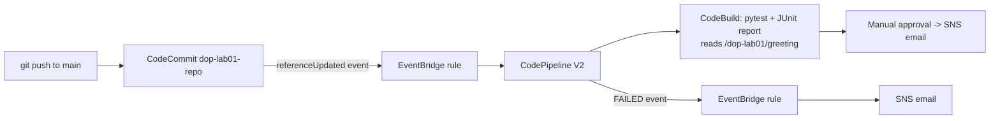

[Labs index](../README.md) | [🏠 Home](../../README.md) | [Lab 02 →](../02-codedeploy-ec2-rollback/README.md)

# Lab 01 - CodeCommit + CodeBuild + CodePipeline V2

**Goal:** build a real pipeline (Source -> Build/test -> Manual approval), read a value from Parameter Store in the build, publish a test report, get an email when the pipeline fails, and see why each piece is configured the way it is.

**Exam topics:** buildspec phases and exit codes, `parameter-store` env, exported variables, test reports, event-based change detection (EventBridge), pipeline service role permissions, manual approval + SNS, pipeline failure notifications, V2 execution mode QUEUED.
**Services:** [CodeCommit](../../services/codecommit.md), [CodeBuild](../../services/codebuild.md), [CodePipeline](../../services/codepipeline.md), [Parameter Store](../../services/secrets-manager-parameter-store.md), [EventBridge](../../services/eventbridge.md)
**Time:** ~1.5 h | **Cost:** < $0.10 (CodeBuild small instance minutes; first 100 build minutes/month are free tier on general1.small)

## What you build


## Prerequisites
Complete "Before you start" in the [labs index](../README.md). Also install the Git helper that uses your AWS CLI credentials (no Git passwords or SSH keys):
```bash
pip3 install git-remote-codecommit     # use a venv or pipx if your Python is "externally managed"
git --version
```

## Step 1 - Deploy the stack
```bash
cd labs/01-codebuild-codepipeline
aws cloudformation deploy \
  --stack-name dop-lab01 \
  --template-file template.yaml \
  --capabilities CAPABILITY_IAM \
  --parameter-overrides NotificationEmail=you@example.com
```
Expected: `Successfully created/updated stack - dop-lab01`. Open your mail and **confirm the SNS subscription**.

Look at what was created:
```bash
aws cloudformation describe-stacks --stack-name dop-lab01 --query 'Stacks[0].Outputs' --output table
```

**Notice:** the template needs `CAPABILITY_IAM` because it creates IAM roles. That is the exam's "Requires capabilities" error if you forget it.

## Step 2 - Push code to CodeCommit
```bash
cd /tmp
git clone codecommit::$AWS_REGION://dop-lab01-repo
cd dop-lab01-repo
git checkout -b main
cp -R ~/Desktop/Upskill/DOP-C02/labs/01-codebuild-codepipeline/app-src/. .   # adjust the path to where you cloned the guide
git add . && git commit -m "first version" && git push -u origin main
```
The push creates the `main` branch, which emits a `referenceCreated` event. The EventBridge rule starts the pipeline. Nothing polls the repository.

## Step 3 - Watch the pipeline
```bash
aws codepipeline get-pipeline-state --name dop-lab01-pipeline \
  --query 'stageStates[].{stage:stageName,status:latestExecution.status}' --output table
```
Run it every 30 s until Build shows `Succeeded` and Approve shows `InProgress`.

Open the console to see the build details:
- **CodeBuild > Build history > the build > Phase details**: SUBMITTED, PROVISIONING, DOWNLOAD_SOURCE, INSTALL, PRE_BUILD, BUILD, POST_BUILD, UPLOAD_ARTIFACTS, FINALIZING.
- **Build logs**: find the line `Greeting from Parameter Store is hello-from-parameter-store`.
- **Reports** tab: report group `dop-lab01-build-unit-tests` with 3 passed tests.

## Step 4 - Approve
You get an approval email that contains `Approve version 1.0.1 from commit <id>`: the pipeline filled in the variables exported by CodeBuild and the source action.

Approve from the CLI (or the console button):
```bash
TOKEN=$(aws codepipeline get-pipeline-state --name dop-lab01-pipeline \
  --query "stageStates[?stageName=='Approve'].actionStates[0].latestExecution.token" --output text)
aws codepipeline put-approval-result --pipeline-name dop-lab01-pipeline \
  --stage-name Approve --action-name ManualApproval --token "$TOKEN" \
  --result summary="tests passed, approved",status=Approved
```
**Exam link:** to let only a release-manager group approve, give only that group `codepipeline:PutApprovalResult` on this pipeline. An approval waits up to **7 days**, then fails.

## Step 5 - Break it: failing unit test
In the repo, change `tests/test_calc.py` so `test_add` expects `6`, then push:
```bash
sed -i.bak 's/== 5/== 6/' tests/test_calc.py && rm tests/test_calc.py.bak
git commit -am "break a test" && git push
```
What you should see:
- The build fails in the **BUILD** phase, because `pytest` exits non-zero.
- **POST_BUILD still runs** and prints `CODEBUILD_BUILD_SUCCEEDING=0`.
- The report shows 1 failed test.
- The pipeline execution is `Failed`, and you get the **"Pipeline dop-lab01-pipeline FAILED"** email from the EventBridge rule.

Fix the test, commit and push again.

## Step 6 - Break it: missing parameter
Edit `buildspec.yml` and change `/dop-lab01/greeting` to `/dop-lab01/missing`. Commit and push.

The build fails **before INSTALL**, in the provisioning/download stage, with an error that the parameter doesn't exist (or is not authorised). This is exam-relevant: a wrong parameter name or a missing `ssm:GetParameters` permission fails the build early. Put the correct name back and push.

## Step 7 - Execution mode QUEUED
Make two quick commits and push them separately within a few seconds. With `ExecutionMode: QUEUED`, both executions run one after the other. With the default `SUPERSEDED`, the newer execution would replace the older one while it waits at a stage.
```bash
aws codepipeline list-pipeline-executions --pipeline-name dop-lab01-pipeline \
  --query 'pipelineExecutionSummaries[0:3].[pipelineExecutionId,status,trigger.triggerType]' --output table
```

## Exam takeaways
- Pipelines start from **EventBridge events** (default for CodeCommit). `PollForSourceChanges: false` + a rule is the event-based setup.
- Build secrets/config come from **Parameter Store / Secrets Manager** in `env`, never plain-text variables. The CodeBuild **service role** needs read access (and `kms:Decrypt` for a CMK).
- A **non-zero exit code** fails the phase. `post_build` runs after a failed `build`; it does not run if `install`/`pre_build` fail.
- **Exported variables** pass values (version, image tag) to later actions.
- Notifications = **EventBridge rule on the pipeline state -> SNS**.

## Cleanup
```bash
BUCKET=$(aws cloudformation describe-stacks --stack-name dop-lab01 --query "Stacks[0].Outputs[?OutputKey=='ArtifactBucketName'].OutputValue" --output text)
aws s3 rm "s3://$BUCKET" --recursive
aws cloudformation delete-stack --stack-name dop-lab01
aws cloudformation wait stack-delete-complete --stack-name dop-lab01
aws codebuild delete-report-group --arn arn:aws:codebuild:$AWS_REGION:$ACCOUNT_ID:report-group/dop-lab01-build-unit-tests --delete-reports
aws logs delete-log-group --log-group-name /aws/codebuild/dop-lab01-build
rm -rf /tmp/dop-lab01-repo
```
(The report group and log group are created by CodeBuild at runtime, so CloudFormation doesn't delete them.)
