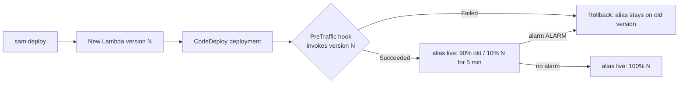

[← Lab 02](../02-codedeploy-ec2-rollback/README.md) | [Labs index](../README.md) | [🏠 Home](../../README.md) | [Lab 04 →](../04-ecs-circuit-breaker/README.md)

# Lab 03 - SAM Lambda canary deployment with hook and alarm rollback

**Goal:** deploy a Lambda function with SAM so new versions get 10% of traffic for 5 minutes before 100%. A pre-traffic hook tests the new version, and a CloudWatch alarm rolls back bad versions automatically.

**Exam topics:** `AutoPublishAlias`, `DeploymentPreference`, Lambda versions/aliases with weighted routing, CodeDeploy for Lambda, `BeforeAllowTraffic` hook + `PutLifecycleEventHookExecutionStatus`, alarm-based rollback, CloudFormation update rollback.
**Services:** [Lambda](../../services/lambda.md), [SAM and CDK](../../services/sam-cdk.md), [CodeDeploy](../../services/codedeploy.md), [CloudWatch](../../services/cloudwatch.md)
**Time:** ~1 h | **Cost:** < $0.05

## What happens on each deployment


## Step 1 - First deployment (version 1)
```bash
cd labs/03-sam-lambda-canary
sam build
sam deploy --guided
```
Answers: stack name `dop-lab03`, your Region, parameters `AppVersion=1`, `Mode=ok`, "Confirm changes" **Y**, "Allow SAM CLI IAM role creation" **Y**, save arguments to `samconfig.toml` **Y**.

The first deployment has no old version, so traffic isn't shifted. Test it:
```bash
aws lambda invoke --function-name dop-lab03-hello:live out.json >/dev/null && cat out.json; echo
```
Expected: `{"statusCode": 200, "body": "hello from version 1"}`.

Look at what SAM generated: CloudFormation console > `dop-lab03` > Resources. You see `ServerlessDeploymentApplication` (CodeDeploy app), a deployment group, `CodeDeployServiceRole`, the alias and the version. You wrote none of these.

## Step 2 - Healthy canary (version 2)
```bash
sam build && sam deploy --parameter-overrides AppVersion=2 Mode=ok
```
While it waits, open **CodeDeploy > Deployments**: the hook runs, then traffic shifts 10%. Check the alias weights in another terminal:
```bash
aws lambda get-alias --function-name dop-lab03-hello --name live \
  --query '{main:FunctionVersion,canary:RoutingConfig.AdditionalVersionWeights}'
```
Expected during the 5 minutes: `main` = old version, `canary` = `{"<new>": 0.1}`. After 5 minutes the alias points 100% to the new version and `sam deploy` finishes.

## Step 3 - Break it: bad version caught by the alarm
`break-real` makes the function fail for real calls but pass the hook's health check. This is a bug your tests didn't catch.
```bash
sam build && sam deploy --parameter-overrides AppVersion=3 Mode=break-real
```
As soon as CodeDeploy shows traffic shifting, send real traffic to the alias (about 10% goes to version 3):
```bash
for i in $(seq 1 60); do aws lambda invoke --function-name dop-lab03-hello:live out.json >/dev/null; cat out.json; echo; sleep 2; done
```
What you should see:
- A few responses contain `errorMessage: version 3 fails for real traffic`.
- Within 1-2 minutes the alarm `dop-lab03-live-errors` goes to **ALARM**.
- The CodeDeploy deployment stops with status **Stopped/Failed**, and the alias goes back to 100% version 2.
- `sam deploy` reports a failure. The CloudFormation stack goes to `UPDATE_ROLLBACK_COMPLETE`, so the template is back to version 2's settings.

Wait until the alarm returns to OK (about 2 minutes without errors) before the next step.

## Step 4 - Break it: bad version caught by the hook
```bash
sam build && sam deploy --parameter-overrides AppVersion=4 Mode=break-all
```
The `CodeDeployHook_dop-lab03-preTraffic` function invokes the new version, gets an error and reports **Failed**. The deployment fails at **BeforeAllowTraffic**, so **no user ever reached version 4**. Check the hook's log:
```bash
aws logs tail /aws/lambda/CodeDeployHook_dop-lab03-preTraffic --since 10m
```

## Step 5 (optional) - Try other deployment types
In `template.yaml`, change `Type: Canary10Percent5Minutes` to `Linear10PercentEvery1Minute` (10 steps over 10 minutes) or `AllAtOnce`, deploy `Mode=ok`, and watch the alias weights change.

## Exam takeaways
- SAM `AutoPublishAlias` + `DeploymentPreference` = the **least-effort** way to do canary/linear Lambda deployments with rollback.
- Lambda deployments are always traffic shifting on an **alias** (no in-place).
- Hooks are Lambda functions that **must call `PutLifecycleEventHookExecutionStatus`**. If they don't, the deployment times out and fails.
- Alarm rollback catches what tests miss. Use an alarm on the **alias** (or the new version's) errors.

## Cleanup
```bash
sam delete --stack-name dop-lab03 --no-prompts
aws logs delete-log-group --log-group-name /aws/lambda/dop-lab03-hello
aws logs delete-log-group --log-group-name /aws/lambda/CodeDeployHook_dop-lab03-preTraffic
rm -f out.json
```
