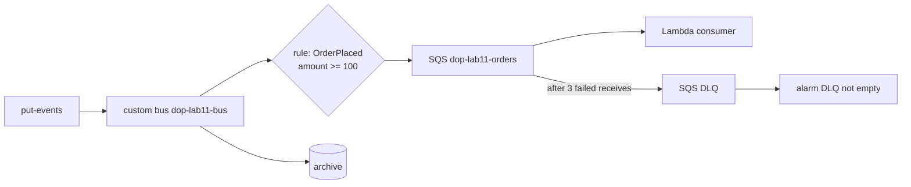

[← Lab 10](../10-xray-api-gateway-lambda/README.md) | [Labs index](../README.md) | [🏠 Home](../../README.md) | [Lab 12 →](../12-auto-scaling-lifecycle-hooks/README.md)

# Lab 11 - EventBridge -> SQS -> Lambda with DLQ, partial batch failures, redrive, archive and replay

**Goal:** route custom events by **content** from a custom event bus to an SQS queue. Process them with Lambda, isolate a **poison message** without blocking the others, watch it land in the **DLQ** after 3 receives, alarm on it, **redrive** it after a fix, and **replay** past events from the archive.

**Exam topics:** custom buses, event patterns (numeric filters), SQS target + queue policy, visibility timeout vs Lambda timeout, `maxReceiveCount` redrive policy, `ReportBatchItemFailures`, DLQ alarm, DLQ redrive to source, EventBridge archive/replay.
**Services:** [EventBridge](../../services/eventbridge.md), [SQS, SNS, Kinesis](../../services/sqs-sns-kinesis.md), [Lambda](../../services/lambda.md)
**Time:** ~1 h | **Cost:** < $0.05



## Step 1 - Deploy and send events
```bash
cd labs/11-eventbridge-sqs-dlq
aws cloudformation deploy --stack-name dop-lab11 --template-file template.yaml --capabilities CAPABILITY_IAM
out() { aws cloudformation describe-stacks --stack-name dop-lab11 --query "Stacks[0].Outputs[?OutputKey=='$1'].OutputValue" --output text; }
export DLQ_URL=$(out DLQUrl) DLQ_ARN=$(out DLQArn) ARCHIVE=$(out ArchiveArn) BUS_ARN=$(out BusArn)
export T0=$(date -u +%Y-%m-%dT%H:%M:%SZ)
aws events put-events --entries file://events.json --query '[FailedEntryCount,Entries[].EventId]'
```

## Step 2 - Content filtering and processing
```bash
sleep 20; aws logs tail /aws/lambda/dop-lab11-consumer --since 5m --format short | grep -E "PROCESSED|FAILED"
```
Expected:
- **PROCESSED** for `o-1` (250) and `o-3` (100);
- **FAILED** for `poison` (999);
- **nothing** for `o-2` (40 < 100, filtered out by the rule) or the `OrderCancelled` event (different detail-type).

The rule's pattern did that, with no code.

## Step 3 - The poison message goes to the DLQ
The consumer reports only the poison message in `batchItemFailures`, so **only it** returns to the queue. The good messages in the same batch are deleted. After the visibility timeout (60 s) it's received again. On the **3rd failed receive** SQS moves it to the DLQ (about 3-4 minutes).
```bash
sleep 200
aws sqs get-queue-attributes --queue-url $DLQ_URL --attribute-names ApproximateNumberOfMessages
aws cloudwatch describe-alarms --alarm-names dop-lab11-dlq-not-empty --query 'MetricAlarms[0].StateValue'
```
Expected: `ApproximateNumberOfMessages: 1`, and within a few minutes the alarm is `ALARM`.

**Exam links:** without `ReportBatchItemFailures`, one bad message makes the **whole batch** retry. That causes duplicate processing of good messages, and eventually the good ones also end up in the DLQ. Set the queue **visibility timeout ≥ 6 × the function timeout**.

## Step 4 - "Fix the bug" and redrive the DLQ
```bash
aws lambda update-function-configuration --function-name dop-lab11-consumer --environment 'Variables={ACCEPT_POISON=true}' >/dev/null
aws lambda wait function-updated --function-name dop-lab11-consumer
aws sqs start-message-move-task --source-arn $DLQ_ARN          # destination defaults to the original source queue
sleep 30; aws logs tail /aws/lambda/dop-lab11-consumer --since 2m --format short | grep poison
aws sqs get-queue-attributes --queue-url $DLQ_URL --attribute-names ApproximateNumberOfMessages
```
Expected: `PROCESSED: {'orderId': 'poison', ...}` and the DLQ is empty. That's the **DLQ redrive** feature: no custom code to move messages back.

## Step 5 - Archive and replay
The archive stores every event sent to the bus (it can take several minutes for events to show up in it). Replay the window from Step 1:
```bash
sleep 300
aws events start-replay --replay-name dop-lab11-replay-$(date +%s) --event-source-arn $ARCHIVE \
  --event-start-time $T0 --event-end-time $(date -u +%Y-%m-%dT%H:%M:%SZ) --destination Arn=$BUS_ARN
aws events list-replays --query 'Replays[0].[ReplayName,State]'
sleep 60; aws logs tail /aws/lambda/dop-lab11-consumer --since 2m --format short | grep PROCESSED
```
Expected: the orders are processed again (replayed events carry a `replay-name` field). Use cases: recover after a consumer outage, test a new rule against real past traffic.

## Exam takeaways
- **Event pattern filtering** belongs in the rule, not in consumer code.
- Poison messages: **DLQ (`maxReceiveCount`) + alarm on the DLQ + redrive** after fixing.
- **Partial batch response** stops one bad message from failing the whole batch.
- EventBridge **archive/replay**, plus retries and an optional DLQ **per target** for delivery failures.

## Cleanup
```bash
aws cloudformation delete-stack --stack-name dop-lab11
aws cloudformation wait stack-delete-complete --stack-name dop-lab11
aws logs delete-log-group --log-group-name /aws/lambda/dop-lab11-consumer
```
