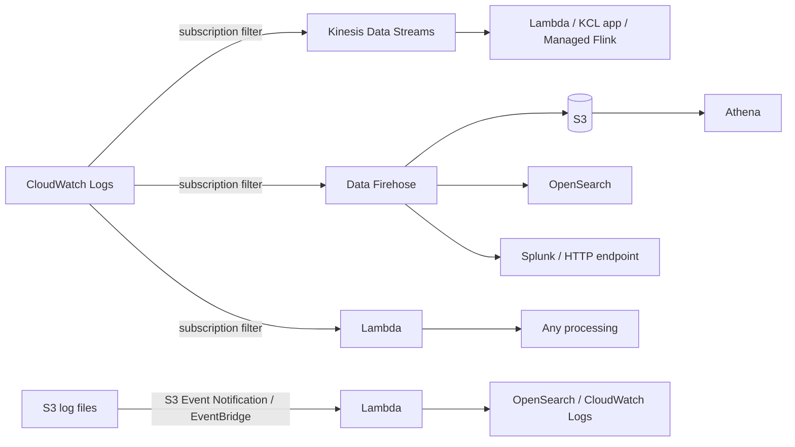

[← Resilience Hub, FIS and Elastic Disaster Recovery](resilience-hub-fis-drs.md) | [Services index](README.md) | [🏠 Home](../README.md) | [AWS X-Ray →](xray.md)

# Amazon CloudWatch (metrics, alarms, logs, agent, synthetics)

**Exam domains:** [Domain 4](../04-monitoring-logging.md), [Domain 5](../05-incident-event-response.md) | **Hands-on:** [Lab 09](../labs/09-cloudwatch-logs-alarms/README.md)

> Exam scenarios for this service are in each domain's quick-map table, and confusing pairs are in [Chapter 7](../07-service-comparisons-numbers.md).

## CloudWatch Metrics

| Concept | Detail |
|---|---|
| **Namespace** | Container, e.g., `AWS/EC2`, `AWS/ApplicationELB`, custom `MyApp` |
| **Metric** | Name + time-ordered data points |
| **Dimensions** | Name/value pairs that identify a metric (up to 30), e.g., `InstanceId`, `AutoScalingGroupName`. A metric with different dimensions is a different metric |
| **Resolution** | Standard = 1-minute; **high resolution = 1-second** (custom metrics, `StorageResolution=1`). Alarms on high-res metrics can evaluate every 10 or 30 s |
| **Retention** | 1-s data 3 h, 60-s data 15 days, 5-min 63 days, 1-h 455 days (15 months) |
| **EC2 default** | **Basic monitoring 5-min** (free); **detailed monitoring 1-min** (paid). Hypervisor metrics only: CPU, network, disk (instance store), status checks. **Memory and disk space usage are NOT default** -> CloudWatch agent |
| **Custom metrics** | `PutMetricData` API / CLI, **Embedded Metric Format (EMF)** from logs (Lambda/containers write JSON logs, CloudWatch extracts metrics - no API calls), CloudWatch agent, StatsD/collectd |
| **Metric math** | Combine metrics in expressions (e.g., error rate = 5xx / requests * 100) and alarm on it |
| **Metrics Insights** | SQL queries over metrics (`SELECT AVG(CPUUtilization) FROM SCHEMA("AWS/EC2", InstanceId) GROUP BY ...`) |
| **Metric streams** | Continuous near-real-time stream of metrics via **Kinesis Data Firehose** to S3, Redshift, OpenSearch, or third parties (Datadog, Splunk, New Relic...). Include/exclude namespaces. Output JSON or OpenTelemetry. Use when "send all metrics to external tool / data lake in near real time" (better than polling `GetMetricData`) |
| **Cross-account observability** | Monitoring account linked to source accounts (OAM sinks/links) to view metrics, logs, traces centrally |

### Common metrics to know (exam guide calls these out)

| Service | Metrics |
|---|---|
| EC2 | `CPUUtilization`, `StatusCheckFailed_System` (AWS hardware -> recover), `StatusCheckFailed_Instance` (your OS -> reboot), `NetworkIn/Out`, `CPUCreditBalance` (T instances) |
| ALB | `HTTPCode_Target_5XX_Count` (your app), `HTTPCode_ELB_5XX_Count` (the LB itself, e.g., 502/503/504), `TargetResponseTime`, `RequestCount`, `HealthyHostCount`, `UnHealthyHostCount`, `RejectedConnectionCount`, `RequestCountPerTarget` |
| NLB | `HealthyHostCount`, `TCP_Target_Reset_Count`, `ActiveFlowCount` |
| RDS | `CPUUtilization`, `DatabaseConnections`, `FreeStorageSpace`, `FreeableMemory`, `ReadLatency/WriteLatency`, **`DiskQueueDepth`** (this is the "queue length" metric for RDS), `ReplicaLag`, `ReadIOPS/WriteIOPS` |
| SQS | `ApproximateNumberOfMessagesVisible` (backlog), `ApproximateAgeOfOldestMessage` (processing is falling behind), `NumberOfMessagesSent/Deleted` |
| Lambda | `Invocations`, `Errors`, `Throttles`, `Duration`, `ConcurrentExecutions`, `IteratorAge` (stream consumers falling behind), `DeadLetterErrors` |
| API Gateway | `Count`, `4XXError`, `5XXError`, `Latency`, `IntegrationLatency`, `CacheHitCount` |
| DynamoDB | `ConsumedRead/WriteCapacityUnits`, `ThrottledRequests`, `ReadThrottleEvents`, `SystemErrors`, `ReplicationLatency` (global tables) |
| ECS | `CPUUtilization`, `MemoryUtilization` (service/cluster); per-task with **Container Insights** |
| Kinesis | `GetRecords.IteratorAgeMilliseconds`, `WriteProvisionedThroughputExceeded`, `ReadProvisionedThroughputExceeded` |
| ASG | `GroupDesiredCapacity`, `GroupInServiceInstances` (enable group metrics) |
| Billing | `EstimatedCharges` (us-east-1 only) |

## CloudWatch Alarms

- States: `OK`, `ALARM`, `INSUFFICIENT_DATA`.
- Settings: period, **evaluation periods**, **datapoints to alarm** ("M out of N", e.g., 3 of 5 to avoid flapping), threshold, statistic (Average, Sum, Min, Max, SampleCount, pNN percentiles), **missing data treatment** (`missing`, `notBreaching`, `breaching`, `ignore`).
- **Actions**: SNS notification, **EC2 actions** (stop, terminate, reboot, **recover**), **Auto Scaling** policy, **SSM OpsItem / Incident Manager incident**, **Lambda function** (direct alarm action), and EventBridge gets every alarm state change.
- **Composite alarms**: combine alarms with AND/OR/NOT -> reduce alert noise ("page only if 5xx high AND latency high"). Can suppress actions with an actions suppressor alarm.
- **Anomaly detection**: ML band based on metric history (seasonality, trend); alarm when metric goes outside band (`ANOMALY_DETECTION_BAND`). Use when "threshold is hard to define / traffic varies by time of day".
- Alarm on **metric math expressions** and **Metrics Insights queries** (alarm across a fleet with one query).
- **Logs anomaly detection** and **pattern analysis** also exist for log groups.

## CloudWatch Logs

| Concept | Detail |
|---|---|
| **Log group** | Container with **retention** (1 day to 10 years, or never expire - default never) and **KMS encryption** (associate a CMK; key policy must allow `logs.<region>.amazonaws.com`) |
| **Log stream** | Sequence from one source (instance, container, Lambda instance) |
| **Log classes** | Standard vs **Infrequent Access** (cheaper ingestion, fewer features) |
| **Metric filters** | Turn log patterns into **CloudWatch metrics** (e.g., count `ERROR`, extract latency value). Then alarm on the metric. Filters only apply to **new** events after creation |
| **Subscription filters** | **Real-time** stream of log events to **Kinesis Data Streams, Kinesis Data Firehose, Lambda, or OpenSearch Service** (via Lambda). Up to 2 subscription filters per log group. **Account-level subscription filter** for all log groups |
| **Cross-account log delivery** | Subscription to a **destination** in central account (destination wraps a Kinesis stream/Firehose; destination policy allows source accounts) -> centralised logging |
| **Logs Insights** | Interactive query language over log groups (see below). Query across up to many log groups/accounts |
| **Live Tail** | Real-time view of incoming logs for troubleshooting |
| **Export to S3** | `CreateExportTask` - **batch**, can take up to 12 h, not real time. For continuous delivery to S3 use subscription -> Firehose -> S3 |
| **Data protection policies** | Detect and **mask sensitive data** (PII, credentials) in logs |
| **Field indexes / transformers** | Parse/normalise logs at ingestion |
| **Centralization rules** | Copy logs from org accounts/Regions into a central account |

### Filter pattern syntax (used by metric filters, subscription filters, `filter-log-events`)
```
ERROR                                   # term match
"Access Denied"                         # exact phrase
?ERROR ?WARN                            # OR
ERROR -Healthcheck                      # exclude
{ $.statusCode = 500 }                  # JSON field
{ $.latency > 1000 && $.path = "/api*" }
{ $.eventName = "ConsoleLogin" && $.responseElements.ConsoleLogin = "Failure" }
[ip, user, ts, request, status_code = 5*, size]   # space-delimited
```

### Logs Insights queries you should be able to read
```
fields @timestamp, @message
| filter @message like /ERROR/
| sort @timestamp desc
| limit 50

filter level = "ERROR"              # filter BEFORE stats
| stats count(*) as errors by bin(5m)

filter @type = "REPORT"                 # Lambda: memory and duration
| stats max(@maxMemoryUsed/1000/1000) as maxMB, avg(@duration) by bin(1h)

parse @message "user=* action=*" as user, action
| stats count() by user, action
```

### Real-time log processing patterns (memorise the arrows)



| Need | Use |
|---|---|
| Near-real-time, durable, multiple consumers, replay, ordered | Kinesis Data Streams |
| Near-real-time delivery to S3/OpenSearch/Redshift/Splunk, no code, transform with Lambda, buffer interval 0-900 s (0 = zero buffering, delivery within seconds) | Data Firehose |
| Search, dashboards (Kibana-style) | OpenSearch Service (+ OpenSearch Dashboards) |
| Ad-hoc SQL over logs in S3 | Athena (partition by date, use Parquet via Firehose conversion for cost) |
| BI dashboards | QuickSight (over Athena) |
| Big data processing | EMR |
| Stream analytics SQL/Java | Managed Service for Apache Flink |
| Logs from SaaS apps | AppFlow |

## CloudWatch agent (unified agent)

- Collects **system metrics** (memory `mem_used_percent`, disk `disk_used_percent`, swap, processes, netstat) and **logs** (any file) from EC2 and on-prem, Linux and Windows (Windows event logs, performance counters).
- Config JSON created by wizard (`amazon-cloudwatch-agent-config-wizard`), store in **SSM Parameter Store** (`AmazonCloudWatch-*`), deploy and start at scale with **SSM** (`AWS-ConfigureAWSPackage` to install, `AmazonCloudWatch-ManageAgent` to configure) via State Manager.
- IAM: `CloudWatchAgentServerPolicy` (+ `AmazonSSMManagedInstanceCore`).
- `append_dimensions` (InstanceId, AutoScalingGroupName), `aggregation_dimensions`, `metrics_collection_interval` (can be 1 s for high-res).
- **procstat** plugin to monitor specific processes; **StatsD/collectd** for app metrics.
- Older "CloudWatch Logs agent" (awslogs) is deprecated -> unified agent.
- Troubleshoot: agent log `/opt/aws/amazon-cloudwatch-agent/logs/amazon-cloudwatch-agent.log`, IAM role, network/endpoint, config file path.

**Containers:** ECS `awslogs` log driver or **FireLens** (Fluent Bit) for routing to multiple destinations; **Container Insights** (with enhanced observability) for cluster/service/task/pod metrics on ECS & EKS (CloudWatch agent / ADOT / Fluent Bit DaemonSet on EKS). **Prometheus** metrics -> Amazon Managed Service for Prometheus + **Amazon Managed Grafana** dashboards.
**Lambda:** logs go to `/aws/lambda/<fn>` automatically (role needs `logs:CreateLogStream/PutLogEvents`); Lambda Insights extension for system-level metrics.

## Dashboards and visualisation
- **CloudWatch dashboards**: global (widgets from multiple Regions **and accounts** with cross-account observability), automatic dashboards per service, share dashboards publicly or with SSO users, text/alarm/log widgets, custom widgets via Lambda.
- **Amazon QuickSight** (Quick Sight): BI dashboards from Athena/S3/Redshift (e.g., Config/Inventory/CUR data).
- **Managed Grafana**: Grafana dashboards over CloudWatch, Prometheus, X-Ray, OpenSearch, with IAM Identity Center auth.

## CloudWatch Synthetics and RUM
- **Synthetics canaries**: scripts (Node.js Puppeteer/Playwright, Python Selenium) run on a schedule to test endpoints/UI flows (heartbeat, API, broken link checker, visual monitoring, GUI workflow). Metrics + screenshots + HAR, alarm on `SuccessPercent`. Test **before users notice**; run after deploys in the pipeline.
- **RUM**: real user monitoring from browsers (page load, JS errors).
- **Internet Monitor**: internet-side availability/performance for your users.
- **Evidently** (feature experiments) - deprecated; use AppConfig.

## EC2 status checks and recovery
- **System status check** (`StatusCheckFailed_System`): problem with AWS hardware, network or power on the host. Fix: **stop and start** (moves to new hardware) or a CloudWatch alarm with the **recover** action (same instance ID, private IP, Elastic IP, metadata, placement group). Many instance types also have simplified automatic recovery by default.
- **Instance status check** (`StatusCheckFailed_Instance`): problem inside your instance (OS boot failure, exhausted memory, bad network config). Fix: **reboot** action or fix the OS/configuration.
- **Attached EBS status check** (`StatusCheckFailed_AttachedEBS`): an attached EBS volume is unreachable or impaired.
- `StatusCheckFailed` combines them. Status checks run every minute.

---

[← Resilience Hub, FIS and Elastic Disaster Recovery](resilience-hub-fis-drs.md) | [Services index](README.md) | [🏠 Home](../README.md) | [AWS X-Ray →](xray.md)
