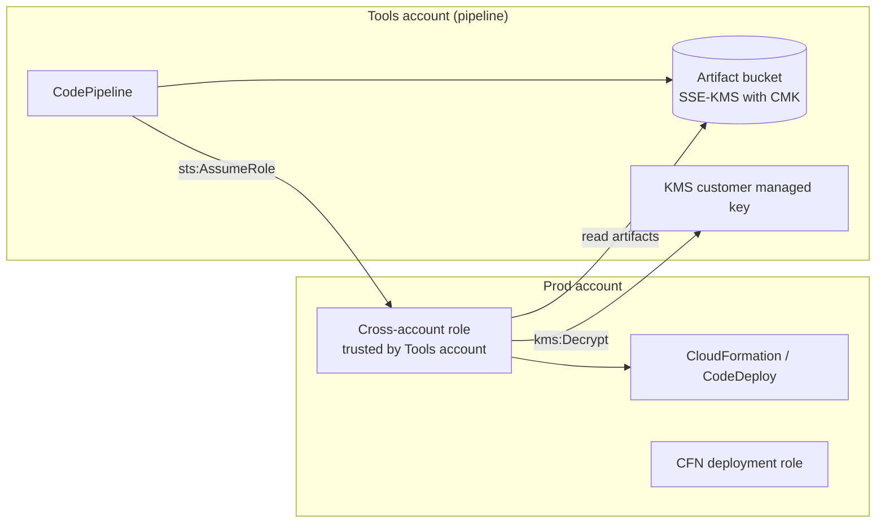

[← AWS CodeBuild](codebuild.md) | [Services index](README.md) | [🏠 Home](../README.md) | [AWS CodeDeploy →](codedeploy.md)

# AWS CodePipeline

**Exam domains:** [Domain 1](../01-sdlc-automation.md), [Domain 5](../05-incident-event-response.md) | **Hands-on:** [Lab 01](../labs/01-codebuild-codepipeline/README.md)

> Exam scenarios for this service are in each domain's quick-map table, and confusing pairs are in [Chapter 7](../07-service-comparisons-numbers.md).

## Overview

**What:** Orchestrator. Stages contain actions. Actions: Source, Build, Test, Deploy, Approval, Invoke (Lambda / Step Functions), Compute.

### Core concepts
- **Stages** run in order. Actions in a stage run in parallel unless `runOrder` differs (same runOrder = parallel).
- **Artifacts** pass between actions via S3 (input/output artifact names).
- **Manual approval** action: SNS notification, optional URL for reviewers, times out after **7 days**.
- **Invoke Lambda action**: the function must call `PutJobSuccessResult` or `PutJobFailureResult`, else action times out.
- **Variables**: actions emit output variables (`#{SourceVariables.CommitId}`, `#{BuildVariables.IMAGE_TAG}`), V2 pipelines also have **pipeline-level variables** set at execution start.
- **Pipeline V2 features** (exam likes these):
  - **Triggers with filters**: on Git **tags**, branches, **file paths**, pull request events (for CodeConnections sources).
  - **Execution modes**: `SUPERSEDED` (default, newer run replaces older waiting run), `QUEUED` (one at a time, in order), `PARALLEL` (independent runs).
  - **Stage-level conditions and automatic rollback on stage failure** (rollback to last successful pipeline execution's artifacts).
- **Change detection**: EventBridge (default for CodeCommit/S3/ECR source) - not polling. For S3 source, CloudTrail data events + EventBridge.
- **Notifications**: pipeline/stage/action state changes in EventBridge (`CodePipeline Pipeline Execution State Change`).
- Retry failed stage/actions without rerunning the whole pipeline.

### Cross-Region pipeline
Set an **artifact store (S3 bucket) in each Region** where actions run (`artifactStores` map). CodePipeline copies artifacts automatically. Use a KMS key in each Region.

### Cross-account pipeline (very common question)

Checklist:
1. **Customer managed KMS key** in the pipeline account (the default `aws/s3` managed key can't be shared cross-account). Key policy grants the prod account role `kms:Decrypt`, `kms:DescribeKey`, `kms:GenerateDataKey*`.
2. **Artifact bucket policy** allows the prod account role to `s3:GetObject`/`PutObject`.
3. **Role in prod account** trusted by the tools account, with permissions to deploy (CloudFormation, CodeDeploy). Pipeline action has `roleArn` = that role.
4. For CloudFormation deploy action: also a **CFN service role** in prod (passed with `iam:PassRole`).
5. Pipeline service role in tools account can `sts:AssumeRole` the prod role.

### Multi-account deployment patterns
- One pipeline in a **tools/shared-services account** deploys to dev, test, prod accounts with cross-account roles (above).
- **CloudFormation StackSets** action in CodePipeline to deploy to many accounts/Regions.
- **CDK Pipelines** (self-mutating pipeline, stages per account/Region).
- **Customizations for Control Tower (CfCT)** pipeline for landing zone resources.

### Traps
- "Pipeline doesn't start on push" -> check EventBridge rule / CodeConnections connection status / trigger filters.
- "Pipeline in account A cannot decrypt artifacts in account B" -> CMK key policy + bucket policy, not the default key.
- "Need a test step that calls an API and fails the pipeline" -> Lambda invoke action or CodeBuild test action.
- "Approval must be by a specific team" -> IAM permission `codepipeline:PutApprovalResult` only for that group.

---

## Amazon S3 as artifact store
CodePipeline stores artifacts in an S3 bucket per Region. Use **versioning**, **lifecycle rules** to expire old artifacts, SSE-KMS.

**Artifact lifecycle tips:** immutable versioned artifacts (build once, promote the same artifact through stages), retain prod artifacts for rollback, expire dev ones.

---

## How pipelines detect changes: events vs webhooks vs polling
- **Events (default, recommended)**: EventBridge rule on the source (CodeCommit, S3 via CloudTrail, ECR) starts the pipeline.
- **CodeConnections (GitHub App / Bitbucket / GitLab)**: the connection pushes changes to the pipeline; V2 trigger filters (branch, tag, file path, PR).
- **Webhooks**: an HTTP endpoint that a script or older GitHub (OAuth) action calls.
- **Polling**: CodePipeline checks the source periodically. Legacy, slower. Migrate polling pipelines to event-based change detection.

## Artifact rules per action (useful for "why is this pipeline invalid?" questions)
| Action | Input artifacts | Output artifacts |
|---|---|---|
| Source (S3, CodeCommit, ECR, GitHub) | 0 | 1 |
| Build / Test (CodeBuild) | 1-5 | 0-5 |
| Manual approval | 0 | 0 |
| Deploy CloudFormation | 0-10 | 0-1 |
| Deploy CodeDeploy / Elastic Beanstalk / ECS / S3 / Service Catalog | 1 | 0 |
| Invoke Lambda | 0-5 | 0-5 |

## CloudFormation deploy action
- Action modes: `CREATE_UPDATE`, `DELETE_ONLY`, `REPLACE_ON_FAILURE` (delete a failed stack and recreate, good for test stacks), `CHANGE_SET_REPLACE` (create or replace a change set), `CHANGE_SET_EXECUTE`.
- Typical prod flow: `CHANGE_SET_REPLACE` -> manual approval (reviewers read the change set) -> `CHANGE_SET_EXECUTE`.
- **Template configuration file** (JSON with `Parameters`, `Tags`, `StackPolicy`) lets the same template use per-stage parameter values, e.g. `test.json` and `prod.json`.
- Parameter overrides can use `Fn::GetArtifactAtt` / `Fn::GetParam` to read values from artifacts (e.g., the image tag).
- Multi-Region: one pipeline, deploy actions with a `region` set, plus an artifact bucket in each Region.

## Pipeline design patterns
- One pipeline, one CodeDeploy application, **parallel deploy actions** to several deployment groups (same `runOrder`).
- Deploy to pre-prod, run tests, manual approval, then prod.
- "Uniform pipeline" for containers: CodeCommit -> CodeBuild builds images (any language) -> ECR -> ECS/Fargate.
- Troubleshooting: failures and stage/action state changes are EventBridge events; most "action failed to run" errors are missing permissions on the **pipeline service role**; CloudTrail shows the denied API call.

---

[← AWS CodeBuild](codebuild.md) | [Services index](README.md) | [🏠 Home](../README.md) | [AWS CodeDeploy →](codedeploy.md)
