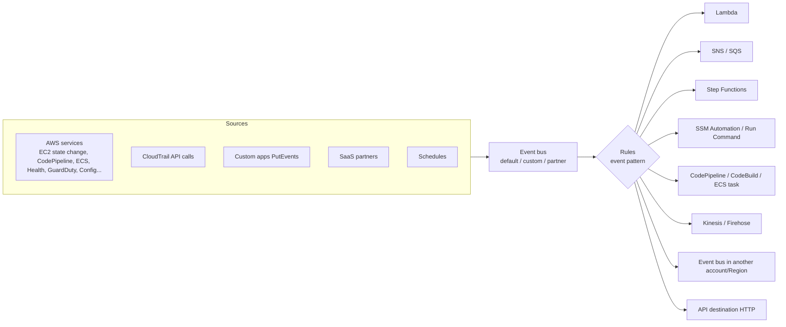

[← AWS CloudTrail](cloudtrail.md) | [Services index](README.md) | [🏠 Home](../README.md) | [AWS Health →](health.md)

# Amazon EventBridge

**Exam domains:** [Domain 5](../05-incident-event-response.md) | **Hands-on:** [Lab 11](../labs/11-eventbridge-sqs-dlq/README.md), [Lab 14](../labs/14-guardduty-security-response/README.md)

> Exam scenarios for this service are in each domain's quick-map table, and confusing pairs are in [Chapter 7](../07-service-comparisons-numbers.md).



| Concept | Detail |
|---|---|
| **Event buses** | **Default** (AWS service events), **custom** (your apps), **partner** (SaaS). Resource policy on bus to allow other accounts/org (`aws:PrincipalOrgID`) to `PutEvents` |
| **Rules** | Event pattern **or** schedule; up to 5 targets per rule; input transformer to reshape event for target |
| **Event pattern** | JSON matching on `source`, `detail-type`, `detail.*`. Supports prefix, suffix, anything-but, numeric, exists, IP, wildcard, `$or` |
| **Cross-account / cross-Region** | Target = event bus in another account/Region -> **central event bus** in security/ops account |
| **Retry + DLQ** | Retries up to 24 h / 185 attempts by default; configure **SQS dead-letter queue** per target for failed deliveries |
| **Archive and replay** | Store events, replay later (testing, recovery) |
| **Schema registry** | Discover event schemas, generate code bindings |
| **Pipes** | Point-to-point source (SQS, Kinesis, DynamoDB Streams) -> filter -> enrich (Lambda/Step Functions/API) -> target |
| **Scheduler** | Cron/rate/one-time schedules at large scale, time zones, flexible windows, retries/DLQ. Preferred over scheduled rules |
| **API destinations** | HTTP endpoints with connection auth (Slack, PagerDuty, ServiceNow) |

Example pattern: EC2 instance terminated in prod
```json
{
  "source": ["aws.ec2"],
  "detail-type": ["EC2 Instance State-change Notification"],
  "detail": { "state": ["terminated"] }
}
```
Example pattern: someone made a security group change (CloudTrail API call)
```json
{
  "source": ["aws.ec2"],
  "detail-type": ["AWS API Call via CloudTrail"],
  "detail": {
    "eventSource": ["ec2.amazonaws.com"],
    "eventName": ["AuthorizeSecurityGroupIngress"]
  }
}
```

**Event examples the exam uses** (source / detail-type):
- `aws.codepipeline` "CodePipeline Pipeline Execution State Change" / "Stage" / "Action"
- `aws.codebuild` "CodeBuild Build State Change"
- `aws.codedeploy` "CodeDeploy Deployment State-change Notification"
- `aws.codecommit` "CodeCommit Repository State Change" / "CodeCommit Pull Request State Change"
- `aws.ecs` "ECS Task State Change", "ECS Service Action", "ECS Deployment State Change"
- `aws.autoscaling` "EC2 Instance Launch Successful/Unsuccessful", "EC2 Instance-launch Lifecycle Action"
- `aws.health` "AWS Health Event"
- `aws.guardduty` "GuardDuty Finding"
- `aws.securityhub` "Security Hub Findings - Imported"
- `aws.config` "Config Rules Compliance Change", "Config Configuration Item Change"
- `aws.inspector2` "Inspector2 Finding"
- `aws.ssm` "Parameter Store Change", "EC2 State Manager Association State Change"
- `aws.s3` "Object Created" (when bucket has EventBridge notifications enabled)
- `aws.cloudformation` "CloudFormation Stack Status Change"
- `aws.trustedadvisor` "Trusted Advisor Check Item Refresh Notification" (us-east-1)
- `aws.signin` "AWS Console Sign In via CloudTrail" (us-east-1 for global)

**Global services events** (IAM, STS global, CloudFront, Route 53, Organizations) are delivered to **us-east-1** -> create the rule in us-east-1.

---

[← AWS CloudTrail](cloudtrail.md) | [Services index](README.md) | [🏠 Home](../README.md) | [AWS Health →](health.md)
