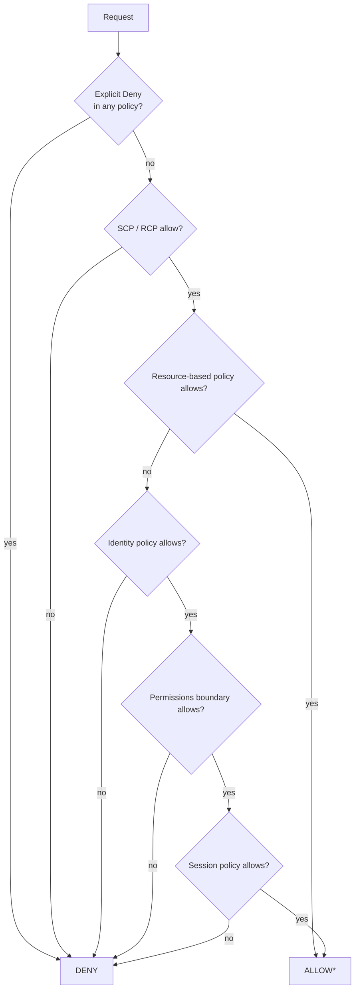

[← Athena and QuickSight (log analytics)](analytics-athena-quicksight.md) | [Services index](README.md) | [🏠 Home](../README.md) | [Secrets Manager and Parameter Store →](secrets-manager-parameter-store.md)

# IAM, STS and IAM Identity Center

**Exam domains:** [Domain 6](../06-security-compliance.md) | **Hands-on:** [Lab 13](../labs/13-iam-boundary-abac/README.md)

> Exam scenarios for this service are in each domain's quick-map table, and confusing pairs are in [Chapter 7](../07-service-comparisons-numbers.md).

| Entity | Use for | Exam rule |
|---|---|---|
| **IAM user** | Legacy humans or third-party systems that can't use roles | Avoid; no long-term keys for humans. If used: MFA, rotate keys |
| **IAM group** | Attach policies to many users | Groups can't be principals in resource policies; no nesting |
| **IAM role** | **Machines** (EC2 instance profile, Lambda execution role, ECS task role, CodeBuild service role), **cross-account access**, **federated humans** | Temporary credentials from STS. Always preferred |
| **Identity provider** | SAML 2.0 or OIDC federation into IAM roles | OIDC for **GitHub Actions/GitLab CI to AWS without keys**, EKS IRSA |
| **IAM Identity Center** | Workforce SSO to many accounts with **permission sets**; identity source = built-in, AD (via Directory Service/AD Connector), or external IdP (Okta, Entra ID) with SCIM | **Default answer for human access to multiple accounts** |
| **Service-linked role** | Predefined role owned by an AWS service | Not restricted by SCPs |
| **Cognito** | App end-users (user pools = sign-up/sign-in; identity pools = temp AWS creds for app users) | Customer-facing apps, not workforce |

## Policy types

| Policy | Attached to | Grants? | Notes |
|---|---|---|---|
| **Identity-based** (managed / inline) | User, group, role | Yes | AWS managed vs customer managed vs inline |
| **Resource-based** | S3 bucket, KMS key, SQS, SNS, Lambda, ECR repo, Secrets Manager, role trust policy... | Yes | Has `Principal`; enables cross-account without role assumption |
| **Permissions boundary** | User or role | **No - sets max** | Delegate admin safely: devs can create roles only with the boundary attached |
| **SCP** | Org root/OU/account | No - max for account principals | Doesn't affect management account or service-linked roles |
| **RCP** | Org root/OU/account | No - max for resources | Data perimeter |
| **Session policy** | Passed in `AssumeRole`/`GetFederationToken` | No - max for that session | Narrow a session further |
| **ACLs** | S3, VPC NACL | Yes | Legacy for S3 (disable with Object Ownership = bucket owner enforced) |

## Policy evaluation logic (single account)

- Default = **implicit deny**. **Explicit deny always wins.**
- *Same account: a resource-based policy that names the principal can allow access even when the identity policy doesn't. For **KMS keys** and **IAM role trust policies**, the resource policy is always required: an identity policy alone is never enough.
- **Cross-account**: need **both** - identity policy in the caller's account **and** resource policy (or role trust) in the target account.
- **KMS**: the **key policy** is the primary control. Unless the key policy allows the account root (`arn:aws:iam::111122223333:root`) to delegate to IAM, IAM policies alone don't give access.

## Conditions you must recognise
| Condition key | Use |
|---|---|
| `aws:MultiFactorAuthPresent` / `aws:MultiFactorAuthAge` | Require MFA for sensitive actions |
| `aws:SourceIp`, `aws:SourceVpce`, `aws:SourceVpc` | Network origin restrictions (S3 bucket only via VPC endpoint) |
| `aws:PrincipalOrgID` / `aws:PrincipalOrgPaths` | Allow anyone in my organization/OU (bucket policies, KMS, EventBridge bus) |
| `aws:ResourceOrgID` | Only access resources in my org (data perimeter) |
| `aws:RequestedRegion` | Restrict Regions |
| `aws:PrincipalTag/xxx`, `aws:ResourceTag/xxx`, `aws:RequestTag/xxx`, `aws:TagKeys` | **ABAC** |
| `aws:SecureTransport` | Deny non-HTTPS (S3 bucket policy) |
| `aws:SourceArn`, `aws:SourceAccount` | **Confused deputy** protection for service principals |
| `sts:ExternalId` | Confused deputy protection for third-party cross-account roles |
| `iam:PassedToService` | Restrict `iam:PassRole` to a service |
| `aws:CalledVia` | Allow only when called through a service (e.g., CloudFormation) |
| `s3:x-amz-server-side-encryption` | Require encryption on PutObject |
| `token.actions.githubusercontent.com:sub` | Restrict GitHub OIDC role to a repo/branch |

## RBAC vs ABAC
- **RBAC**: roles/permission sets per job function (Developer, ReadOnly, Admin). Simple; grows with number of resources.
- **ABAC**: one policy using tags: allow when `aws:ResourceTag/Project` == `${aws:PrincipalTag/Project}`. Scales: new projects need no new policies. Session tags from IdP via Identity Center **attributes for access control**.
```json
{
  "Effect": "Allow",
  "Action": ["ec2:StartInstances", "ec2:StopInstances"],
  "Resource": "*",
  "Condition": {
    "StringEquals": { "aws:ResourceTag/Project": "${aws:PrincipalTag/Project}" }
  }
}
```

## Permissions boundary pattern (delegated admin)
"Developers must create IAM roles for their Lambda functions but must not escalate privileges":
1. Create boundary policy `DevBoundary` (max allowed: S3/DynamoDB/Logs on their resources).
2. Give developers `iam:CreateRole`/`iam:PutRolePolicy`/`iam:AttachRolePolicy` **only with condition** `iam:PermissionsBoundary` = `DevBoundary` ARN.
3. Deny them `iam:DeleteRolePermissionsBoundary` / editing the boundary policy.

## STS and credentials
- `AssumeRole` (cross-account, same account), `AssumeRoleWithSAML`, `AssumeRoleWithWebIdentity` (OIDC: GitHub Actions, EKS IRSA, Cognito), `GetSessionToken` (MFA for IAM users), `GetFederationToken`.
- Session duration: role max session 1-12 h (default 1 h); **role chaining** limited to 1 h.
- **Revoke** active sessions: "Revoke active sessions" on role (adds deny on `aws:TokenIssueTime` older than now).
- EC2 **instance profile** + **IMDSv2** (session-token based, protects from SSRF) - enforce with launch template `HttpTokens: required`, SCP condition `ec2:MetadataHttpTokens`, Config rule `ec2-imdsv2-check`, or declarative policy.
- **IAM Roles Anywhere**: X.509 certs for on-prem workloads to get temporary creds (no long-term keys).
- **MFA**: enforce with policy denying all except MFA setup when `aws:MultiFactorAuthPresent` is false; root user MFA (hardware/passkey); Identity Center MFA settings.
- **Credential reports** and **access advisor / last accessed** info to remove unused permissions; Access Analyzer **unused access** findings and **policy generation from CloudTrail**.

## IAM Identity Center in more detail
- **Login flow**: user opens the AWS access portal URL -> signs in with the identity source (Identity Center directory, AD, or external IdP via SAML 2.0) -> sees the accounts and **permission sets** assigned to them (directly or through groups) -> gets temporary credentials for the role Identity Center created in that account.
- Also provides SSO into business apps (SAML 2.0 apps) and EC2 Windows instances.
- **Permission sets** = collections of policies (AWS managed, customer managed by name, inline, permissions boundary) that Identity Center provisions as IAM roles (`AWSReservedSSO_...`) in each assigned account.
- **External IdPs** (Okta, Entra ID, Google): SAML for sign-in + **SCIM** for automatic user/group provisioning.
- **ABAC**: pass user attributes (department, cost center, project) from the identity source as **session tags** ("attributes for access control"), then write permission set policies that compare `aws:PrincipalTag/...` with `aws:ResourceTag/...`.

---

[← Athena and QuickSight (log analytics)](analytics-athena-quicksight.md) | [Services index](README.md) | [🏠 Home](../README.md) | [Secrets Manager and Parameter Store →](secrets-manager-parameter-store.md)
