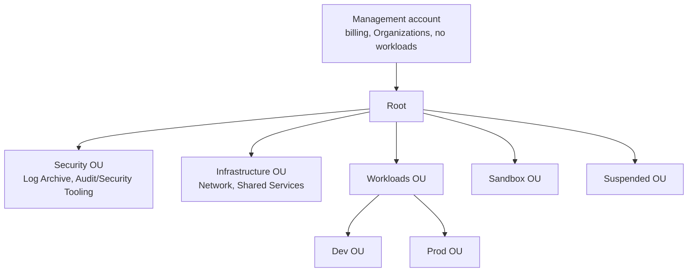

[← AWS Service Catalog](service-catalog.md) | [Services index](README.md) | [🏠 Home](../README.md) | [AWS Control Tower →](control-tower.md)

# AWS Organizations and SCPs

**Exam domains:** [Domain 2](../02-config-mgmt-iac.md), [Domain 6](../06-security-compliance.md) | **Hands-on:** [Lab 15](../labs/15-organizations-scp/README.md)

> Exam scenarios for this service are in each domain's quick-map table, and confusing pairs are in [Chapter 7](../07-service-comparisons-numbers.md).



Best practices:
- Keep the **management account** for billing/Organizations only; no workloads.
- Separate accounts per environment/team = blast radius + billing separation.
- **Log Archive** account (central CloudTrail/Config logs, locked down) and **Audit / Security Tooling** account (delegated admin for GuardDuty, Security Hub, Config aggregator, Inspector, Macie, Detective, Access Analyzer).
- Use **delegated administrator** so security services are managed from the security account, not management.

## Policy types

| Policy | What it does |
|---|---|
| **SCP (Service Control Policy)** | Sets the **maximum permissions** for IAM principals in member accounts. **Never grants** permissions. Doesn't affect the management account, or service-linked roles. Applies to root user of member accounts. Attach to root/OU/account. Inherited down. |
| **RCP (Resource Control Policy)** | Maximum permissions on **resources** (S3, STS, KMS, SQS, Secrets Manager...) regardless of who calls - e.g., "no principal outside my org can access my S3 buckets" (data perimeter). |
| **Tag policies** | Standardise tag keys/values (case, allowed values); report or enforce on resource types |
| **Backup policies** | Org-wide AWS Backup plans |
| **AI services opt-out** | Opt out of content use by AI services |
| **Declarative policies** | Enforce service configuration baselines (e.g., block public AMI sharing, IMDSv2 default, VPC block public access) even for new features |
| **Chatbot policies** | Control Chatbot access |

**SCP examples to recognise**
```json
{
  "Version": "2012-10-17",
  "Statement": [
    {
      "Sid": "DenyOutsideApprovedRegions",
      "Effect": "Deny",
      "NotAction": ["iam:*", "organizations:*", "sts:*", "cloudfront:*", "route53:*", "support:*", "budgets:*"],
      "Resource": "*",
      "Condition": { "StringNotEquals": { "aws:RequestedRegion": ["us-east-1", "eu-west-1"] } }
    },
    {
      "Sid": "ProtectSecurityServices",
      "Effect": "Deny",
      "Action": ["cloudtrail:StopLogging", "cloudtrail:DeleteTrail", "guardduty:DeleteDetector", "config:StopConfigurationRecorder"],
      "Resource": "*",
      "Condition": { "ArnNotLike": { "aws:PrincipalArn": "arn:aws:iam::*:role/OrgSecurityAdmin" } }
    }
  ]
}
```
- SCP strategy: keep `FullAWSAccess` attached and add **deny list** SCPs (common), or remove it and use **allow list** SCPs (strict).
- Effective permission = intersection of SCP allows (at every level from root down) AND IAM policy. Explicit deny anywhere wins.

**Account creation automation:** `CreateAccount` API (Organizations) creates `OrganizationAccountAccessRole` in the new account (admin role trusted by management account). For full baselines use **Control Tower Account Factory**.

---

## Feature sets, billing and moving accounts
- **Consolidated billing only**: one bill, aggregated usage discounts. **All features (default)**: adds SCPs, RCPs, other policy types, trusted access for services. Invited accounts must approve "all features". You can't go back to consolidated billing only.
- **Reserved Instance and Savings Plans discounts are shared** across all accounts by default. The management account can turn sharing off for specific accounts.
- **Moving an account to another organization**: remove it from the old org (the account needs its own payment method and must meet standalone requirements), send an invite from the new org, accept in the account.
- Use an SCP to stop member accounts from calling `organizations:LeaveOrganization`.

---

[← AWS Service Catalog](service-catalog.md) | [Services index](README.md) | [🏠 Home](../README.md) | [AWS Control Tower →](control-tower.md)
